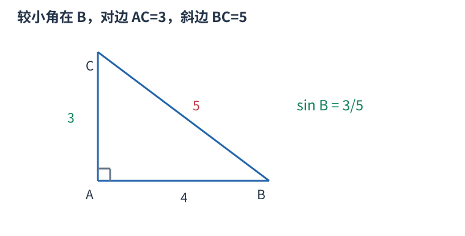

# P1888 最短边除最长边并约分 题解

## 目录

| 题号 | 题名 | 考点 | 难度 |
|---|---|---|---|
| A | 三角函数 | 最大公约数 | 900 |

## A. 三角函数

> 原题：[P1888](https://www.luogu.com.cn/problem/P1888)
> 解法：最短边除最长边并约分 · C++17

### 题意

输入无序的三条直角三角形边长，输出较小锐角的正弦值，要求最简分数。

<!-- reusable-foundations:start -->

### 从零讲：C++ 输入输出：把数据读进变量，把结果写到标准输出

程序运行时从标准输入接收题目给的数据，把答案送到标准输出。`cin` 和 `cout` 定义在 `<iostream>`；写 `using namespace std;` 后可以省略它们前面的 `std::`。最小完整程序是：

```cxx
#include <iostream>
using namespace std;
int main() {
    int a, b;
    cin >> a >> b;
    cout << a + b << '\n';
    return 0;
}
```

输入二十和三十，两个变量分别保存二十、三十，输出五十。`int a, b;` 声明两个整数变量；`cin >> a` 才给变量赋入输入值。多个 `>>` 从左到右读取，读取整数时会跳过空格、制表符、换行，所以两个整数可以分处两行。负号属于整数，不需要另读一个符号。

`cout <<` 后可以接数值、字符或字符串。`' '` 是一个空格字符，`'\n'` 是换行字符，`"Hello"` 是字符串。`cout << a << ' ' << b << '\n';` 输出两个以空格分开的整数并换行。评测程序只需要答案，不应加入“请输入”等提示。

读取 `char c; cin >> c;` 会跳过前导空白。要读取包含空格的一整行，用 `<string>` 中的 `string s; getline(cin, s);`。若此前用 `cin >> n` 读取过整数，换行还留在输入中，需要先处理那一个剩余换行；不能盲目把所有空格都删掉，因为字符画的行首空格和文本中的空格可能就是数据。

`fixed << setprecision(3)`（需要 `<iomanip>`）表示以小数形式保留三位小数，例如把 $2.5$ 输出成 $2.500$；不用 `fixed` 时，`setprecision` 指有效数字总数。设置会影响后续输出，使用前应确认所需精度。

竞赛中可在首次输入输出前调用 `ios::sync_with_stdio(false); cin.tie(nullptr);`，减少 C++ 流与 C 标准输入输出的同步、绑定开销。随后保持使用 `cin/cout`，不要混用另一套 `scanf/printf`。交互题还要在需要对方回应前主动刷新，例如 `cout << query << endl;`；普通题用换行字符即可。

读入长度为 $L$ 的文本、或输出 $L$ 个字符，至少需要 $O(L)$ 时间。数据类型仍要能容纳结果：把两个整数相乘时，即使保存到 `long long`，也要让乘法本身在这个类型中进行，例如先把输入声明为 `long long`。

### 从零讲：整除、最大公约数与质因数

正整数 $d$ 整除 $n$，表示 $n$ 能分成整数个大小为 $d$ 的组，即 `n % d == 0`。公约数同时整除两个数，其中最大者为最大公约数。欧几里得算法使用 $\gcd(a,b)=\gcd(b,a\bmod b)$，因为共同整除两者的数也恰好整除余数。

例如 $\gcd(18,12)=\gcd(12,6)=\gcd(6,0)=6$。每两轮较大参数至少缩半，故为 $O(\log\max(a,b))$。C++17 `<numeric>` 提供 `gcd`；最小公倍数可按 `a/gcd(a,b)*b` 计算以减少中间量，但最终乘积仍须检查范围。

质数是大于一、只有一和自身两个正因数的整数，一不是质数。合数一定有不超过平方根的质因数：若一对因数都超过平方根，乘积会大于原数。因此试除只需检查到平方根。

```cxx
vector<pair<long long,int>> factor(long long n) {
    vector<pair<long long,int>> result;
    for (long long p = 2; p <= n / p; ++p) {
        if (n % p != 0) continue;
        int exponent = 0;
        while (n % p == 0) { n /= p; ++exponent; }
        result.push_back({p, exponent});
    }
    if (n > 1) result.push_back({n, 1});
    return result;
}
```

正整数六十拆成 $2^2\times3\times5$。每个因子的指数可从零选到其最大次数，所以因数数量为 $(2+1)(1+1)(1+1)=12$。剩余大于一的部分必须作为一个质因数保留。条件 `p<=n/p` 避免为检查平方而溢出。

试除最坏约 $O(\sqrt n)$。要处理从一到 $N$ 的大量质数问题，可用筛法：埃氏筛从每个质数的平方起标记倍数，时间 $O(N\log\log N)$、空间 $O(N)$。线性筛额外维护最小质因子，使每个合数只由规定的一次生成；不能把任意双循环标倍数都称为线性筛。

<!-- reusable-foundations:end -->

### 思路

对于三、四、五，较小锐角的对边是三、斜边是五，正弦为五分之三，写成 3/5。一般直角三角形的两个锐角与两条直角边大小顺序一致；取最短边作为分子、最长边作为分母即可，不需要计算角度。



图中的较小锐角为 B；它的对边是最短边，斜边是最长边。

设这两条边为 $p$、$q$，最大公约数为 $g$。把 $p$ 与 $q$ 同除 $g$ 不改变比例，并消除所有公因子，所以得到最简分数。C++17 的 `gcd` 计算两个整数的最大公约数。

边长最大为 V，时间 $O(\log V)$、额外空间 $O(1)$。

### 参考代码

```cpp
#include <bits/stdc++.h>
using namespace std;

int main() {
    ios::sync_with_stdio(false);
    cin.tie(nullptr);
long long a, b, c; cin >> a >> b >> c;
long long p = min({a,b,c}), q = max({a,b,c});
long long g = gcd(p,q);
cout << p/g << '/' << q/g << '\n';
    return 0;
}
```

### 易错点

输出分数而非浮点数；输入顺序不表示哪条是斜边。

## 实测记录

本地 C++17 编译、1 组原站样例与 206 组独立边界/小域校验通过。
正文参考程序与源码逐字核对；没有向原站提交。
