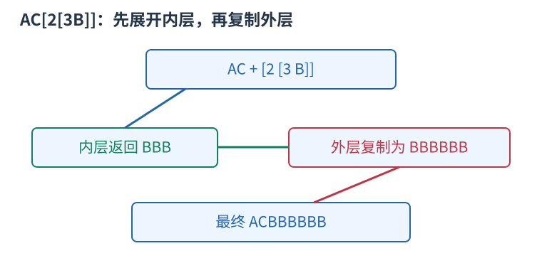

# P1928 递归解析一层括号并返回展开文本 题解

## 目录

| 题号 | 题名 | 考点 | 难度 |
|---|---|---|---|
| A | 外星密码 | 递归 | 1500 |

## A. 外星密码

> 原题：[P1928](https://www.luogu.com.cn/problem/P1928)
> 解法：递归解析一层括号并返回展开文本 · C++17

### 题意

把含嵌套 [重复次数 文本] 的字符串完整展开，重复次数为一到九十九，字母均为大写。

<!-- reusable-foundations:start -->

### 从零讲：C++ 输入输出：把数据读进变量，把结果写到标准输出

程序运行时从标准输入接收题目给的数据，把答案送到标准输出。`cin` 和 `cout` 定义在 `<iostream>`；写 `using namespace std;` 后可以省略它们前面的 `std::`。最小完整程序是：

```cxx
#include <iostream>
using namespace std;
int main() {
    int a, b;
    cin >> a >> b;
    cout << a + b << '\n';
    return 0;
}
```

输入二十和三十，两个变量分别保存二十、三十，输出五十。`int a, b;` 声明两个整数变量；`cin >> a` 才给变量赋入输入值。多个 `>>` 从左到右读取，读取整数时会跳过空格、制表符、换行，所以两个整数可以分处两行。负号属于整数，不需要另读一个符号。

`cout <<` 后可以接数值、字符或字符串。`' '` 是一个空格字符，`'\n'` 是换行字符，`"Hello"` 是字符串。`cout << a << ' ' << b << '\n';` 输出两个以空格分开的整数并换行。评测程序只需要答案，不应加入“请输入”等提示。

读取 `char c; cin >> c;` 会跳过前导空白。要读取包含空格的一整行，用 `<string>` 中的 `string s; getline(cin, s);`。若此前用 `cin >> n` 读取过整数，换行还留在输入中，需要先处理那一个剩余换行；不能盲目把所有空格都删掉，因为字符画的行首空格和文本中的空格可能就是数据。

`fixed << setprecision(3)`（需要 `<iomanip>`）表示以小数形式保留三位小数，例如把 $2.5$ 输出成 $2.500$；不用 `fixed` 时，`setprecision` 指有效数字总数。设置会影响后续输出，使用前应确认所需精度。

竞赛中可在首次输入输出前调用 `ios::sync_with_stdio(false); cin.tie(nullptr);`，减少 C++ 流与 C 标准输入输出的同步、绑定开销。随后保持使用 `cin/cout`，不要混用另一套 `scanf/printf`。交互题还要在需要对方回应前主动刷新，例如 `cout << query << endl;`；普通题用换行字符即可。

读入长度为 $L$ 的文本、或输出 $L$ 个字符，至少需要 $O(L)$ 时间。数据类型仍要能容纳结果：把两个整数相乘时，即使保存到 `long long`，也要让乘法本身在这个类型中进行，例如先把输入声明为 `long long`。

### 从零讲：数组：用下标定位一组状态

数组把同一类型的若干值按位置保存。`int a[5] = {};` 创建五个初始为零的整数，合法下标是零到四；`a[2] = 7;` 只修改第三格。下标表示位置，格子中保存的值是另一回事。

```cxx
int a[4] = {4, 3, 0, 5};
int sum = 0;
for (int i = 0; i < 4; ++i) sum += a[i];
// 和为十二；a[0] 是四，a[3] 是五
```

读写一个给定下标的格子是 $O(1)$。扫描全部 $n$ 格为 $O(n)$，保存 $n$ 格的空间为 $O(n)$。不能访问负下标或 $a[n]$，越界属于未定义行为，可能表现为随机数或崩溃，编译通过不代表安全。

`bool seen[34] = {};` 可以保存号码是否出现过，初始全为 false；`seen[x]=true` 表示记录出现状态。再次赋 true 不改变结果，因此适合去重、标记删除；若操作是开关翻转，则要写 `seen[x]=!seen[x]`。标记真假和记录出现次数是不同任务，后者需要整数计数数组。

若题目用一到 $n$ 编号，可以创建 $n+1$ 格并预留零号，统一按原编号访问。或者读入时改成零到 $n-1$，但必须让全部循环与公式使用同一套下标。

二维数组 `int a[5][6] = {};` 有五行六列，`a[r][c]` 表示第 $r$ 行第 $c$ 列。三维数组再加一个方向，用三个下标定位单位格子。逐格扫描的时间是各维长度的乘积，空间也按格子总数计算。

固定数组的长度需要在编译时确定，不能在标准 C++17 中写依赖输入的 `int a[n]`。输入后才确定大小时使用 `vector<int> a(n,0)`；它同样从零编号，也可以按下标访问，但仍须检查下标边界。大数组应避免放在空间有限的函数栈上，可以用动态容器或全局数组。数组里的旧状态是否应该保留，需要根据当前问题决定，多组测试不能意外继承上一组的内容。

### 从零讲：vector：长度可变的连续数组

`vector<T>` 保存一串同类型的元素，适合按下标访问、扫描、排序。`T` 是元素类型，例如 `vector<int>` 保存整数，`vector<pair<int,int>>` 保存整数对，`vector<vector<int>>` 可保存每个顶点各自的邻居。需要 `<vector>`。

```cxx
vector<int> a(3, 7);   // 三个元素，内容是 7、7、7
a.push_back(9);       // 在末尾追加，现在长度为 4
int x = a[1];         // 从 0 编号，这里得到 7
a[1] = 2;            // 改第二个元素
int n = int(a.size());
```

`vector<int> a(3)` 创建三个值为零的元素；`a.reserve(3)` 只预留容量，元素数仍为零，此时不能访问 `a[0]`。长度 `size()` 与容量 `capacity()` 是不同概念。

下标访问为 $O(1)$，遍历为 $O(n)$。末尾追加通常为 $O(1)$；容量不足时会分配更大的连续空间并搬移元素，这次可能为 $O(n)$，一连串追加的平均成本称为摊还 $O(1)$。中间插入或删除会搬移后续元素，最坏 $O(n)$。内存是元素量的 $O(n)$，并可能预留部分尚未使用的容量。

`begin()` 指向首元素，`end()` 指向尾后位置，`sort(a.begin(),a.end())` 操作整个数组。`a[i]` 不检查越界；下标须满足 $0\le i<\mathrm{size}$。`at(i)` 会检查越界并抛异常。空数组不能访问 `front()`、`back()`；`pop_back()` 也要求非空。

扩容后指向旧存储的迭代器、引用和指针会失效。遍历的同时 `push_back`，不能假定此前取得的引用仍可用。读取大数组的函数常用 `const vector<int>& a` 按常量引用传入，既不复制也禁止通过该引用修改；`vector<int> a` 按值传参则复制内容。选择副本还是引用取决于是否要保留独立数据。

### 从零讲：分支与循环：按条件选择，按次序重复

`if (条件) { ... } else { ... }` 根据条件的真假选择一条分支。比较运算 `==`、`!=`、`<`、`<=`、`>`、`>=` 返回真假值；`=` 是赋值，不能代替相等比较。`&&` 表示两边都成立，`||` 表示至少一边成立，`!` 把真假反转。

```cxx
int score = 85;
if (score >= 90) cout << "A";
else if (score >= 60) cout << "B";
else cout << "C"; // 这个例子输出 B
```

这条分支链只执行第一个符合条件的分支。先处理高分后，第二个条件自然只会接到低于九十分的数。几个独立的 `if` 则可能执行多次；两种结构代表不同问题。逻辑运算会短路：`i < n && a[i] == 0` 先确认下标合法，才读取那一格。

`for (初始化; 继续条件; 每轮更新)` 适合知道重复范围的情况。例如下列代码依次处理一到四，总和是十：

```cxx
int sum = 0;
for (int i = 1; i <= 4; ++i) {
    sum += i;
}
cout << sum;
```

初始化只做一次；每轮先判断条件，条件为真才执行循环体，随后执行更新。`++i` 把 $i$ 加一，`sum += i` 等价于把旧 sum 加 $i$ 再保存。应明确每个变量在循环前、循环后分别表示什么；最大值相同时是否更新，决定了保留较早还是较晚的答案。

`while (条件)` 适合“不满足目标就再做一步”：

```cxx
int x = 13, times = 0;
while (x > 1) {
    x /= 2;
    ++times;
}
// x 依次是 13、6、3、1，执行三次
```

循环开始前先检查条件，初始已满足目标时可能一次也不执行。每次执行必须推进状态，否则可能无限循环。`break` 结束最内层循环，`continue` 跳过本轮剩余部分；`for` 中的 continue 之后仍会执行每轮更新。

复杂度由实际执行次数决定。上述求和执行 $n$ 次是 $O(n)$；每次将正整数减半只执行 $O(\log n)$ 次。两层循环不能仅凭外观判定为平方：内层若总共只前进 $n$ 次，总量仍可能线性。变量应在正确作用范围初始化；多组数据的计数器若未重置，下一组会错误继承上一组结果。

### 从零讲：具名函数：给可复用计算一个明确接口

函数把一段计算包装成“输入参数 → 返回结果”。例如判断整数是否为偶数：

```cxx
bool even(int x) {
    return x % 2 == 0;
}
int main() {
    bool a = even(8); // a 为 true
    bool b = even(7); // b 为 false
}
```

`bool` 是返回类型，`even` 是函数名，`int x` 是参数声明。调用 `even(8)` 时，实参八传入这个新调用的局部变量 $x$，执行 return 后把真假值交回调用处。定义本身不执行计算，只有调用才执行。函数应在调用处之前定义，或提前写声明。

普通数值参数按值传递，函数里修改 $x$ 不会改变调用者原变量。参数写成 `int &x` 时才引用调用者对象；必须让这个对象在调用期间有效。`const vector<int>& a` 用引用避免复制整个容器，并承诺不通过这个引用修改它。返回局部变量的值是安全的，返回局部变量的引用则在函数结束后失效。

函数名应说明它回答的问题，调用处负责传哪些数据。例如闰年判定只接收一个年份并返回真假，枚举年份范围和输出格式由调用者处理。同一判定被多次使用时，这能减少规则不一致；但函数包装不会自动降低算法复杂度，仍要把每次调用实际做的工作计入时间。

如果函数内部又调用自身，就是递归，需要明确最小情况如何直接返回、每次调用如何逼近它；递归会占用调用栈。普通辅助函数可以不使用递归，不应仅因写成函数就称作递归算法。

### 从零讲：递归：把一个任务交给更小的同类任务

递归函数在执行时再次调用自己。要先明确每次调用代表什么、什么时候不再递归、每次为何更接近终点。例如求阶乘：$f(0)=1$，$f(n)=n f(n-1)$；求五的阶乘会先请求四的阶乘，直到零，再逐层返回乘积。

```cxx
long long factorial(int n) {
    if (n == 0) return 1;
    return n * factorial(n - 1);
}
```

`factorial(3)` 的调用链是 $3\to2\to1\to0$，返回链依次为 $1,1,2,6$。每层保留自己的参数和等待执行的后续操作，因此递归不是所有层共享同一个局部变量。

树上遍历时，一次调用可以代表“处理以 $u$ 为根的子树”。先处理子节点再汇总是后序；先给自己信息再向下传是先序。无向图中需要访问标记，树上至少排除父节点，否则会沿同一条边来回递归。

时间要看所有调用做了多少工作，不能只看代码短。每个树节点访问一次、每条边检查常数次为 $O(n+m)$；反复求相同子问题可能指数增长。可以用记忆化保存结果，但缓存键必须包含影响结果的全部参数。

递归深度为 $h$ 时，调用栈通常用 $O(h)$ 空间。链状树可能深到 $n$，有栈溢出风险，可用显式栈模拟。回溯还须在返回前撤销对共享状态的本层修改；局部变量自然消失，外部数组的修改不会自动恢复。C++17 lambda 的递归另见 lambda 课中的显式 self 参数写法。

### 从零讲：string：字符、下标与子串

`string` 保存字符序列。`string s="abca";` 的长度为四，下标从零开始，`s[0]=='a'`、`s[3]=='a'`。字符用单引号，字符串用双引号；二者类型不同。需要 `<string>`。

`cin >> s` 读到空白停止；整行含空格时使用 `getline`，并留意前一次格式化输入残留的换行。`s.size()` 是字符单元数量，不一定等于 UTF-8 中文字数；竞赛英文小写字母题通常一个字符对应一个单元。

```cxx
string s = "abca";
string middle = s.substr(1, 2); // 从下标 1 开始取 2 个字符，得到 bc
size_t pos = s.find('c');       // 得到 2；找不到是 string::npos
if (pos != string::npos) cout << s[pos];
```

`substr(start,length)` 的第二项是长度，不是右端点。普通下标访问为 $O(1)$；复制长为 $k$ 的子串需要 $O(k)$ 时间和空间，循环里反复截取可能累积成平方成本。字符串比较按第一个不同字符决定字典序，公共前缀可能需要线性比较。

常见字符转数字是 `c-'0'`，前提 `c` 在 `'0'` 到 `'9'`。修改原串可用 `for(char& c:s)`，只读使用 `char c`。`reverse(s.begin(),s.end())` 原地翻转；若还需要原串，应先复制。空串不能访问首尾，尾后位置不能当普通字符读取。

### 从零讲：字符串修改、数字转换与字符判断

处理文本时先区分三种对象：字符如 `'7'`、字符序列如 `"275"`、整数如 `275`。它们的表示和运算规则不同。字符减 `'0'` 只适用于单个十进制数字；多位数字可以用 `stoi` 或 `stoll` 转换。

```cxx
string s = "275";
int x = stoi(s);               // 得到整数二百七十五
long long y = stoll("10000000000");
string equation = s + "+125=" + to_string(x + 125);
// equation 为 275+125=400
```

`stoi` 返回 int，`stoll` 返回 long long；`to_string` 把整数转为十进制字符串，也会保留负号。转换读取十进制数字需要合法输入并且结果在返回类型范围内；非法或越界的转换会抛异常。题目保证格式正确时可以直接使用，处理不可信文本时应检查错误与是否完整消费了输入。转换长度为 L 的整数文本需要 $O(L)$ 时间。

`isdigit` 与 `tolower` 定义在 `<cctype>`。`isdigit(c)` 判断一个字符是不是数字，`tolower(c)` 把可转换的大写字母转成小写，其它字符保持不变。向这类函数传入普通 char 前，应先转成 unsigned char，避免负的 char 值超出接口允许范围：

```cxx
char c = 'A';
c = static_cast<char>(tolower(static_cast<unsigned char>(c))); // a
bool digit = isdigit(static_cast<unsigned char>('7'));         // true
```

下面的操作直接修改字符串；它们改变的是字符位置，不能把旧下标当成某个字符永远不变的身份：

```cxx
string text = "bcd";
text.insert(1, "XX"); // 在旧下标一之前插入，得到 bXXcd
text += "e";          // 追加，得到 bXXcde
text.pop_back();      // 删除末尾 e，恢复 bXXcd
char last = text.back(); // d，前提是非空
size_t where = text.find_first_of("./%"); // 没有这些字符，返回 npos
size_t first = string("00070").find_first_not_of('0'); // 三，从零编号
```

`find` 查找整个子串，`find_first_of` 查找给定字符集合中的任意一个，`find_first_not_of` 查找首个不在指定集合中的字符。这些函数返回位置或 `string::npos`，不是直接返回真假。合法的零号位置不能误判为“没有找到”；输出找不到时应显式处理 npos，不能依赖把无符号大数转换成负数。

`insert` 要移动插入点后面的字符，长度为 L 的串中插入 $k$ 个字符通常需要 $O(L+k)$ 时间，并可能重新分配存储，旧指针、引用和迭代器可能失效。删除末尾和读取 back 为常数操作，但都要求字符串非空。子串查找的最坏复杂度可能与文本长度和模式长度的乘积相关，不能一律写成常数或对数。

<!-- reusable-foundations:end -->

### 思路

用共享下标读取当前层直到右括号或输入结束。普通字母直接追加；遇左括号先读完整十进制次数，再递归得到括号内部的展开串，跳过右括号后重复追加指定次数。



每个括号层返回完整展开的片段，次数属于当前左括号，不能在嵌套时混用。

压缩长度 M、输出长度 L、嵌套深度 D 下，时间与空间上界为 $O(M+DL)$。

### 参考代码

```cpp
#include <bits/stdc++.h>
using namespace std;
string encoded;size_t position=0;
string parse(){
    string result;
    while(position<encoded.size()&&encoded[position]!=']'){
        if(encoded[position]!='['){result.push_back(encoded[position++]);continue;}
        ++position;int times=0;
        while(position<encoded.size()&&'0'<=encoded[position]&&encoded[position]<='9')
            times=times*10+(encoded[position++]-'0');
        string part=parse();++position; // 内层停在 ]，本层消费该括号
        for(int k=0;k<times;++k)result+=part;
    }
    return result;
}
int main() {
    ios::sync_with_stdio(false);
    cin.tie(nullptr);
cin>>encoded;cout<<parse()<<'\n';
    return 0;
}
```

### 易错点

读完整多位次数；当前层停在右括号，由调用者跳过；输出的是展开结果。

## 实测记录

本地 C++17 编译、1 组原站样例与 188 组独立边界/小域校验通过。
正文参考程序与源码逐字核对；没有向原站提交。
