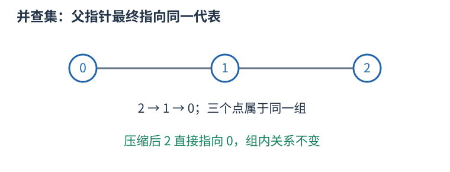
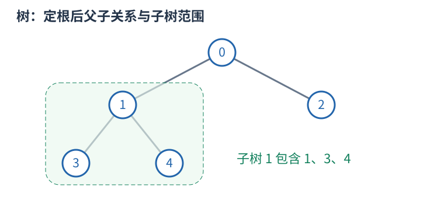
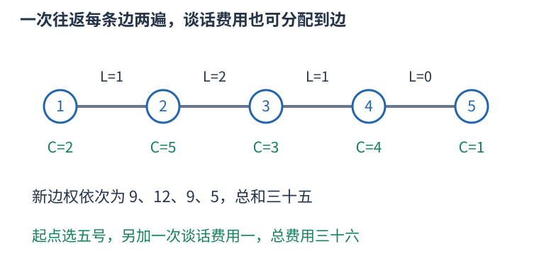

# P2916 把往返路程和重复谈话折算到边上，再求最小生成树 题解

## 目录

| 题号 | 题名 | 考点 | 难度 |
|---|---|---|---|
| A | Cheering up the Cow G | 生成树 + 并查集 | 1800 |

## A. Cheering up the Cow G

> 原题：[P2916](https://www.luogu.com.cn/problem/P2916)
> 解法：把往返路程和重复谈话折算到边上，再求最小生成树 · C++17

### 题意

在保持所有牧场连通的前提下删掉尽量多道路，随后从自选牧场出发访问全部奶牛并回到起点。走边耗时 L，每次到达牧场都要谈话 C，起点出发与最终返回各谈一次，求最少总时间。

<!-- reusable-foundations:start -->

### 从零讲：C++ 输入输出：把数据读进变量，把结果写到标准输出

程序运行时从标准输入接收题目给的数据，把答案送到标准输出。`cin` 和 `cout` 定义在 `<iostream>`；写 `using namespace std;` 后可以省略它们前面的 `std::`。最小完整程序是：

```cxx
#include <iostream>
using namespace std;
int main() {
    int a, b;
    cin >> a >> b;
    cout << a + b << '\n';
    return 0;
}
```

输入二十和三十，两个变量分别保存二十、三十，输出五十。`int a, b;` 声明两个整数变量；`cin >> a` 才给变量赋入输入值。多个 `>>` 从左到右读取，读取整数时会跳过空格、制表符、换行，所以两个整数可以分处两行。负号属于整数，不需要另读一个符号。

`cout <<` 后可以接数值、字符或字符串。`' '` 是一个空格字符，`'\n'` 是换行字符，`"Hello"` 是字符串。`cout << a << ' ' << b << '\n';` 输出两个以空格分开的整数并换行。评测程序只需要答案，不应加入“请输入”等提示。

读取 `char c; cin >> c;` 会跳过前导空白。要读取包含空格的一整行，用 `<string>` 中的 `string s; getline(cin, s);`。若此前用 `cin >> n` 读取过整数，换行还留在输入中，需要先处理那一个剩余换行；不能盲目把所有空格都删掉，因为字符画的行首空格和文本中的空格可能就是数据。

`fixed << setprecision(3)`（需要 `<iomanip>`）表示以小数形式保留三位小数，例如把 $2.5$ 输出成 $2.500$；不用 `fixed` 时，`setprecision` 指有效数字总数。设置会影响后续输出，使用前应确认所需精度。

竞赛中可在首次输入输出前调用 `ios::sync_with_stdio(false); cin.tie(nullptr);`，减少 C++ 流与 C 标准输入输出的同步、绑定开销。随后保持使用 `cin/cout`，不要混用另一套 `scanf/printf`。交互题还要在需要对方回应前主动刷新，例如 `cout << query << endl;`；普通题用换行字符即可。

读入长度为 $L$ 的文本、或输出 $L$ 个字符，至少需要 $O(L)$ 时间。数据类型仍要能容纳结果：把两个整数相乘时，即使保存到 `long long`，也要让乘法本身在这个类型中进行，例如先把输入声明为 `long long`。

### 从零讲：分支与循环：按条件选择，按次序重复

`if (条件) { ... } else { ... }` 根据条件的真假选择一条分支。比较运算 `==`、`!=`、`<`、`<=`、`>`、`>=` 返回真假值；`=` 是赋值，不能代替相等比较。`&&` 表示两边都成立，`||` 表示至少一边成立，`!` 把真假反转。

```cxx
int score = 85;
if (score >= 90) cout << "A";
else if (score >= 60) cout << "B";
else cout << "C"; // 这个例子输出 B
```

这条分支链只执行第一个符合条件的分支。先处理高分后，第二个条件自然只会接到低于九十分的数。几个独立的 `if` 则可能执行多次；两种结构代表不同问题。逻辑运算会短路：`i < n && a[i] == 0` 先确认下标合法，才读取那一格。

`for (初始化; 继续条件; 每轮更新)` 适合知道重复范围的情况。例如下列代码依次处理一到四，总和是十：

```cxx
int sum = 0;
for (int i = 1; i <= 4; ++i) {
    sum += i;
}
cout << sum;
```

初始化只做一次；每轮先判断条件，条件为真才执行循环体，随后执行更新。`++i` 把 $i$ 加一，`sum += i` 等价于把旧 sum 加 $i$ 再保存。应明确每个变量在循环前、循环后分别表示什么；最大值相同时是否更新，决定了保留较早还是较晚的答案。

`while (条件)` 适合“不满足目标就再做一步”：

```cxx
int x = 13, times = 0;
while (x > 1) {
    x /= 2;
    ++times;
}
// x 依次是 13、6、3、1，执行三次
```

循环开始前先检查条件，初始已满足目标时可能一次也不执行。每次执行必须推进状态，否则可能无限循环。`break` 结束最内层循环，`continue` 跳过本轮剩余部分；`for` 中的 continue 之后仍会执行每轮更新。

复杂度由实际执行次数决定。上述求和执行 $n$ 次是 $O(n)$；每次将正整数减半只执行 $O(\log n)$ 次。两层循环不能仅凭外观判定为平方：内层若总共只前进 $n$ 次，总量仍可能线性。变量应在正确作用范围初始化；多组数据的计数器若未重置，下一组会错误继承上一组结果。

### 从零讲：vector：长度可变的连续数组

`vector<T>` 保存一串同类型的元素，适合按下标访问、扫描、排序。`T` 是元素类型，例如 `vector<int>` 保存整数，`vector<pair<int,int>>` 保存整数对，`vector<vector<int>>` 可保存每个顶点各自的邻居。需要 `<vector>`。

```cxx
vector<int> a(3, 7);   // 三个元素，内容是 7、7、7
a.push_back(9);       // 在末尾追加，现在长度为 4
int x = a[1];         // 从 0 编号，这里得到 7
a[1] = 2;            // 改第二个元素
int n = int(a.size());
```

`vector<int> a(3)` 创建三个值为零的元素；`a.reserve(3)` 只预留容量，元素数仍为零，此时不能访问 `a[0]`。长度 `size()` 与容量 `capacity()` 是不同概念。

下标访问为 $O(1)$，遍历为 $O(n)$。末尾追加通常为 $O(1)$；容量不足时会分配更大的连续空间并搬移元素，这次可能为 $O(n)$，一连串追加的平均成本称为摊还 $O(1)$。中间插入或删除会搬移后续元素，最坏 $O(n)$。内存是元素量的 $O(n)$，并可能预留部分尚未使用的容量。

`begin()` 指向首元素，`end()` 指向尾后位置，`sort(a.begin(),a.end())` 操作整个数组。`a[i]` 不检查越界；下标须满足 $0\le i<\mathrm{size}$。`at(i)` 会检查越界并抛异常。空数组不能访问 `front()`、`back()`；`pop_back()` 也要求非空。

扩容后指向旧存储的迭代器、引用和指针会失效。遍历的同时 `push_back`，不能假定此前取得的引用仍可用。读取大数组的函数常用 `const vector<int>& a` 按常量引用传入，既不复制也禁止通过该引用修改；`vector<int> a` 按值传参则复制内容。选择副本还是引用取决于是否要保留独立数据。

### 从零讲：整数类型、整除与溢出

计算前先看每一步可能达到的范围。常见环境中 `int` 是 32 位，上界约 $2.1\times10^9$；`long long` 至少 64 位，常见有符号 64 位上界约 $9.22\times10^{18}$。`using ll = long long;` 只是为已有类型起别名。

```cxx
int a = 100000, b = 100000;
long long wrong = a * b;      // 右边先按 int 乘，可能已溢出
long long right = 1LL * a * b; // 先把运算提升到 long long
```

不能指望“接收结果的变量够大”修复此前已经溢出的计算。先提高操作数类型，再做乘法。超过 64 位时，GCC 的 `__int128` 可作中间量，但它不是标准 C++17 类型，也没有标准流输出重载；先证明范围，再选择工具。

整数 `/` 对有符号数向零截断：`7/3==2`、`-7/3==-2`。对非负数才等于向下取整。余数满足 `a == (a/b)*b + a%b`，除数不能为零；要将余数归入 $[0,m-1]$（$m>0$），可用 `(a % m + m) % m`，同时保证中间加法不溢出。

非负 $a$、正 $b$ 的向上取整可写 `a/b + (a%b != 0)`，比 `(a+b-1)/b` 更容易避免加法溢出。比较平方时也应在宽类型内计算；浮点数不适合作为大整数相等的默认判断方式。

`size()` 返回无符号类型。空容器上写 `size()-1` 会绕到很大的数，逆序遍历可以先转成有符号、确认长度，或使用逆向迭代器。`abs` 对最小有符号数无法在同类型中表达其正值，需先约束输入差值范围。一般机器整数运算按常数时间估算，宽类型解决表示范围，不改变算法的增长阶。

### 从零讲：具名函数：给可复用计算一个明确接口

函数把一段计算包装成“输入参数 → 返回结果”。例如判断整数是否为偶数：

```cxx
bool even(int x) {
    return x % 2 == 0;
}
int main() {
    bool a = even(8); // a 为 true
    bool b = even(7); // b 为 false
}
```

`bool` 是返回类型，`even` 是函数名，`int x` 是参数声明。调用 `even(8)` 时，实参八传入这个新调用的局部变量 $x$，执行 return 后把真假值交回调用处。定义本身不执行计算，只有调用才执行。函数应在调用处之前定义，或提前写声明。

普通数值参数按值传递，函数里修改 $x$ 不会改变调用者原变量。参数写成 `int &x` 时才引用调用者对象；必须让这个对象在调用期间有效。`const vector<int>& a` 用引用避免复制整个容器，并承诺不通过这个引用修改它。返回局部变量的值是安全的，返回局部变量的引用则在函数结束后失效。

函数名应说明它回答的问题，调用处负责传哪些数据。例如闰年判定只接收一个年份并返回真假，枚举年份范围和输出格式由调用者处理。同一判定被多次使用时，这能减少规则不一致；但函数包装不会自动降低算法复杂度，仍要把每次调用实际做的工作计入时间。

如果函数内部又调用自身，就是递归，需要明确最小情况如何直接返回、每次调用如何逼近它；递归会占用调用栈。普通辅助函数可以不使用递归，不应仅因写成函数就称作递归算法。

### 从零讲：并查集：维护哪些对象已属于同一组

从每个元素独立成组开始，反复合并两组、判断两项是否连通。并查集用父指针形成若干棵树，每棵树的根代表一组；根的编号只是代表，不一定是最小编号或有特殊题意。



```cxx
struct DSU {
    vector<int> parent, size;
    DSU(int n): parent(n), size(n, 1) {
        iota(parent.begin(), parent.end(), 0);
    }
    int find(int x) {
        return parent[x] == x ? x : parent[x] = find(parent[x]);
    }
    bool merge(int a, int b) {
        a = find(a); b = find(b);
        if (a == b) return false;
        if (size[a] < size[b]) swap(a, b);
        parent[b] = a; size[a] += size[b];
        return true;
    }
};
```

合并 $0,1$ 再合并 $1,2$ 后，三者的 `find` 相同，即使零和二没有直接边。这表示路径连通，不表示两项相邻。路径压缩将访问链上的父亲直接改为根；按大小合并把小树挂到大树，避免人为形成长链。

初始化 $O(n)$，两种优化一起使用时，一连串操作的摊还成本为 $O(\alpha(n))$ 每次，常见规模近似常数；不能说每一次都严格 $O(1)$。数组空间 $O(n)$。

普通并查集擅长增加连通关系，不直接支持删边和拆组。回滚版本通常不用路径压缩，并保存每次合并改变的值；带权版本还需维护到父亲的关系，不能只合并普通 parent。分组大小等统计应读根上的记录。

### 从零讲：树的根、子树、DFS 序与倍增

树是连通且无环的无向图，$n$ 个顶点有 $n-1$ 条边。指定一个根后，每个非根顶点有唯一父亲，其他向下邻居是孩子。子树包含自己和全部后代；换根会改变父子关系，但不改变原边。



#### 子树信息按依赖顺序计算

例如子树大小 `size[u]` 初始为一，每个孩子处理完后累加 `size[v]`。一来自节点自己，不能漏掉。树形 DP 也如此：先明确某状态允许怎样选择，再合并各孩子提供的信息；孩子独立性来自树上没有跨子树边，仍可能因总预算或选中父亲等条件产生状态关联。

换根 DP 先求一个根的状态，再沿边换根，将“来自孩子的一侧”和“来自父亲的一侧”合并。应画清只有哪条边的方向改变、哪些量不变；不能仅凭两张答案表代替依赖解释。普通遍历每条边常数次为 $O(n)$，背包式合并可能更大，按实际合并循环计算。

#### DFS 序为什么能把子树变成区间

进入节点时分配编号 `tin[u]`，完成整棵子树后记录最后编号 `tout[u]`。深度优先在返回父亲前会完整处理这棵子树，因此它的所有编号连续，恰是 $[tin[u],tout[u]]$。这允许把子树和等查询交给数组结构。若同时记录进出事件，区间定义会不同，不可混用两种序列。

#### 倍增与最近公共祖先

`up[k][u]` 存 $u$ 向上 $2^k$ 条边到达的祖先。基础 `up[0][u]=parent[u]`，递推为 `up[k][u]=up[k-1][up[k-1][u]]`，因为连续走两段 $2^{k-1}$。跳十三层可拆为八加四加一，只需对数个跳跃。

LCA 是两个节点公共祖先中最深者。先把更深的一方跳到同深度；若已经相同就是答案。否则从大到小试跳，祖先不同才两边同时上移，最后它们的父亲就是 LCA。预处理 $O(n\log n)$、每次查询 $O(\log n)$，表空间 $O(n\log n)$。根的虚拟祖先需统一定义，不能访问非法下标。

树的直径在非负无权边长等常见条件下可用两次最远点搜索求出；带负权时要重新判断。虚树则将关注节点按 DFS 序组织，补上相邻节点的 LCA 后连接祖先关系，边应携带原路径含义，不能把压缩后一条边误当原图一步。深链上的递归也须留意栈深度。

### 从零讲：图的表示、BFS 与 DFS

图由顶点与边组成，适合表达“哪些对象之间能一步到达”。有向边只允许一个方向；无向边需保存两个方向。邻接表 `vector<vector<int>> graph(n)` 为每个顶点保存邻居，空间 $O(n+m)$，无向边在表中出现两次。

以边 $0-1,0-2,1-3$ 为例，从零出发：


#### BFS 为什么得到最少边数

初始顶点距离为零，入先进先出的队列。弹出顶点时，将尚未到达的邻居距离设为当前距离加一，并立刻标记入队。距离为一的顶点都会先于距离为二的处理，因此第一次发现就是最少边数。

```cxx
vector<int> distance(n, -1);
queue<int> q;
distance[start] = 0; q.push(start);
while (!q.empty()) {
    int u = q.front(); q.pop();
    for (int v : graph[u]) if (distance[v] == -1) {
        distance[v] = distance[u] + 1;
        q.push(v);
    }
}
```

适用于无权或所有边代价相同的最少步数。边权不同，第一次发现未必费用最小，不能继续套这一结论。多起点 BFS 先把所有合法起点设零并入队。

#### DFS 的调用代表一整块未探索区域

DFS 标记当前点后，递归处理每个尚未访问的邻点；也可用显式栈。上例可能按 $0,1,3,2$ 的顺序深入，但顺序取决于邻居存放方式。它擅长检查连通性、处理子树和回溯，不保证最短路径。

两种遍历在每个顶点入队或调用一次、每条边检查常数次的实现下，时间均为 $O(n+m)$，额外标记和队列/栈为 $O(n)$。不要等出队才首次标记，否则同一顶点可能重复入队。图不连通时，从一个起点无法覆盖所有点；统计连通块应从每个尚未访问点再启动一次遍历。树的深递归可能用尽调用栈。

### 从零讲：sort 与比较器：先建立统一的顺序

排序把原来任意排列的数据，按照可比较的键整理成有序序列，便于查边界、比较相邻项和按顺序处理。头文件 `<algorithm>`；普通数组和 `vector` 可用 `sort(first,last)`，范围为左闭右开。

```cxx
vector<int> a{5, 2, 5, 1};
sort(a.begin(), a.end());     // 变成 1、2、5、5，重复值仍保留
sort(a.begin(), a.end(), greater<int>());  // 降序
```

`sort` 时间 $O(n\log n)$，不是每次比较都扫描整个数组。C++ 标准规定复杂度要求，不规定必须使用某一固定内部排序实现，不能统一称它为快速排序。

对 `pair`，默认先比较 `first`，相同再比较 `second`，都是升序。自定义比较器 `cmp(a,b)` 返回真表示“$a$ 必须排在 $b$ 前面”。例如按分数降序、同分按编号升序：

```cxx
sort(students.begin(), students.end(), [](const auto& a, const auto& b) {
    if (a.score != b.score) return a.score > b.score;
    return a.id < b.id;
});
```

规则必须自洽：元素不能排在自己前面，不能出现 $a$ 在 $b$ 前、$b$ 在 $c$ 前、$c$ 又在 $a$ 前的循环。`<=` 会让相同元素也必须互相在前，因此不是合法的严格比较器。排序过程中也不能改变比较依据。

排序会改变原位置；若编号或两项的配对有意义，应将完整记录一起排序或另存查询副本，不能把两个相关字段各自排序后继续当作原配对。普通 `sort` 不保证同键元素保持输入先后；确需稳定顺序时用 `stable_sort` 或将原编号纳入比较键。排序只建立顺序，不能代替贪心策略的正确性证明。

### 从零讲：结构体：把一个对象的相关数据保存在一起

结构体给一组不同类型的字段起一个整体类型名。例如一个学生有姓名和三科分数：

```cxx
struct Student {
    string name;
    int chinese, math, english;
};
Student a{"Lin", 90, 95, 92};
cout << a.name << ' ' << a.math; // Lin 95
```

`Student` 是新类型，$a$ 是这个类型的对象，点号选择对象中的某个字段。创建 `vector<Student> students(n)` 就能保存 $n$ 个学生，`students[i].math` 表示第 $i$ 个学生的数学分。这样一名学生的数据随对象一起移动，不会在排序时只移动姓名而忘记移动分数。

字段必须在使用前初始化或读入。`Student a{};` 会让字符串为空、整数为零；不加初始化的局部整数成员不能假定为零。字段名的访问本身为常数时间，但复制对象的成本取决于成员：复制很长的字符串会复制它的内容。只读取现有对象时可用 `const Student&` 避免复制。

结构体不会自动规定大小顺序。排序若要按分数降序、并列按姓名升序，需要另外提供满足严格弱序的比较函数。枚举输入已排序对象时，则可以直接沿用题目保证的顺序。先明确要比较的是对象的哪些字段，再决定是否需要排序。

### 从零讲：lambda：完整例子、捕获规则与局部变量的生命周期

#### 它解决什么问题

一段操作在当前函数里需要调用多次，或者某个算法需要你提供“怎样比较”的规则，可以把这段操作写成 lambda。lambda 表达式产生一个可以像函数一样调用的对象；“匿名”指它没有普通函数声明中的函数名，仍可以用变量保存并命名。

```cxx
auto add = [](int a, int b) -> int {
    return a + b;
};
int answer = add(2, 3);  // 调用后得到 5；定义本身不会执行函数体
```

读法是：用 `auto` 保存对象；`[](){}` 中的方括号部分是捕获列表；圆括号是每次调用传入的参数；`-> int` 指定返回类型；花括号里写执行过程；定义后的分号结束赋值。返回类型能够推导时可省略，所以也常见 `auto add = [](int a,int b) { return a+b; };`。


#### 参数和捕获有什么区别

参数每次调用都由调用者提供；捕获让函数体使用定义位置附近的局部变量，调用时不用重复传它。例如阈值来自当前环境，待判断的值每次变化：

```cxx
int threshold = 10;
auto enough = [threshold](int value) {
    return value >= threshold;
};
bool a = enough(12);  // true，value 是本次传入的 12
```

这里 `threshold` 是捕获，`value` 是参数。常用的捕获方式如下：

| 写法 | 意思 | 适合的需要 |
|---|---|---|
| `[](){}` | 不捕获局部变量 | 只依赖参数的计算或比较 |
| `[x](){}` | 保存定义时 `x` 的副本 | 需要固定一份快照 |
| `[&x](){}` | 引用外面的 `x` | 读取最新值或修改原变量 |
| `[=](){}` | 按值捕获实际需要的局部变量 | 需要多个快照 |
| `[&](){}` | 按引用捕获实际需要的局部变量 | 当前作用域内的辅助函数 |
| `[&a, limit](){}` | 引用 `a`，复制 `limit` | 显式区分共享数据和快照 |

`[&](){}` 不是“把参数按引用传递”；是否按引用传参由圆括号里的 `int&`、`const vector<int>&` 等类型决定。全局变量可以直接访问，无需捕获。

#### 用可观察的结果区分复制与引用

```cxx
int base = 10;
auto snapshot = [base](int x) { return base + x; };
auto current = [&base](int x) { return base + x; };
base = 20;
int a = snapshot(1);  // 11：使用定义时保存的 10
int b = current(1);   // 21：使用外面的最新值 20
```

默认情况下不能在 lambda 内修改按值捕获的副本。加 `mutable` 才能修改副本，但仍不会改外面的原变量：`auto next = [base]() mutable { return ++base; };`。对大数组按值捕获可能复制整个数组；如果只在数组仍然存活时查询，显式引用可避免这份复制。

#### 两种常见用法

**局部辅助函数。** 把“给一个参数就求出结果”的操作命名后，主流程只写调用。外层数组保持原处，辅助函数按引用读取，能减少重复代码，并让环境依赖集中在定义附近。对多个调用位置修正一处逻辑即可。普通独立函数也能做到复用，但外层局部数据通常需要显式传参。

**作为算法的规则。** 把比较方式直接交给 `sort`，能在调用处看到排序依据：

```cxx
vector<pair<int,int>> items={{2,7},{1,2},{1,4}};
sort(items.begin(), items.end(), [](const auto& a, const auto& b) {
    if (a.first != b.first) return a.first < b.first;
    return a.second > b.second;
});
```

先按第一项升序，第一项相同时按第二项降序。比较器必须形成严格弱序，同一个元素与自己比较应为假；写成 `<=` 可能破坏排序前提。传 `const auto&` 可以避免每次比较都复制元素。

#### 递归时怎样引用自己

在 `auto f = ...` 的初始化表达式中不能直接假定 `f` 的类型已确定。C++17 可以把自己作为参数传进去：

```cxx
auto factorial = [](auto&& self, int n) -> long long {
    if (n <= 1) return 1;
    return n * self(self, n - 1);
};
long long value = factorial(factorial, 5);  // 120
```

也可先声明 `std::function<long long(int)> f` 再赋 lambda，通过引用调用 `f`；需要 `<functional>`。`std::function` 用统一类型包装可调用对象，便于存储和传递，但可能有间接调用、分配等额外开销。只在当前地方使用时，`auto` 常更直接。这些是组织代码的选择，不会改变原算法的复杂度。

#### 生命周期和复杂度

引用捕获不会延长被引用变量的生命。把引用局部数组的 lambda 返回到函数外，局部数组已经销毁，再调用就会访问失效对象；放入异步任务或长久保存时，也须检查这一点。必要时捕获一份拥有数据的副本，或设计明确的共享所有权。

调用一次 lambda 的时间取决于函数体：内部扫描 $n$ 个元素就是 $O(n)$，做两次有序数组二分就是 $O(\log n)$。创建时复制大容器还会有与数据量相关的成本。lambda 的优势是局部表达、复用和传递行为，本身不保证运行更快。

规范核对：[C++ 工作草案：捕获](https://eel.is/c++draft/expr.prim.lambda.capture)、[函数对象](https://eel.is/c++draft/function.objects)。示例均为 C++17 写法。

### 从零讲：计数：先确定一个方案包含哪些选择

加法用于互斥类别，乘法用于逐步选择，除法用于消除确切的重复。公式每一项都应能对应一个实际对象，不能只凭“看起来有几个位置”相乘。

三个人中选两人且指定先后：第一人三种选择，第二人只能从剩下两人中选，得到六种。若只选一个无序小组，AB 和 BA 表示同组，每组恰数两次，除以二得到三组。


一般地，$n$ 个不同对象选 $k$ 个且排序有 $n(n-1)\cdots(n-k+1)$ 种；不区分内部顺序，恰有 $k!$ 个排列表示同一子集，所以

$$\binom nk=\frac{n!}{k!(n-k)!}.$$

这个除法成立依赖“每个最终对象被数同样多次”。若含相同元素、对称或禁用条件，重复倍数可能改变，要重新证明。比如组的内部无序和组之间无序是两种不同的对称性，不应混成一句“除去重复”。

互相独立不是乘法原则唯一的表述；逐步计数只需每种前序选择都有相同数量的后续选择。若后续数量随前序变化，就应分别计算后求和。

在模数下计算组合数时，普通整数除法不能直接替代分母逆元。若用阶乘和逆阶乘，须满足逆元存在等前提。答案可能指数增长，先确定取模或大整数方式；数值范围也决定预处理是否可行。

<!-- reusable-foundations:end -->

### 思路

连通 $n$ 个点至少留 $n-1$ 条边。若留下环，还可删环上一边保持连通，因此“删掉尽量多”使保留图必须是一棵生成树，不能另选多留边来缩短行走。



五个牧场的所有道路都已在链上，度数谈话项与两倍路程一起放到边权，只有最初一次起点谈话留在边外。

树上每条边是访问两侧所必经的唯一通道。从起点出发最后回到起点，每条边至少往返各一次；深度优先遍历可以恰好每边走两次，达到最少路程 $2 \sum L$。

这时牧场 $v$ 的每条相邻边恰有一次向 $v$ 的到达，共 $deg(v)$ 次谈话；起点还多了最开始尚未走边时的一次。最终返回的谈话已在“沿相邻边到达”中计过，不应再额外加第二次。于是谈话总费用为 $\sum C[v]deg(v)+C[start]$。

每条边 $u-v$ 各给两端增加一个度数，故把两部分合在一起，单边新权值是 $2L+C[u]+C[v]$，全部边权之和外再加 $C[start]$。起点可任意选择，与树的选择独立，取全体 C 的最小值即可。

现在才是标准最小生成树：对新权值排序，跨块的边才选入，成功 $n-1$ 次结束。不能先按原路程 L 选树再加谈话费用，两种排序可能选出不同树。答案使用 long long，保留零长度道路，谈话费用仍正常计入。

时间 $O(m\log m+m\alpha(n)+n)$，空间 $O(n+m)$。

### 参考代码

```cpp
#include <bits/stdc++.h>
using namespace std;
struct DSU {
    vector<int>parent,size;
    DSU(int n):parent(n+1),size(n+1,1){iota(parent.begin(),parent.end(),0);}
    int find(int x){return parent[x]==x?x:parent[x]=find(parent[x]);}
    bool merge(int a,int b){
        a=find(a);b=find(b);if(a==b)return false;
        if(size[a]<size[b])swap(a,b);
        parent[b]=a;size[a]+=size[b];return true;
    }
};
struct Edge{int u,v;long long weight;};
int main() {
    ios::sync_with_stdio(false);
    cin.tie(nullptr);
int n,m;cin>>n>>m;vector<long long>cost(n+1);long long answer=LLONG_MAX;
for(int i=1;i<=n;++i){cin>>cost[i];answer=min(answer,cost[i]);}
vector<Edge>edges(m);for(auto &e:edges){long long length;cin>>e.u>>e.v>>length;e.weight=2*length+cost[e.u]+cost[e.v];}
sort(edges.begin(),edges.end(),[](const Edge&a,const Edge&b){return a.weight<b.weight;});
DSU groups(n);int chosen=0;for(auto e:edges)if(groups.merge(e.u,e.v)){answer+=e.weight;if(++chosen==n-1)break;}
cout<<answer<<'\n';
    return 0;
}
```

### 易错点

先改边权再排序；最终返回谈话已在度数项中，只另加一次起点 C；保留图必须是树。

## 实测记录

本地 C++17 编译、1 组原站样例与 154 组独立边界/小域校验通过。
正文参考程序与源码逐字核对；没有向原站提交。
