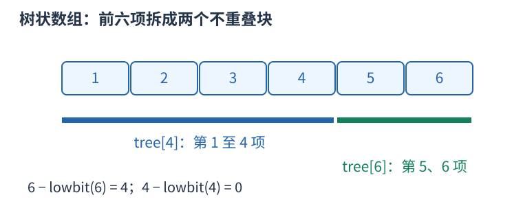
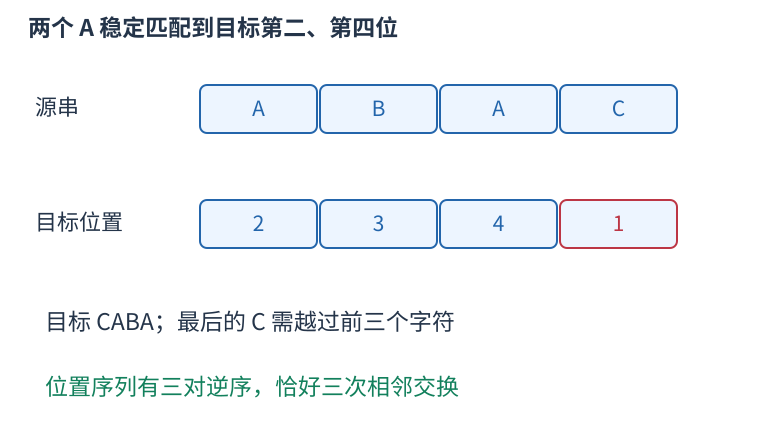

# P3531 相同字母按出现次序匹配，再数目标位置的逆序对 题解

## 目录

| 题号 | 题名 | 考点 | 难度 |
|---|---|---|---|
| A | LIT-Letters | 树状数组 | 1500 |

## A. LIT-Letters

> 原题：[P3531](https://www.luogu.com.cn/problem/P3531)
> 解法：相同字母按出现次序匹配，再数目标位置的逆序对 · C++17

### 题意

两个大写字母串互为重排，每次只交换相邻字符，求把$a$变成$b$的最少交换次数。

<!-- reusable-foundations:start -->

### 从零讲：C++ 输入输出：把数据读进变量，把结果写到标准输出

程序运行时从标准输入接收题目给的数据，把答案送到标准输出。`cin` 和 `cout` 定义在 `<iostream>`；写 `using namespace std;` 后可以省略它们前面的 `std::`。最小完整程序是：

```cxx
#include <iostream>
using namespace std;
int main() {
    int a, b;
    cin >> a >> b;
    cout << a + b << '\n';
    return 0;
}
```

输入二十和三十，两个变量分别保存二十、三十，输出五十。`int a, b;` 声明两个整数变量；`cin >> a` 才给变量赋入输入值。多个 `>>` 从左到右读取，读取整数时会跳过空格、制表符、换行，所以两个整数可以分处两行。负号属于整数，不需要另读一个符号。

`cout <<` 后可以接数值、字符或字符串。`' '` 是一个空格字符，`'\n'` 是换行字符，`"Hello"` 是字符串。`cout << a << ' ' << b << '\n';` 输出两个以空格分开的整数并换行。评测程序只需要答案，不应加入“请输入”等提示。

读取 `char c; cin >> c;` 会跳过前导空白。要读取包含空格的一整行，用 `<string>` 中的 `string s; getline(cin, s);`。若此前用 `cin >> n` 读取过整数，换行还留在输入中，需要先处理那一个剩余换行；不能盲目把所有空格都删掉，因为字符画的行首空格和文本中的空格可能就是数据。

`fixed << setprecision(3)`（需要 `<iomanip>`）表示以小数形式保留三位小数，例如把 $2.5$ 输出成 $2.500$；不用 `fixed` 时，`setprecision` 指有效数字总数。设置会影响后续输出，使用前应确认所需精度。

竞赛中可在首次输入输出前调用 `ios::sync_with_stdio(false); cin.tie(nullptr);`，减少 C++ 流与 C 标准输入输出的同步、绑定开销。随后保持使用 `cin/cout`，不要混用另一套 `scanf/printf`。交互题还要在需要对方回应前主动刷新，例如 `cout << query << endl;`；普通题用换行字符即可。

读入长度为 $L$ 的文本、或输出 $L$ 个字符，至少需要 $O(L)$ 时间。数据类型仍要能容纳结果：把两个整数相乘时，即使保存到 `long long`，也要让乘法本身在这个类型中进行，例如先把输入声明为 `long long`。

### 从零讲：分支与循环：按条件选择，按次序重复

`if (条件) { ... } else { ... }` 根据条件的真假选择一条分支。比较运算 `==`、`!=`、`<`、`<=`、`>`、`>=` 返回真假值；`=` 是赋值，不能代替相等比较。`&&` 表示两边都成立，`||` 表示至少一边成立，`!` 把真假反转。

```cxx
int score = 85;
if (score >= 90) cout << "A";
else if (score >= 60) cout << "B";
else cout << "C"; // 这个例子输出 B
```

这条分支链只执行第一个符合条件的分支。先处理高分后，第二个条件自然只会接到低于九十分的数。几个独立的 `if` 则可能执行多次；两种结构代表不同问题。逻辑运算会短路：`i < n && a[i] == 0` 先确认下标合法，才读取那一格。

`for (初始化; 继续条件; 每轮更新)` 适合知道重复范围的情况。例如下列代码依次处理一到四，总和是十：

```cxx
int sum = 0;
for (int i = 1; i <= 4; ++i) {
    sum += i;
}
cout << sum;
```

初始化只做一次；每轮先判断条件，条件为真才执行循环体，随后执行更新。`++i` 把 $i$ 加一，`sum += i` 等价于把旧 sum 加 $i$ 再保存。应明确每个变量在循环前、循环后分别表示什么；最大值相同时是否更新，决定了保留较早还是较晚的答案。

`while (条件)` 适合“不满足目标就再做一步”：

```cxx
int x = 13, times = 0;
while (x > 1) {
    x /= 2;
    ++times;
}
// x 依次是 13、6、3、1，执行三次
```

循环开始前先检查条件，初始已满足目标时可能一次也不执行。每次执行必须推进状态，否则可能无限循环。`break` 结束最内层循环，`continue` 跳过本轮剩余部分；`for` 中的 continue 之后仍会执行每轮更新。

复杂度由实际执行次数决定。上述求和执行 $n$ 次是 $O(n)$；每次将正整数减半只执行 $O(\log n)$ 次。两层循环不能仅凭外观判定为平方：内层若总共只前进 $n$ 次，总量仍可能线性。变量应在正确作用范围初始化；多组数据的计数器若未重置，下一组会错误继承上一组结果。

### 从零讲：vector：长度可变的连续数组

`vector<T>` 保存一串同类型的元素，适合按下标访问、扫描、排序。`T` 是元素类型，例如 `vector<int>` 保存整数，`vector<pair<int,int>>` 保存整数对，`vector<vector<int>>` 可保存每个顶点各自的邻居。需要 `<vector>`。

```cxx
vector<int> a(3, 7);   // 三个元素，内容是 7、7、7
a.push_back(9);       // 在末尾追加，现在长度为 4
int x = a[1];         // 从 0 编号，这里得到 7
a[1] = 2;            // 改第二个元素
int n = int(a.size());
```

`vector<int> a(3)` 创建三个值为零的元素；`a.reserve(3)` 只预留容量，元素数仍为零，此时不能访问 `a[0]`。长度 `size()` 与容量 `capacity()` 是不同概念。

下标访问为 $O(1)$，遍历为 $O(n)$。末尾追加通常为 $O(1)$；容量不足时会分配更大的连续空间并搬移元素，这次可能为 $O(n)$，一连串追加的平均成本称为摊还 $O(1)$。中间插入或删除会搬移后续元素，最坏 $O(n)$。内存是元素量的 $O(n)$，并可能预留部分尚未使用的容量。

`begin()` 指向首元素，`end()` 指向尾后位置，`sort(a.begin(),a.end())` 操作整个数组。`a[i]` 不检查越界；下标须满足 $0\le i<\mathrm{size}$。`at(i)` 会检查越界并抛异常。空数组不能访问 `front()`、`back()`；`pop_back()` 也要求非空。

扩容后指向旧存储的迭代器、引用和指针会失效。遍历的同时 `push_back`，不能假定此前取得的引用仍可用。读取大数组的函数常用 `const vector<int>& a` 按常量引用传入，既不复制也禁止通过该引用修改；`vector<int> a` 按值传参则复制内容。选择副本还是引用取决于是否要保留独立数据。

### 从零讲：整数类型、整除与溢出

计算前先看每一步可能达到的范围。常见环境中 `int` 是 32 位，上界约 $2.1\times10^9$；`long long` 至少 64 位，常见有符号 64 位上界约 $9.22\times10^{18}$。`using ll = long long;` 只是为已有类型起别名。

```cxx
int a = 100000, b = 100000;
long long wrong = a * b;      // 右边先按 int 乘，可能已溢出
long long right = 1LL * a * b; // 先把运算提升到 long long
```

不能指望“接收结果的变量够大”修复此前已经溢出的计算。先提高操作数类型，再做乘法。超过 64 位时，GCC 的 `__int128` 可作中间量，但它不是标准 C++17 类型，也没有标准流输出重载；先证明范围，再选择工具。

整数 `/` 对有符号数向零截断：`7/3==2`、`-7/3==-2`。对非负数才等于向下取整。余数满足 `a == (a/b)*b + a%b`，除数不能为零；要将余数归入 $[0,m-1]$（$m>0$），可用 `(a % m + m) % m`，同时保证中间加法不溢出。

非负 $a$、正 $b$ 的向上取整可写 `a/b + (a%b != 0)`，比 `(a+b-1)/b` 更容易避免加法溢出。比较平方时也应在宽类型内计算；浮点数不适合作为大整数相等的默认判断方式。

`size()` 返回无符号类型。空容器上写 `size()-1` 会绕到很大的数，逆序遍历可以先转成有符号、确认长度，或使用逆向迭代器。`abs` 对最小有符号数无法在同类型中表达其正值，需先约束输入差值范围。一般机器整数运算按常数时间估算，宽类型解决表示范围，不改变算法的增长阶。

### 从零讲：具名函数：给可复用计算一个明确接口

函数把一段计算包装成“输入参数 → 返回结果”。例如判断整数是否为偶数：

```cxx
bool even(int x) {
    return x % 2 == 0;
}
int main() {
    bool a = even(8); // a 为 true
    bool b = even(7); // b 为 false
}
```

`bool` 是返回类型，`even` 是函数名，`int x` 是参数声明。调用 `even(8)` 时，实参八传入这个新调用的局部变量 $x$，执行 return 后把真假值交回调用处。定义本身不执行计算，只有调用才执行。函数应在调用处之前定义，或提前写声明。

普通数值参数按值传递，函数里修改 $x$ 不会改变调用者原变量。参数写成 `int &x` 时才引用调用者对象；必须让这个对象在调用期间有效。`const vector<int>& a` 用引用避免复制整个容器，并承诺不通过这个引用修改它。返回局部变量的值是安全的，返回局部变量的引用则在函数结束后失效。

函数名应说明它回答的问题，调用处负责传哪些数据。例如闰年判定只接收一个年份并返回真假，枚举年份范围和输出格式由调用者处理。同一判定被多次使用时，这能减少规则不一致；但函数包装不会自动降低算法复杂度，仍要把每次调用实际做的工作计入时间。

如果函数内部又调用自身，就是递归，需要明确最小情况如何直接返回、每次调用如何逼近它；递归会占用调用栈。普通辅助函数可以不使用递归，不应仅因写成函数就称作递归算法。

### 从零讲：树状数组：动态前缀和

前缀和数组适合不修改的序列；若要不断给单点加值并查询前缀总和，树状数组把每个前缀拆成少量已维护的小块。

从一编号，`lowbit(i)=i&-i` 是二进制最低的一位所代表的数。`tree[i]` 维护区间 $[i-\operatorname{lowbit}(i)+1,i]$ 的和。例如 $i=6$、二进制 $110_2$，lowbit 为二，维护第五、第六项；查询前六项时再转到四，取第一到第四项。



```cxx
void add(int i, long long delta) {
    for (; i <= n; i += i & -i) tree[i] += delta;
}
long long prefix(int i) {
    long long sum = 0;
    for (; i > 0; i -= i & -i) sum += tree[i];
    return sum;
}
```

查询每次去掉最低的一位，区间块恰好首尾衔接；更新则访问所有覆盖原位置的上层块。二进制位数为 $O(\log n)$，所以两种操作均为 $O(\log n)$，空间 $O(n)$。区间 $[l,r]$ 的和仍为 `prefix(r)-prefix(l-1)`。

`add` 接收增量，不是新值；赋新值需减去旧值。下标零会使更新步长为零，导致死循环，必须从一开始。坐标稀疏时可先离散化。求第 $k$ 小的倍增搜索还要求维护的频次非负，不能将任意带负数的前缀误认为单调。

### 从零讲：string：字符、下标与子串

`string` 保存字符序列。`string s="abca";` 的长度为四，下标从零开始，`s[0]=='a'`、`s[3]=='a'`。字符用单引号，字符串用双引号；二者类型不同。需要 `<string>`。

`cin >> s` 读到空白停止；整行含空格时使用 `getline`，并留意前一次格式化输入残留的换行。`s.size()` 是字符单元数量，不一定等于 UTF-8 中文字数；竞赛英文小写字母题通常一个字符对应一个单元。

```cxx
string s = "abca";
string middle = s.substr(1, 2); // 从下标 1 开始取 2 个字符，得到 bc
size_t pos = s.find('c');       // 得到 2；找不到是 string::npos
if (pos != string::npos) cout << s[pos];
```

`substr(start,length)` 的第二项是长度，不是右端点。普通下标访问为 $O(1)$；复制长为 $k$ 的子串需要 $O(k)$ 时间和空间，循环里反复截取可能累积成平方成本。字符串比较按第一个不同字符决定字典序，公共前缀可能需要线性比较。

常见字符转数字是 `c-'0'`，前提 `c` 在 `'0'` 到 `'9'`。修改原串可用 `for(char& c:s)`，只读使用 `char c`。`reverse(s.begin(),s.end())` 原地翻转；若还需要原串，应先复制。空串不能访问首尾，尾后位置不能当普通字符读取。

### 从零讲：array：长度在编译时固定的标准库数组

`array<T,N>`保存N个T类型元素，长度写在类型中，运行时不会伸长。它需要头文件`<array>`，支持下标访问、整体复制、范围for以及begin、end，因此长度已知的四科题数适合用array保存。[C++标准草案中的array定义](https://eel.is/c++draft/array.overview)规定它连续存放固定数量的元素。

下标从零开始，四个元素的下标为零到三，访问第四号下标已经越界。方括号访问不自动检查范围；at会检查，但不能因此忽略合法边界。

```cxx
array<int,4> counts{}; // 四个整数全部初始化为零
counts[0] = 2;
counts[1] = 3;
auto saved = counts; // 整体复制，后续各自修改
counts.fill(1);
int sum = 0;
for (int x : saved) sum += x;
cout << saved.size() << ' ' << sum << ' ' << counts[0] << '\n';
```

这段程序输出四、五、一，依次是固定长度、复制前数组的元素和，以及fill后当前数组的首项。空花括号使整数初始为零；如果只声明局部的array而不初始化，不能在赋值前读其中的整数。题解中的counts没有花括号，但它的每一项都先被输入写入，随后才会读取。

范围for中的`int x`是副本，改变$x$不会改变数组；需要逐项写入时使用`int &x`。例如输入循环中的引用让cin直接修改对应元素。长度由输入$n$决定时改用vector；不要把运行时变量$n$直接当作array类型参数。

一次下标访问为常数时间，复制或fill需要遍历N项。array本身不会像vector一样提供push_back来增加元素。

<!-- reusable-foundations:end -->

### 思路




给$b$中每种字母保存其出现位置。顺序读取$a$，同字母依次匹配$b$中最早尚未使用的位置，得到一个目标位置排列。它的逆序对数就是最少相邻交换次数。用树状数组统计已经出现的目标位置，当前贡献为此前项数减不大于当前位置的项数。答案用六十四位。

时间 $O(n\log n)$，空间 $O(n)$。

### 参考代码

```cpp
#include <bits/stdc++.h>
using namespace std;
struct Fenwick {
    int n; vector<int> tree;
    explicit Fenwick(int size):n(size),tree(size+1){}
    void add(int p,int v){for(;p<=n;p+=p&-p) tree[p]+=v;}
    int sum(int p) const {int value=0;for(;p;p-=p&-p) value+=tree[p];return value;}
    int kth(int k) const {int p=0;for(int step=1<<20;step;step>>=1){int q=p+step;if(q<=n&&tree[q]<k){p=q;k-=tree[q];}}return p+1;}
};
int main() {
    ios::sync_with_stdio(false);
    cin.tie(nullptr);
int n;string a,b;cin>>n>>a>>b;array<vector<int>,26>positions;array<int,26>next={};
for(int i=0;i<n;++i) positions[b[i]-'A'].push_back(i+1);
Fenwick bit(n);long long answer=0;for(int i=0;i<n;++i){int letter=a[i]-'A',p=positions[letter][next[letter]++];answer+=i-bit.sum(p);bit.add(p,1);}
cout<<answer<<'\n';
    return 0;
}
```

### 易错点

同字母稳定匹配；目标位置从一编号；先查询后插入；统计此前更大位置；总逆序对六十四位；不能只数字符不在原位置的数量。

## 实测记录

本地 C++17 编译、1 组原站样例与 182 组独立边界/小域校验通过。
正文参考程序与源码逐字核对；没有向原站提交。
