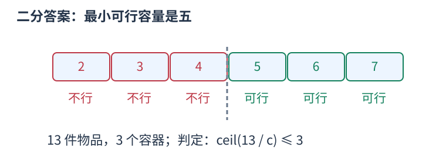

# P3611 二分同时表演数，用小根堆模拟最早空位 题解

## 目录

| 题号 | 题名 | 考点 | 难度 |
|---|---|---|---|
| A | Cow Dance Show S | 二分答案 + 堆 | 1800 |

## A. Cow Dance Show S

> 原题：[P3611](https://www.luogu.com.cn/problem/P3611)
> 解法：二分同时表演数，用小根堆模拟最早空位 · C++17

### 题意

奶牛按固定顺序上台，空出位置就立即由下一头接上，求在时限内结束所需的最小舞台容量。

<!-- reusable-foundations:start -->

### 从零讲：C++ 输入输出：把数据读进变量，把结果写到标准输出

程序运行时从标准输入接收题目给的数据，把答案送到标准输出。`cin` 和 `cout` 定义在 `<iostream>`；写 `using namespace std;` 后可以省略它们前面的 `std::`。最小完整程序是：

```cxx
#include <iostream>
using namespace std;
int main() {
    int a, b;
    cin >> a >> b;
    cout << a + b << '\n';
    return 0;
}
```

输入二十和三十，两个变量分别保存二十、三十，输出五十。`int a, b;` 声明两个整数变量；`cin >> a` 才给变量赋入输入值。多个 `>>` 从左到右读取，读取整数时会跳过空格、制表符、换行，所以两个整数可以分处两行。负号属于整数，不需要另读一个符号。

`cout <<` 后可以接数值、字符或字符串。`' '` 是一个空格字符，`'\n'` 是换行字符，`"Hello"` 是字符串。`cout << a << ' ' << b << '\n';` 输出两个以空格分开的整数并换行。评测程序只需要答案，不应加入“请输入”等提示。

读取 `char c; cin >> c;` 会跳过前导空白。要读取包含空格的一整行，用 `<string>` 中的 `string s; getline(cin, s);`。若此前用 `cin >> n` 读取过整数，换行还留在输入中，需要先处理那一个剩余换行；不能盲目把所有空格都删掉，因为字符画的行首空格和文本中的空格可能就是数据。

`fixed << setprecision(3)`（需要 `<iomanip>`）表示以小数形式保留三位小数，例如把 $2.5$ 输出成 $2.500$；不用 `fixed` 时，`setprecision` 指有效数字总数。设置会影响后续输出，使用前应确认所需精度。

竞赛中可在首次输入输出前调用 `ios::sync_with_stdio(false); cin.tie(nullptr);`，减少 C++ 流与 C 标准输入输出的同步、绑定开销。随后保持使用 `cin/cout`，不要混用另一套 `scanf/printf`。交互题还要在需要对方回应前主动刷新，例如 `cout << query << endl;`；普通题用换行字符即可。

读入长度为 $L$ 的文本、或输出 $L$ 个字符，至少需要 $O(L)$ 时间。数据类型仍要能容纳结果：把两个整数相乘时，即使保存到 `long long`，也要让乘法本身在这个类型中进行，例如先把输入声明为 `long long`。

### 从零讲：分支与循环：按条件选择，按次序重复

`if (条件) { ... } else { ... }` 根据条件的真假选择一条分支。比较运算 `==`、`!=`、`<`、`<=`、`>`、`>=` 返回真假值；`=` 是赋值，不能代替相等比较。`&&` 表示两边都成立，`||` 表示至少一边成立，`!` 把真假反转。

```cxx
int score = 85;
if (score >= 90) cout << "A";
else if (score >= 60) cout << "B";
else cout << "C"; // 这个例子输出 B
```

这条分支链只执行第一个符合条件的分支。先处理高分后，第二个条件自然只会接到低于九十分的数。几个独立的 `if` 则可能执行多次；两种结构代表不同问题。逻辑运算会短路：`i < n && a[i] == 0` 先确认下标合法，才读取那一格。

`for (初始化; 继续条件; 每轮更新)` 适合知道重复范围的情况。例如下列代码依次处理一到四，总和是十：

```cxx
int sum = 0;
for (int i = 1; i <= 4; ++i) {
    sum += i;
}
cout << sum;
```

初始化只做一次；每轮先判断条件，条件为真才执行循环体，随后执行更新。`++i` 把 $i$ 加一，`sum += i` 等价于把旧 sum 加 $i$ 再保存。应明确每个变量在循环前、循环后分别表示什么；最大值相同时是否更新，决定了保留较早还是较晚的答案。

`while (条件)` 适合“不满足目标就再做一步”：

```cxx
int x = 13, times = 0;
while (x > 1) {
    x /= 2;
    ++times;
}
// x 依次是 13、6、3、1，执行三次
```

循环开始前先检查条件，初始已满足目标时可能一次也不执行。每次执行必须推进状态，否则可能无限循环。`break` 结束最内层循环，`continue` 跳过本轮剩余部分；`for` 中的 continue 之后仍会执行每轮更新。

复杂度由实际执行次数决定。上述求和执行 $n$ 次是 $O(n)$；每次将正整数减半只执行 $O(\log n)$ 次。两层循环不能仅凭外观判定为平方：内层若总共只前进 $n$ 次，总量仍可能线性。变量应在正确作用范围初始化；多组数据的计数器若未重置，下一组会错误继承上一组结果。

### 从零讲：vector：长度可变的连续数组

`vector<T>` 保存一串同类型的元素，适合按下标访问、扫描、排序。`T` 是元素类型，例如 `vector<int>` 保存整数，`vector<pair<int,int>>` 保存整数对，`vector<vector<int>>` 可保存每个顶点各自的邻居。需要 `<vector>`。

```cxx
vector<int> a(3, 7);   // 三个元素，内容是 7、7、7
a.push_back(9);       // 在末尾追加，现在长度为 4
int x = a[1];         // 从 0 编号，这里得到 7
a[1] = 2;            // 改第二个元素
int n = int(a.size());
```

`vector<int> a(3)` 创建三个值为零的元素；`a.reserve(3)` 只预留容量，元素数仍为零，此时不能访问 `a[0]`。长度 `size()` 与容量 `capacity()` 是不同概念。

下标访问为 $O(1)$，遍历为 $O(n)$。末尾追加通常为 $O(1)$；容量不足时会分配更大的连续空间并搬移元素，这次可能为 $O(n)$，一连串追加的平均成本称为摊还 $O(1)$。中间插入或删除会搬移后续元素，最坏 $O(n)$。内存是元素量的 $O(n)$，并可能预留部分尚未使用的容量。

`begin()` 指向首元素，`end()` 指向尾后位置，`sort(a.begin(),a.end())` 操作整个数组。`a[i]` 不检查越界；下标须满足 $0\le i<\mathrm{size}$。`at(i)` 会检查越界并抛异常。空数组不能访问 `front()`、`back()`；`pop_back()` 也要求非空。

扩容后指向旧存储的迭代器、引用和指针会失效。遍历的同时 `push_back`，不能假定此前取得的引用仍可用。读取大数组的函数常用 `const vector<int>& a` 按常量引用传入，既不复制也禁止通过该引用修改；`vector<int> a` 按值传参则复制内容。选择副本还是引用取决于是否要保留独立数据。

### 从零讲：整数类型、整除与溢出

计算前先看每一步可能达到的范围。常见环境中 `int` 是 32 位，上界约 $2.1\times10^9$；`long long` 至少 64 位，常见有符号 64 位上界约 $9.22\times10^{18}$。`using ll = long long;` 只是为已有类型起别名。

```cxx
int a = 100000, b = 100000;
long long wrong = a * b;      // 右边先按 int 乘，可能已溢出
long long right = 1LL * a * b; // 先把运算提升到 long long
```

不能指望“接收结果的变量够大”修复此前已经溢出的计算。先提高操作数类型，再做乘法。超过 64 位时，GCC 的 `__int128` 可作中间量，但它不是标准 C++17 类型，也没有标准流输出重载；先证明范围，再选择工具。

整数 `/` 对有符号数向零截断：`7/3==2`、`-7/3==-2`。对非负数才等于向下取整。余数满足 `a == (a/b)*b + a%b`，除数不能为零；要将余数归入 $[0,m-1]$（$m>0$），可用 `(a % m + m) % m`，同时保证中间加法不溢出。

非负 $a$、正 $b$ 的向上取整可写 `a/b + (a%b != 0)`，比 `(a+b-1)/b` 更容易避免加法溢出。比较平方时也应在宽类型内计算；浮点数不适合作为大整数相等的默认判断方式。

`size()` 返回无符号类型。空容器上写 `size()-1` 会绕到很大的数，逆序遍历可以先转成有符号、确认长度，或使用逆向迭代器。`abs` 对最小有符号数无法在同类型中表达其正值，需先约束输入差值范围。一般机器整数运算按常数时间估算，宽类型解决表示范围，不改变算法的增长阶。

### 从零讲：具名函数：给可复用计算一个明确接口

函数把一段计算包装成“输入参数 → 返回结果”。例如判断整数是否为偶数：

```cxx
bool even(int x) {
    return x % 2 == 0;
}
int main() {
    bool a = even(8); // a 为 true
    bool b = even(7); // b 为 false
}
```

`bool` 是返回类型，`even` 是函数名，`int x` 是参数声明。调用 `even(8)` 时，实参八传入这个新调用的局部变量 $x$，执行 return 后把真假值交回调用处。定义本身不执行计算，只有调用才执行。函数应在调用处之前定义，或提前写声明。

普通数值参数按值传递，函数里修改 $x$ 不会改变调用者原变量。参数写成 `int &x` 时才引用调用者对象；必须让这个对象在调用期间有效。`const vector<int>& a` 用引用避免复制整个容器，并承诺不通过这个引用修改它。返回局部变量的值是安全的，返回局部变量的引用则在函数结束后失效。

函数名应说明它回答的问题，调用处负责传哪些数据。例如闰年判定只接收一个年份并返回真假，枚举年份范围和输出格式由调用者处理。同一判定被多次使用时，这能减少规则不一致；但函数包装不会自动降低算法复杂度，仍要把每次调用实际做的工作计入时间。

如果函数内部又调用自身，就是递归，需要明确最小情况如何直接返回、每次调用如何逼近它；递归会占用调用栈。普通辅助函数可以不使用递归，不应仅因写成函数就称作递归算法。

### 从零讲：二分答案：在单调的可行性分界处找最优值

当直接求最小答案困难，但给定候选值后可以检查是否可行，可以把优化问题转成判定。前提是可行性只有一道分界，而不是来回变化。

例如要容纳总量十三，每个容器最多装 $c$，只有三个容器。判定为 $\lceil13/c\rceil\le3$。容量三、四不可行，容量五、六及更大都可行，因为增大容量不会让已有装法失效。



要找最小可行值，可维护闭区间内仍可能的答案：

```cxx
int left = 1, right = 13; // 已知答案在此范围，right 可行
while (left < right) {
    int mid = left + (right - left) / 2;
    if (check(mid)) right = mid;
    else left = mid + 1;
}
int answer = left;
```

中点可行时，最优答案可能就是中点或更小，因此保留它；中点不可行时，所有更小值都不行，排除到中点为止。候选范围每轮缩半。若一次检查为 $T$，总时间为 $O(T\log R)$，$R$ 是初始候选数；额外空间来自检查函数和常数个边界。

开始前分别证明单调性、上下界和确有解。若上界也不可行，不能把二分最后停下的位置当作合法答案。求最大可行值时分界方向和取中点方式要配合修改。判定中的除法、乘法也可能溢出；非负向上整除可以写 `a/b+(a%b!=0)`。

二分不负责证明 `check` 正确，也不能降低一次检查本身的复杂度。与有序数组上的边界函数相比，这里的“数组”是候选答案的概念序列，不必真正生成所有候选。

### 从零讲：priority_queue：随时取出最高优先级

若数据不断加入，每次只关心当前最大或最小项，无需每次排序整个数组。`priority_queue<T>` 用堆维护这一项：`top()` 查看，`push(x)` 加入，`pop()` 移除顶部但不返回值。需要 `<queue>`。

```cxx
priority_queue<int> largest;
largest.push(3); largest.push(8); largest.push(5);
int x = largest.top(); // 8，默认大根堆
largest.pop();         // 移走 8，此后顶部为 5
priority_queue<int, vector<int>, greater<int>> smallest;
```

最后一行是小根堆；对由距离和顶点编号组成的 `pair` 使用相同配置，可优先取最小距离。堆只保证顶部最优，内部并非完整有序数组，也不能高效随意查中间某个值。

堆在逻辑上是完全二叉树，高度为 $O(\log n)$，插入上浮、删除下沉最多跨越这个高度。故 `push`、`pop` 为 $O(\log n)$，`top` 为 $O(1)$，空间 $O(n)$。访问或删除顶部之前必须非空。

需要更新某项优先级时，标准 `priority_queue` 没有直接修改接口。常见方法是插入新版，取出时检查它是否仍与外部最新记录相符，丢弃过期项；这会影响队列大小和总复杂度，须按实际插入次数计算。

<!-- reusable-foundations:end -->

### 思路

判定容量 K 时，用小根堆保存 K 个位置当前任务的结束时刻。下一头在最早结束的位置开始，把堆顶加上它的时长后重新入堆。所有结束时刻最大值不超过时限则可行；容量越大不会延后任何奶牛，可二分最小可行 K。

一次判定 $O(n\log(K+1))$，总时间 $O(n\log^2(n+1))$、空间 $O(n)$。

### 参考代码

```cpp
#include <bits/stdc++.h>
using namespace std;
bool finishes(const vector<long long>&duration,int capacity,long long limit){
    priority_queue<long long,vector<long long>,greater<long long>>ends;
    for(int i=0;i<capacity;++i)ends.push(0);
    // 堆顶是最早空位的完成时刻，而非单头表演时长。
    for(long long d:duration){long long finish=ends.top()+d;ends.pop();if(finish>limit)return false;ends.push(finish);}
    return true;
}
int main() {
    ios::sync_with_stdio(false);
    cin.tie(nullptr);
int n;long long limit;cin>>n>>limit;vector<long long>duration(n);for(auto &x:duration)cin>>x;int lo=1,hi=n;
while(lo<hi){int mid=(lo+hi)/2;if(finishes(duration,mid,limit))hi=mid;else lo=mid+1;}
cout<<lo<<'\n';
    return 0;
}
```

### 易错点

不改变上台顺序；堆保存完成时间；二分找最小可行容量。

## 实测记录

本地 C++17 编译、1 组原站样例与 151 组独立边界/小域校验通过。
正文参考程序与源码逐字核对；没有向原站提交。
