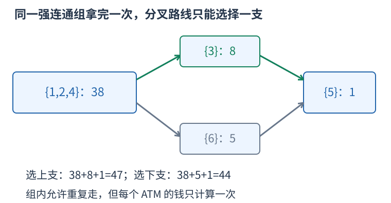

# P3627 强连通区域汇总现金，缩成 DAG 后求可达最大收益 题解

## 目录

| 题号 | 题名 | 考点 | 难度 |
|---|---|---|---|
| A | 抢掠计划 | DFS + 拓扑排序 + 线性 DP | 1800 |

## A. 抢掠计划

> 原题：[P3627](https://www.luogu.com.cn/problem/P3627)
> 解法：强连通区域汇总现金，缩成 DAG 后求可达最大收益 · C++17

### 题意

从指定起点沿单向路行走，可以重复经过点和边，但每个 ATM 的钱只能取一次。最后必须停在一个酒吧，求最多取得多少钱；钱数均非负。

<!-- reusable-foundations:start -->

### 从零讲：C++ 输入输出：把数据读进变量，把结果写到标准输出

程序运行时从标准输入接收题目给的数据，把答案送到标准输出。`cin` 和 `cout` 定义在 `<iostream>`；写 `using namespace std;` 后可以省略它们前面的 `std::`。最小完整程序是：

```cxx
#include <iostream>
using namespace std;
int main() {
    int a, b;
    cin >> a >> b;
    cout << a + b << '\n';
    return 0;
}
```

输入二十和三十，两个变量分别保存二十、三十，输出五十。`int a, b;` 声明两个整数变量；`cin >> a` 才给变量赋入输入值。多个 `>>` 从左到右读取，读取整数时会跳过空格、制表符、换行，所以两个整数可以分处两行。负号属于整数，不需要另读一个符号。

`cout <<` 后可以接数值、字符或字符串。`' '` 是一个空格字符，`'\n'` 是换行字符，`"Hello"` 是字符串。`cout << a << ' ' << b << '\n';` 输出两个以空格分开的整数并换行。评测程序只需要答案，不应加入“请输入”等提示。

读取 `char c; cin >> c;` 会跳过前导空白。要读取包含空格的一整行，用 `<string>` 中的 `string s; getline(cin, s);`。若此前用 `cin >> n` 读取过整数，换行还留在输入中，需要先处理那一个剩余换行；不能盲目把所有空格都删掉，因为字符画的行首空格和文本中的空格可能就是数据。

`fixed << setprecision(3)`（需要 `<iomanip>`）表示以小数形式保留三位小数，例如把 $2.5$ 输出成 $2.500$；不用 `fixed` 时，`setprecision` 指有效数字总数。设置会影响后续输出，使用前应确认所需精度。

竞赛中可在首次输入输出前调用 `ios::sync_with_stdio(false); cin.tie(nullptr);`，减少 C++ 流与 C 标准输入输出的同步、绑定开销。随后保持使用 `cin/cout`，不要混用另一套 `scanf/printf`。交互题还要在需要对方回应前主动刷新，例如 `cout << query << endl;`；普通题用换行字符即可。

读入长度为 $L$ 的文本、或输出 $L$ 个字符，至少需要 $O(L)$ 时间。数据类型仍要能容纳结果：把两个整数相乘时，即使保存到 `long long`，也要让乘法本身在这个类型中进行，例如先把输入声明为 `long long`。

### 从零讲：分支与循环：按条件选择，按次序重复

`if (条件) { ... } else { ... }` 根据条件的真假选择一条分支。比较运算 `==`、`!=`、`<`、`<=`、`>`、`>=` 返回真假值；`=` 是赋值，不能代替相等比较。`&&` 表示两边都成立，`||` 表示至少一边成立，`!` 把真假反转。

```cxx
int score = 85;
if (score >= 90) cout << "A";
else if (score >= 60) cout << "B";
else cout << "C"; // 这个例子输出 B
```

这条分支链只执行第一个符合条件的分支。先处理高分后，第二个条件自然只会接到低于九十分的数。几个独立的 `if` 则可能执行多次；两种结构代表不同问题。逻辑运算会短路：`i < n && a[i] == 0` 先确认下标合法，才读取那一格。

`for (初始化; 继续条件; 每轮更新)` 适合知道重复范围的情况。例如下列代码依次处理一到四，总和是十：

```cxx
int sum = 0;
for (int i = 1; i <= 4; ++i) {
    sum += i;
}
cout << sum;
```

初始化只做一次；每轮先判断条件，条件为真才执行循环体，随后执行更新。`++i` 把 $i$ 加一，`sum += i` 等价于把旧 sum 加 $i$ 再保存。应明确每个变量在循环前、循环后分别表示什么；最大值相同时是否更新，决定了保留较早还是较晚的答案。

`while (条件)` 适合“不满足目标就再做一步”：

```cxx
int x = 13, times = 0;
while (x > 1) {
    x /= 2;
    ++times;
}
// x 依次是 13、6、3、1，执行三次
```

循环开始前先检查条件，初始已满足目标时可能一次也不执行。每次执行必须推进状态，否则可能无限循环。`break` 结束最内层循环，`continue` 跳过本轮剩余部分；`for` 中的 continue 之后仍会执行每轮更新。

复杂度由实际执行次数决定。上述求和执行 $n$ 次是 $O(n)$；每次将正整数减半只执行 $O(\log n)$ 次。两层循环不能仅凭外观判定为平方：内层若总共只前进 $n$ 次，总量仍可能线性。变量应在正确作用范围初始化；多组数据的计数器若未重置，下一组会错误继承上一组结果。

### 从零讲：vector：长度可变的连续数组

`vector<T>` 保存一串同类型的元素，适合按下标访问、扫描、排序。`T` 是元素类型，例如 `vector<int>` 保存整数，`vector<pair<int,int>>` 保存整数对，`vector<vector<int>>` 可保存每个顶点各自的邻居。需要 `<vector>`。

```cxx
vector<int> a(3, 7);   // 三个元素，内容是 7、7、7
a.push_back(9);       // 在末尾追加，现在长度为 4
int x = a[1];         // 从 0 编号，这里得到 7
a[1] = 2;            // 改第二个元素
int n = int(a.size());
```

`vector<int> a(3)` 创建三个值为零的元素；`a.reserve(3)` 只预留容量，元素数仍为零，此时不能访问 `a[0]`。长度 `size()` 与容量 `capacity()` 是不同概念。

下标访问为 $O(1)$，遍历为 $O(n)$。末尾追加通常为 $O(1)$；容量不足时会分配更大的连续空间并搬移元素，这次可能为 $O(n)$，一连串追加的平均成本称为摊还 $O(1)$。中间插入或删除会搬移后续元素，最坏 $O(n)$。内存是元素量的 $O(n)$，并可能预留部分尚未使用的容量。

`begin()` 指向首元素，`end()` 指向尾后位置，`sort(a.begin(),a.end())` 操作整个数组。`a[i]` 不检查越界；下标须满足 $0\le i<\mathrm{size}$。`at(i)` 会检查越界并抛异常。空数组不能访问 `front()`、`back()`；`pop_back()` 也要求非空。

扩容后指向旧存储的迭代器、引用和指针会失效。遍历的同时 `push_back`，不能假定此前取得的引用仍可用。读取大数组的函数常用 `const vector<int>& a` 按常量引用传入，既不复制也禁止通过该引用修改；`vector<int> a` 按值传参则复制内容。选择副本还是引用取决于是否要保留独立数据。

### 从零讲：整数类型、整除与溢出

计算前先看每一步可能达到的范围。常见环境中 `int` 是 32 位，上界约 $2.1\times10^9$；`long long` 至少 64 位，常见有符号 64 位上界约 $9.22\times10^{18}$。`using ll = long long;` 只是为已有类型起别名。

```cxx
int a = 100000, b = 100000;
long long wrong = a * b;      // 右边先按 int 乘，可能已溢出
long long right = 1LL * a * b; // 先把运算提升到 long long
```

不能指望“接收结果的变量够大”修复此前已经溢出的计算。先提高操作数类型，再做乘法。超过 64 位时，GCC 的 `__int128` 可作中间量，但它不是标准 C++17 类型，也没有标准流输出重载；先证明范围，再选择工具。

整数 `/` 对有符号数向零截断：`7/3==2`、`-7/3==-2`。对非负数才等于向下取整。余数满足 `a == (a/b)*b + a%b`，除数不能为零；要将余数归入 $[0,m-1]$（$m>0$），可用 `(a % m + m) % m`，同时保证中间加法不溢出。

非负 $a$、正 $b$ 的向上取整可写 `a/b + (a%b != 0)`，比 `(a+b-1)/b` 更容易避免加法溢出。比较平方时也应在宽类型内计算；浮点数不适合作为大整数相等的默认判断方式。

`size()` 返回无符号类型。空容器上写 `size()-1` 会绕到很大的数，逆序遍历可以先转成有符号、确认长度，或使用逆向迭代器。`abs` 对最小有符号数无法在同类型中表达其正值，需先约束输入差值范围。一般机器整数运算按常数时间估算，宽类型解决表示范围，不改变算法的增长阶。

### 从零讲：具名函数：给可复用计算一个明确接口

函数把一段计算包装成“输入参数 → 返回结果”。例如判断整数是否为偶数：

```cxx
bool even(int x) {
    return x % 2 == 0;
}
int main() {
    bool a = even(8); // a 为 true
    bool b = even(7); // b 为 false
}
```

`bool` 是返回类型，`even` 是函数名，`int x` 是参数声明。调用 `even(8)` 时，实参八传入这个新调用的局部变量 $x$，执行 return 后把真假值交回调用处。定义本身不执行计算，只有调用才执行。函数应在调用处之前定义，或提前写声明。

普通数值参数按值传递，函数里修改 $x$ 不会改变调用者原变量。参数写成 `int &x` 时才引用调用者对象；必须让这个对象在调用期间有效。`const vector<int>& a` 用引用避免复制整个容器，并承诺不通过这个引用修改它。返回局部变量的值是安全的，返回局部变量的引用则在函数结束后失效。

函数名应说明它回答的问题，调用处负责传哪些数据。例如闰年判定只接收一个年份并返回真假，枚举年份范围和输出格式由调用者处理。同一判定被多次使用时，这能减少规则不一致；但函数包装不会自动降低算法复杂度，仍要把每次调用实际做的工作计入时间。

如果函数内部又调用自身，就是递归，需要明确最小情况如何直接返回、每次调用如何逼近它；递归会占用调用栈。普通辅助函数可以不使用递归，不应仅因写成函数就称作递归算法。

### 从零讲：图的表示、BFS 与 DFS

图由顶点与边组成，适合表达“哪些对象之间能一步到达”。有向边只允许一个方向；无向边需保存两个方向。邻接表 `vector<vector<int>> graph(n)` 为每个顶点保存邻居，空间 $O(n+m)$，无向边在表中出现两次。

以边 $0-1,0-2,1-3$ 为例，从零出发：


#### BFS 为什么得到最少边数

初始顶点距离为零，入先进先出的队列。弹出顶点时，将尚未到达的邻居距离设为当前距离加一，并立刻标记入队。距离为一的顶点都会先于距离为二的处理，因此第一次发现就是最少边数。

```cxx
vector<int> distance(n, -1);
queue<int> q;
distance[start] = 0; q.push(start);
while (!q.empty()) {
    int u = q.front(); q.pop();
    for (int v : graph[u]) if (distance[v] == -1) {
        distance[v] = distance[u] + 1;
        q.push(v);
    }
}
```

适用于无权或所有边代价相同的最少步数。边权不同，第一次发现未必费用最小，不能继续套这一结论。多起点 BFS 先把所有合法起点设零并入队。

#### DFS 的调用代表一整块未探索区域

DFS 标记当前点后，递归处理每个尚未访问的邻点；也可用显式栈。上例可能按 $0,1,3,2$ 的顺序深入，但顺序取决于邻居存放方式。它擅长检查连通性、处理子树和回溯，不保证最短路径。

两种遍历在每个顶点入队或调用一次、每条边检查常数次的实现下，时间均为 $O(n+m)$，额外标记和队列/栈为 $O(n)$。不要等出队才首次标记，否则同一顶点可能重复入队。图不连通时，从一个起点无法覆盖所有点；统计连通块应从每个尚未访问点再启动一次遍历。树的深递归可能用尽调用栈。

### 从零讲：queue、deque 与 stack：处理顺序也是规则

`queue` 是先进先出：先进入的先处理，适合按层扩展；`stack` 是后进先出：最后放入的先处理，适合嵌套配对与回退；`deque` 支持两端加入删除，适合滑动窗口和 0-1 BFS。它们不能按方便程度随意互换，处理顺序会影响算法成立的理由。

```cxx
queue<int> q;
q.push(3); q.push(5);
int first = q.front(); // 3
q.pop();              // 删除 3，pop 不返回元素
stack<int> st;
st.push(3); st.push(5);
int last = st.top();   // 5
st.pop();
```

`deque` 的接口是 `push_back`、`push_front`、`pop_back`、`pop_front`、`front`、`back`。在常用默认底层容器下，这些端点操作为常数时间；保存 $n$ 项需要 $O(n)$ 空间。`stack` 和 `queue` 是限制了接口的适配器，也可选择其它底层容器。

任何 `front`、`back`、`top` 或弹出操作前都须保证非空；先读元素再弹出。遍历图时，容器只规定“谁先处理”，仍需另存访问标记；若不限制同一个状态反复入队，有限图也可能无限重复处理。

### 从零讲：拓扑排序与生成树：两类不同的图结构

有向依赖图里，一项任务必须等全部前置完成才能执行。拓扑序要求每条边 $u\to v$ 中 $u$ 都出现在 $v$ 之前，只有有向无环图才存在这样的完整顺序。

Kahn 算法统计入度，把所有入度零的点加入队列；每取出一点，就删除它的出边并减少邻点入度，某点变成零时再入队。例如依赖 $A\to C,B\to C$，A、B 可任意先后，但 C 必须等两者都处理完。

初始化与扫描时间 $O(n+m)$、空间 $O(n+m)$。最后处理不足 $n$ 个点表示仍存在环，不能把剩余点随便接到输出后面。拓扑序可能不唯一；若题目要求字典序最小，每次应从当前入度零者中取最小，可换小根堆，复杂度相应增加。

生成树讨论的是无向连通图：选 $n-1$ 条边连接所有顶点且不成环。最小生成树再要求总权最小，不是从一个源点到各点的最短路径树。

Kruskal 将边按权从小到大处理，用并查集判断两端是否已经连通；不连通才选并合并。依据是连接当前分量的一条最轻合法边总能放入某棵最优树。排序 $O(m\log m)$，并查集操作近似线性，空间 $O(n+m)$。若最终没选到 $n-1$ 条边，原图不连通，只得到森林。

拓扑排序维护依赖先后，生成树维护无环连通结构，二者不能因为名字里都有“序”或“树”而混淆。先画出边方向、权值和目标，再选择方法。

### 从零讲：动态规划：保存明确子问题的答案

若多个决策会反复遇到相同的剩余问题，可以为每个不同问题保存一次答案。状态不是“当前操作到了哪儿”的模糊描述，而是一个有完整条件、能独立提问的问题。

例如台阶一次走一或二级，求到达第 $i$ 级的方式数。令 $f_i$ 为恰好到第 $i$ 级的方案数。最后一步只有两类：从 $i-1$ 走一级，或从 $i-2$ 走两级，类别互斥且覆盖所有方案，所以 $f_i=f_{i-1}+f_{i-2}$。


起点 $f_0=1$ 表示原地不走的一种空方案，$f_1=1$。于是 $f_2=2,f_3=3,f_4=5$。从小到大计算，因为当前格依赖的格都已经完成。`f[0]=0` 会把“空方案”错误删掉。

```cxx
vector<long long> f(n + 1, 0);
f[0] = 1;
for (int i = 1; i <= n; ++i) {
    f[i] = f[i - 1];
    if (i >= 2) f[i] += f[i - 2];
}
```

另一个问题若问最小费用，就应对候选取 `min`；问最大收益取 `max`；问数量才在不重不漏的分类下相加。不能只把加号替换掉，初值也要随状态含义重新决定。不可达状态应与合法的零答案区别。

时间通常为状态数乘每个状态枚举的转移数，本例 $O(n)$；保存整表用 $O(n)$。只依赖最近两格时可滚动到 $O(1)$ 空间，但要先保存仍需读取的旧值。若下标不够决定后续可选动作，就缺少状态维度，不能把不同问题混在同一格。

检查一份 DP 时依次核对：状态的问题、基础答案、最后一步分类、依赖计算顺序、最终读哪一格。记忆化搜索使用同样的子问题，只是按递归需要计算；它也需要终止条件并避免状态依赖成环。

### 从零讲：结构体：把一个对象的相关数据保存在一起

结构体给一组不同类型的字段起一个整体类型名。例如一个学生有姓名和三科分数：

```cxx
struct Student {
    string name;
    int chinese, math, english;
};
Student a{"Lin", 90, 95, 92};
cout << a.name << ' ' << a.math; // Lin 95
```

`Student` 是新类型，$a$ 是这个类型的对象，点号选择对象中的某个字段。创建 `vector<Student> students(n)` 就能保存 $n$ 个学生，`students[i].math` 表示第 $i$ 个学生的数学分。这样一名学生的数据随对象一起移动，不会在排序时只移动姓名而忘记移动分数。

字段必须在使用前初始化或读入。`Student a{};` 会让字符串为空、整数为零；不加初始化的局部整数成员不能假定为零。字段名的访问本身为常数时间，但复制对象的成本取决于成员：复制很长的字符串会复制它的内容。只读取现有对象时可用 `const Student&` 避免复制。

结构体不会自动规定大小顺序。排序若要按分数降序、并列按姓名升序，需要另外提供满足严格弱序的比较函数。枚举输入已排序对象时，则可以直接沿用题目保证的顺序。先明确要比较的是对象的哪些字段，再决定是否需要排序。

<!-- reusable-foundations:end -->

### 思路

环允许重复经过，不能直接把每条路都当成独立收益，也不能在原图上反复“松弛”现金，否则同一个 ATM 会被多次加钱。



缩图对应原样例：一二四互通，三和六是两条不同后继支路，最终都能到五。

把互相可达的顶点分为一组，称为强连通分量。若进入其中一个点，因为组内任意两点互通，就能依次走到所有 ATM，拿完非负现金，再走到想使用的出口或组内酒吧。允许重复路口，而现金只按顶点汇总一次，所以这一区域的收益恰好是现金总和。

求分量采用两遍 DFS。第一遍在原图中搜索，只有当顶点的所有出边都处理完，才将它加入完成顺序；第二遍按完成顺序的逆序，在反图中扩展并标记同组。为何反图不会把下一组也混入？对分量间原边 A→B，第一遍的最大完成时间满足 A 晚于 B；先处理 A 后，反图没有能从 A 走到尚未处理的 B 的通路。递次取完源分量，恰得到一个个强连通区域。

第一遍必须记录“完成”时间，不能把普通栈出栈顺序直接当作完成时间。代码用每个点的下一条待处理边下标模拟递归，深链也不占用系统调用栈。第二遍只需普通栈，发现时就标记，防止重复入栈。

将原边两端的分量编号不同者加入新图。新图若还有有向环，环上分量便能互相到达，本应是同一组，矛盾，所以新图是 DAG。重边可保留，入度与出边按同样次数处理即可。

令 $best[c]$ 为从起点进入并拿完分量 $c$ 后的最大现金。初始只有起点分量为其区内现金，其余为负一表示不可达。对分量边 $c \to d$，用 $best[c]+sum[d]$ 更新 $best[d]$，但只有 $c$ 可达时才转移。全图零入度队列决定处理顺序，不能因为某组与起点无关就遗漏入度的消除。

最后只在酒吧所在分量取最大值。经过一个酒吧后可以继续走，所以不需要提前停止。路径不同的区域收益取最大值，不能把无法同时经过的两条支路总和相加。

两遍 DFS、缩图与 DP 的时间及空间均为 $O(n+m)$。

### 参考代码

```cpp
#include <bits/stdc++.h>
using namespace std;

int main() {
    ios::sync_with_stdio(false);
    cin.tie(nullptr);
int n,m;cin>>n>>m;vector<vector<int>>graph(n+1),reverse_graph(n+1);vector<pair<int,int>>edges(m);
for(auto &e:edges){cin>>e.first>>e.second;graph[e.first].push_back(e.second);reverse_graph[e.second].push_back(e.first);}
vector<long long>money(n+1);for(int u=1;u<=n;++u)cin>>money[u];int start,p;cin>>start>>p;vector<int>bars(p);for(int &u:bars)cin>>u;
vector<int>seen(n+1),next_edge(n+1),order,stack;
for(int root=1;root<=n;++root)if(!seen[root]){seen[root]=1;stack.push_back(root);
    while(!stack.empty()){int u=stack.back();if(next_edge[u]<int(graph[u].size())){int v=graph[u][next_edge[u]++];if(!seen[v]){seen[v]=1;stack.push_back(v);}}
        else{order.push_back(u);stack.pop_back();}}
}
vector<int>component(n+1);int count=0;vector<long long>sum(1);
for(int at=n-1;at>=0;--at){int root=order[at];if(component[root])continue;++count;sum.push_back(0);component[root]=count;stack.push_back(root);
    while(!stack.empty()){int u=stack.back();stack.pop_back();sum[count]+=money[u];for(int v:reverse_graph[u])if(!component[v]){component[v]=count;stack.push_back(v);}}
}
vector<vector<int>>dag(count+1);vector<int>indegree(count+1);for(auto [u,v]:edges)if(component[u]!=component[v]){dag[component[u]].push_back(component[v]);++indegree[component[v]];}
vector<long long>best(count+1,-1);best[component[start]]=sum[component[start]];queue<int>ready;for(int u=1;u<=count;++u)if(!indegree[u])ready.push(u);
while(!ready.empty()){int u=ready.front();ready.pop();for(int v:dag[u]){if(best[u]>=0)best[v]=max(best[v],best[u]+sum[v]);if(--indegree[v]==0)ready.push(v);}}
long long answer=0;for(int u:bars)answer=max(answer,best[component[u]]);cout<<answer<<'\n';
    return 0;
}
```

### 易错点

组内现金只加一次；第一遍记录完成时间；深图用显式栈；不可达与收益零区分；只在酒吧读最终答案。

## 实测记录

本地 C++17 编译、1 组原站样例与 132 组独立边界/小域校验通过。
正文参考程序与源码逐字核对；没有向原站提交。
