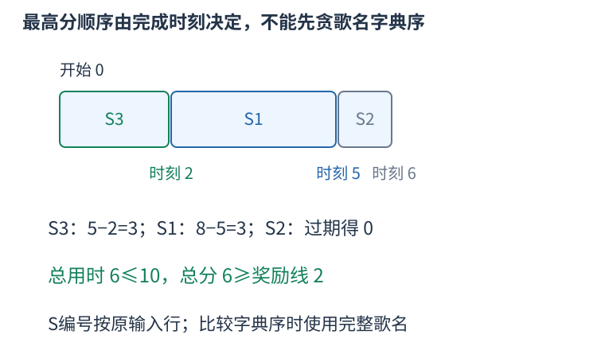

# P3947 集合确定已用时间，最优后缀的排名确定字典序 题解

## 目录

| 题号 | 题名 | 考点 | 难度 |
|---|---|---|---|
| A | 肝活动 | 状压 DP | 2100 |

## A. 肝活动

> 原题：[P3947](https://www.luogu.com.cn/problem/P3947)
> 解法：集合确定已用时间，最优后缀的排名确定字典序 · C++17

### 题意

每首歌恰好完成一次，得分为开放剩余时间减完成时刻与零的较大值；在活动期限内达到目标，输出最高分和字典序最小的完整歌名序列，否则输出No Answer。

<!-- reusable-foundations:start -->

### 从零讲：C++ 输入输出：把数据读进变量，把结果写到标准输出

程序运行时从标准输入接收题目给的数据，把答案送到标准输出。`cin` 和 `cout` 定义在 `<iostream>`；写 `using namespace std;` 后可以省略它们前面的 `std::`。最小完整程序是：

```cxx
#include <iostream>
using namespace std;
int main() {
    int a, b;
    cin >> a >> b;
    cout << a + b << '\n';
    return 0;
}
```

输入二十和三十，两个变量分别保存二十、三十，输出五十。`int a, b;` 声明两个整数变量；`cin >> a` 才给变量赋入输入值。多个 `>>` 从左到右读取，读取整数时会跳过空格、制表符、换行，所以两个整数可以分处两行。负号属于整数，不需要另读一个符号。

`cout <<` 后可以接数值、字符或字符串。`' '` 是一个空格字符，`'\n'` 是换行字符，`"Hello"` 是字符串。`cout << a << ' ' << b << '\n';` 输出两个以空格分开的整数并换行。评测程序只需要答案，不应加入“请输入”等提示。

读取 `char c; cin >> c;` 会跳过前导空白。要读取包含空格的一整行，用 `<string>` 中的 `string s; getline(cin, s);`。若此前用 `cin >> n` 读取过整数，换行还留在输入中，需要先处理那一个剩余换行；不能盲目把所有空格都删掉，因为字符画的行首空格和文本中的空格可能就是数据。

`fixed << setprecision(3)`（需要 `<iomanip>`）表示以小数形式保留三位小数，例如把 $2.5$ 输出成 $2.500$；不用 `fixed` 时，`setprecision` 指有效数字总数。设置会影响后续输出，使用前应确认所需精度。

竞赛中可在首次输入输出前调用 `ios::sync_with_stdio(false); cin.tie(nullptr);`，减少 C++ 流与 C 标准输入输出的同步、绑定开销。随后保持使用 `cin/cout`，不要混用另一套 `scanf/printf`。交互题还要在需要对方回应前主动刷新，例如 `cout << query << endl;`；普通题用换行字符即可。

读入长度为 $L$ 的文本、或输出 $L$ 个字符，至少需要 $O(L)$ 时间。数据类型仍要能容纳结果：把两个整数相乘时，即使保存到 `long long`，也要让乘法本身在这个类型中进行，例如先把输入声明为 `long long`。

### 从零讲：分支与循环：按条件选择，按次序重复

`if (条件) { ... } else { ... }` 根据条件的真假选择一条分支。比较运算 `==`、`!=`、`<`、`<=`、`>`、`>=` 返回真假值；`=` 是赋值，不能代替相等比较。`&&` 表示两边都成立，`||` 表示至少一边成立，`!` 把真假反转。

```cxx
int score = 85;
if (score >= 90) cout << "A";
else if (score >= 60) cout << "B";
else cout << "C"; // 这个例子输出 B
```

这条分支链只执行第一个符合条件的分支。先处理高分后，第二个条件自然只会接到低于九十分的数。几个独立的 `if` 则可能执行多次；两种结构代表不同问题。逻辑运算会短路：`i < n && a[i] == 0` 先确认下标合法，才读取那一格。

`for (初始化; 继续条件; 每轮更新)` 适合知道重复范围的情况。例如下列代码依次处理一到四，总和是十：

```cxx
int sum = 0;
for (int i = 1; i <= 4; ++i) {
    sum += i;
}
cout << sum;
```

初始化只做一次；每轮先判断条件，条件为真才执行循环体，随后执行更新。`++i` 把 $i$ 加一，`sum += i` 等价于把旧 sum 加 $i$ 再保存。应明确每个变量在循环前、循环后分别表示什么；最大值相同时是否更新，决定了保留较早还是较晚的答案。

`while (条件)` 适合“不满足目标就再做一步”：

```cxx
int x = 13, times = 0;
while (x > 1) {
    x /= 2;
    ++times;
}
// x 依次是 13、6、3、1，执行三次
```

循环开始前先检查条件，初始已满足目标时可能一次也不执行。每次执行必须推进状态，否则可能无限循环。`break` 结束最内层循环，`continue` 跳过本轮剩余部分；`for` 中的 continue 之后仍会执行每轮更新。

复杂度由实际执行次数决定。上述求和执行 $n$ 次是 $O(n)$；每次将正整数减半只执行 $O(\log n)$ 次。两层循环不能仅凭外观判定为平方：内层若总共只前进 $n$ 次，总量仍可能线性。变量应在正确作用范围初始化；多组数据的计数器若未重置，下一组会错误继承上一组结果。

### 从零讲：vector：长度可变的连续数组

`vector<T>` 保存一串同类型的元素，适合按下标访问、扫描、排序。`T` 是元素类型，例如 `vector<int>` 保存整数，`vector<pair<int,int>>` 保存整数对，`vector<vector<int>>` 可保存每个顶点各自的邻居。需要 `<vector>`。

```cxx
vector<int> a(3, 7);   // 三个元素，内容是 7、7、7
a.push_back(9);       // 在末尾追加，现在长度为 4
int x = a[1];         // 从 0 编号，这里得到 7
a[1] = 2;            // 改第二个元素
int n = int(a.size());
```

`vector<int> a(3)` 创建三个值为零的元素；`a.reserve(3)` 只预留容量，元素数仍为零，此时不能访问 `a[0]`。长度 `size()` 与容量 `capacity()` 是不同概念。

下标访问为 $O(1)$，遍历为 $O(n)$。末尾追加通常为 $O(1)$；容量不足时会分配更大的连续空间并搬移元素，这次可能为 $O(n)$，一连串追加的平均成本称为摊还 $O(1)$。中间插入或删除会搬移后续元素，最坏 $O(n)$。内存是元素量的 $O(n)$，并可能预留部分尚未使用的容量。

`begin()` 指向首元素，`end()` 指向尾后位置，`sort(a.begin(),a.end())` 操作整个数组。`a[i]` 不检查越界；下标须满足 $0\le i<\mathrm{size}$。`at(i)` 会检查越界并抛异常。空数组不能访问 `front()`、`back()`；`pop_back()` 也要求非空。

扩容后指向旧存储的迭代器、引用和指针会失效。遍历的同时 `push_back`，不能假定此前取得的引用仍可用。读取大数组的函数常用 `const vector<int>& a` 按常量引用传入，既不复制也禁止通过该引用修改；`vector<int> a` 按值传参则复制内容。选择副本还是引用取决于是否要保留独立数据。

### 从零讲：整数类型、整除与溢出

计算前先看每一步可能达到的范围。常见环境中 `int` 是 32 位，上界约 $2.1\times10^9$；`long long` 至少 64 位，常见有符号 64 位上界约 $9.22\times10^{18}$。`using ll = long long;` 只是为已有类型起别名。

```cxx
int a = 100000, b = 100000;
long long wrong = a * b;      // 右边先按 int 乘，可能已溢出
long long right = 1LL * a * b; // 先把运算提升到 long long
```

不能指望“接收结果的变量够大”修复此前已经溢出的计算。先提高操作数类型，再做乘法。超过 64 位时，GCC 的 `__int128` 可作中间量，但它不是标准 C++17 类型，也没有标准流输出重载；先证明范围，再选择工具。

整数 `/` 对有符号数向零截断：`7/3==2`、`-7/3==-2`。对非负数才等于向下取整。余数满足 `a == (a/b)*b + a%b`，除数不能为零；要将余数归入 $[0,m-1]$（$m>0$），可用 `(a % m + m) % m`，同时保证中间加法不溢出。

非负 $a$、正 $b$ 的向上取整可写 `a/b + (a%b != 0)`，比 `(a+b-1)/b` 更容易避免加法溢出。比较平方时也应在宽类型内计算；浮点数不适合作为大整数相等的默认判断方式。

`size()` 返回无符号类型。空容器上写 `size()-1` 会绕到很大的数，逆序遍历可以先转成有符号、确认长度，或使用逆向迭代器。`abs` 对最小有符号数无法在同类型中表达其正值，需先约束输入差值范围。一般机器整数运算按常数时间估算，宽类型解决表示范围，不改变算法的增长阶。

### 从零讲：具名函数：给可复用计算一个明确接口

函数把一段计算包装成“输入参数 → 返回结果”。例如判断整数是否为偶数：

```cxx
bool even(int x) {
    return x % 2 == 0;
}
int main() {
    bool a = even(8); // a 为 true
    bool b = even(7); // b 为 false
}
```

`bool` 是返回类型，`even` 是函数名，`int x` 是参数声明。调用 `even(8)` 时，实参八传入这个新调用的局部变量 $x$，执行 return 后把真假值交回调用处。定义本身不执行计算，只有调用才执行。函数应在调用处之前定义，或提前写声明。

普通数值参数按值传递，函数里修改 $x$ 不会改变调用者原变量。参数写成 `int &x` 时才引用调用者对象；必须让这个对象在调用期间有效。`const vector<int>& a` 用引用避免复制整个容器，并承诺不通过这个引用修改它。返回局部变量的值是安全的，返回局部变量的引用则在函数结束后失效。

函数名应说明它回答的问题，调用处负责传哪些数据。例如闰年判定只接收一个年份并返回真假，枚举年份范围和输出格式由调用者处理。同一判定被多次使用时，这能减少规则不一致；但函数包装不会自动降低算法复杂度，仍要把每次调用实际做的工作计入时间。

如果函数内部又调用自身，就是递归，需要明确最小情况如何直接返回、每次调用如何逼近它；递归会占用调用栈。普通辅助函数可以不使用递归，不应仅因写成函数就称作递归算法。

### 从零讲：位运算：把非负整数看成一组二进制开关

五写成二进制为 $0101_2$，三为 $0011_2$。同一列各代表一位：按位与 `&` 两边都为一才得一，按位或 `|` 任一为一就得一，按位异或 `^` 不同才为一。所以 $5\mathbin{\&}3=1$，$5\mathbin{|}3=7$，$5\mathbin{\oplus}3=6$。


`1ULL << k` 把一移到第 $k$ 位。对非负无符号整数，`(mask >> k) & 1ULL` 读该位，`mask | (1ULL<<k)` 置一，`mask & ~(1ULL<<k)` 清零，`mask ^ (1ULL<<k)` 翻转。最低位编号为零。

```cxx
unsigned long long mask = 5; // 第 0、2 位为一
bool has = (mask >> 2) & 1ULL; // true
mask |= 1ULL << 1;             // 变成 7
```

位移次数必须小于类型位宽，且不能为负；不要用普通 `1` 去移到超出 int 范围的位置。C++17 有符号负数右移和溢出的规则不适合直接套“乘除二的幂”，用明确范围的无符号数更容易保证行为。`^` 是异或，绝不是乘方。

逻辑与 `&&`、逻辑或 `||` 将整体条件视为真假，并会短路；按位 `&`、`|` 逐位计算，不会因此跳过右侧表达式。运算符优先级可能与直觉不同，写 `(mask & bit) != 0`，别省掉关键括号。

固定机器字内的一次位运算按 $O(1)$ 估算；枚举全部 $k$ 位状态仍有 $2^k$ 种，不能因为每次运算快就忽略状态数。`x & (x-1)` 对正无符号数清掉最低的一位；GCC 的 `__builtin_popcountll(x)` 统计一的数量，注意实参位宽与具体编译器支持。

### 从零讲：动态规划：保存明确子问题的答案

若多个决策会反复遇到相同的剩余问题，可以为每个不同问题保存一次答案。状态不是“当前操作到了哪儿”的模糊描述，而是一个有完整条件、能独立提问的问题。

例如台阶一次走一或二级，求到达第 $i$ 级的方式数。令 $f_i$ 为恰好到第 $i$ 级的方案数。最后一步只有两类：从 $i-1$ 走一级，或从 $i-2$ 走两级，类别互斥且覆盖所有方案，所以 $f_i=f_{i-1}+f_{i-2}$。


起点 $f_0=1$ 表示原地不走的一种空方案，$f_1=1$。于是 $f_2=2,f_3=3,f_4=5$。从小到大计算，因为当前格依赖的格都已经完成。`f[0]=0` 会把“空方案”错误删掉。

```cxx
vector<long long> f(n + 1, 0);
f[0] = 1;
for (int i = 1; i <= n; ++i) {
    f[i] = f[i - 1];
    if (i >= 2) f[i] += f[i - 2];
}
```

另一个问题若问最小费用，就应对候选取 `min`；问最大收益取 `max`；问数量才在不重不漏的分类下相加。不能只把加号替换掉，初值也要随状态含义重新决定。不可达状态应与合法的零答案区别。

时间通常为状态数乘每个状态枚举的转移数，本例 $O(n)$；保存整表用 $O(n)$。只依赖最近两格时可滚动到 $O(1)$ 空间，但要先保存仍需读取的旧值。若下标不够决定后续可选动作，就缺少状态维度，不能把不同问题混在同一格。

检查一份 DP 时依次核对：状态的问题、基础答案、最后一步分类、依赖计算顺序、最终读哪一格。记忆化搜索使用同样的子问题，只是按递归需要计算；它也需要终止条件并避免状态依赖成环。

### 从零讲：状态压缩与记忆化：把集合也作为状态的一部分

对象数量很少、每个只区分选或没选时，可用二进制位表示集合。第 $k$ 位为一代表第 $k$ 项在集合里，三项的全部集合为掩码零到七。

例如掩码五的二进制是 $101_2$，表示选第零、第二项。`mask | (1<<k)` 加入 $k$，`(mask>>k)&1` 判断是否已经选，状态数量为 $2^n$，不是 $n$。

一个常见状态 `dp[mask][last]` 表示恰好访问 mask 中的顶点、最后停在 last 的最小费用。只存 mask 不足以确定下一条边的代价，因为不同终点的后续选择不同。起点状态为零，其余为不可达；尝试加入尚未选的 next，更新对应新集合和终点。

状态数 $O(n2^n)$，每个枚举 $n$ 个下一步时为 $O(n^2 2^n)$，表空间 $O(n2^n)$。$n$ 稍增，指数即成为瓶颈；位运算为常数不意味着整体线性。位移不能越过整型位宽。

记忆化按“需要某状态才计算”的方式保存结果。不能用零兼作“尚未计算”，因为零可能是合法最优值或方案数；单独保存访问状态。缓存键要包含每个影响未来的条件，若函数还读取会变化的外部数组，旧缓存可能不再对应同一个问题。

数位 DP 将数字按位构造，状态常有位置、是否仍受上界限制、是否已开始、问题所需的余数或计数。前导零是否算有效数字需按题意定义，带 tight 的状态不能随意跨不同上界复用。区间 DP 则按区间长度增加，保证读取的子区间已完成；两类 DP 的具体状态仍须从目标推导，不能只换数组名字。

### 从零讲：string：字符、下标与子串

`string` 保存字符序列。`string s="abca";` 的长度为四，下标从零开始，`s[0]=='a'`、`s[3]=='a'`。字符用单引号，字符串用双引号；二者类型不同。需要 `<string>`。

`cin >> s` 读到空白停止；整行含空格时使用 `getline`，并留意前一次格式化输入残留的换行。`s.size()` 是字符单元数量，不一定等于 UTF-8 中文字数；竞赛英文小写字母题通常一个字符对应一个单元。

```cxx
string s = "abca";
string middle = s.substr(1, 2); // 从下标 1 开始取 2 个字符，得到 bc
size_t pos = s.find('c');       // 得到 2；找不到是 string::npos
if (pos != string::npos) cout << s[pos];
```

`substr(start,length)` 的第二项是长度，不是右端点。普通下标访问为 $O(1)$；复制长为 $k$ 的子串需要 $O(k)$ 时间和空间，循环里反复截取可能累积成平方成本。字符串比较按第一个不同字符决定字典序，公共前缀可能需要线性比较。

常见字符转数字是 `c-'0'`，前提 `c` 在 `'0'` 到 `'9'`。修改原串可用 `for(char& c:s)`，只读使用 `char c`。`reverse(s.begin(),s.end())` 原地翻转；若还需要原串，应先复制。空串不能访问首尾，尾后位置不能当普通字符读取。

### 从零讲：sort 与比较器：先建立统一的顺序

排序把原来任意排列的数据，按照可比较的键整理成有序序列，便于查边界、比较相邻项和按顺序处理。头文件 `<algorithm>`；普通数组和 `vector` 可用 `sort(first,last)`，范围为左闭右开。

```cxx
vector<int> a{5, 2, 5, 1};
sort(a.begin(), a.end());     // 变成 1、2、5、5，重复值仍保留
sort(a.begin(), a.end(), greater<int>());  // 降序
```

`sort` 时间 $O(n\log n)$，不是每次比较都扫描整个数组。C++ 标准规定复杂度要求，不规定必须使用某一固定内部排序实现，不能统一称它为快速排序。

对 `pair`，默认先比较 `first`，相同再比较 `second`，都是升序。自定义比较器 `cmp(a,b)` 返回真表示“$a$ 必须排在 $b$ 前面”。例如按分数降序、同分按编号升序：

```cxx
sort(students.begin(), students.end(), [](const auto& a, const auto& b) {
    if (a.score != b.score) return a.score > b.score;
    return a.id < b.id;
});
```

规则必须自洽：元素不能排在自己前面，不能出现 $a$ 在 $b$ 前、$b$ 在 $c$ 前、$c$ 又在 $a$ 前的循环。`<=` 会让相同元素也必须互相在前，因此不是合法的严格比较器。排序过程中也不能改变比较依据。

排序会改变原位置；若编号或两项的配对有意义，应将完整记录一起排序或另存查询副本，不能把两个相关字段各自排序后继续当作原配对。普通 `sort` 不保证同键元素保持输入先后；确需稳定顺序时用 `stable_sort` 或将原编号纳入比较键。排序只建立顺序，不能代替贪心策略的正确性证明。

### 从零讲：pair、tuple 与结构化绑定

有些数据天然需要成组：一个区间有两个端点，一个队列状态有坐标和距离。`pair<A,B>` 保存两项，用 `.first`、`.second` 读取；`tuple<A,B,C>` 可保存更多项，用 `get<0>(t)` 等读取。分别需要 `<utility>`、`<tuple>`。

C++17 的结构化绑定能为一组分量起局部名字：

```cxx
pair<int,int> point{3, 5};
auto [x, y] = point;      // 复制出两个分量
x = 9;                  // point.first 仍为 3
auto& [u, v] = point;    // 绑定原对象的分量
u = 7;                  // point.first 变为 7
```

`for (auto [l,r] : segments)` 每轮读取一对值；`for (const auto& [l,r] : segments)` 以只读引用读取，避免复制；需要修改原记录时才用 `auto&`。引用必须在原对象还存在且位置未失效时使用。

`pair` 和 `tuple` 的默认比较是字典序：从第一项起，第一个不同的分量决定顺序。`priority_queue<pair<int,int>>` 因而先比较第一项，再以第二项破同分，不能误认为只看第一项。这类语法只让记录组织和访问更清楚，拆分本身的成本取决于分量是否需要复制。

### 从零讲：无符号六十四位整数与模二的六十四次方

`<cstdint>` 的 `uint64_t` 是恰好六十四位的无符号整数类型，取值范围从零到 $2^{64}-1$。这类精确宽度别名在平台具有相应整数类型时提供；本项目使用的 GNU C++17 目标平台支持它。与 `long long` 的常见有符号范围相比，它不保存负数，最高位也参与表示非负数值。

#### 加法回绕是语言规则

无符号整数的加、减、乘会按其位数对应的二次幂取模。最大值加一得到零，零减一得到最大值。六十四位无符号数因此正好进行模 $2^{64}$ 运算，前提是操作本身在这个类型中发生。

```cxx
#include <cstdint>
#include <limits>
using namespace std;
int main() {
    uint64_t top = numeric_limits<uint64_t>::max();
    uint64_t zero = top + uint64_t(1);
    uint64_t wrapped = uint64_t(0) - uint64_t(1);
    uint64_t product = uint64_t(1000000000) * uint64_t(1000000000);
    // zero 为零，wrapped 等于 top，product 为 10^18。
}
```

不能先用 int 相乘，再存到 `uint64_t`：右侧可能早已按 int 溢出。有符号溢出也不能代替这条回绕规则；C++ 对有符号溢出没有规定应得到模值。需要的是模 $2^{64}$ 时，让两边操作数及累计量都使用对应的无符号类型，而不是等到最后再转换。

#### 模值不能用来比较真实大小

回绕保留的是余数，不再保留原数的大小关系。最大值加一的数学结果比最大值大，但保存的余数零却小于它。因此最小费用、大小排序和贪心判断应先根据不会回绕的真实量完成，最后仅对累加的答案使用模运算。

不要写 `1ULL << 64` 生成模数：移位数量必须小于左操作数的位宽，移六十四位不合法。也不需要显式写出无法用 `uint64_t` 保存的 $2^{64}$；让无符号算术自然取模即可。一般只计算机器宽度的运算，单次时间与空间均为 $O(1)$。

<!-- reusable-foundations:end -->

### 思路




每首只唱一次，所有歌曲的总时长与顺序无关；若它已经超过活动剩余时间，无论怎样排序都失败。顺序只改变每首完成的时刻，进而改变得分，不能因为某首过了开放时间就不唱它。

设$elapsed[S]$为唱完集合S的总时长，$f[S]$为从这时开始，把其余歌全部唱完最多还能赚的分。下一首选$j$，完成时刻是$elapsed[S]$加$T_j$，本次分数为$M_j$减这个时刻与零取较大；再加f[S并入$j$]，全部候选取最大。

全集之后没有歌，$f$[全集]为零；按掩码从大到小计算，来源都是增加了一位的更大集合。最后$f$[空集]便是最高分，若它仍小于奖励线，也要输出无解。

还要在最优总分内选歌名序列的字典序最小者。只看能达到$f[S]$的下一首。若下一歌名不同，较小者立即更好；如果名字相同，则要比较后续序列，不能仅因输入编号较小就决定。题面没有必要的重名限制，程序也不依赖这一假定。

按剩余歌曲数逐层处理，每个下一状态的最优后缀已经有排名rank。一个候选序列可以用二元组“下一歌名的编号、下一状态后缀排名”比较；取最小二元组，同时记录选哪首歌。将本层这些二元组排序、相同者赋相同排名，便得到本层正确的后缀字典序。

代码用无符号六十四位整数保存二元组：名字编号放高三十二位，后缀排名放低三十二位。两个编号都小于二的三十二次方，高段比较先决定名字先后，高段相同才比较低段，所以整数比较正好等于二元组的字典序。

歌名已经按字典序输入，可先给连续相同名字赋相同编号。排名只在同长度的序列间比较，不同层各自重新从零编号。根状态记录的选择再接着下一状态的选择，得到完整最优输出。

总共有二的$n$次方个集合；排序总成本不超过状态数乘其对数，也在$n$乘二的$n$次方量级。时间表用题面保证不溢出的int，总分用long long，避免在收益相加时缩窄。

歌名最大长度L，时间 $O(n2^n+nL)$，空间 $O(2^n+nL)$；按常数次机器字比较排名二元组。

### 参考代码

```cpp
#include <bits/stdc++.h>
using namespace std;

int main() {
    ios::sync_with_stdio(false);
    cin.tie(nullptr);
int n;long long target,deadline;cin>>n>>target>>deadline;
vector<string>name(n);vector<int>duration(n),open(n),nameRank(n);long long totalTime=0;
for(int i=0;i<n;++i){cin>>name[i]>>duration[i]>>open[i];totalTime+=duration[i];if(i) nameRank[i]=nameRank[i-1]+(name[i]!=name[i-1]);}
if(totalTime>deadline){cout<<"No Answer\n";return 0;}
int states=1<<n,full=states-1;vector<int>elapsed(states);vector<unsigned char>count(states);vector<vector<int>>layer(n+1);
layer[0].push_back(0);
for(int mask=1;mask<states;++mask){
    int first=0;while(!(mask>>first&1)) ++first;int rest=mask^(1<<first);
    elapsed[mask]=elapsed[rest]+duration[first];count[mask]=count[rest]+1;layer[count[mask]].push_back(mask);
}
vector<long long>dp(states);
for(int mask=full-1;mask>=0;--mask) for(int j=0;j<n;++j) if(!(mask>>j&1)){
    long long gain=max(0LL,1LL*open[j]-elapsed[mask]-duration[j]);dp[mask]=max(dp[mask],gain+dp[mask|(1<<j)]);
}
if(dp[0]<target){cout<<"No Answer\n";return 0;}
vector<int>rank(states);vector<unsigned char>choice(states,255);
for(int used=n-1;used>=0;--used){
    vector<pair<unsigned long long,int>>keys;keys.reserve(layer[used].size());
    for(int mask:layer[used]){
        unsigned long long best=ULLONG_MAX;int selectedName=-1;
        for(int j=0;j<n;++j) if(!(mask>>j&1)){
            if(selectedName>=0&&nameRank[j]>selectedName) break;
            int next=mask|(1<<j);long long gain=max(0LL,1LL*open[j]-elapsed[mask]-duration[j]);
            if(gain+dp[next]!=dp[mask]) continue;
            unsigned long long key=(static_cast<unsigned long long>(nameRank[j])<<32)|static_cast<unsigned int>(rank[next]);
            if(key<best){best=key;choice[mask]=j;selectedName=nameRank[j];}
        }
        keys.push_back({best,mask});
    }
    sort(keys.begin(),keys.end());int current=0;
    for(size_t i=0;i<keys.size();++i){if(i&&keys[i].first!=keys[i-1].first) ++current;rank[keys[i].second]=current;}
}
cout<<dp[0]<<'\n';int mask=0;
while(mask!=full){int j=choice[mask];cout<<name[j]<<'\n';mask|=1<<j;}
    return 0;
}
```

### 易错点

全部歌曲都要完成；过开放期仅得零分；时间总和先判；分数仍需达线；同名时还要比较后缀；后缀排名只在同长度层内比较。

## 实测记录

本地 C++17 编译、2 组原站样例与 185 组独立边界/小域校验通过。
正文参考程序与源码逐字核对；没有向原站提交。
