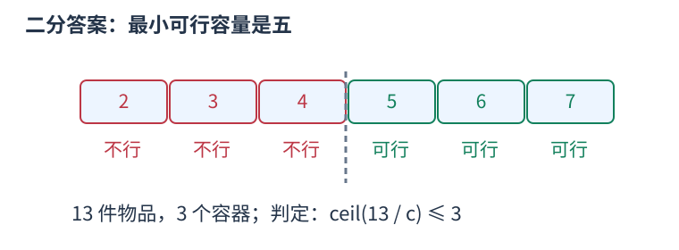
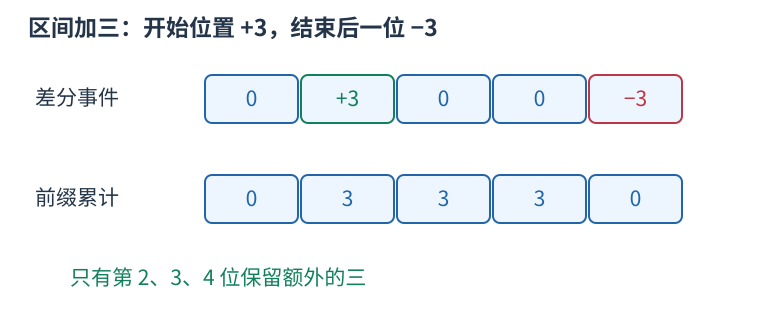
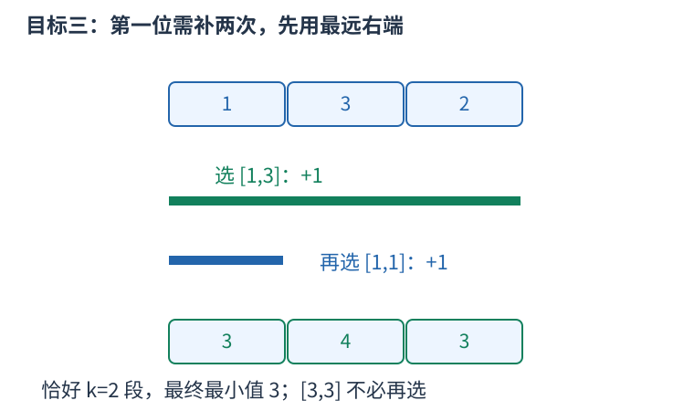

# P4064 二分最低值，缺多少次覆盖就选右端最远的可用区间 题解

## 目录

| 题号 | 题名 | 考点 | 难度 |
|---|---|---|---|
| A | 加法 | 二分查找 + 贪心 + 堆 | 2100 |

## A. 加法

> 原题：[P4064](https://www.luogu.com.cn/problem/P4064)
> 解法：二分最低值，缺多少次覆盖就选右端最远的可用区间 · C++17

### 题意

给定互异的可选区间，每段最多用一次，必须恰好选$k$段分别加相同正数，使最终最小元素最大。

<!-- reusable-foundations:start -->

### 从零讲：C++ 输入输出：把数据读进变量，把结果写到标准输出

程序运行时从标准输入接收题目给的数据，把答案送到标准输出。`cin` 和 `cout` 定义在 `<iostream>`；写 `using namespace std;` 后可以省略它们前面的 `std::`。最小完整程序是：

```cxx
#include <iostream>
using namespace std;
int main() {
    int a, b;
    cin >> a >> b;
    cout << a + b << '\n';
    return 0;
}
```

输入二十和三十，两个变量分别保存二十、三十，输出五十。`int a, b;` 声明两个整数变量；`cin >> a` 才给变量赋入输入值。多个 `>>` 从左到右读取，读取整数时会跳过空格、制表符、换行，所以两个整数可以分处两行。负号属于整数，不需要另读一个符号。

`cout <<` 后可以接数值、字符或字符串。`' '` 是一个空格字符，`'\n'` 是换行字符，`"Hello"` 是字符串。`cout << a << ' ' << b << '\n';` 输出两个以空格分开的整数并换行。评测程序只需要答案，不应加入“请输入”等提示。

读取 `char c; cin >> c;` 会跳过前导空白。要读取包含空格的一整行，用 `<string>` 中的 `string s; getline(cin, s);`。若此前用 `cin >> n` 读取过整数，换行还留在输入中，需要先处理那一个剩余换行；不能盲目把所有空格都删掉，因为字符画的行首空格和文本中的空格可能就是数据。

`fixed << setprecision(3)`（需要 `<iomanip>`）表示以小数形式保留三位小数，例如把 $2.5$ 输出成 $2.500$；不用 `fixed` 时，`setprecision` 指有效数字总数。设置会影响后续输出，使用前应确认所需精度。

竞赛中可在首次输入输出前调用 `ios::sync_with_stdio(false); cin.tie(nullptr);`，减少 C++ 流与 C 标准输入输出的同步、绑定开销。随后保持使用 `cin/cout`，不要混用另一套 `scanf/printf`。交互题还要在需要对方回应前主动刷新，例如 `cout << query << endl;`；普通题用换行字符即可。

读入长度为 $L$ 的文本、或输出 $L$ 个字符，至少需要 $O(L)$ 时间。数据类型仍要能容纳结果：把两个整数相乘时，即使保存到 `long long`，也要让乘法本身在这个类型中进行，例如先把输入声明为 `long long`。

### 从零讲：分支与循环：按条件选择，按次序重复

`if (条件) { ... } else { ... }` 根据条件的真假选择一条分支。比较运算 `==`、`!=`、`<`、`<=`、`>`、`>=` 返回真假值；`=` 是赋值，不能代替相等比较。`&&` 表示两边都成立，`||` 表示至少一边成立，`!` 把真假反转。

```cxx
int score = 85;
if (score >= 90) cout << "A";
else if (score >= 60) cout << "B";
else cout << "C"; // 这个例子输出 B
```

这条分支链只执行第一个符合条件的分支。先处理高分后，第二个条件自然只会接到低于九十分的数。几个独立的 `if` 则可能执行多次；两种结构代表不同问题。逻辑运算会短路：`i < n && a[i] == 0` 先确认下标合法，才读取那一格。

`for (初始化; 继续条件; 每轮更新)` 适合知道重复范围的情况。例如下列代码依次处理一到四，总和是十：

```cxx
int sum = 0;
for (int i = 1; i <= 4; ++i) {
    sum += i;
}
cout << sum;
```

初始化只做一次；每轮先判断条件，条件为真才执行循环体，随后执行更新。`++i` 把 $i$ 加一，`sum += i` 等价于把旧 sum 加 $i$ 再保存。应明确每个变量在循环前、循环后分别表示什么；最大值相同时是否更新，决定了保留较早还是较晚的答案。

`while (条件)` 适合“不满足目标就再做一步”：

```cxx
int x = 13, times = 0;
while (x > 1) {
    x /= 2;
    ++times;
}
// x 依次是 13、6、3、1，执行三次
```

循环开始前先检查条件，初始已满足目标时可能一次也不执行。每次执行必须推进状态，否则可能无限循环。`break` 结束最内层循环，`continue` 跳过本轮剩余部分；`for` 中的 continue 之后仍会执行每轮更新。

复杂度由实际执行次数决定。上述求和执行 $n$ 次是 $O(n)$；每次将正整数减半只执行 $O(\log n)$ 次。两层循环不能仅凭外观判定为平方：内层若总共只前进 $n$ 次，总量仍可能线性。变量应在正确作用范围初始化；多组数据的计数器若未重置，下一组会错误继承上一组结果。

### 从零讲：vector：长度可变的连续数组

`vector<T>` 保存一串同类型的元素，适合按下标访问、扫描、排序。`T` 是元素类型，例如 `vector<int>` 保存整数，`vector<pair<int,int>>` 保存整数对，`vector<vector<int>>` 可保存每个顶点各自的邻居。需要 `<vector>`。

```cxx
vector<int> a(3, 7);   // 三个元素，内容是 7、7、7
a.push_back(9);       // 在末尾追加，现在长度为 4
int x = a[1];         // 从 0 编号，这里得到 7
a[1] = 2;            // 改第二个元素
int n = int(a.size());
```

`vector<int> a(3)` 创建三个值为零的元素；`a.reserve(3)` 只预留容量，元素数仍为零，此时不能访问 `a[0]`。长度 `size()` 与容量 `capacity()` 是不同概念。

下标访问为 $O(1)$，遍历为 $O(n)$。末尾追加通常为 $O(1)$；容量不足时会分配更大的连续空间并搬移元素，这次可能为 $O(n)$，一连串追加的平均成本称为摊还 $O(1)$。中间插入或删除会搬移后续元素，最坏 $O(n)$。内存是元素量的 $O(n)$，并可能预留部分尚未使用的容量。

`begin()` 指向首元素，`end()` 指向尾后位置，`sort(a.begin(),a.end())` 操作整个数组。`a[i]` 不检查越界；下标须满足 $0\le i<\mathrm{size}$。`at(i)` 会检查越界并抛异常。空数组不能访问 `front()`、`back()`；`pop_back()` 也要求非空。

扩容后指向旧存储的迭代器、引用和指针会失效。遍历的同时 `push_back`，不能假定此前取得的引用仍可用。读取大数组的函数常用 `const vector<int>& a` 按常量引用传入，既不复制也禁止通过该引用修改；`vector<int> a` 按值传参则复制内容。选择副本还是引用取决于是否要保留独立数据。

### 从零讲：整数类型、整除与溢出

计算前先看每一步可能达到的范围。常见环境中 `int` 是 32 位，上界约 $2.1\times10^9$；`long long` 至少 64 位，常见有符号 64 位上界约 $9.22\times10^{18}$。`using ll = long long;` 只是为已有类型起别名。

```cxx
int a = 100000, b = 100000;
long long wrong = a * b;      // 右边先按 int 乘，可能已溢出
long long right = 1LL * a * b; // 先把运算提升到 long long
```

不能指望“接收结果的变量够大”修复此前已经溢出的计算。先提高操作数类型，再做乘法。超过 64 位时，GCC 的 `__int128` 可作中间量，但它不是标准 C++17 类型，也没有标准流输出重载；先证明范围，再选择工具。

整数 `/` 对有符号数向零截断：`7/3==2`、`-7/3==-2`。对非负数才等于向下取整。余数满足 `a == (a/b)*b + a%b`，除数不能为零；要将余数归入 $[0,m-1]$（$m>0$），可用 `(a % m + m) % m`，同时保证中间加法不溢出。

非负 $a$、正 $b$ 的向上取整可写 `a/b + (a%b != 0)`，比 `(a+b-1)/b` 更容易避免加法溢出。比较平方时也应在宽类型内计算；浮点数不适合作为大整数相等的默认判断方式。

`size()` 返回无符号类型。空容器上写 `size()-1` 会绕到很大的数，逆序遍历可以先转成有符号、确认长度，或使用逆向迭代器。`abs` 对最小有符号数无法在同类型中表达其正值，需先约束输入差值范围。一般机器整数运算按常数时间估算，宽类型解决表示范围，不改变算法的增长阶。

### 从零讲：具名函数：给可复用计算一个明确接口

函数把一段计算包装成“输入参数 → 返回结果”。例如判断整数是否为偶数：

```cxx
bool even(int x) {
    return x % 2 == 0;
}
int main() {
    bool a = even(8); // a 为 true
    bool b = even(7); // b 为 false
}
```

`bool` 是返回类型，`even` 是函数名，`int x` 是参数声明。调用 `even(8)` 时，实参八传入这个新调用的局部变量 $x$，执行 return 后把真假值交回调用处。定义本身不执行计算，只有调用才执行。函数应在调用处之前定义，或提前写声明。

普通数值参数按值传递，函数里修改 $x$ 不会改变调用者原变量。参数写成 `int &x` 时才引用调用者对象；必须让这个对象在调用期间有效。`const vector<int>& a` 用引用避免复制整个容器，并承诺不通过这个引用修改它。返回局部变量的值是安全的，返回局部变量的引用则在函数结束后失效。

函数名应说明它回答的问题，调用处负责传哪些数据。例如闰年判定只接收一个年份并返回真假，枚举年份范围和输出格式由调用者处理。同一判定被多次使用时，这能减少规则不一致；但函数包装不会自动降低算法复杂度，仍要把每次调用实际做的工作计入时间。

如果函数内部又调用自身，就是递归，需要明确最小情况如何直接返回、每次调用如何逼近它；递归会占用调用栈。普通辅助函数可以不使用递归，不应仅因写成函数就称作递归算法。

### 从零讲：二分答案：在单调的可行性分界处找最优值

当直接求最小答案困难，但给定候选值后可以检查是否可行，可以把优化问题转成判定。前提是可行性只有一道分界，而不是来回变化。

例如要容纳总量十三，每个容器最多装 $c$，只有三个容器。判定为 $\lceil13/c\rceil\le3$。容量三、四不可行，容量五、六及更大都可行，因为增大容量不会让已有装法失效。



要找最小可行值，可维护闭区间内仍可能的答案：

```cxx
int left = 1, right = 13; // 已知答案在此范围，right 可行
while (left < right) {
    int mid = left + (right - left) / 2;
    if (check(mid)) right = mid;
    else left = mid + 1;
}
int answer = left;
```

中点可行时，最优答案可能就是中点或更小，因此保留它；中点不可行时，所有更小值都不行，排除到中点为止。候选范围每轮缩半。若一次检查为 $T$，总时间为 $O(T\log R)$，$R$ 是初始候选数；额外空间来自检查函数和常数个边界。

开始前分别证明单调性、上下界和确有解。若上界也不可行，不能把二分最后停下的位置当作合法答案。求最大可行值时分界方向和取中点方式要配合修改。判定中的除法、乘法也可能溢出；非负向上整除可以写 `a/b+(a%b!=0)`。

二分不负责证明 `check` 正确，也不能降低一次检查本身的复杂度。与有序数组上的边界函数相比，这里的“数组”是候选答案的概念序列，不必真正生成所有候选。

### 从零讲：贪心：先证明当前选择不会丢掉最优解

贪心每一步确定一个局部选择，不再撤回。它能省去搜索，但必须解释为什么始终存在一个最优方案也做这个选择。

例如选择最多个互不重叠的活动（这里允许后一活动起点等于前一活动终点）。每次选结束最早的活动：若最优方案的首项结束更晚，把它换成最早结束者，后续原本能接的活动仍能接，数量不变。这就是交换论证；换完首项，剩余问题仍为同类问题。


实现时按结束时间升序排序，维护上一次选中活动的结束时刻，依次选合法项。排序 $O(n\log n)$，扫描 $O(n)$，保存活动为 $O(n)$。若题目不允许端点相接，判断须从大于等于改成严格大于。

“选最长”“选价值最高”“选最靠左”都是不同策略。没有交换、支配关系或不变量的依据，不能只凭排序键直觉宣布正确。比如有容量和价值的物品选择，眼前价值最高者可能挡住两个总价值更高的小物品。

写题解时说明被替换的是哪一项、替换后什么约束仍满足、目标为何不变差，并说明余下状态为何允许重复同样论证。若选择还影响未保存的条件，就可能需要更丰富的状态或动态规划。

### 从零讲：priority_queue：随时取出最高优先级

若数据不断加入，每次只关心当前最大或最小项，无需每次排序整个数组。`priority_queue<T>` 用堆维护这一项：`top()` 查看，`push(x)` 加入，`pop()` 移除顶部但不返回值。需要 `<queue>`。

```cxx
priority_queue<int> largest;
largest.push(3); largest.push(8); largest.push(5);
int x = largest.top(); // 8，默认大根堆
largest.pop();         // 移走 8，此后顶部为 5
priority_queue<int, vector<int>, greater<int>> smallest;
```

最后一行是小根堆；对由距离和顶点编号组成的 `pair` 使用相同配置，可优先取最小距离。堆只保证顶部最优，内部并非完整有序数组，也不能高效随意查中间某个值。

堆在逻辑上是完全二叉树，高度为 $O(\log n)$，插入上浮、删除下沉最多跨越这个高度。故 `push`、`pop` 为 $O(\log n)$，`top` 为 $O(1)$，空间 $O(n)$。访问或删除顶部之前必须非空。

需要更新某项优先级时，标准 `priority_queue` 没有直接修改接口。常见方法是插入新版，取出时检查它是否仍与外部最新记录相符，丢弃过期项；这会影响队列大小和总复杂度，须按实际插入次数计算。

### 从零讲：差分：把区间的变化写在两个边界

很多次操作都给一整段加同一个数，最后才需要所有位置的结果。逐项修改会重复扫描；差分只记录“从哪里开始多这一份、从哪里停止”。

定义 $D_1=a_1$，$D_i=a_i-a_{i-1}$。从左累计 $D$ 就能恢复 $a$。给闭区间 $[l,r]$ 加 $v$，仅需 $D_l$ 加 $v$、$D_{r+1}$ 减 $v$：第 $l$ 位开始，前缀多出 $v$；到第 $r+1$ 位，额外的一份被抵消。



例如五个零上给 $[2,4]$ 加三，差分事件为 $[0,3,0,0,-3]$，累计得到 $[0,3,3,3,0]$。两个标记不表示只修改了两个原元素。

```cxx
vector<long long> d(n + 2, 0);
d[l] += v;
d[r + 1] -= v;
long long current = 0;
for (int i = 1; i <= n; ++i) {
    current += d[i];
    // current 是该位置受到的总增量
}
```

$q$ 次区间加与最后恢复共 $O(n+q)$，空间 $O(n)$。如果初始数组非零，可先构造它的差分，或在恢复增量后加回原值。右边界要标在后一位，数组须留出 `n+1`；闭区间和半开区间的停止位置不能混用。

差分适合离线集中恢复。若每次操作后立刻查询任意位置，仅存差分并不能自动做到常数时间，需要动态前缀数据结构。坐标非常大但事件少时，应排序事件或离散化，不能按最大坐标盲目分配数组。

### 从零讲：sort 与比较器：先建立统一的顺序

排序把原来任意排列的数据，按照可比较的键整理成有序序列，便于查边界、比较相邻项和按顺序处理。头文件 `<algorithm>`；普通数组和 `vector` 可用 `sort(first,last)`，范围为左闭右开。

```cxx
vector<int> a{5, 2, 5, 1};
sort(a.begin(), a.end());     // 变成 1、2、5、5，重复值仍保留
sort(a.begin(), a.end(), greater<int>());  // 降序
```

`sort` 时间 $O(n\log n)$，不是每次比较都扫描整个数组。C++ 标准规定复杂度要求，不规定必须使用某一固定内部排序实现，不能统一称它为快速排序。

对 `pair`，默认先比较 `first`，相同再比较 `second`，都是升序。自定义比较器 `cmp(a,b)` 返回真表示“$a$ 必须排在 $b$ 前面”。例如按分数降序、同分按编号升序：

```cxx
sort(students.begin(), students.end(), [](const auto& a, const auto& b) {
    if (a.score != b.score) return a.score > b.score;
    return a.id < b.id;
});
```

规则必须自洽：元素不能排在自己前面，不能出现 $a$ 在 $b$ 前、$b$ 在 $c$ 前、$c$ 又在 $a$ 前的循环。`<=` 会让相同元素也必须互相在前，因此不是合法的严格比较器。排序过程中也不能改变比较依据。

排序会改变原位置；若编号或两项的配对有意义，应将完整记录一起排序或另存查询副本，不能把两个相关字段各自排序后继续当作原配对。普通 `sort` 不保证同键元素保持输入先后；确需稳定顺序时用 `stable_sort` 或将原编号纳入比较键。排序只建立顺序，不能代替贪心策略的正确性证明。

### 从零讲：lambda：完整例子、捕获规则与局部变量的生命周期

#### 它解决什么问题

一段操作在当前函数里需要调用多次，或者某个算法需要你提供“怎样比较”的规则，可以把这段操作写成 lambda。lambda 表达式产生一个可以像函数一样调用的对象；“匿名”指它没有普通函数声明中的函数名，仍可以用变量保存并命名。

```cxx
auto add = [](int a, int b) -> int {
    return a + b;
};
int answer = add(2, 3);  // 调用后得到 5；定义本身不会执行函数体
```

读法是：用 `auto` 保存对象；`[](){}` 中的方括号部分是捕获列表；圆括号是每次调用传入的参数；`-> int` 指定返回类型；花括号里写执行过程；定义后的分号结束赋值。返回类型能够推导时可省略，所以也常见 `auto add = [](int a,int b) { return a+b; };`。


#### 参数和捕获有什么区别

参数每次调用都由调用者提供；捕获让函数体使用定义位置附近的局部变量，调用时不用重复传它。例如阈值来自当前环境，待判断的值每次变化：

```cxx
int threshold = 10;
auto enough = [threshold](int value) {
    return value >= threshold;
};
bool a = enough(12);  // true，value 是本次传入的 12
```

这里 `threshold` 是捕获，`value` 是参数。常用的捕获方式如下：

| 写法 | 意思 | 适合的需要 |
|---|---|---|
| `[](){}` | 不捕获局部变量 | 只依赖参数的计算或比较 |
| `[x](){}` | 保存定义时 `x` 的副本 | 需要固定一份快照 |
| `[&x](){}` | 引用外面的 `x` | 读取最新值或修改原变量 |
| `[=](){}` | 按值捕获实际需要的局部变量 | 需要多个快照 |
| `[&](){}` | 按引用捕获实际需要的局部变量 | 当前作用域内的辅助函数 |
| `[&a, limit](){}` | 引用 `a`，复制 `limit` | 显式区分共享数据和快照 |

`[&](){}` 不是“把参数按引用传递”；是否按引用传参由圆括号里的 `int&`、`const vector<int>&` 等类型决定。全局变量可以直接访问，无需捕获。

#### 用可观察的结果区分复制与引用

```cxx
int base = 10;
auto snapshot = [base](int x) { return base + x; };
auto current = [&base](int x) { return base + x; };
base = 20;
int a = snapshot(1);  // 11：使用定义时保存的 10
int b = current(1);   // 21：使用外面的最新值 20
```

默认情况下不能在 lambda 内修改按值捕获的副本。加 `mutable` 才能修改副本，但仍不会改外面的原变量：`auto next = [base]() mutable { return ++base; };`。对大数组按值捕获可能复制整个数组；如果只在数组仍然存活时查询，显式引用可避免这份复制。

#### 两种常见用法

**局部辅助函数。** 把“给一个参数就求出结果”的操作命名后，主流程只写调用。外层数组保持原处，辅助函数按引用读取，能减少重复代码，并让环境依赖集中在定义附近。对多个调用位置修正一处逻辑即可。普通独立函数也能做到复用，但外层局部数据通常需要显式传参。

**作为算法的规则。** 把比较方式直接交给 `sort`，能在调用处看到排序依据：

```cxx
vector<pair<int,int>> items={{2,7},{1,2},{1,4}};
sort(items.begin(), items.end(), [](const auto& a, const auto& b) {
    if (a.first != b.first) return a.first < b.first;
    return a.second > b.second;
});
```

先按第一项升序，第一项相同时按第二项降序。比较器必须形成严格弱序，同一个元素与自己比较应为假；写成 `<=` 可能破坏排序前提。传 `const auto&` 可以避免每次比较都复制元素。

#### 递归时怎样引用自己

在 `auto f = ...` 的初始化表达式中不能直接假定 `f` 的类型已确定。C++17 可以把自己作为参数传进去：

```cxx
auto factorial = [](auto&& self, int n) -> long long {
    if (n <= 1) return 1;
    return n * self(self, n - 1);
};
long long value = factorial(factorial, 5);  // 120
```

也可先声明 `std::function<long long(int)> f` 再赋 lambda，通过引用调用 `f`；需要 `<functional>`。`std::function` 用统一类型包装可调用对象，便于存储和传递，但可能有间接调用、分配等额外开销。只在当前地方使用时，`auto` 常更直接。这些是组织代码的选择，不会改变原算法的复杂度。

#### 生命周期和复杂度

引用捕获不会延长被引用变量的生命。把引用局部数组的 lambda 返回到函数外，局部数组已经销毁，再调用就会访问失效对象；放入异步任务或长久保存时，也须检查这一点。必要时捕获一份拥有数据的副本，或设计明确的共享所有权。

调用一次 lambda 的时间取决于函数体：内部扫描 $n$ 个元素就是 $O(n)$，做两次有序数组二分就是 $O(\log n)$。创建时复制大容器还会有与数据量相关的成本。lambda 的优势是局部表达、复用和传递行为，本身不保证运行更快。

规范核对：[C++ 工作草案：捕获](https://eel.is/c++draft/expr.prim.lambda.capture)、[函数对象](https://eel.is/c++draft/function.objects)。示例均为 C++17 写法。

### 从零讲：pair、tuple 与结构化绑定

有些数据天然需要成组：一个区间有两个端点，一个队列状态有坐标和距离。`pair<A,B>` 保存两项，用 `.first`、`.second` 读取；`tuple<A,B,C>` 可保存更多项，用 `get<0>(t)` 等读取。分别需要 `<utility>`、`<tuple>`。

C++17 的结构化绑定能为一组分量起局部名字：

```cxx
pair<int,int> point{3, 5};
auto [x, y] = point;      // 复制出两个分量
x = 9;                  // point.first 仍为 3
auto& [u, v] = point;    // 绑定原对象的分量
u = 7;                  // point.first 变为 7
```

`for (auto [l,r] : segments)` 每轮读取一对值；`for (const auto& [l,r] : segments)` 以只读引用读取，避免复制；需要修改原记录时才用 `auto&`。引用必须在原对象还存在且位置未失效时使用。

`pair` 和 `tuple` 的默认比较是字典序：从第一项起，第一个不同的分量决定顺序。`priority_queue<pair<int,int>>` 因而先比较第一项，再以第二项破同分，不能误认为只看第一项。这类语法只让记录组织和访问更清楚，拆分本身的成本取决于分量是否需要复制。

<!-- reusable-foundations:end -->

### 思路




若某个目标最低值可达到，更低目标也可达到，二分最大可行目标。下界为原数组最小值；无论怎样选，一项至多被增加$k$次，所以上界可取原最小值加$k$乘$a$。

固定目标，从左到右保证每项达标。将左端不超过当前位置$i$的区间放入大根堆，堆按右端排列。它们尚未使用，其中右端小于$i$者已经过期，取用前弹掉。

已选区间对当前位置的覆盖次数为active，用到期差分维护：选右端$r$的区间时立刻active加一，并在$r$加一处减一。若$A[i]$加$a$乘active仍不足目标，按差额向上取整得到还需多少次覆盖。

每次补选右端最大的可用区间。交换证明要保留此前已经选定的集合：它们已让所有更早位置达标。若一个可行补全用较短区间覆盖当前$i$，可以把它换为贪心的更长右端区间；以前位置即使失去某次补全覆盖，也仍由已固定集合保证。当前位置及未来，替换者覆盖得不少。因此可以逐个让最优补全包含贪心选择。

每段只能选一次，取用后从堆删除。若堆空，当前项无法补足；若所需新增段使总选择数超过$k$，也直接失败。一次检查中区间各入堆一次、最多出堆一次，不是对每个位置重新枚举所有区间。

虽然题目必须恰好选$k$段，可行性检查只要求不超过$k$段。因为每次增加为正，剩余的未选互异区间可以任意补到$k$段，只会使元素更大，不会破坏已达到的目标。这一转化依赖$k$不超过$m$和正增加量，不能推广到负操作或强制不变的其它约束。

多组分别排序、建堆与差分；二分中重新建状态，不能沿用上次目标的选择。计算差额、乘法及二分端点用long long。

总时间 $O((n+m\log m)\log(ka+1)+m\log m)$，空间 $O(n+m)$。

### 参考代码

```cpp
#include <bits/stdc++.h>
using namespace std;

int main() {
    ios::sync_with_stdio(false);
    cin.tie(nullptr);
int tests;cin>>tests;while(tests--){int n,m,k;long long increment;cin>>n>>m>>k>>increment;vector<long long>a(n+1);for(int i=1;i<=n;++i) cin>>a[i];vector<pair<int,int>>intervals(m);for(auto &[l,r]:intervals) cin>>l>>r;sort(intervals.begin(),intervals.end());
auto feasible=[&](long long target){vector<int>expiration(n+2);priority_queue<int>ends;int next=0,active=0,used=0;for(int i=1;i<=n;++i){active+=expiration[i];while(next<m&&intervals[next].first<=i) ends.push(intervals[next++].second);long long shortage=target-a[i]-increment*active;if(shortage<=0) continue;long long need=(shortage+increment-1)/increment;if(used+need>k) return false;while(need--){while(!ends.empty()&&ends.top()<i) ends.pop();if(ends.empty()) return false;int r=ends.top();ends.pop();++active;++used;--expiration[r+1];}}return true;};
long long low=*min_element(a.begin()+1,a.end()),high=low+k*increment;while(low<high){long long middle=(low+high+1)/2;if(feasible(middle)) low=middle;else high=middle-1;}cout<<low<<'\n';}
    return 0;
}
```

### 易错点

区间各最多一次；先加入左端已到者；取右端最远者；过期区间不可用；新增选择计入$k$；正增加才可把至多补到恰好；每次检查重建。

## 实测记录

本地 C++17 编译、1 组原站样例与 183 组独立边界/小域校验通过。
正文参考程序与源码逐字核对；没有向原站提交。
