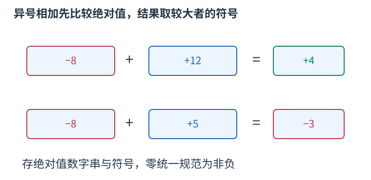
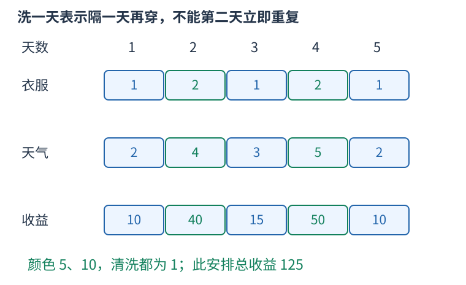

# P4928 按每件衣服还需等待的天数压缩状态，逐日选择 题解

## 目录

| 题号 | 题名 | 考点 | 难度 |
|---|---|---|---|
| A | 衣服？身外之物！ | 状压 DP + 高精度 | 2100 |

## A. 衣服？身外之物！

> 原题：[P4928](https://www.luogu.com.cn/problem/P4928)
> 解法：按每件衣服还需等待的天数压缩状态，逐日选择 · C++17

### 题意

每天必须穿一件未在清洗的衣服，收益为颜色值乘当天可正可负的天气；求全程最高总舒适度，必有一天无衣可穿则输出指定文字。

<!-- reusable-foundations:start -->

### 从零讲：C++ 输入输出：把数据读进变量，把结果写到标准输出

程序运行时从标准输入接收题目给的数据，把答案送到标准输出。`cin` 和 `cout` 定义在 `<iostream>`；写 `using namespace std;` 后可以省略它们前面的 `std::`。最小完整程序是：

```cxx
#include <iostream>
using namespace std;
int main() {
    int a, b;
    cin >> a >> b;
    cout << a + b << '\n';
    return 0;
}
```

输入二十和三十，两个变量分别保存二十、三十，输出五十。`int a, b;` 声明两个整数变量；`cin >> a` 才给变量赋入输入值。多个 `>>` 从左到右读取，读取整数时会跳过空格、制表符、换行，所以两个整数可以分处两行。负号属于整数，不需要另读一个符号。

`cout <<` 后可以接数值、字符或字符串。`' '` 是一个空格字符，`'\n'` 是换行字符，`"Hello"` 是字符串。`cout << a << ' ' << b << '\n';` 输出两个以空格分开的整数并换行。评测程序只需要答案，不应加入“请输入”等提示。

读取 `char c; cin >> c;` 会跳过前导空白。要读取包含空格的一整行，用 `<string>` 中的 `string s; getline(cin, s);`。若此前用 `cin >> n` 读取过整数，换行还留在输入中，需要先处理那一个剩余换行；不能盲目把所有空格都删掉，因为字符画的行首空格和文本中的空格可能就是数据。

`fixed << setprecision(3)`（需要 `<iomanip>`）表示以小数形式保留三位小数，例如把 $2.5$ 输出成 $2.500$；不用 `fixed` 时，`setprecision` 指有效数字总数。设置会影响后续输出，使用前应确认所需精度。

竞赛中可在首次输入输出前调用 `ios::sync_with_stdio(false); cin.tie(nullptr);`，减少 C++ 流与 C 标准输入输出的同步、绑定开销。随后保持使用 `cin/cout`，不要混用另一套 `scanf/printf`。交互题还要在需要对方回应前主动刷新，例如 `cout << query << endl;`；普通题用换行字符即可。

读入长度为 $L$ 的文本、或输出 $L$ 个字符，至少需要 $O(L)$ 时间。数据类型仍要能容纳结果：把两个整数相乘时，即使保存到 `long long`，也要让乘法本身在这个类型中进行，例如先把输入声明为 `long long`。

### 从零讲：分支与循环：按条件选择，按次序重复

`if (条件) { ... } else { ... }` 根据条件的真假选择一条分支。比较运算 `==`、`!=`、`<`、`<=`、`>`、`>=` 返回真假值；`=` 是赋值，不能代替相等比较。`&&` 表示两边都成立，`||` 表示至少一边成立，`!` 把真假反转。

```cxx
int score = 85;
if (score >= 90) cout << "A";
else if (score >= 60) cout << "B";
else cout << "C"; // 这个例子输出 B
```

这条分支链只执行第一个符合条件的分支。先处理高分后，第二个条件自然只会接到低于九十分的数。几个独立的 `if` 则可能执行多次；两种结构代表不同问题。逻辑运算会短路：`i < n && a[i] == 0` 先确认下标合法，才读取那一格。

`for (初始化; 继续条件; 每轮更新)` 适合知道重复范围的情况。例如下列代码依次处理一到四，总和是十：

```cxx
int sum = 0;
for (int i = 1; i <= 4; ++i) {
    sum += i;
}
cout << sum;
```

初始化只做一次；每轮先判断条件，条件为真才执行循环体，随后执行更新。`++i` 把 $i$ 加一，`sum += i` 等价于把旧 sum 加 $i$ 再保存。应明确每个变量在循环前、循环后分别表示什么；最大值相同时是否更新，决定了保留较早还是较晚的答案。

`while (条件)` 适合“不满足目标就再做一步”：

```cxx
int x = 13, times = 0;
while (x > 1) {
    x /= 2;
    ++times;
}
// x 依次是 13、6、3、1，执行三次
```

循环开始前先检查条件，初始已满足目标时可能一次也不执行。每次执行必须推进状态，否则可能无限循环。`break` 结束最内层循环，`continue` 跳过本轮剩余部分；`for` 中的 continue 之后仍会执行每轮更新。

复杂度由实际执行次数决定。上述求和执行 $n$ 次是 $O(n)$；每次将正整数减半只执行 $O(\log n)$ 次。两层循环不能仅凭外观判定为平方：内层若总共只前进 $n$ 次，总量仍可能线性。变量应在正确作用范围初始化；多组数据的计数器若未重置，下一组会错误继承上一组结果。

### 从零讲：vector：长度可变的连续数组

`vector<T>` 保存一串同类型的元素，适合按下标访问、扫描、排序。`T` 是元素类型，例如 `vector<int>` 保存整数，`vector<pair<int,int>>` 保存整数对，`vector<vector<int>>` 可保存每个顶点各自的邻居。需要 `<vector>`。

```cxx
vector<int> a(3, 7);   // 三个元素，内容是 7、7、7
a.push_back(9);       // 在末尾追加，现在长度为 4
int x = a[1];         // 从 0 编号，这里得到 7
a[1] = 2;            // 改第二个元素
int n = int(a.size());
```

`vector<int> a(3)` 创建三个值为零的元素；`a.reserve(3)` 只预留容量，元素数仍为零，此时不能访问 `a[0]`。长度 `size()` 与容量 `capacity()` 是不同概念。

下标访问为 $O(1)$，遍历为 $O(n)$。末尾追加通常为 $O(1)$；容量不足时会分配更大的连续空间并搬移元素，这次可能为 $O(n)$，一连串追加的平均成本称为摊还 $O(1)$。中间插入或删除会搬移后续元素，最坏 $O(n)$。内存是元素量的 $O(n)$，并可能预留部分尚未使用的容量。

`begin()` 指向首元素，`end()` 指向尾后位置，`sort(a.begin(),a.end())` 操作整个数组。`a[i]` 不检查越界；下标须满足 $0\le i<\mathrm{size}$。`at(i)` 会检查越界并抛异常。空数组不能访问 `front()`、`back()`；`pop_back()` 也要求非空。

扩容后指向旧存储的迭代器、引用和指针会失效。遍历的同时 `push_back`，不能假定此前取得的引用仍可用。读取大数组的函数常用 `const vector<int>& a` 按常量引用传入，既不复制也禁止通过该引用修改；`vector<int> a` 按值传参则复制内容。选择副本还是引用取决于是否要保留独立数据。

### 从零讲：整数类型、整除与溢出

计算前先看每一步可能达到的范围。常见环境中 `int` 是 32 位，上界约 $2.1\times10^9$；`long long` 至少 64 位，常见有符号 64 位上界约 $9.22\times10^{18}$。`using ll = long long;` 只是为已有类型起别名。

```cxx
int a = 100000, b = 100000;
long long wrong = a * b;      // 右边先按 int 乘，可能已溢出
long long right = 1LL * a * b; // 先把运算提升到 long long
```

不能指望“接收结果的变量够大”修复此前已经溢出的计算。先提高操作数类型，再做乘法。超过 64 位时，GCC 的 `__int128` 可作中间量，但它不是标准 C++17 类型，也没有标准流输出重载；先证明范围，再选择工具。

整数 `/` 对有符号数向零截断：`7/3==2`、`-7/3==-2`。对非负数才等于向下取整。余数满足 `a == (a/b)*b + a%b`，除数不能为零；要将余数归入 $[0,m-1]$（$m>0$），可用 `(a % m + m) % m`，同时保证中间加法不溢出。

非负 $a$、正 $b$ 的向上取整可写 `a/b + (a%b != 0)`，比 `(a+b-1)/b` 更容易避免加法溢出。比较平方时也应在宽类型内计算；浮点数不适合作为大整数相等的默认判断方式。

`size()` 返回无符号类型。空容器上写 `size()-1` 会绕到很大的数，逆序遍历可以先转成有符号、确认长度，或使用逆向迭代器。`abs` 对最小有符号数无法在同类型中表达其正值，需先约束输入差值范围。一般机器整数运算按常数时间估算，宽类型解决表示范围，不改变算法的增长阶。

### 从零讲：具名函数：给可复用计算一个明确接口

函数把一段计算包装成“输入参数 → 返回结果”。例如判断整数是否为偶数：

```cxx
bool even(int x) {
    return x % 2 == 0;
}
int main() {
    bool a = even(8); // a 为 true
    bool b = even(7); // b 为 false
}
```

`bool` 是返回类型，`even` 是函数名，`int x` 是参数声明。调用 `even(8)` 时，实参八传入这个新调用的局部变量 $x$，执行 return 后把真假值交回调用处。定义本身不执行计算，只有调用才执行。函数应在调用处之前定义，或提前写声明。

普通数值参数按值传递，函数里修改 $x$ 不会改变调用者原变量。参数写成 `int &x` 时才引用调用者对象；必须让这个对象在调用期间有效。`const vector<int>& a` 用引用避免复制整个容器，并承诺不通过这个引用修改它。返回局部变量的值是安全的，返回局部变量的引用则在函数结束后失效。

函数名应说明它回答的问题，调用处负责传哪些数据。例如闰年判定只接收一个年份并返回真假，枚举年份范围和输出格式由调用者处理。同一判定被多次使用时，这能减少规则不一致；但函数包装不会自动降低算法复杂度，仍要把每次调用实际做的工作计入时间。

如果函数内部又调用自身，就是递归，需要明确最小情况如何直接返回、每次调用如何逼近它；递归会占用调用栈。普通辅助函数可以不使用递归，不应仅因写成函数就称作递归算法。

### 从零讲：位运算：把非负整数看成一组二进制开关

五写成二进制为 $0101_2$，三为 $0011_2$。同一列各代表一位：按位与 `&` 两边都为一才得一，按位或 `|` 任一为一就得一，按位异或 `^` 不同才为一。所以 $5\mathbin{\&}3=1$，$5\mathbin{|}3=7$，$5\mathbin{\oplus}3=6$。


`1ULL << k` 把一移到第 $k$ 位。对非负无符号整数，`(mask >> k) & 1ULL` 读该位，`mask | (1ULL<<k)` 置一，`mask & ~(1ULL<<k)` 清零，`mask ^ (1ULL<<k)` 翻转。最低位编号为零。

```cxx
unsigned long long mask = 5; // 第 0、2 位为一
bool has = (mask >> 2) & 1ULL; // true
mask |= 1ULL << 1;             // 变成 7
```

位移次数必须小于类型位宽，且不能为负；不要用普通 `1` 去移到超出 int 范围的位置。C++17 有符号负数右移和溢出的规则不适合直接套“乘除二的幂”，用明确范围的无符号数更容易保证行为。`^` 是异或，绝不是乘方。

逻辑与 `&&`、逻辑或 `||` 将整体条件视为真假，并会短路；按位 `&`、`|` 逐位计算，不会因此跳过右侧表达式。运算符优先级可能与直觉不同，写 `(mask & bit) != 0`，别省掉关键括号。

固定机器字内的一次位运算按 $O(1)$ 估算；枚举全部 $k$ 位状态仍有 $2^k$ 种，不能因为每次运算快就忽略状态数。`x & (x-1)` 对正无符号数清掉最低的一位；GCC 的 `__builtin_popcountll(x)` 统计一的数量，注意实参位宽与具体编译器支持。

### 从零讲：动态规划：保存明确子问题的答案

若多个决策会反复遇到相同的剩余问题，可以为每个不同问题保存一次答案。状态不是“当前操作到了哪儿”的模糊描述，而是一个有完整条件、能独立提问的问题。

例如台阶一次走一或二级，求到达第 $i$ 级的方式数。令 $f_i$ 为恰好到第 $i$ 级的方案数。最后一步只有两类：从 $i-1$ 走一级，或从 $i-2$ 走两级，类别互斥且覆盖所有方案，所以 $f_i=f_{i-1}+f_{i-2}$。


起点 $f_0=1$ 表示原地不走的一种空方案，$f_1=1$。于是 $f_2=2,f_3=3,f_4=5$。从小到大计算，因为当前格依赖的格都已经完成。`f[0]=0` 会把“空方案”错误删掉。

```cxx
vector<long long> f(n + 1, 0);
f[0] = 1;
for (int i = 1; i <= n; ++i) {
    f[i] = f[i - 1];
    if (i >= 2) f[i] += f[i - 2];
}
```

另一个问题若问最小费用，就应对候选取 `min`；问最大收益取 `max`；问数量才在不重不漏的分类下相加。不能只把加号替换掉，初值也要随状态含义重新决定。不可达状态应与合法的零答案区别。

时间通常为状态数乘每个状态枚举的转移数，本例 $O(n)$；保存整表用 $O(n)$。只依赖最近两格时可滚动到 $O(1)$ 空间，但要先保存仍需读取的旧值。若下标不够决定后续可选动作，就缺少状态维度，不能把不同问题混在同一格。

检查一份 DP 时依次核对：状态的问题、基础答案、最后一步分类、依赖计算顺序、最终读哪一格。记忆化搜索使用同样的子问题，只是按递归需要计算；它也需要终止条件并避免状态依赖成环。

### 从零讲：状态压缩与记忆化：把集合也作为状态的一部分

对象数量很少、每个只区分选或没选时，可用二进制位表示集合。第 $k$ 位为一代表第 $k$ 项在集合里，三项的全部集合为掩码零到七。

例如掩码五的二进制是 $101_2$，表示选第零、第二项。`mask | (1<<k)` 加入 $k$，`(mask>>k)&1` 判断是否已经选，状态数量为 $2^n$，不是 $n$。

一个常见状态 `dp[mask][last]` 表示恰好访问 mask 中的顶点、最后停在 last 的最小费用。只存 mask 不足以确定下一条边的代价，因为不同终点的后续选择不同。起点状态为零，其余为不可达；尝试加入尚未选的 next，更新对应新集合和终点。

状态数 $O(n2^n)$，每个枚举 $n$ 个下一步时为 $O(n^2 2^n)$，表空间 $O(n2^n)$。$n$ 稍增，指数即成为瓶颈；位运算为常数不意味着整体线性。位移不能越过整型位宽。

记忆化按“需要某状态才计算”的方式保存结果。不能用零兼作“尚未计算”，因为零可能是合法最优值或方案数；单独保存访问状态。缓存键要包含每个影响未来的条件，若函数还读取会变化的外部数组，旧缓存可能不再对应同一个问题。

数位 DP 将数字按位构造，状态常有位置、是否仍受上界限制、是否已开始、问题所需的余数或计数。前导零是否算有效数字需按题意定义，带 tight 的状态不能随意跨不同上界复用。区间 DP 则按区间长度增加，保证读取的子区间已完成；两类 DP 的具体状态仍须从目标推导，不能只换数组名字。

### 从零讲：string：字符、下标与子串

`string` 保存字符序列。`string s="abca";` 的长度为四，下标从零开始，`s[0]=='a'`、`s[3]=='a'`。字符用单引号，字符串用双引号；二者类型不同。需要 `<string>`。

`cin >> s` 读到空白停止；整行含空格时使用 `getline`，并留意前一次格式化输入残留的换行。`s.size()` 是字符单元数量，不一定等于 UTF-8 中文字数；竞赛英文小写字母题通常一个字符对应一个单元。

```cxx
string s = "abca";
string middle = s.substr(1, 2); // 从下标 1 开始取 2 个字符，得到 bc
size_t pos = s.find('c');       // 得到 2；找不到是 string::npos
if (pos != string::npos) cout << s[pos];
```

`substr(start,length)` 的第二项是长度，不是右端点。普通下标访问为 $O(1)$；复制长为 $k$ 的子串需要 $O(k)$ 时间和空间，循环里反复截取可能累积成平方成本。字符串比较按第一个不同字符决定字典序，公共前缀可能需要线性比较。

常见字符转数字是 `c-'0'`，前提 `c` 在 `'0'` 到 `'9'`。修改原串可用 `for(char& c:s)`，只读使用 `char c`。`reverse(s.begin(),s.end())` 原地翻转；若还需要原串，应先复制。空串不能访问首尾，尾后位置不能当普通字符读取。

### 从零讲：字符串修改、数字转换与字符判断

处理文本时先区分三种对象：字符如 `'7'`、字符序列如 `"275"`、整数如 `275`。它们的表示和运算规则不同。字符减 `'0'` 只适用于单个十进制数字；多位数字可以用 `stoi` 或 `stoll` 转换。

```cxx
string s = "275";
int x = stoi(s);               // 得到整数二百七十五
long long y = stoll("10000000000");
string equation = s + "+125=" + to_string(x + 125);
// equation 为 275+125=400
```

`stoi` 返回 int，`stoll` 返回 long long；`to_string` 把整数转为十进制字符串，也会保留负号。转换读取十进制数字需要合法输入并且结果在返回类型范围内；非法或越界的转换会抛异常。题目保证格式正确时可以直接使用，处理不可信文本时应检查错误与是否完整消费了输入。转换长度为 L 的整数文本需要 $O(L)$ 时间。

`isdigit` 与 `tolower` 定义在 `<cctype>`。`isdigit(c)` 判断一个字符是不是数字，`tolower(c)` 把可转换的大写字母转成小写，其它字符保持不变。向这类函数传入普通 char 前，应先转成 unsigned char，避免负的 char 值超出接口允许范围：

```cxx
char c = 'A';
c = static_cast<char>(tolower(static_cast<unsigned char>(c))); // a
bool digit = isdigit(static_cast<unsigned char>('7'));         // true
```

下面的操作直接修改字符串；它们改变的是字符位置，不能把旧下标当成某个字符永远不变的身份：

```cxx
string text = "bcd";
text.insert(1, "XX"); // 在旧下标一之前插入，得到 bXXcd
text += "e";          // 追加，得到 bXXcde
text.pop_back();      // 删除末尾 e，恢复 bXXcd
char last = text.back(); // d，前提是非空
size_t where = text.find_first_of("./%"); // 没有这些字符，返回 npos
size_t first = string("00070").find_first_not_of('0'); // 三，从零编号
```

`find` 查找整个子串，`find_first_of` 查找给定字符集合中的任意一个，`find_first_not_of` 查找首个不在指定集合中的字符。这些函数返回位置或 `string::npos`，不是直接返回真假。合法的零号位置不能误判为“没有找到”；输出找不到时应显式处理 npos，不能依赖把无符号大数转换成负数。

`insert` 要移动插入点后面的字符，长度为 L 的串中插入 $k$ 个字符通常需要 $O(L+k)$ 时间，并可能重新分配存储，旧指针、引用和迭代器可能失效。删除末尾和读取 back 为常数操作，但都要求字符串非空。子串查找的最坏复杂度可能与文本长度和模式长度的乘积相关，不能一律写成常数或对数。

### 从零讲：结构体：把一个对象的相关数据保存在一起

结构体给一组不同类型的字段起一个整体类型名。例如一个学生有姓名和三科分数：

```cxx
struct Student {
    string name;
    int chinese, math, english;
};
Student a{"Lin", 90, 95, 92};
cout << a.name << ' ' << a.math; // Lin 95
```

`Student` 是新类型，$a$ 是这个类型的对象，点号选择对象中的某个字段。创建 `vector<Student> students(n)` 就能保存 $n$ 个学生，`students[i].math` 表示第 $i$ 个学生的数学分。这样一名学生的数据随对象一起移动，不会在排序时只移动姓名而忘记移动分数。

字段必须在使用前初始化或读入。`Student a{};` 会让字符串为空、整数为零；不加初始化的局部整数成员不能假定为零。字段名的访问本身为常数时间，但复制对象的成本取决于成员：复制很长的字符串会复制它的内容。只读取现有对象时可用 `const Student&` 避免复制。

结构体不会自动规定大小顺序。排序若要按分数降序、并列按姓名升序，需要另外提供满足严格弱序的比较函数。枚举输入已排序对象时，则可以直接沿用题目保证的顺序。先明确要比较的是对象的哪些字段，再决定是否需要排序。

### 从零讲：有符号十进制大整数：分开管理符号与绝对值

当输入整数没有足够小的范围保证时，先读成字符串，避免在读入阶段就溢出。下面的Number保存一个符号与不含前导零的绝对值数字串；零统一写成正号的"0"。这是整数的精确表示，不经过double近似。



Number是结构体名，与它同名且没有返回类型的成员是构造函数。`Number(text)` 从一段有可选正负号的十进制文本构造对象；默认构造则采用成员初值，得到零。运算后的对象也保持同样的规范，因此比较时不必再考虑"0003"与"3"这类重复表示。

比较先看正负号。符号相同时，绝对值位数较多者更大；位数相同才可直接按字符串字典序比较。两数均为负时，绝对值越大，实际数值反而越小。

加法分两类。同号时，从个位起逐位相加，记进位，结果保留共同符号；异号时，相当于用绝对值较大者减较小者，逐位借位，结果取绝对值较大者的符号。例如负八加十二得到四，负八加五得到负三，恰好抵消时重新规范成零。

乘一个32位整数时，将乘数先提升到long long，再求其绝对值，避免对int最小负数直接取反。逐位做“本位乘数加进位”，符号由两者是否异号决定。中间量至多约十倍乘数绝对值，在long long内；这不是任意两个大整数相乘的实现。

以下程序包含完整的规范化、比较、加法、绝对值减法和乘小整数。`const Number&` 只读引用避免每次调用先复制参数；返回Number的值则由调用者独立持有。

```cxx
#include <bits/stdc++.h>
using namespace std;
struct Number{
    string digits="0";bool negative=false;
    Number()=default;
    Number(string text){
        size_t pos=0;
        if(!text.empty()&&(text[0]=='-'||text[0]=='+')){negative=text[0]=='-';++pos;}
        while(pos<text.size()&&text[pos]=='0') ++pos;
        digits=pos==text.size()?"0":text.substr(pos);
        if(digits=="0") negative=false;
    }
};
int absoluteCompare(const string &a,const string &b){
    if(a.size()!=b.size()) return a.size()<b.size()?-1:1;
    return a==b?0:(a<b?-1:1);
}
bool lessNumber(const Number &a,const Number &b){
    if(a.negative!=b.negative) return a.negative;
    int order=absoluteCompare(a.digits,b.digits);
    return a.negative?order>0:order<0;
}
string absoluteAdd(const string &a,const string &b){
    string result;int i=int(a.size())-1,j=int(b.size())-1,carry=0;
    while(i>=0||j>=0||carry){
        int value=carry;if(i>=0) value+=a[i--]-'0';if(j>=0) value+=b[j--]-'0';
        result.push_back(char('0'+value%10));carry=value/10;
    }
    reverse(result.begin(),result.end());return result;
}
// 前提：a 不小于 b；两个参数都只含绝对值数字。
string absoluteSubtract(const string &a,const string &b){
    string result;int j=int(b.size())-1,borrow=0;
    for(int i=int(a.size())-1;i>=0;--i){
        int value=a[i]-'0'-borrow-(j>=0?b[j--]-'0':0);borrow=value<0;
        if(borrow) value+=10;result.push_back(char('0'+value));
    }
    while(result.size()>1&&result.back()=='0') result.pop_back();
    reverse(result.begin(),result.end());return result;
}
Number plusNumber(const Number &a,const Number &b){
    Number result;
    if(a.negative==b.negative){result.digits=absoluteAdd(a.digits,b.digits);result.negative=a.negative;}
    else if(absoluteCompare(a.digits,b.digits)>=0){result.digits=absoluteSubtract(a.digits,b.digits);result.negative=a.negative;}
    else{result.digits=absoluteSubtract(b.digits,a.digits);result.negative=b.negative;}
    if(result.digits=="0") result.negative=false;return result;
}
Number timesSmall(const Number &a,int multiplier){
    Number result;if(!multiplier||a.digits=="0") return result;
    result.negative=a.negative^(multiplier<0);long long factor=multiplier;if(factor<0) factor=-factor;
    long long carry=0;string digits;
    for(int i=int(a.digits.size())-1;i>=0;--i){
        long long value=(a.digits[i]-'0')*factor+carry;digits.push_back(char('0'+value%10));carry=value/10;
    }
    while(carry){digits.push_back(char('0'+carry%10));carry/=10;}
    reverse(digits.begin(),digits.end());result.digits=digits;return result;
}
int main() {
    Number a("-999999999999999999999999999999");
    Number b("1000000000000000000000000000000");
    Number sum = plusNumber(a, b);
    Number product = timesSmall(Number("-12345678901234567890"), -100000000);
    cout << (sum.negative ? "-" : "") << sum.digits << '\n';
    cout << (product.negative ? "-" : "") << product.digits << '\n';
    cout << lessNumber(Number("-10"), Number("-2")) << '\n';
}
```

第一行是精确的一；第二行是两个负数相乘得到的正整数1234567890123456789000000000；第三行是一，表示负十确实小于负二。不会先把大数塞进机器整数再试图补救。

各次比较或加减处理至多L位，时间$O(L)$，结果空间$O(L)$；乘小整数处理L位及有限个末尾进位，也是$O(L)$时间，空间按实际结果位数计。若累加很多次，L应取过程中实际最大位数，而不只取最初输入长度。

这个类型没有用某个数字值表示“状态不存在”。把它用于优化或路径状态时，应另外保存可达标记；零和负数都可能是合法答案。它也没有实现除法、任意大整数乘法或自动类型转换，使用的操作必须确实在这里定义。

### 从零讲：数值工具：连续编号、累加与最值

这些工具分别处理“填连续编号”“合并数值”“比较候选”，使用前要看返回类型和范围。`iota`、`accumulate` 在 `<numeric>`，`min`、`max` 在 `<algorithm>`。

```cxx
vector<int> id(4);
iota(id.begin(), id.end(), 0); // 0、1、2、3，容器本来就要有 4 项
vector<int> a{1000000000, 1000000000, 1000000000};
long long sum = accumulate(a.begin(), a.end(), 0LL); // 3000000000
int best = max(3, 7); // 返回 7，不会修改原参数
```

`accumulate` 的初始值决定累加器类型；写零会先按 `int` 累加，即使最终接收变量是 `long long` 也来不及修复溢出。`min`、`max` 的候选通常应为同一类型；更新变量须写 `best=max(best,candidate)`，只调用 `max` 不会自动赋值。

`fill(a.begin(),a.end(),value)` 给每个已有元素赋值，时间 $O(n)$。`memset` 逐字节填充，不适合填任意整数一或大哨兵；用 `fill` 更能直接表达意图。初始化一个长为 $n$ 的数组也需要 $O(n)$，把它放进每轮循环可能成为主要耗时。

极大或极小哨兵要与合法答案范围区分，并给后续加法留下余地。若不可达值为 `INF`，不能不检查就算 `INF+weight`；计数题、最短路和最大值问题的初值含义不同，应从“尚未选任何东西”或“尚未到达”的状态推出来。

<!-- reusable-foundations:end -->

### 思路




每件衣服记录今天还需跳过几天，零表示可穿，最多六，用七进制合成状态。穿$i$后，下一天它的计数设为清洗时间，其余正计数减一。逐日最大收益DP，必须选一件，不能因天气负数跳过。用独立可达标记区分负收益和无解；颜色上界未给出，程序用十进制有符号大整数，避免自行设限。

设运算最大位数L，时间 $O(mn7^n L)$，空间 $O(7^n(L+n)+m+nL)$。

### 参考代码

```cpp
#include <bits/stdc++.h>
using namespace std;
struct Number{
    string digits="0";bool negative=false;
    Number()=default;
    Number(string text){
        size_t pos=0;
        if(!text.empty()&&(text[0]=='-'||text[0]=='+')){negative=text[0]=='-';++pos;}
        while(pos<text.size()&&text[pos]=='0') ++pos;
        digits=pos==text.size()?"0":text.substr(pos);
        if(digits=="0") negative=false;
    }
};
int absoluteCompare(const string &a,const string &b){
    if(a.size()!=b.size()) return a.size()<b.size()?-1:1;
    return a==b?0:(a<b?-1:1);
}
bool lessNumber(const Number &a,const Number &b){
    if(a.negative!=b.negative) return a.negative;
    int order=absoluteCompare(a.digits,b.digits);
    return a.negative?order>0:order<0;
}
string absoluteAdd(const string &a,const string &b){
    string result;int i=int(a.size())-1,j=int(b.size())-1,carry=0;
    while(i>=0||j>=0||carry){
        int value=carry;if(i>=0) value+=a[i--]-'0';if(j>=0) value+=b[j--]-'0';
        result.push_back(char('0'+value%10));carry=value/10;
    }
    reverse(result.begin(),result.end());return result;
}
// 前提：a 不小于 b；两个参数都只含绝对值数字。
string absoluteSubtract(const string &a,const string &b){
    string result;int j=int(b.size())-1,borrow=0;
    for(int i=int(a.size())-1;i>=0;--i){
        int value=a[i]-'0'-borrow-(j>=0?b[j--]-'0':0);borrow=value<0;
        if(borrow) value+=10;result.push_back(char('0'+value));
    }
    while(result.size()>1&&result.back()=='0') result.pop_back();
    reverse(result.begin(),result.end());return result;
}
Number plusNumber(const Number &a,const Number &b){
    Number result;
    if(a.negative==b.negative){result.digits=absoluteAdd(a.digits,b.digits);result.negative=a.negative;}
    else if(absoluteCompare(a.digits,b.digits)>=0){result.digits=absoluteSubtract(a.digits,b.digits);result.negative=a.negative;}
    else{result.digits=absoluteSubtract(b.digits,a.digits);result.negative=b.negative;}
    if(result.digits=="0") result.negative=false;return result;
}
Number timesSmall(const Number &a,int multiplier){
    Number result;if(!multiplier||a.digits=="0") return result;
    result.negative=a.negative^(multiplier<0);long long factor=multiplier;if(factor<0) factor=-factor;
    long long carry=0;string digits;
    for(int i=int(a.digits.size())-1;i>=0;--i){
        long long value=(a.digits[i]-'0')*factor+carry;digits.push_back(char('0'+value%10));carry=value/10;
    }
    while(carry){digits.push_back(char('0'+carry%10));carry/=10;}
    reverse(digits.begin(),digits.end());result.digits=digits;return result;
}
int main() {
    ios::sync_with_stdio(false);
    cin.tie(nullptr);
int n,m;cin>>n>>m;vector<Number>color(n);for(auto &value:color){string text;cin>>text;value=Number(text);}
vector<int>wash(n),weather(m);for(int &x:wash) cin>>x;for(int &x:weather) cin>>x;
vector<int>power(n,1);int states=1;for(int i=0;i<n;++i){power[i]=states;states*=7;}
vector<vector<int>>transition(states,vector<int>(n,-1));
for(int state=0;state<states;++state){
    vector<int>age(n);int value=state,decayed=0;
    for(int i=0;i<n;++i){age[i]=value%7;value/=7;decayed+=max(0,age[i]-1)*power[i];}
    for(int i=0;i<n;++i) if(age[i]==0) transition[state][i]=decayed+wash[i]*power[i];
}
vector<Number>dp(states),next(states);vector<char>reachable(states),nextReachable(states);reachable[0]=true;
for(int day=0;day<m;++day){
    fill(nextReachable.begin(),nextReachable.end(),false);vector<Number>gain(n);
    for(int i=0;i<n;++i) gain[i]=timesSmall(color[i],weather[day]);
    bool any=false;
    for(int state=0;state<states;++state) if(reachable[state]) for(int i=0;i<n;++i){
        int target=transition[state][i];if(target<0) continue;
        Number candidate=plusNumber(dp[state],gain[i]);
        if(!nextReachable[target]||lessNumber(next[target],candidate)){next[target]=candidate;nextReachable[target]=true;any=true;}
    }
    if(!any){cout<<"gcd loves her clothes!\n";return 0;}
    dp.swap(next);reachable.swap(nextReachable);
}
Number answer;bool found=false;
for(int state=0;state<states;++state) if(reachable[state]&&(!found||lessNumber(answer,dp[state]))){answer=dp[state];found=true;}
if(answer.negative) cout<<'-';cout<<answer.digits<<'\n';
    return 0;
}
```

### 易错点

计数零才允许今天穿；刚穿者明天设$y$，其余计数才递减；负天气仍须穿；负收益不能与零取最大；清洗时间一隔一天再用；颜色读字符串。

## 实测记录

本地 C++17 编译、1 组原站样例与 224 组独立边界/小域校验通过。
正文参考程序与源码逐字核对；没有向原站提交。
