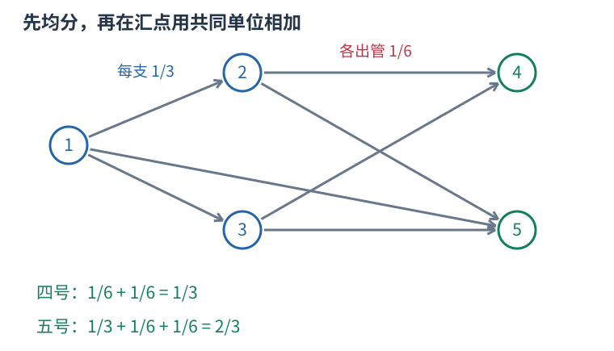

# P7113 拓扑传播精确分数，加法先求公分母再约分 题解

## 目录

| 题号 | 题名 | 考点 | 难度 |
|---|---|---|---|
| A | 排水系统 | 拓扑排序 + 最大公约数 | 1500 |

## A. 排水系统

> 原题：[P7113](https://www.luogu.com.cn/problem/P7113)
> 解法：拓扑传播精确分数，加法先求公分母再约分 · C++17

### 题意

前 $m$ 个接收口各有一吨污水，在无环管网中均分到每条出管。按编号输出每个最终排水口的最简分数。附件样例二、三未取得数据，实际原站样例验证只计可读取的第一组。

<!-- reusable-foundations:start -->

### 从零讲：C++ 输入输出：把数据读进变量，把结果写到标准输出

程序运行时从标准输入接收题目给的数据，把答案送到标准输出。`cin` 和 `cout` 定义在 `<iostream>`；写 `using namespace std;` 后可以省略它们前面的 `std::`。最小完整程序是：

```cxx
#include <iostream>
using namespace std;
int main() {
    int a, b;
    cin >> a >> b;
    cout << a + b << '\n';
    return 0;
}
```

输入二十和三十，两个变量分别保存二十、三十，输出五十。`int a, b;` 声明两个整数变量；`cin >> a` 才给变量赋入输入值。多个 `>>` 从左到右读取，读取整数时会跳过空格、制表符、换行，所以两个整数可以分处两行。负号属于整数，不需要另读一个符号。

`cout <<` 后可以接数值、字符或字符串。`' '` 是一个空格字符，`'\n'` 是换行字符，`"Hello"` 是字符串。`cout << a << ' ' << b << '\n';` 输出两个以空格分开的整数并换行。评测程序只需要答案，不应加入“请输入”等提示。

读取 `char c; cin >> c;` 会跳过前导空白。要读取包含空格的一整行，用 `<string>` 中的 `string s; getline(cin, s);`。若此前用 `cin >> n` 读取过整数，换行还留在输入中，需要先处理那一个剩余换行；不能盲目把所有空格都删掉，因为字符画的行首空格和文本中的空格可能就是数据。

`fixed << setprecision(3)`（需要 `<iomanip>`）表示以小数形式保留三位小数，例如把 $2.5$ 输出成 $2.500$；不用 `fixed` 时，`setprecision` 指有效数字总数。设置会影响后续输出，使用前应确认所需精度。

竞赛中可在首次输入输出前调用 `ios::sync_with_stdio(false); cin.tie(nullptr);`，减少 C++ 流与 C 标准输入输出的同步、绑定开销。随后保持使用 `cin/cout`，不要混用另一套 `scanf/printf`。交互题还要在需要对方回应前主动刷新，例如 `cout << query << endl;`；普通题用换行字符即可。

读入长度为 $L$ 的文本、或输出 $L$ 个字符，至少需要 $O(L)$ 时间。数据类型仍要能容纳结果：把两个整数相乘时，即使保存到 `long long`，也要让乘法本身在这个类型中进行，例如先把输入声明为 `long long`。

### 从零讲：分支与循环：按条件选择，按次序重复

`if (条件) { ... } else { ... }` 根据条件的真假选择一条分支。比较运算 `==`、`!=`、`<`、`<=`、`>`、`>=` 返回真假值；`=` 是赋值，不能代替相等比较。`&&` 表示两边都成立，`||` 表示至少一边成立，`!` 把真假反转。

```cxx
int score = 85;
if (score >= 90) cout << "A";
else if (score >= 60) cout << "B";
else cout << "C"; // 这个例子输出 B
```

这条分支链只执行第一个符合条件的分支。先处理高分后，第二个条件自然只会接到低于九十分的数。几个独立的 `if` 则可能执行多次；两种结构代表不同问题。逻辑运算会短路：`i < n && a[i] == 0` 先确认下标合法，才读取那一格。

`for (初始化; 继续条件; 每轮更新)` 适合知道重复范围的情况。例如下列代码依次处理一到四，总和是十：

```cxx
int sum = 0;
for (int i = 1; i <= 4; ++i) {
    sum += i;
}
cout << sum;
```

初始化只做一次；每轮先判断条件，条件为真才执行循环体，随后执行更新。`++i` 把 $i$ 加一，`sum += i` 等价于把旧 sum 加 $i$ 再保存。应明确每个变量在循环前、循环后分别表示什么；最大值相同时是否更新，决定了保留较早还是较晚的答案。

`while (条件)` 适合“不满足目标就再做一步”：

```cxx
int x = 13, times = 0;
while (x > 1) {
    x /= 2;
    ++times;
}
// x 依次是 13、6、3、1，执行三次
```

循环开始前先检查条件，初始已满足目标时可能一次也不执行。每次执行必须推进状态，否则可能无限循环。`break` 结束最内层循环，`continue` 跳过本轮剩余部分；`for` 中的 continue 之后仍会执行每轮更新。

复杂度由实际执行次数决定。上述求和执行 $n$ 次是 $O(n)$；每次将正整数减半只执行 $O(\log n)$ 次。两层循环不能仅凭外观判定为平方：内层若总共只前进 $n$ 次，总量仍可能线性。变量应在正确作用范围初始化；多组数据的计数器若未重置，下一组会错误继承上一组结果。

### 从零讲：vector：长度可变的连续数组

`vector<T>` 保存一串同类型的元素，适合按下标访问、扫描、排序。`T` 是元素类型，例如 `vector<int>` 保存整数，`vector<pair<int,int>>` 保存整数对，`vector<vector<int>>` 可保存每个顶点各自的邻居。需要 `<vector>`。

```cxx
vector<int> a(3, 7);   // 三个元素，内容是 7、7、7
a.push_back(9);       // 在末尾追加，现在长度为 4
int x = a[1];         // 从 0 编号，这里得到 7
a[1] = 2;            // 改第二个元素
int n = int(a.size());
```

`vector<int> a(3)` 创建三个值为零的元素；`a.reserve(3)` 只预留容量，元素数仍为零，此时不能访问 `a[0]`。长度 `size()` 与容量 `capacity()` 是不同概念。

下标访问为 $O(1)$，遍历为 $O(n)$。末尾追加通常为 $O(1)$；容量不足时会分配更大的连续空间并搬移元素，这次可能为 $O(n)$，一连串追加的平均成本称为摊还 $O(1)$。中间插入或删除会搬移后续元素，最坏 $O(n)$。内存是元素量的 $O(n)$，并可能预留部分尚未使用的容量。

`begin()` 指向首元素，`end()` 指向尾后位置，`sort(a.begin(),a.end())` 操作整个数组。`a[i]` 不检查越界；下标须满足 $0\le i<\mathrm{size}$。`at(i)` 会检查越界并抛异常。空数组不能访问 `front()`、`back()`；`pop_back()` 也要求非空。

扩容后指向旧存储的迭代器、引用和指针会失效。遍历的同时 `push_back`，不能假定此前取得的引用仍可用。读取大数组的函数常用 `const vector<int>& a` 按常量引用传入，既不复制也禁止通过该引用修改；`vector<int> a` 按值传参则复制内容。选择副本还是引用取决于是否要保留独立数据。

### 从零讲：整数类型、整除与溢出

计算前先看每一步可能达到的范围。常见环境中 `int` 是 32 位，上界约 $2.1\times10^9$；`long long` 至少 64 位，常见有符号 64 位上界约 $9.22\times10^{18}$。`using ll = long long;` 只是为已有类型起别名。

```cxx
int a = 100000, b = 100000;
long long wrong = a * b;      // 右边先按 int 乘，可能已溢出
long long right = 1LL * a * b; // 先把运算提升到 long long
```

不能指望“接收结果的变量够大”修复此前已经溢出的计算。先提高操作数类型，再做乘法。超过 64 位时，GCC 的 `__int128` 可作中间量，但它不是标准 C++17 类型，也没有标准流输出重载；先证明范围，再选择工具。

整数 `/` 对有符号数向零截断：`7/3==2`、`-7/3==-2`。对非负数才等于向下取整。余数满足 `a == (a/b)*b + a%b`，除数不能为零；要将余数归入 $[0,m-1]$（$m>0$），可用 `(a % m + m) % m`，同时保证中间加法不溢出。

非负 $a$、正 $b$ 的向上取整可写 `a/b + (a%b != 0)`，比 `(a+b-1)/b` 更容易避免加法溢出。比较平方时也应在宽类型内计算；浮点数不适合作为大整数相等的默认判断方式。

`size()` 返回无符号类型。空容器上写 `size()-1` 会绕到很大的数，逆序遍历可以先转成有符号、确认长度，或使用逆向迭代器。`abs` 对最小有符号数无法在同类型中表达其正值，需先约束输入差值范围。一般机器整数运算按常数时间估算，宽类型解决表示范围，不改变算法的增长阶。

### 从零讲：具名函数：给可复用计算一个明确接口

函数把一段计算包装成“输入参数 → 返回结果”。例如判断整数是否为偶数：

```cxx
bool even(int x) {
    return x % 2 == 0;
}
int main() {
    bool a = even(8); // a 为 true
    bool b = even(7); // b 为 false
}
```

`bool` 是返回类型，`even` 是函数名，`int x` 是参数声明。调用 `even(8)` 时，实参八传入这个新调用的局部变量 $x$，执行 return 后把真假值交回调用处。定义本身不执行计算，只有调用才执行。函数应在调用处之前定义，或提前写声明。

普通数值参数按值传递，函数里修改 $x$ 不会改变调用者原变量。参数写成 `int &x` 时才引用调用者对象；必须让这个对象在调用期间有效。`const vector<int>& a` 用引用避免复制整个容器，并承诺不通过这个引用修改它。返回局部变量的值是安全的，返回局部变量的引用则在函数结束后失效。

函数名应说明它回答的问题，调用处负责传哪些数据。例如闰年判定只接收一个年份并返回真假，枚举年份范围和输出格式由调用者处理。同一判定被多次使用时，这能减少规则不一致；但函数包装不会自动降低算法复杂度，仍要把每次调用实际做的工作计入时间。

如果函数内部又调用自身，就是递归，需要明确最小情况如何直接返回、每次调用如何逼近它；递归会占用调用栈。普通辅助函数可以不使用递归，不应仅因写成函数就称作递归算法。

### 从零讲：图的表示、BFS 与 DFS

图由顶点与边组成，适合表达“哪些对象之间能一步到达”。有向边只允许一个方向；无向边需保存两个方向。邻接表 `vector<vector<int>> graph(n)` 为每个顶点保存邻居，空间 $O(n+m)$，无向边在表中出现两次。

以边 $0-1,0-2,1-3$ 为例，从零出发：


#### BFS 为什么得到最少边数

初始顶点距离为零，入先进先出的队列。弹出顶点时，将尚未到达的邻居距离设为当前距离加一，并立刻标记入队。距离为一的顶点都会先于距离为二的处理，因此第一次发现就是最少边数。

```cxx
vector<int> distance(n, -1);
queue<int> q;
distance[start] = 0; q.push(start);
while (!q.empty()) {
    int u = q.front(); q.pop();
    for (int v : graph[u]) if (distance[v] == -1) {
        distance[v] = distance[u] + 1;
        q.push(v);
    }
}
```

适用于无权或所有边代价相同的最少步数。边权不同，第一次发现未必费用最小，不能继续套这一结论。多起点 BFS 先把所有合法起点设零并入队。

#### DFS 的调用代表一整块未探索区域

DFS 标记当前点后，递归处理每个尚未访问的邻点；也可用显式栈。上例可能按 $0,1,3,2$ 的顺序深入，但顺序取决于邻居存放方式。它擅长检查连通性、处理子树和回溯，不保证最短路径。

两种遍历在每个顶点入队或调用一次、每条边检查常数次的实现下，时间均为 $O(n+m)$，额外标记和队列/栈为 $O(n)$。不要等出队才首次标记，否则同一顶点可能重复入队。图不连通时，从一个起点无法覆盖所有点；统计连通块应从每个尚未访问点再启动一次遍历。树的深递归可能用尽调用栈。

### 从零讲：queue、deque 与 stack：处理顺序也是规则

`queue` 是先进先出：先进入的先处理，适合按层扩展；`stack` 是后进先出：最后放入的先处理，适合嵌套配对与回退；`deque` 支持两端加入删除，适合滑动窗口和 0-1 BFS。它们不能按方便程度随意互换，处理顺序会影响算法成立的理由。

```cxx
queue<int> q;
q.push(3); q.push(5);
int first = q.front(); // 3
q.pop();              // 删除 3，pop 不返回元素
stack<int> st;
st.push(3); st.push(5);
int last = st.top();   // 5
st.pop();
```

`deque` 的接口是 `push_back`、`push_front`、`pop_back`、`pop_front`、`front`、`back`。在常用默认底层容器下，这些端点操作为常数时间；保存 $n$ 项需要 $O(n)$ 空间。`stack` 和 `queue` 是限制了接口的适配器，也可选择其它底层容器。

任何 `front`、`back`、`top` 或弹出操作前都须保证非空；先读元素再弹出。遍历图时，容器只规定“谁先处理”，仍需另存访问标记；若不限制同一个状态反复入队，有限图也可能无限重复处理。

### 从零讲：拓扑排序与生成树：两类不同的图结构

有向依赖图里，一项任务必须等全部前置完成才能执行。拓扑序要求每条边 $u\to v$ 中 $u$ 都出现在 $v$ 之前，只有有向无环图才存在这样的完整顺序。

Kahn 算法统计入度，把所有入度零的点加入队列；每取出一点，就删除它的出边并减少邻点入度，某点变成零时再入队。例如依赖 $A\to C,B\to C$，A、B 可任意先后，但 C 必须等两者都处理完。

初始化与扫描时间 $O(n+m)$、空间 $O(n+m)$。最后处理不足 $n$ 个点表示仍存在环，不能把剩余点随便接到输出后面。拓扑序可能不唯一；若题目要求字典序最小，每次应从当前入度零者中取最小，可换小根堆，复杂度相应增加。

生成树讨论的是无向连通图：选 $n-1$ 条边连接所有顶点且不成环。最小生成树再要求总权最小，不是从一个源点到各点的最短路径树。

Kruskal 将边按权从小到大处理，用并查集判断两端是否已经连通；不连通才选并合并。依据是连接当前分量的一条最轻合法边总能放入某棵最优树。排序 $O(m\log m)$，并查集操作近似线性，空间 $O(n+m)$。若最终没选到 $n-1$ 条边，原图不连通，只得到森林。

拓扑排序维护依赖先后，生成树维护无环连通结构，二者不能因为名字里都有“序”或“树”而混淆。先画出边方向、权值和目标，再选择方法。

### 从零讲：整除、最大公约数与质因数

正整数 $d$ 整除 $n$，表示 $n$ 能分成整数个大小为 $d$ 的组，即 `n % d == 0`。公约数同时整除两个数，其中最大者为最大公约数。欧几里得算法使用 $\gcd(a,b)=\gcd(b,a\bmod b)$，因为共同整除两者的数也恰好整除余数。

例如 $\gcd(18,12)=\gcd(12,6)=\gcd(6,0)=6$。每两轮较大参数至少缩半，故为 $O(\log\max(a,b))$。C++17 `<numeric>` 提供 `gcd`；最小公倍数可按 `a/gcd(a,b)*b` 计算以减少中间量，但最终乘积仍须检查范围。

质数是大于一、只有一和自身两个正因数的整数，一不是质数。合数一定有不超过平方根的质因数：若一对因数都超过平方根，乘积会大于原数。因此试除只需检查到平方根。

```cxx
vector<pair<long long,int>> factor(long long n) {
    vector<pair<long long,int>> result;
    for (long long p = 2; p <= n / p; ++p) {
        if (n % p != 0) continue;
        int exponent = 0;
        while (n % p == 0) { n /= p; ++exponent; }
        result.push_back({p, exponent});
    }
    if (n > 1) result.push_back({n, 1});
    return result;
}
```

正整数六十拆成 $2^2\times3\times5$。每个因子的指数可从零选到其最大次数，所以因数数量为 $(2+1)(1+1)(1+1)=12$。剩余大于一的部分必须作为一个质因数保留。条件 `p<=n/p` 避免为检查平方而溢出。

试除最坏约 $O(\sqrt n)$。要处理从一到 $N$ 的大量质数问题，可用筛法：埃氏筛从每个质数的平方起标记倍数，时间 $O(N\log\log N)$、空间 $O(N)$。线性筛额外维护最小质因子，使每个合数只由规定的一次生成；不能把任意双循环标倍数都称为线性筛。

<!-- reusable-foundations:end -->

### 思路

水必须先在合流处收齐，再均分出去。例如样例中四号收到两份六分之一，最终为三分之一；五号收到三分之一和两份六分之一，最终为三分之二。若每到一份水就把结点永久标记完成，会丢掉后来的一份。



与第一组样例的五个结点及七条管道完全一致，四号、五号为最终排水口。

对每个点保存约分后的 $p/q$，初始为零比一，前 $m$ 个点改为一比一。入度为零的点全部入队，包含没有接收到水的源点。取出 $u$ 后，若有 $d$ 条出管，它给每条管道的水为 $p/(qd)$，先约分，再分别加入后继。无出管点不做除法。

两个分数 $p/q$、$r/s$ 相加时，令 $g=\gcd(q, s)$，公分母为 $q(s/g)$，分子为 $p(s/g)+r(q/g)$。这里两项分别是把原来的两份水放到同一种小份单位后，各占多少份。得到新分数后再约分。直接算 qs 会产生完全可以提前消掉的公因子。

为什么数值需要宽整数而仍有上界？一条水路最多经过十个中间点，即最多十一条均分边。每个分流数在一到五之间，只含质因子二、三、五；每步最多给二贡献两次幂，给三或五贡献一次幂。因此每条路径的分母都整除 60 的十一次方，约分后汇总分母也整除它。这个公共上界约为 $3.63 \times 10^{19}$，已经超过常见有符号六十四位；总水量至多十吨，使用有符号一百二十八位足够。

上述先求公分母的加法，产生的是这些分母的最小公倍数，仍在同一上界内，不会先乘成两个上界的平方。零分数约为零比一。__int128 是 GCC 扩展，标准流没有直接输出重载，程序自写逐位输出；输入与结点编号仍用普通整数。

原缓存另外两组只写“见附件”，没有伪造为可运行样例；独立校验用精确有理数直接枚举水路，另覆盖深度和大分母。

设管道数为 $e$、数值上界为 B，拓扑遍历 $O(n+e)$，每条边另有 $O(\log B)$ 次欧几里得步骤；固定一百二十八位算术下总时间 $O((n+e)\log B)$，空间 $O(n+e)$。

### 参考代码

```cpp
#include <bits/stdc++.h>
using namespace std;
using i128=__int128;
i128 gcd128(i128 a,i128 b){while(b){i128 r=a%b;a=b;b=r;}return a;}
struct Fraction{
    i128 p=0,q=1;
    void reduce(){i128 g=gcd128(p,q);p/=g;q/=g;}
    void add(const Fraction &other){i128 g=gcd128(q,other.q);p=p*(other.q/g)+other.p*(q/g);q=q*(other.q/g);reduce();}
};
void print128(i128 value){if(value==0){cout<<0;return;}string s;while(value){s.push_back(char('0'+value%10));value/=10;}reverse(s.begin(),s.end());cout<<s;}
int main() {
    ios::sync_with_stdio(false);
    cin.tie(nullptr);
int n,m;cin>>n>>m;vector<vector<int>>graph(n+1);vector<int>indegree(n+1);vector<Fraction>water(n+1);
for(int u=1;u<=n;++u){int d;cin>>d;while(d--){int v;cin>>v;graph[u].push_back(v);++indegree[v];}}
for(int u=1;u<=m;++u)water[u].p=1;
queue<int>ready;for(int u=1;u<=n;++u)if(!indegree[u])ready.push(u);
while(!ready.empty()){int u=ready.front();ready.pop();if(graph[u].empty())continue;
    Fraction part{water[u].p,water[u].q*int(graph[u].size())};part.reduce();
    for(int v:graph[u]){water[v].add(part);if(--indegree[v]==0)ready.push(v);}
}for(int u=1;u<=n;++u)if(graph[u].empty()){print128(water[u].p);cout<<' ';print128(water[u].q);cout<<'\n';}
    return 0;
}
```

### 易错点

不使用浮点近似；分数加法先消公因子；无水结点也消除入度；无出边不均分；输出所有排水口，包括零比一。

## 实测记录

本地 C++17 编译、1 组原站样例与 132 组独立边界/小域校验通过。
正文参考程序与源码逐字核对；没有向原站提交。
