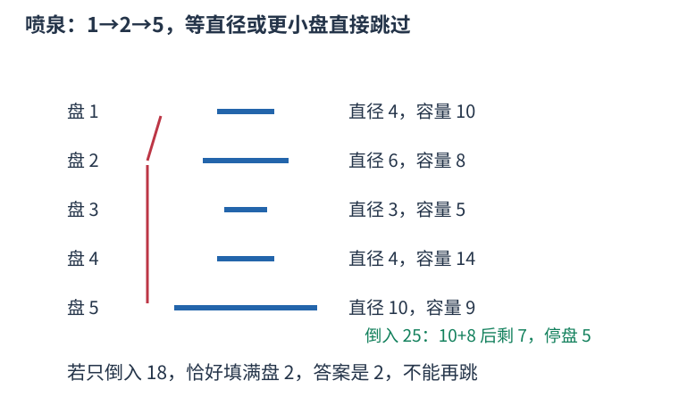

# P7167 单调栈连溢流后继，倍增跳过已灌满圆盘 题解

## 目录

| 题号 | 题名 | 考点 | 难度 |
|---|---|---|---|
| A | Fountain (Day1) | 单调栈 + 倍增 | 1800 |

## A. Fountain (Day1)

> 原题：[P7167](https://www.luogu.com.cn/problem/P7167)
> 解法：单调栈连溢流后继，倍增跳过已灌满圆盘 · C++17

### 题意

水灌满一个圆盘后流向下方第一个直径严格更大的圆盘，每次独立倒水，求最后停留圆盘，全部流走则输出零。

<!-- reusable-foundations:start -->

### 从零讲：C++ 输入输出：把数据读进变量，把结果写到标准输出

程序运行时从标准输入接收题目给的数据，把答案送到标准输出。`cin` 和 `cout` 定义在 `<iostream>`；写 `using namespace std;` 后可以省略它们前面的 `std::`。最小完整程序是：

```cxx
#include <iostream>
using namespace std;
int main() {
    int a, b;
    cin >> a >> b;
    cout << a + b << '\n';
    return 0;
}
```

输入二十和三十，两个变量分别保存二十、三十，输出五十。`int a, b;` 声明两个整数变量；`cin >> a` 才给变量赋入输入值。多个 `>>` 从左到右读取，读取整数时会跳过空格、制表符、换行，所以两个整数可以分处两行。负号属于整数，不需要另读一个符号。

`cout <<` 后可以接数值、字符或字符串。`' '` 是一个空格字符，`'\n'` 是换行字符，`"Hello"` 是字符串。`cout << a << ' ' << b << '\n';` 输出两个以空格分开的整数并换行。评测程序只需要答案，不应加入“请输入”等提示。

读取 `char c; cin >> c;` 会跳过前导空白。要读取包含空格的一整行，用 `<string>` 中的 `string s; getline(cin, s);`。若此前用 `cin >> n` 读取过整数，换行还留在输入中，需要先处理那一个剩余换行；不能盲目把所有空格都删掉，因为字符画的行首空格和文本中的空格可能就是数据。

`fixed << setprecision(3)`（需要 `<iomanip>`）表示以小数形式保留三位小数，例如把 $2.5$ 输出成 $2.500$；不用 `fixed` 时，`setprecision` 指有效数字总数。设置会影响后续输出，使用前应确认所需精度。

竞赛中可在首次输入输出前调用 `ios::sync_with_stdio(false); cin.tie(nullptr);`，减少 C++ 流与 C 标准输入输出的同步、绑定开销。随后保持使用 `cin/cout`，不要混用另一套 `scanf/printf`。交互题还要在需要对方回应前主动刷新，例如 `cout << query << endl;`；普通题用换行字符即可。

读入长度为 $L$ 的文本、或输出 $L$ 个字符，至少需要 $O(L)$ 时间。数据类型仍要能容纳结果：把两个整数相乘时，即使保存到 `long long`，也要让乘法本身在这个类型中进行，例如先把输入声明为 `long long`。

### 从零讲：数组：用下标定位一组状态

数组把同一类型的若干值按位置保存。`int a[5] = {};` 创建五个初始为零的整数，合法下标是零到四；`a[2] = 7;` 只修改第三格。下标表示位置，格子中保存的值是另一回事。

```cxx
int a[4] = {4, 3, 0, 5};
int sum = 0;
for (int i = 0; i < 4; ++i) sum += a[i];
// 和为十二；a[0] 是四，a[3] 是五
```

读写一个给定下标的格子是 $O(1)$。扫描全部 $n$ 格为 $O(n)$，保存 $n$ 格的空间为 $O(n)$。不能访问负下标或 $a[n]$，越界属于未定义行为，可能表现为随机数或崩溃，编译通过不代表安全。

`bool seen[34] = {};` 可以保存号码是否出现过，初始全为 false；`seen[x]=true` 表示记录出现状态。再次赋 true 不改变结果，因此适合去重、标记删除；若操作是开关翻转，则要写 `seen[x]=!seen[x]`。标记真假和记录出现次数是不同任务，后者需要整数计数数组。

若题目用一到 $n$ 编号，可以创建 $n+1$ 格并预留零号，统一按原编号访问。或者读入时改成零到 $n-1$，但必须让全部循环与公式使用同一套下标。

二维数组 `int a[5][6] = {};` 有五行六列，`a[r][c]` 表示第 $r$ 行第 $c$ 列。三维数组再加一个方向，用三个下标定位单位格子。逐格扫描的时间是各维长度的乘积，空间也按格子总数计算。

固定数组的长度需要在编译时确定，不能在标准 C++17 中写依赖输入的 `int a[n]`。输入后才确定大小时使用 `vector<int> a(n,0)`；它同样从零编号，也可以按下标访问，但仍须检查下标边界。大数组应避免放在空间有限的函数栈上，可以用动态容器或全局数组。数组里的旧状态是否应该保留，需要根据当前问题决定，多组测试不能意外继承上一组的内容。

### 从零讲：vector：长度可变的连续数组

`vector<T>` 保存一串同类型的元素，适合按下标访问、扫描、排序。`T` 是元素类型，例如 `vector<int>` 保存整数，`vector<pair<int,int>>` 保存整数对，`vector<vector<int>>` 可保存每个顶点各自的邻居。需要 `<vector>`。

```cxx
vector<int> a(3, 7);   // 三个元素，内容是 7、7、7
a.push_back(9);       // 在末尾追加，现在长度为 4
int x = a[1];         // 从 0 编号，这里得到 7
a[1] = 2;            // 改第二个元素
int n = int(a.size());
```

`vector<int> a(3)` 创建三个值为零的元素；`a.reserve(3)` 只预留容量，元素数仍为零，此时不能访问 `a[0]`。长度 `size()` 与容量 `capacity()` 是不同概念。

下标访问为 $O(1)$，遍历为 $O(n)$。末尾追加通常为 $O(1)$；容量不足时会分配更大的连续空间并搬移元素，这次可能为 $O(n)$，一连串追加的平均成本称为摊还 $O(1)$。中间插入或删除会搬移后续元素，最坏 $O(n)$。内存是元素量的 $O(n)$，并可能预留部分尚未使用的容量。

`begin()` 指向首元素，`end()` 指向尾后位置，`sort(a.begin(),a.end())` 操作整个数组。`a[i]` 不检查越界；下标须满足 $0\le i<\mathrm{size}$。`at(i)` 会检查越界并抛异常。空数组不能访问 `front()`、`back()`；`pop_back()` 也要求非空。

扩容后指向旧存储的迭代器、引用和指针会失效。遍历的同时 `push_back`，不能假定此前取得的引用仍可用。读取大数组的函数常用 `const vector<int>& a` 按常量引用传入，既不复制也禁止通过该引用修改；`vector<int> a` 按值传参则复制内容。选择副本还是引用取决于是否要保留独立数据。

### 从零讲：分支与循环：按条件选择，按次序重复

`if (条件) { ... } else { ... }` 根据条件的真假选择一条分支。比较运算 `==`、`!=`、`<`、`<=`、`>`、`>=` 返回真假值；`=` 是赋值，不能代替相等比较。`&&` 表示两边都成立，`||` 表示至少一边成立，`!` 把真假反转。

```cxx
int score = 85;
if (score >= 90) cout << "A";
else if (score >= 60) cout << "B";
else cout << "C"; // 这个例子输出 B
```

这条分支链只执行第一个符合条件的分支。先处理高分后，第二个条件自然只会接到低于九十分的数。几个独立的 `if` 则可能执行多次；两种结构代表不同问题。逻辑运算会短路：`i < n && a[i] == 0` 先确认下标合法，才读取那一格。

`for (初始化; 继续条件; 每轮更新)` 适合知道重复范围的情况。例如下列代码依次处理一到四，总和是十：

```cxx
int sum = 0;
for (int i = 1; i <= 4; ++i) {
    sum += i;
}
cout << sum;
```

初始化只做一次；每轮先判断条件，条件为真才执行循环体，随后执行更新。`++i` 把 $i$ 加一，`sum += i` 等价于把旧 sum 加 $i$ 再保存。应明确每个变量在循环前、循环后分别表示什么；最大值相同时是否更新，决定了保留较早还是较晚的答案。

`while (条件)` 适合“不满足目标就再做一步”：

```cxx
int x = 13, times = 0;
while (x > 1) {
    x /= 2;
    ++times;
}
// x 依次是 13、6、3、1，执行三次
```

循环开始前先检查条件，初始已满足目标时可能一次也不执行。每次执行必须推进状态，否则可能无限循环。`break` 结束最内层循环，`continue` 跳过本轮剩余部分；`for` 中的 continue 之后仍会执行每轮更新。

复杂度由实际执行次数决定。上述求和执行 $n$ 次是 $O(n)$；每次将正整数减半只执行 $O(\log n)$ 次。两层循环不能仅凭外观判定为平方：内层若总共只前进 $n$ 次，总量仍可能线性。变量应在正确作用范围初始化；多组数据的计数器若未重置，下一组会错误继承上一组结果。

### 从零讲：具名函数：给可复用计算一个明确接口

函数把一段计算包装成“输入参数 → 返回结果”。例如判断整数是否为偶数：

```cxx
bool even(int x) {
    return x % 2 == 0;
}
int main() {
    bool a = even(8); // a 为 true
    bool b = even(7); // b 为 false
}
```

`bool` 是返回类型，`even` 是函数名，`int x` 是参数声明。调用 `even(8)` 时，实参八传入这个新调用的局部变量 $x$，执行 return 后把真假值交回调用处。定义本身不执行计算，只有调用才执行。函数应在调用处之前定义，或提前写声明。

普通数值参数按值传递，函数里修改 $x$ 不会改变调用者原变量。参数写成 `int &x` 时才引用调用者对象；必须让这个对象在调用期间有效。`const vector<int>& a` 用引用避免复制整个容器，并承诺不通过这个引用修改它。返回局部变量的值是安全的，返回局部变量的引用则在函数结束后失效。

函数名应说明它回答的问题，调用处负责传哪些数据。例如闰年判定只接收一个年份并返回真假，枚举年份范围和输出格式由调用者处理。同一判定被多次使用时，这能减少规则不一致；但函数包装不会自动降低算法复杂度，仍要把每次调用实际做的工作计入时间。

如果函数内部又调用自身，就是递归，需要明确最小情况如何直接返回、每次调用如何逼近它；递归会占用调用栈。普通辅助函数可以不使用递归，不应仅因写成函数就称作递归算法。

### 从零讲：单调栈与单调队列：删去以后不会更优的候选

若某个新候选在所有未来场景都不劣于一个旧候选，就可以永久删去旧候选。这种支配关系使栈或双端队列中的值保持单调，而不是仅仅为了“看上去有序”。

#### 单调栈找下一个更大项

从左扫描 $[2,1,3]$，栈保存尚未找到答案的下标。读三时，它大于栈顶的一，故一的首个右侧更大值为三；再大于二，二的答案也是三。每个值在自己的答案被首次发现时出栈。


```cxx
for (int i = 0; i < n; ++i) {
    while (!st.empty() && a[st.back()] < a[i]) {
        answer[st.back()] = i;
        st.pop_back();
    }
    st.push_back(i);
}
```

严格大于用 `<` 弹出；若问大于等于，等号处理会改变。栈里保存下标，才能计算距离和识别相同数的不同位置。没有答案的项保留约定哨兵。

#### 单调队列维护固定窗口最大值

队首保存当前最大项的下标。新值到来，从队尾删除不大于它的旧值：新值更晚过期且不小，不会比这些旧值差；再把过期下标从队首移走。查询最大值读队首。

每个下标都只入、出一次，所以两者总时间 $O(n)$，空间最坏 $O(n)$。这是摊还分析，不能把“一个 while 里有时弹很多项”误算为必然平方，也不能把每次操作都说成严格常数。删候选之前应证明它在剩余有效期内永远不更优；窗口范围改变或查询目标不同，支配关系也要重证。

### 从零讲：倍增：把重复后继操作拼成二的幂次步长

若每个状态都有唯一后继 $next[u]$，反复移动 $t$ 步可以预先保存一、二、四、八……步的目的地。它适用于树的祖先、函数反复应用、跳转链等，不要求状态原本就是一棵树。

定义 $up[j][u]$ 为从 $u$ 出发走 $2^j$ 次后继到达的位置。基础 $up[0][u]=next[u]$；两段各 $2^{j-1}$ 次组成 $2^j$ 次，所以令 $v=up[j-1][u]$，有 $up[j][u]=up[j-1][v]$。先算小 $j$ 再算大 $j$，第二段才有现成答案。

例如链 1→2→3→4→5→0，走三步可拆成二加一：先从一用二步表到三，再用一步表到四。拆分的是移动次数，目的地必须沿上一次的结果继续，不能每次都从原起点查表。

如果每移动一次有费用 $w[u]$，约定费用属于出发状态 $u$、不包含最终到达者，就可同步保存 $cost[j][u]$。拼接公式是 $cost[j-1][u]+cost[j-1][v]$；若错误地把中间点在两段都算一遍，就会重复收费。

```cxx
// 此例使用固定大小的一张后继表；零号状态表示终点。
int next_node[6] = {0, 2, 3, 4, 5, 0};
int up[3][6] = {};
for (int u = 0; u < 6; ++u) up[0][u] = next_node[u];
for (int j = 1; j < 3; ++j)
    for (int u = 0; u < 6; ++u)
        up[j][u] = up[j-1][up[j-1][u]];
int u = 1, steps = 3;
for (int j = 0; j < 3; ++j)
    if ((steps >> j) & 1) u = up[j][u];
```

以上代码结束时 $u=4$。所有表下标必须合法，终点零的后继也设为零；如果要求走精确 $t$ 步，最大层数由 $t$ 的位数决定，而非一律由状态数决定。无环且链长至多 $n$ 时，按 $n$ 的位数建表就够用。

用预算找最长可走前缀时，常从大步长往小试跳，只有整段费用满足预算才接纳。这依赖费用非负等保证可行前缀具有单调性的条件，不能把任意带负费用的链也照搬。比较使用 `<` 还是 `<=` 由“恰好用完是否允许离开当前段”的题意决定。

$n$ 个状态、最大跳数 T 的预处理时间与空间均为 $O(n \log(T+1))$，一次按位跳转为 $O(\log(T+1))$。费用累加可能超过单步数值，应使用足够宽的整数类型。

### 从零讲：整数类型、整除与溢出

计算前先看每一步可能达到的范围。常见环境中 `int` 是 32 位，上界约 $2.1\times10^9$；`long long` 至少 64 位，常见有符号 64 位上界约 $9.22\times10^{18}$。`using ll = long long;` 只是为已有类型起别名。

```cxx
int a = 100000, b = 100000;
long long wrong = a * b;      // 右边先按 int 乘，可能已溢出
long long right = 1LL * a * b; // 先把运算提升到 long long
```

不能指望“接收结果的变量够大”修复此前已经溢出的计算。先提高操作数类型，再做乘法。超过 64 位时，GCC 的 `__int128` 可作中间量，但它不是标准 C++17 类型，也没有标准流输出重载；先证明范围，再选择工具。

整数 `/` 对有符号数向零截断：`7/3==2`、`-7/3==-2`。对非负数才等于向下取整。余数满足 `a == (a/b)*b + a%b`，除数不能为零；要将余数归入 $[0,m-1]$（$m>0$），可用 `(a % m + m) % m`，同时保证中间加法不溢出。

非负 $a$、正 $b$ 的向上取整可写 `a/b + (a%b != 0)`，比 `(a+b-1)/b` 更容易避免加法溢出。比较平方时也应在宽类型内计算；浮点数不适合作为大整数相等的默认判断方式。

`size()` 返回无符号类型。空容器上写 `size()-1` 会绕到很大的数，逆序遍历可以先转成有符号、确认长度，或使用逆向迭代器。`abs` 对最小有符号数无法在同类型中表达其正值，需先约束输入差值范围。一般机器整数运算按常数时间估算，宽类型解决表示范围，不改变算法的增长阶。

<!-- reusable-foundations:end -->

### 思路

单调栈求每个圆盘下方首个严格更大直径的位置作为 next。倍增保存从 $u$ 开始灌满 $2^j$ 个盘后到达的位置，以及这些盘的容量和。查询从大步长往小试，只有容量和严格小于剩余水量才整段跳过；最终所在盘就是答案。



水平线段长度按直径绘制；盘三、四都比盘二小，溢流不经过它们，容量也不能被扣除。

预处理 $O(n\log n)$、每次询问 $O(\log n)$，空间 $O(n\log n)$。

### 参考代码

```cpp
#include <bits/stdc++.h>
using namespace std;

int main() {
    ios::sync_with_stdio(false);
    cin.tie(nullptr);
int n,q;cin>>n>>q;const int LOG=18;
vector<int>diameter(n+1),stack;vector<vector<int>>up(LOG,vector<int>(n+1));
vector<vector<long long>>cost(LOG,vector<long long>(n+1));
for(int i=1;i<=n;++i){
    cin>>diameter[i]>>cost[0][i];
    while(!stack.empty()&&diameter[stack.back()]<diameter[i]){up[0][stack.back()]=i;stack.pop_back();}
    stack.push_back(i);
}
for(int j=1;j<LOG;++j)for(int u=1;u<=n;++u){
    int middle=up[j-1][u];up[j][u]=up[j-1][middle];cost[j][u]=cost[j-1][u]+cost[j-1][middle];
}
while(q--){
    int u;long long water;cin>>u>>water;
    for(int j=LOG-1;j>=0&&u!=0;--j)if(cost[j][u]<water){water-=cost[j][u];u=up[j][u];}
    cout<<u<<'\n';
}
    return 0;
}
```

### 易错点

直径相等不能接水；水量等于容量时不溢出；询问独立，不能累计修改容量。

## 实测记录

本地 C++17 编译、1 组原站样例与 151 组独立边界/小域校验通过。
正文参考程序与源码逐字核对；没有向原站提交。
