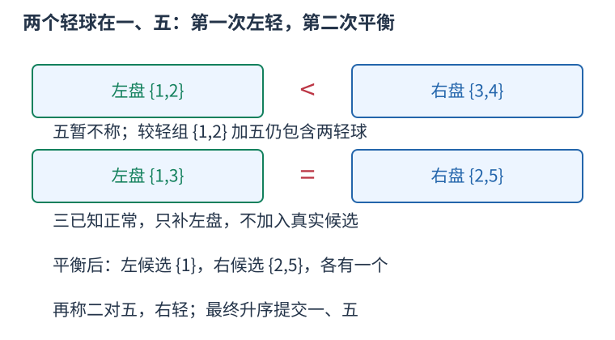

# P7579 两轻球二分定位，分开后分别三分 题解

## 目录

| 题号 | 题名 | 考点 | 难度 |
|---|---|---|---|
| A | 称重(weigh) | 交互题 + 二分查找 + 分治 | 1800 |

## A. 称重(weigh)

> 原题：[P7579](https://www.luogu.com.cn/problem/P7579)
> 解法：两轻球二分定位，分开后分别三分 · C++17

### 题意

天平最多使用指定次数，从五到五百个球中找两个同样较轻的球。程序只读球数，再逐次称量、读取比较结果，最终升序输出两个编号。

<!-- reusable-foundations:start -->

### 从零讲：C++ 输入输出：把数据读进变量，把结果写到标准输出

程序运行时从标准输入接收题目给的数据，把答案送到标准输出。`cin` 和 `cout` 定义在 `<iostream>`；写 `using namespace std;` 后可以省略它们前面的 `std::`。最小完整程序是：

```cxx
#include <iostream>
using namespace std;
int main() {
    int a, b;
    cin >> a >> b;
    cout << a + b << '\n';
    return 0;
}
```

输入二十和三十，两个变量分别保存二十、三十，输出五十。`int a, b;` 声明两个整数变量；`cin >> a` 才给变量赋入输入值。多个 `>>` 从左到右读取，读取整数时会跳过空格、制表符、换行，所以两个整数可以分处两行。负号属于整数，不需要另读一个符号。

`cout <<` 后可以接数值、字符或字符串。`' '` 是一个空格字符，`'\n'` 是换行字符，`"Hello"` 是字符串。`cout << a << ' ' << b << '\n';` 输出两个以空格分开的整数并换行。评测程序只需要答案，不应加入“请输入”等提示。

读取 `char c; cin >> c;` 会跳过前导空白。要读取包含空格的一整行，用 `<string>` 中的 `string s; getline(cin, s);`。若此前用 `cin >> n` 读取过整数，换行还留在输入中，需要先处理那一个剩余换行；不能盲目把所有空格都删掉，因为字符画的行首空格和文本中的空格可能就是数据。

`fixed << setprecision(3)`（需要 `<iomanip>`）表示以小数形式保留三位小数，例如把 $2.5$ 输出成 $2.500$；不用 `fixed` 时，`setprecision` 指有效数字总数。设置会影响后续输出，使用前应确认所需精度。

竞赛中可在首次输入输出前调用 `ios::sync_with_stdio(false); cin.tie(nullptr);`，减少 C++ 流与 C 标准输入输出的同步、绑定开销。随后保持使用 `cin/cout`，不要混用另一套 `scanf/printf`。交互题还要在需要对方回应前主动刷新，例如 `cout << query << endl;`；普通题用换行字符即可。

读入长度为 $L$ 的文本、或输出 $L$ 个字符，至少需要 $O(L)$ 时间。数据类型仍要能容纳结果：把两个整数相乘时，即使保存到 `long long`，也要让乘法本身在这个类型中进行，例如先把输入声明为 `long long`。

### 从零讲：分支与循环：按条件选择，按次序重复

`if (条件) { ... } else { ... }` 根据条件的真假选择一条分支。比较运算 `==`、`!=`、`<`、`<=`、`>`、`>=` 返回真假值；`=` 是赋值，不能代替相等比较。`&&` 表示两边都成立，`||` 表示至少一边成立，`!` 把真假反转。

```cxx
int score = 85;
if (score >= 90) cout << "A";
else if (score >= 60) cout << "B";
else cout << "C"; // 这个例子输出 B
```

这条分支链只执行第一个符合条件的分支。先处理高分后，第二个条件自然只会接到低于九十分的数。几个独立的 `if` 则可能执行多次；两种结构代表不同问题。逻辑运算会短路：`i < n && a[i] == 0` 先确认下标合法，才读取那一格。

`for (初始化; 继续条件; 每轮更新)` 适合知道重复范围的情况。例如下列代码依次处理一到四，总和是十：

```cxx
int sum = 0;
for (int i = 1; i <= 4; ++i) {
    sum += i;
}
cout << sum;
```

初始化只做一次；每轮先判断条件，条件为真才执行循环体，随后执行更新。`++i` 把 $i$ 加一，`sum += i` 等价于把旧 sum 加 $i$ 再保存。应明确每个变量在循环前、循环后分别表示什么；最大值相同时是否更新，决定了保留较早还是较晚的答案。

`while (条件)` 适合“不满足目标就再做一步”：

```cxx
int x = 13, times = 0;
while (x > 1) {
    x /= 2;
    ++times;
}
// x 依次是 13、6、3、1，执行三次
```

循环开始前先检查条件，初始已满足目标时可能一次也不执行。每次执行必须推进状态，否则可能无限循环。`break` 结束最内层循环，`continue` 跳过本轮剩余部分；`for` 中的 continue 之后仍会执行每轮更新。

复杂度由实际执行次数决定。上述求和执行 $n$ 次是 $O(n)$；每次将正整数减半只执行 $O(\log n)$ 次。两层循环不能仅凭外观判定为平方：内层若总共只前进 $n$ 次，总量仍可能线性。变量应在正确作用范围初始化；多组数据的计数器若未重置，下一组会错误继承上一组结果。

### 从零讲：vector：长度可变的连续数组

`vector<T>` 保存一串同类型的元素，适合按下标访问、扫描、排序。`T` 是元素类型，例如 `vector<int>` 保存整数，`vector<pair<int,int>>` 保存整数对，`vector<vector<int>>` 可保存每个顶点各自的邻居。需要 `<vector>`。

```cxx
vector<int> a(3, 7);   // 三个元素，内容是 7、7、7
a.push_back(9);       // 在末尾追加，现在长度为 4
int x = a[1];         // 从 0 编号，这里得到 7
a[1] = 2;            // 改第二个元素
int n = int(a.size());
```

`vector<int> a(3)` 创建三个值为零的元素；`a.reserve(3)` 只预留容量，元素数仍为零，此时不能访问 `a[0]`。长度 `size()` 与容量 `capacity()` 是不同概念。

下标访问为 $O(1)$，遍历为 $O(n)$。末尾追加通常为 $O(1)$；容量不足时会分配更大的连续空间并搬移元素，这次可能为 $O(n)$，一连串追加的平均成本称为摊还 $O(1)$。中间插入或删除会搬移后续元素，最坏 $O(n)$。内存是元素量的 $O(n)$，并可能预留部分尚未使用的容量。

`begin()` 指向首元素，`end()` 指向尾后位置，`sort(a.begin(),a.end())` 操作整个数组。`a[i]` 不检查越界；下标须满足 $0\le i<\mathrm{size}$。`at(i)` 会检查越界并抛异常。空数组不能访问 `front()`、`back()`；`pop_back()` 也要求非空。

扩容后指向旧存储的迭代器、引用和指针会失效。遍历的同时 `push_back`，不能假定此前取得的引用仍可用。读取大数组的函数常用 `const vector<int>& a` 按常量引用传入，既不复制也禁止通过该引用修改；`vector<int> a` 按值传参则复制内容。选择副本还是引用取决于是否要保留独立数据。

### 从零讲：整数类型、整除与溢出

计算前先看每一步可能达到的范围。常见环境中 `int` 是 32 位，上界约 $2.1\times10^9$；`long long` 至少 64 位，常见有符号 64 位上界约 $9.22\times10^{18}$。`using ll = long long;` 只是为已有类型起别名。

```cxx
int a = 100000, b = 100000;
long long wrong = a * b;      // 右边先按 int 乘，可能已溢出
long long right = 1LL * a * b; // 先把运算提升到 long long
```

不能指望“接收结果的变量够大”修复此前已经溢出的计算。先提高操作数类型，再做乘法。超过 64 位时，GCC 的 `__int128` 可作中间量，但它不是标准 C++17 类型，也没有标准流输出重载；先证明范围，再选择工具。

整数 `/` 对有符号数向零截断：`7/3==2`、`-7/3==-2`。对非负数才等于向下取整。余数满足 `a == (a/b)*b + a%b`，除数不能为零；要将余数归入 $[0,m-1]$（$m>0$），可用 `(a % m + m) % m`，同时保证中间加法不溢出。

非负 $a$、正 $b$ 的向上取整可写 `a/b + (a%b != 0)`，比 `(a+b-1)/b` 更容易避免加法溢出。比较平方时也应在宽类型内计算；浮点数不适合作为大整数相等的默认判断方式。

`size()` 返回无符号类型。空容器上写 `size()-1` 会绕到很大的数，逆序遍历可以先转成有符号、确认长度，或使用逆向迭代器。`abs` 对最小有符号数无法在同类型中表达其正值，需先约束输入差值范围。一般机器整数运算按常数时间估算，宽类型解决表示范围，不改变算法的增长阶。

### 从零讲：具名函数：给可复用计算一个明确接口

函数把一段计算包装成“输入参数 → 返回结果”。例如判断整数是否为偶数：

```cxx
bool even(int x) {
    return x % 2 == 0;
}
int main() {
    bool a = even(8); // a 为 true
    bool b = even(7); // b 为 false
}
```

`bool` 是返回类型，`even` 是函数名，`int x` 是参数声明。调用 `even(8)` 时，实参八传入这个新调用的局部变量 $x$，执行 return 后把真假值交回调用处。定义本身不执行计算，只有调用才执行。函数应在调用处之前定义，或提前写声明。

普通数值参数按值传递，函数里修改 $x$ 不会改变调用者原变量。参数写成 `int &x` 时才引用调用者对象；必须让这个对象在调用期间有效。`const vector<int>& a` 用引用避免复制整个容器，并承诺不通过这个引用修改它。返回局部变量的值是安全的，返回局部变量的引用则在函数结束后失效。

函数名应说明它回答的问题，调用处负责传哪些数据。例如闰年判定只接收一个年份并返回真假，枚举年份范围和输出格式由调用者处理。同一判定被多次使用时，这能减少规则不一致；但函数包装不会自动降低算法复杂度，仍要把每次调用实际做的工作计入时间。

如果函数内部又调用自身，就是递归，需要明确最小情况如何直接返回、每次调用如何逼近它；递归会占用调用栈。普通辅助函数可以不使用递归，不应仅因写成函数就称作递归算法。

### 从零讲：交互输入输出：先发出问题，再等待对方回复

普通输入输出题通常可以把已知输入一次读完；交互题的下一条输入取决于本程序刚刚发出的询问。选手程序与交互器通过标准输入、标准输出轮流传消息，先明确每条消息的格式和谁先说话。

例如协议约定询问 `? l r`，交互器返回一个整数，最终答案用 `! answer` 表示。一次请求先输出完整一行并刷新，然后再读取返回值：

```cxx
#include <iostream>
#include <cstdlib>
using namespace std;
long long ask(int l, int r) {
    cout << "? " << l << ' ' << r << endl;
    long long reply;
    if (!(cin >> reply) || reply < 0) exit(0);
    return reply;
}
int main() {
    ios::sync_with_stdio(false);
    cin.tie(nullptr);
    long long reply = ask(1, 3);
    cout << "! " << reply << endl;
}
```

这是消息格式示例：交互器若回复七，程序发出 `? 1 3` 后读取七，再发出 `! 7`。具体题目的算法、合法询问范围和答案内容仍由该题协议决定。例如另一个协议可能用整数一表示询问、整数二表示最终答案，不能直接套这里的符号。

输出流可能先把文字留在缓冲区，直到积累到一定量才真正发送。`'\n'` 只添加换行，`endl` 同时换行并刷新；也可以用换行加 `cout.flush()`。尤其 `cin.tie(nullptr)` 解除了读输入前自动刷新 cout 的关系，每次询问必须主动刷新，否则两边可能都在等待对方。

根据协议处理错误或 EOF。上面的整数协议约定负数为错误提示，所以立即退出；字符比较协议返回的是 `<`、`=`、`>`，应按它自己的合法字符处理。最终答完一组后，有的题进入下一组，有的题要求立即终止，必须按题面约定执行。

问数限制只计协议定义的询问，通常不计最终答案。不能额外向标准输出打印调试文字；如需本地日志，使用独立文件或标准错误。官方样例的输入与输出两列往往是一份对话记录，正确算法可能选择其它合法询问顺序，本地验证应由真实交互器根据隐藏数据回复并检查最终结果。

时间与空间要把算法本身和通信量分别统计。发送一次长度为 $k$ 的编号列表，输出成本为 $O(k)$，不是只因它被称为“一次询问”就等于常数运算。

### 从零讲：迭代器、begin/end 与左闭右开范围

迭代器表示容器中的一个位置。`*it` 读取它指向的元素，`++it` 向后移动，`it == c.end()` 判断是否已经到尾后。把末尾之后的位置作为边界，使空范围、整个容器和一段子区间都能用同一形式表示。

```cxx
vector<int> a{4, 7, 9};
for (auto it = a.begin(); it != a.end(); ++it) {
    cout << *it << ' ';   // 输出 4 7 9
}
```

`[first,last)` 包含 `first`，排除 `last`。`[begin,begin)` 是空范围，`[begin,end)` 包含所有元素。不能读取 `*end()`；找不到时返回 `end()` 是合法结果，必须先判断再读取。

数组和 `vector` 的迭代器支持随机访问：`begin()+k` 跳到下标 $k$，`it-begin()` 得到下标，均为 $O(1)$。例如指向下标二的位置之前有零、一两个元素，故减起点也能表示前面有几个数。相减只对同一容器中可相减的迭代器有效。

`list`、`set`、`map` 的迭代器通常只能逐步移动，不支持 `it-begin()`。`distance(begin,it)` 可以计算距离，但在这些容器上需要走过中间位置，时间为 $O(k)$；不能因为写了一个函数就认为它是常数时间。

容器修改后，旧位置可能失效：`vector` 扩容会使旧位置失效，删除元素会影响该处及其后位置。需要跨修改保存“第几个”时可保存下标，再按新数据重新取得迭代器，同时核对下标是否仍然合法。

### 从零讲：二分答案：在单调的可行性分界处找最优值

当直接求最小答案困难，但给定候选值后可以检查是否可行，可以把优化问题转成判定。前提是可行性只有一道分界，而不是来回变化。

例如要容纳总量十三，每个容器最多装 $c$，只有三个容器。判定为 $\lceil13/c\rceil\le3$。容量三、四不可行，容量五、六及更大都可行，因为增大容量不会让已有装法失效。


要找最小可行值，可维护闭区间内仍可能的答案：

```cxx
int left = 1, right = 13; // 已知答案在此范围，right 可行
while (left < right) {
    int mid = left + (right - left) / 2;
    if (check(mid)) right = mid;
    else left = mid + 1;
}
int answer = left;
```

中点可行时，最优答案可能就是中点或更小，因此保留它；中点不可行时，所有更小值都不行，排除到中点为止。候选范围每轮缩半。若一次检查为 $T$，总时间为 $O(T\log R)$，$R$ 是初始候选数；额外空间来自检查函数和常数个边界。

开始前分别证明单调性、上下界和确有解。若上界也不可行，不能把二分最后停下的位置当作合法答案。求最大可行值时分界方向和取中点方式要配合修改。判定中的除法、乘法也可能溢出；非负向上整除可以写 `a/b+(a%b!=0)`。

二分不负责证明 `check` 正确，也不能降低一次检查本身的复杂度。与有序数组上的边界函数相比，这里的“数组”是候选答案的概念序列，不必真正生成所有候选。

<!-- reusable-foundations:end -->

### 思路

**相同球数的称量，比较的是两边轻球的数量。** 正常球重 W、轻球重 $w<W$，两边各放 $p$ 个，总质量分别为 $pW-$轻球数*$(W-w)$，所以轻球多的一盘更轻。我们的每次询问都保证球数相等，避免混入球数不同的影响。



盘内数字是球编号。每次两侧个数相等，质量差只来自轻球数，不把补盘的正常球误当候选。

先维护“两个轻球都在候选组中”。偶数候选平均分为 A、B：若左轻，两轻都在 A，B 中任意球都是正常球；右轻反之；平衡时，两轻不能全在某侧，只能每组各一个。此时把问题拆成两个“已知恰有一个轻球”的搜索。

候选组为奇数时，小侧可用一个候选组外的已知正常球补齐，这个正常球只参与称量，不加入候选。首次 $n$ 为奇数，还没有正常球可用：两边各放 $floor(n/2)$ 个，剩一个 $z$ 不称。平衡说明每边一个轻球、$z$ 正常；异重说明轻球只能在较轻一边加 $z$ 中，重边全部正常。这样第一次之后就有了正常球，后续奇数候选都能补齐。候选只剩两个时直接提交它们。

例如五球中一、五偏轻。先称 {1,2} 对 {3,4}，左轻，保留 {1,2,5}，三是正常球。再称 {1,3} 对 {2,5}，平衡；真实候选左组 {1}、右组 {2,5} 各有一个轻球。左组已定位，右组称二对五，右轻，得到五。

**一轻球搜索为什么能三分？** 大小 $s$ 的组分成前 $q=ceil(s/3)$ 个、接着 $q$ 个、其余个，称前两组。轻球在前组则左轻，在第二组则右轻，平衡则在未称组。三个子组大小都不超过 $ceil(s/3)$，故最多 $ceil(\log_3 s)$ 问。$s=2$ 时两边各一个，合法数据不可能平衡。

**核对最紧的问数限制。** 若分开前经历 $t$ 次异重，候选数至多 $ceil(n/2^t)$。接下来平衡的一问将其拆成各至多 $ceil(n/2^{t+1})$ 个，故总问数不超过

$$t+1+2\left\lceil\log_3\left\lceil\frac{n}{2^{t+1}}\right\rceil\right\rceil.$$

对 $n \le 500$，取可能的 $t$ 逐个核对，上式最大十三；若一直异重直到两球直接结束，只需至多九问。唯一十二问子任务的 $n$ 是不超过二百五十六的二次幂，此时上式最大十一。不要读入 $k$，它是测试点属性，输入中没有它。

询问格式是 `1 p ... q ...`，最终格式为 `2 x y` 且 $x<y$。每次用 endl 刷新，再读取字符；提交最终答案后立即结束。官方样例是一次对话，别把样例的三个回复当作适用于任意询问顺序的固定输入。

询问次数至多十三，二次幂子任务至多十一；本地计算及发送编号总量均为 $O(n)$，空间 $O(n)$。

### 参考代码

```cpp
#include <bits/stdc++.h>
using namespace std;
char weigh(const vector<int>&left,const vector<int>&right){
    cout<<"1 "<<left.size();for(int x:left)cout<<' '<<x;
    cout<<' '<<right.size();for(int x:right)cout<<' '<<x;cout<<endl;
    char reply;if(!(cin>>reply)||(reply!='<'&&reply!='>'&&reply!='='))exit(0);
    return reply;
}
int find_one(vector<int>group){
    while(group.size()>1){
        int q=((int)group.size()+2)/3;
        vector<int>left(group.begin(),group.begin()+q),right(group.begin()+q,group.begin()+2*q);
        char reply=weigh(left,right);
        if(reply=='<')group=left;
        else if(reply=='>')group=right;
        else group=vector<int>(group.begin()+2*q,group.end());
    }
    return group[0];
}
void answer(int x,int y){if(x>y)swap(x,y);cout<<"2 "<<x<<' '<<y<<endl;}
int main() {
    ios::sync_with_stdio(false);
    cin.tie(nullptr);
int n;if(!(cin>>n))return 0;
vector<int>candidate(n);iota(candidate.begin(),candidate.end(),1);int normal=0;
while(candidate.size()>2){
    int half=(int)candidate.size()/2;
    vector<int>left(candidate.begin(),candidate.begin()+half);
    vector<int>right(candidate.begin()+half,candidate.end());
    if(candidate.size()%2&&normal==0){
        // 首次奇数规模：留下一个球，异重时它仍可能是轻球。
        int outside=right.back();right.pop_back();char reply=weigh(left,right);
        if(reply=='='){answer(find_one(left),find_one(right));return 0;}
        if(reply=='<'){normal=right[0];candidate=left;}
        else{normal=left[0];candidate=right;}
        candidate.push_back(outside);
    }else{
        vector<int>pan=left;
        if(pan.size()<right.size())pan.push_back(normal); // 只给称盘补正常球
        char reply=weigh(pan,right);
        if(reply=='='){answer(find_one(left),find_one(right));return 0;}
        if(reply=='<'){normal=right[0];candidate=left;}
        else{normal=left[0];candidate=right;}
    }
}
answer(candidate[0],candidate[1]);
    return 0;
}
```

### 易错点

两盘编号必须互不重复；补入的正常球不属于候选；不读取 $k$；每问刷新，最终答案升序并立即退出。

## 实测记录

本地 C++17 编译、918 个真实交互场景与 918 组转录重放通过；核对主动刷新、合法询问与问数上限。
官方样例是对话，已按样例秘密场景另行交互验证，未当作普通固定输入输出比较。
正文参考程序与源码逐字核对；没有向原站提交。
