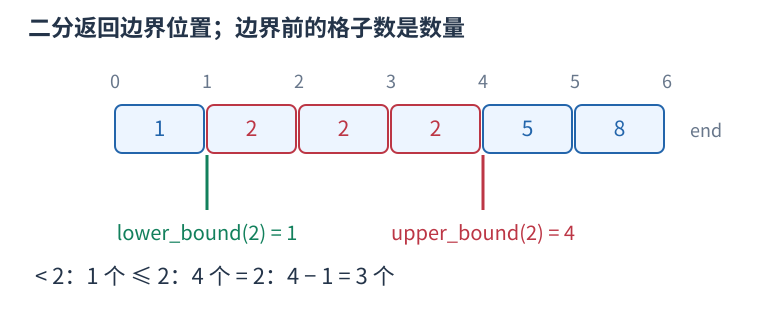
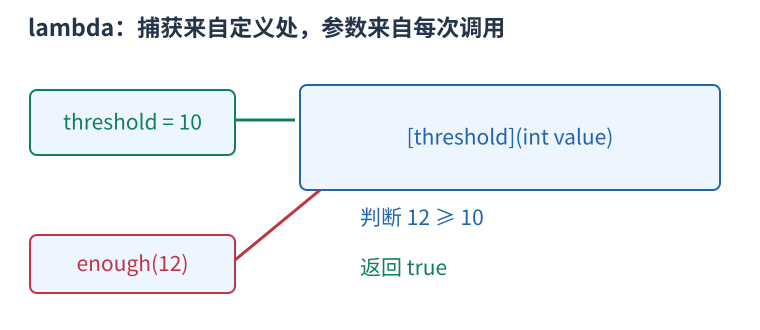
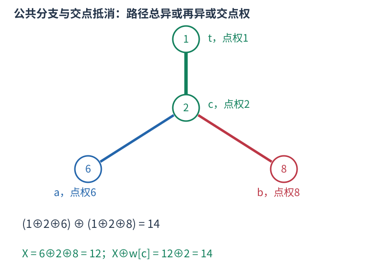

# P8201 路径异或抵消后，只需查路径上是否出现指定点权 题解

## 目录

| 题号 | 题名 | 考点 | 难度 |
|---|---|---|---|
| A | 生活在树上（hard version） | LCA + DFS | 2100 |

## A. 生活在树上（hard version）

> 原题：[P8201](https://www.luogu.com.cn/problem/P8201)
> 解法：路径异或抵消后，只需查路径上是否出现指定点权 · C++17

### 题意

树上两点$a$、$b$及给定$k$，问是否存在任意城市$t$，使$t$到$a$路径点权异或与$t$到$b$路径点权异或的结果等于$k$。

<!-- reusable-foundations:start -->

### 从零讲：C++ 输入输出：把数据读进变量，把结果写到标准输出

程序运行时从标准输入接收题目给的数据，把答案送到标准输出。`cin` 和 `cout` 定义在 `<iostream>`；写 `using namespace std;` 后可以省略它们前面的 `std::`。最小完整程序是：

```cxx
#include <iostream>
using namespace std;
int main() {
    int a, b;
    cin >> a >> b;
    cout << a + b << '\n';
    return 0;
}
```

输入二十和三十，两个变量分别保存二十、三十，输出五十。`int a, b;` 声明两个整数变量；`cin >> a` 才给变量赋入输入值。多个 `>>` 从左到右读取，读取整数时会跳过空格、制表符、换行，所以两个整数可以分处两行。负号属于整数，不需要另读一个符号。

`cout <<` 后可以接数值、字符或字符串。`' '` 是一个空格字符，`'\n'` 是换行字符，`"Hello"` 是字符串。`cout << a << ' ' << b << '\n';` 输出两个以空格分开的整数并换行。评测程序只需要答案，不应加入“请输入”等提示。

读取 `char c; cin >> c;` 会跳过前导空白。要读取包含空格的一整行，用 `<string>` 中的 `string s; getline(cin, s);`。若此前用 `cin >> n` 读取过整数，换行还留在输入中，需要先处理那一个剩余换行；不能盲目把所有空格都删掉，因为字符画的行首空格和文本中的空格可能就是数据。

`fixed << setprecision(3)`（需要 `<iomanip>`）表示以小数形式保留三位小数，例如把 $2.5$ 输出成 $2.500$；不用 `fixed` 时，`setprecision` 指有效数字总数。设置会影响后续输出，使用前应确认所需精度。

竞赛中可在首次输入输出前调用 `ios::sync_with_stdio(false); cin.tie(nullptr);`，减少 C++ 流与 C 标准输入输出的同步、绑定开销。随后保持使用 `cin/cout`，不要混用另一套 `scanf/printf`。交互题还要在需要对方回应前主动刷新，例如 `cout << query << endl;`；普通题用换行字符即可。

读入长度为 $L$ 的文本、或输出 $L$ 个字符，至少需要 $O(L)$ 时间。数据类型仍要能容纳结果：把两个整数相乘时，即使保存到 `long long`，也要让乘法本身在这个类型中进行，例如先把输入声明为 `long long`。

### 从零讲：分支与循环：按条件选择，按次序重复

`if (条件) { ... } else { ... }` 根据条件的真假选择一条分支。比较运算 `==`、`!=`、`<`、`<=`、`>`、`>=` 返回真假值；`=` 是赋值，不能代替相等比较。`&&` 表示两边都成立，`||` 表示至少一边成立，`!` 把真假反转。

```cxx
int score = 85;
if (score >= 90) cout << "A";
else if (score >= 60) cout << "B";
else cout << "C"; // 这个例子输出 B
```

这条分支链只执行第一个符合条件的分支。先处理高分后，第二个条件自然只会接到低于九十分的数。几个独立的 `if` 则可能执行多次；两种结构代表不同问题。逻辑运算会短路：`i < n && a[i] == 0` 先确认下标合法，才读取那一格。

`for (初始化; 继续条件; 每轮更新)` 适合知道重复范围的情况。例如下列代码依次处理一到四，总和是十：

```cxx
int sum = 0;
for (int i = 1; i <= 4; ++i) {
    sum += i;
}
cout << sum;
```

初始化只做一次；每轮先判断条件，条件为真才执行循环体，随后执行更新。`++i` 把 $i$ 加一，`sum += i` 等价于把旧 sum 加 $i$ 再保存。应明确每个变量在循环前、循环后分别表示什么；最大值相同时是否更新，决定了保留较早还是较晚的答案。

`while (条件)` 适合“不满足目标就再做一步”：

```cxx
int x = 13, times = 0;
while (x > 1) {
    x /= 2;
    ++times;
}
// x 依次是 13、6、3、1，执行三次
```

循环开始前先检查条件，初始已满足目标时可能一次也不执行。每次执行必须推进状态，否则可能无限循环。`break` 结束最内层循环，`continue` 跳过本轮剩余部分；`for` 中的 continue 之后仍会执行每轮更新。

复杂度由实际执行次数决定。上述求和执行 $n$ 次是 $O(n)$；每次将正整数减半只执行 $O(\log n)$ 次。两层循环不能仅凭外观判定为平方：内层若总共只前进 $n$ 次，总量仍可能线性。变量应在正确作用范围初始化；多组数据的计数器若未重置，下一组会错误继承上一组结果。

### 从零讲：vector：长度可变的连续数组

`vector<T>` 保存一串同类型的元素，适合按下标访问、扫描、排序。`T` 是元素类型，例如 `vector<int>` 保存整数，`vector<pair<int,int>>` 保存整数对，`vector<vector<int>>` 可保存每个顶点各自的邻居。需要 `<vector>`。

```cxx
vector<int> a(3, 7);   // 三个元素，内容是 7、7、7
a.push_back(9);       // 在末尾追加，现在长度为 4
int x = a[1];         // 从 0 编号，这里得到 7
a[1] = 2;            // 改第二个元素
int n = int(a.size());
```

`vector<int> a(3)` 创建三个值为零的元素；`a.reserve(3)` 只预留容量，元素数仍为零，此时不能访问 `a[0]`。长度 `size()` 与容量 `capacity()` 是不同概念。

下标访问为 $O(1)$，遍历为 $O(n)$。末尾追加通常为 $O(1)$；容量不足时会分配更大的连续空间并搬移元素，这次可能为 $O(n)$，一连串追加的平均成本称为摊还 $O(1)$。中间插入或删除会搬移后续元素，最坏 $O(n)$。内存是元素量的 $O(n)$，并可能预留部分尚未使用的容量。

`begin()` 指向首元素，`end()` 指向尾后位置，`sort(a.begin(),a.end())` 操作整个数组。`a[i]` 不检查越界；下标须满足 $0\le i<\mathrm{size}$。`at(i)` 会检查越界并抛异常。空数组不能访问 `front()`、`back()`；`pop_back()` 也要求非空。

扩容后指向旧存储的迭代器、引用和指针会失效。遍历的同时 `push_back`，不能假定此前取得的引用仍可用。读取大数组的函数常用 `const vector<int>& a` 按常量引用传入，既不复制也禁止通过该引用修改；`vector<int> a` 按值传参则复制内容。选择副本还是引用取决于是否要保留独立数据。

### 从零讲：整数类型、整除与溢出

计算前先看每一步可能达到的范围。常见环境中 `int` 是 32 位，上界约 $2.1\times10^9$；`long long` 至少 64 位，常见有符号 64 位上界约 $9.22\times10^{18}$。`using ll = long long;` 只是为已有类型起别名。

```cxx
int a = 100000, b = 100000;
long long wrong = a * b;      // 右边先按 int 乘，可能已溢出
long long right = 1LL * a * b; // 先把运算提升到 long long
```

不能指望“接收结果的变量够大”修复此前已经溢出的计算。先提高操作数类型，再做乘法。超过 64 位时，GCC 的 `__int128` 可作中间量，但它不是标准 C++17 类型，也没有标准流输出重载；先证明范围，再选择工具。

整数 `/` 对有符号数向零截断：`7/3==2`、`-7/3==-2`。对非负数才等于向下取整。余数满足 `a == (a/b)*b + a%b`，除数不能为零；要将余数归入 $[0,m-1]$（$m>0$），可用 `(a % m + m) % m`，同时保证中间加法不溢出。

非负 $a$、正 $b$ 的向上取整可写 `a/b + (a%b != 0)`，比 `(a+b-1)/b` 更容易避免加法溢出。比较平方时也应在宽类型内计算；浮点数不适合作为大整数相等的默认判断方式。

`size()` 返回无符号类型。空容器上写 `size()-1` 会绕到很大的数，逆序遍历可以先转成有符号、确认长度，或使用逆向迭代器。`abs` 对最小有符号数无法在同类型中表达其正值，需先约束输入差值范围。一般机器整数运算按常数时间估算，宽类型解决表示范围，不改变算法的增长阶。

### 从零讲：具名函数：给可复用计算一个明确接口

函数把一段计算包装成“输入参数 → 返回结果”。例如判断整数是否为偶数：

```cxx
bool even(int x) {
    return x % 2 == 0;
}
int main() {
    bool a = even(8); // a 为 true
    bool b = even(7); // b 为 false
}
```

`bool` 是返回类型，`even` 是函数名，`int x` 是参数声明。调用 `even(8)` 时，实参八传入这个新调用的局部变量 $x$，执行 return 后把真假值交回调用处。定义本身不执行计算，只有调用才执行。函数应在调用处之前定义，或提前写声明。

普通数值参数按值传递，函数里修改 $x$ 不会改变调用者原变量。参数写成 `int &x` 时才引用调用者对象；必须让这个对象在调用期间有效。`const vector<int>& a` 用引用避免复制整个容器，并承诺不通过这个引用修改它。返回局部变量的值是安全的，返回局部变量的引用则在函数结束后失效。

函数名应说明它回答的问题，调用处负责传哪些数据。例如闰年判定只接收一个年份并返回真假，枚举年份范围和输出格式由调用者处理。同一判定被多次使用时，这能减少规则不一致；但函数包装不会自动降低算法复杂度，仍要把每次调用实际做的工作计入时间。

如果函数内部又调用自身，就是递归，需要明确最小情况如何直接返回、每次调用如何逼近它；递归会占用调用栈。普通辅助函数可以不使用递归，不应仅因写成函数就称作递归算法。

### 从零讲：树的根、子树、DFS 序与倍增

树是连通且无环的无向图，$n$ 个顶点有 $n-1$ 条边。指定一个根后，每个非根顶点有唯一父亲，其他向下邻居是孩子。子树包含自己和全部后代；换根会改变父子关系，但不改变原边。


#### 子树信息按依赖顺序计算

例如子树大小 `size[u]` 初始为一，每个孩子处理完后累加 `size[v]`。一来自节点自己，不能漏掉。树形 DP 也如此：先明确某状态允许怎样选择，再合并各孩子提供的信息；孩子独立性来自树上没有跨子树边，仍可能因总预算或选中父亲等条件产生状态关联。

换根 DP 先求一个根的状态，再沿边换根，将“来自孩子的一侧”和“来自父亲的一侧”合并。应画清只有哪条边的方向改变、哪些量不变；不能仅凭两张答案表代替依赖解释。普通遍历每条边常数次为 $O(n)$，背包式合并可能更大，按实际合并循环计算。

#### DFS 序为什么能把子树变成区间

进入节点时分配编号 `tin[u]`，完成整棵子树后记录最后编号 `tout[u]`。深度优先在返回父亲前会完整处理这棵子树，因此它的所有编号连续，恰是 $[tin[u],tout[u]]$。这允许把子树和等查询交给数组结构。若同时记录进出事件，区间定义会不同，不可混用两种序列。

#### 倍增与最近公共祖先

`up[k][u]` 存 $u$ 向上 $2^k$ 条边到达的祖先。基础 `up[0][u]=parent[u]`，递推为 `up[k][u]=up[k-1][up[k-1][u]]`，因为连续走两段 $2^{k-1}$。跳十三层可拆为八加四加一，只需对数个跳跃。

LCA 是两个节点公共祖先中最深者。先把更深的一方跳到同深度；若已经相同就是答案。否则从大到小试跳，祖先不同才两边同时上移，最后它们的父亲就是 LCA。预处理 $O(n\log n)$、每次查询 $O(\log n)$，表空间 $O(n\log n)$。根的虚拟祖先需统一定义，不能访问非法下标。

树的直径在非负无权边长等常见条件下可用两次最远点搜索求出；带负权时要重新判断。虚树则将关注节点按 DFS 序组织，补上相邻节点的 LCA 后连接祖先关系，边应携带原路径含义，不能把压缩后一条边误当原图一步。深链上的递归也须留意栈深度。

### 从零讲：倍增：把重复后继操作拼成二的幂次步长

若每个状态都有唯一后继 $next[u]$，反复移动 $t$ 步可以预先保存一、二、四、八……步的目的地。它适用于树的祖先、函数反复应用、跳转链等，不要求状态原本就是一棵树。

定义 $up[j][u]$ 为从 $u$ 出发走 $2^j$ 次后继到达的位置。基础 $up[0][u]=next[u]$；两段各 $2^{j-1}$ 次组成 $2^j$ 次，所以令 $v=up[j-1][u]$，有 $up[j][u]=up[j-1][v]$。先算小 $j$ 再算大 $j$，第二段才有现成答案。

例如链 1→2→3→4→5→0，走三步可拆成二加一：先从一用二步表到三，再用一步表到四。拆分的是移动次数，目的地必须沿上一次的结果继续，不能每次都从原起点查表。

如果每移动一次有费用 $w[u]$，约定费用属于出发状态 $u$、不包含最终到达者，就可同步保存 $cost[j][u]$。拼接公式是 $cost[j-1][u]+cost[j-1][v]$；若错误地把中间点在两段都算一遍，就会重复收费。

```cxx
// 此例使用固定大小的一张后继表；零号状态表示终点。
int next_node[6] = {0, 2, 3, 4, 5, 0};
int up[3][6] = {};
for (int u = 0; u < 6; ++u) up[0][u] = next_node[u];
for (int j = 1; j < 3; ++j)
    for (int u = 0; u < 6; ++u)
        up[j][u] = up[j-1][up[j-1][u]];
int u = 1, steps = 3;
for (int j = 0; j < 3; ++j)
    if ((steps >> j) & 1) u = up[j][u];
```

以上代码结束时 $u=4$。所有表下标必须合法，终点零的后继也设为零；如果要求走精确 $t$ 步，最大层数由 $t$ 的位数决定，而非一律由状态数决定。无环且链长至多 $n$ 时，按 $n$ 的位数建表就够用。

用预算找最长可走前缀时，常从大步长往小试跳，只有整段费用满足预算才接纳。这依赖费用非负等保证可行前缀具有单调性的条件，不能把任意带负费用的链也照搬。比较使用 `<` 还是 `<=` 由“恰好用完是否允许离开当前段”的题意决定。

$n$ 个状态、最大跳数 T 的预处理时间与空间均为 $O(n \log(T+1))$，一次按位跳转为 $O(\log(T+1))$。费用累加可能超过单步数值，应使用足够宽的整数类型。

### 从零讲：位运算：把非负整数看成一组二进制开关

五写成二进制为 $0101_2$，三为 $0011_2$。同一列各代表一位：按位与 `&` 两边都为一才得一，按位或 `|` 任一为一就得一，按位异或 `^` 不同才为一。所以 $5\mathbin{\&}3=1$，$5\mathbin{|}3=7$，$5\mathbin{\oplus}3=6$。


`1ULL << k` 把一移到第 $k$ 位。对非负无符号整数，`(mask >> k) & 1ULL` 读该位，`mask | (1ULL<<k)` 置一，`mask & ~(1ULL<<k)` 清零，`mask ^ (1ULL<<k)` 翻转。最低位编号为零。

```cxx
unsigned long long mask = 5; // 第 0、2 位为一
bool has = (mask >> 2) & 1ULL; // true
mask |= 1ULL << 1;             // 变成 7
```

位移次数必须小于类型位宽，且不能为负；不要用普通 `1` 去移到超出 int 范围的位置。C++17 有符号负数右移和溢出的规则不适合直接套“乘除二的幂”，用明确范围的无符号数更容易保证行为。`^` 是异或，绝不是乘方。

逻辑与 `&&`、逻辑或 `||` 将整体条件视为真假，并会短路；按位 `&`、`|` 逐位计算，不会因此跳过右侧表达式。运算符优先级可能与直觉不同，写 `(mask & bit) != 0`，别省掉关键括号。

固定机器字内的一次位运算按 $O(1)$ 估算；枚举全部 $k$ 位状态仍有 $2^k$ 种，不能因为每次运算快就忽略状态数。`x & (x-1)` 对正无符号数清掉最低的一位；GCC 的 `__builtin_popcountll(x)` 统计一的数量，注意实参位宽与具体编译器支持。

### 从零讲：sort 与比较器：先建立统一的顺序

排序把原来任意排列的数据，按照可比较的键整理成有序序列，便于查边界、比较相邻项和按顺序处理。头文件 `<algorithm>`；普通数组和 `vector` 可用 `sort(first,last)`，范围为左闭右开。

```cxx
vector<int> a{5, 2, 5, 1};
sort(a.begin(), a.end());     // 变成 1、2、5、5，重复值仍保留
sort(a.begin(), a.end(), greater<int>());  // 降序
```

`sort` 时间 $O(n\log n)$，不是每次比较都扫描整个数组。C++ 标准规定复杂度要求，不规定必须使用某一固定内部排序实现，不能统一称它为快速排序。

对 `pair`，默认先比较 `first`，相同再比较 `second`，都是升序。自定义比较器 `cmp(a,b)` 返回真表示“$a$ 必须排在 $b$ 前面”。例如按分数降序、同分按编号升序：

```cxx
sort(students.begin(), students.end(), [](const auto& a, const auto& b) {
    if (a.score != b.score) return a.score > b.score;
    return a.id < b.id;
});
```

规则必须自洽：元素不能排在自己前面，不能出现 $a$ 在 $b$ 前、$b$ 在 $c$ 前、$c$ 又在 $a$ 前的循环。`<=` 会让相同元素也必须互相在前，因此不是合法的严格比较器。排序过程中也不能改变比较依据。

排序会改变原位置；若编号或两项的配对有意义，应将完整记录一起排序或另存查询副本，不能把两个相关字段各自排序后继续当作原配对。普通 `sort` 不保证同键元素保持输入先后；确需稳定顺序时用 `stable_sort` 或将原编号纳入比较键。排序只建立顺序，不能代替贪心策略的正确性证明。

### 从零讲：lower_bound 与 upper_bound：从位置到数量

#### 什么时候使用

有一批可以比较大小的数据，需要反复问“小于某数的有几个”“某个值出现几次”“第一个达到要求的元素在哪”。先排序，再查边界，能避免每次从头扫描。这里先讨论从小到大的 `vector<int>`，头文件为 `<algorithm>` 和 `<vector>`，适用于 C++17。

#### 先弄清返回的是什么

`a.begin()` 指向第一个元素，`a.end()` 指向末元素之后的空位置。`[a.begin(), a.end())` 包含左端、不包含右端。迭代器可以理解为指向容器中某个位置的标记；它不是元素的值，也不是数量。

设有序数组为 $[1,2,2,2,5,8]$，下标从零开始，查询 $x=2$：



- `lower_bound(a.begin(), a.end(), x)` 返回第一个**大于等于** `x` 的位置，这里是下标一。
- `upper_bound(a.begin(), a.end(), x)` 返回第一个**严格大于** `x` 的位置，这里是下标四。

把名字与等号绑定记忆：`lower_bound` 是相等区间的左边界，`upper_bound` 是相等区间的右边界；没有相等元素时两条边界重合。两个函数均不保证命中 `x`。

```cxx
vector<int> a{1, 2, 2, 2, 5, 8};
int x = 2;
auto lo = lower_bound(a.begin(), a.end(), x);
auto hi = upper_bound(a.begin(), a.end(), x);
int less = int(lo - a.begin());          // 1 个元素 < 2
int lessEqual = int(hi - a.begin());     // 4 个元素 <= 2
int equal = int(hi - lo);                // 3 个元素 == 2
```

#### 为什么“位置减 begin”可以计数

`lo` 之前恰有下标 $0$ 到 $0$ 的一个元素。一般地，第一个大于等于 $x$ 的位置如果是 $k$，它前面的下标为 $0,1,\ldots,k-1$，恰有 $k$ 个；有序性保证这 $k$ 个全部严格小于 $x$，之后没有漏下的小数。对 `vector`，`lo-a.begin()` 就是跨过的格子数 $k$。

同理，`hi` 之前全部不大于 $x$，所以它的下标就是不大于 $x$ 的数量。令数组长度为 $n$，便有：

| 要统计的元素 | C++ 表达式 | 本例结果 |
|---|---|---|
| 小于 $x$ | `lo - a.begin()` | $1$ |
| 不大于 $x$ | `hi - a.begin()` | $4$ |
| 大于等于 $x$ | `a.end() - lo` | $5$ |
| 大于 $x$ | `a.end() - hi` | $2$ |
| 等于 $x$ | `hi - lo` | $3$ |

因此，函数本身找的是分界位置，计数来自分界两边的长度。查询闭区间 $[L,R]$ 中的数量（保证 $L\le R$），用 `upper_bound(..., R)-lower_bound(..., L)`；这也避免了写 `L-1` 时可能发生的整数下溢。

#### 底层怎样二分

下面返回下标，展示 `lower_bound` 的核心逻辑，不依赖库函数：

```cxx
int first_ge(const vector<int>& a, int x) {
    int left = 0, right = int(a.size());
    // 答案在位置 [left, right] 内；待判断元素在 [left, right)。
    while (left < right) {
        int mid = left + (right - left) / 2;
        if (a[mid] < x) left = mid + 1;
        else right = mid;
    }
    return left;  // 可以等于 a.size()，表示没有符合条件的元素
}
```

若中点小于 $x$，它左侧都小于 $x$，连同中点一起排除；否则答案不会在中点右侧，把右边界移到中点，保留中点本身作为可能答案。每次排除约一半候选，区间长度从 $n$ 变成约 $n/2,n/4,\ldots$，经过约 $\log_2 n$ 次就剩一个边界，所以时间为 $O(\log n)$，额外空间为 $O(1)$。

实现 `upper_bound` 时，把 `a[mid] < x` 改为 `a[mid] <= x`：遇到相等也继续向右，才能越过全部重复值。比如六个数查二，`lower_bound` 的左边界、右边界和中点三个下标依次为 $(0,6,3)$、$(0,3,1)$、$(0,1,0)$，最终返回一；`upper_bound` 依次为 $(0,6,3)$、$(4,6,5)$、$(4,5,4)$，最终返回四。

#### 使用条件和边界

第一次排序花 $O(n\log n)$，之后 $q$ 次查询共花 $O(q\log n)$。每次查询前都重新排序，会丢掉复用有序数组的优势。若还需要原来的配对、编号或顺序，应另存原数据，再排序供查询的副本。

查零时两条边界都在 `begin()`；查十时都在 `end()`；查三时都指向五。空数组也会返回 `end()`，计数自然为零。**可以拿 `end()` 计算长度，不能解引用它。** 查是否存在应写 `it != a.end() && *it == x`。

一般前提是比较条件能把范围分成两段；完整升序是最易保证的方式。普通乱序数组不能直接套用。降序或自定义排序必须使用匹配的比较器，不能沿用上表的自然大小解释。

`vector`、数组的随机访问迭代器支持常数时间跳到中点和相减，所以总时间为 $O(\log n)$。`list` 或 `set` 的迭代器不支持相减，通用二分虽然比较次数是对数，迭代器移动却可能达到线性；在 `set`、`map` 上优先用成员函数 `s.lower_bound(x)`、`s.upper_bound(x)`，它们沿树查找为 $O(\log n)$。成员函数得到的迭代器到 `begin()` 的距离仍未必能快速计算。

规范核对：[C++ 工作草案：二分边界算法](https://eel.is/c++draft/alg.binary.search)。本文只使用 C++17 已有接口。

### 从零讲：lambda：完整例子、捕获规则与局部变量的生命周期

#### 它解决什么问题

一段操作在当前函数里需要调用多次，或者某个算法需要你提供“怎样比较”的规则，可以把这段操作写成 lambda。lambda 表达式产生一个可以像函数一样调用的对象；“匿名”指它没有普通函数声明中的函数名，仍可以用变量保存并命名。

```cxx
auto add = [](int a, int b) -> int {
    return a + b;
};
int answer = add(2, 3);  // 调用后得到 5；定义本身不会执行函数体
```

读法是：用 `auto` 保存对象；`[](){}` 中的方括号部分是捕获列表；圆括号是每次调用传入的参数；`-> int` 指定返回类型；花括号里写执行过程；定义后的分号结束赋值。返回类型能够推导时可省略，所以也常见 `auto add = [](int a,int b) { return a+b; };`。



#### 参数和捕获有什么区别

参数每次调用都由调用者提供；捕获让函数体使用定义位置附近的局部变量，调用时不用重复传它。例如阈值来自当前环境，待判断的值每次变化：

```cxx
int threshold = 10;
auto enough = [threshold](int value) {
    return value >= threshold;
};
bool a = enough(12);  // true，value 是本次传入的 12
```

这里 `threshold` 是捕获，`value` 是参数。常用的捕获方式如下：

| 写法 | 意思 | 适合的需要 |
|---|---|---|
| `[](){}` | 不捕获局部变量 | 只依赖参数的计算或比较 |
| `[x](){}` | 保存定义时 `x` 的副本 | 需要固定一份快照 |
| `[&x](){}` | 引用外面的 `x` | 读取最新值或修改原变量 |
| `[=](){}` | 按值捕获实际需要的局部变量 | 需要多个快照 |
| `[&](){}` | 按引用捕获实际需要的局部变量 | 当前作用域内的辅助函数 |
| `[&a, limit](){}` | 引用 `a`，复制 `limit` | 显式区分共享数据和快照 |

`[&](){}` 不是“把参数按引用传递”；是否按引用传参由圆括号里的 `int&`、`const vector<int>&` 等类型决定。全局变量可以直接访问，无需捕获。

#### 用可观察的结果区分复制与引用

```cxx
int base = 10;
auto snapshot = [base](int x) { return base + x; };
auto current = [&base](int x) { return base + x; };
base = 20;
int a = snapshot(1);  // 11：使用定义时保存的 10
int b = current(1);   // 21：使用外面的最新值 20
```

默认情况下不能在 lambda 内修改按值捕获的副本。加 `mutable` 才能修改副本，但仍不会改外面的原变量：`auto next = [base]() mutable { return ++base; };`。对大数组按值捕获可能复制整个数组；如果只在数组仍然存活时查询，显式引用可避免这份复制。

#### 两种常见用法

**局部辅助函数。** 把“给一个参数就求出结果”的操作命名后，主流程只写调用。外层数组保持原处，辅助函数按引用读取，能减少重复代码，并让环境依赖集中在定义附近。对多个调用位置修正一处逻辑即可。普通独立函数也能做到复用，但外层局部数据通常需要显式传参。

**作为算法的规则。** 把比较方式直接交给 `sort`，能在调用处看到排序依据：

```cxx
vector<pair<int,int>> items={{2,7},{1,2},{1,4}};
sort(items.begin(), items.end(), [](const auto& a, const auto& b) {
    if (a.first != b.first) return a.first < b.first;
    return a.second > b.second;
});
```

先按第一项升序，第一项相同时按第二项降序。比较器必须形成严格弱序，同一个元素与自己比较应为假；写成 `<=` 可能破坏排序前提。传 `const auto&` 可以避免每次比较都复制元素。

#### 递归时怎样引用自己

在 `auto f = ...` 的初始化表达式中不能直接假定 `f` 的类型已确定。C++17 可以把自己作为参数传进去：

```cxx
auto factorial = [](auto&& self, int n) -> long long {
    if (n <= 1) return 1;
    return n * self(self, n - 1);
};
long long value = factorial(factorial, 5);  // 120
```

也可先声明 `std::function<long long(int)> f` 再赋 lambda，通过引用调用 `f`；需要 `<functional>`。`std::function` 用统一类型包装可调用对象，便于存储和传递，但可能有间接调用、分配等额外开销。只在当前地方使用时，`auto` 常更直接。这些是组织代码的选择，不会改变原算法的复杂度。

#### 生命周期和复杂度

引用捕获不会延长被引用变量的生命。把引用局部数组的 lambda 返回到函数外，局部数组已经销毁，再调用就会访问失效对象；放入异步任务或长久保存时，也须检查这一点。必要时捕获一份拥有数据的副本，或设计明确的共享所有权。

调用一次 lambda 的时间取决于函数体：内部扫描 $n$ 个元素就是 $O(n)$，做两次有序数组二分就是 $O(\log n)$。创建时复制大容器还会有与数据量相关的成本。lambda 的优势是局部表达、复用和传递行为，本身不保证运行更快。

规范核对：[C++ 工作草案：捕获](https://eel.is/c++draft/expr.prim.lambda.capture)、[函数对象](https://eel.is/c++draft/function.objects)。示例均为 C++17 写法。

<!-- reusable-foundations:end -->

### 思路




把$t$投影到$a$至$b$路径的交点$c$，两条$t$出发路径共有部分抵消，得到结果为$a$至$b$整条路径异或再异或$w[c]$。所以只需查$a$至$b$路径上是否有点权X异或$k$。先倍增求LCA和路径异或，离线把查询挂到两个端点；再DFS维护每种权值在当前祖先链中最近出现者，深度至少LCA即在所需半条路径。显式栈进入、退出时恢复状态，避免长链递归。

时间 $O((n+m)\log n)$，空间 $O(n\log n+m)$。

### 参考代码

```cpp
#include <bits/stdc++.h>
using namespace std;

int main() {
    ios::sync_with_stdio(false);
    cin.tie(nullptr);
int n,m;cin>>n>>m;const int levels=20;vector<int>weight(n+1),values;for(int i=1;i<=n;++i){cin>>weight[i];values.push_back(weight[i]);}sort(values.begin(),values.end());values.erase(unique(values.begin(),values.end()),values.end());vector<int>rank(n+1);for(int i=1;i<=n;++i) rank[i]=lower_bound(values.begin(),values.end(),weight[i])-values.begin();
vector<int>head(n+1,-1),to(2*(n-1)),next(2*(n-1));int edges=0;auto add=[&](int x,int y){to[edges]=y;next[edges]=head[x];head[x]=edges++;};for(int i=1,x,y;i<n;++i){cin>>x>>y;add(x,y);add(y,x);}
vector<array<int,levels>>up(n+1);vector<int>depth(n+1),prefix(n+1),order={1};depth[1]=1;prefix[1]=weight[1];for(int at=0;at<(int)order.size();++at){int u=order[at];for(int e=head[u];e!=-1;e=next[e]){int v=to[e];if(v==up[u][0]) continue;up[v][0]=u;depth[v]=depth[u]+1;prefix[v]=prefix[u]^weight[v];for(int j=1;j<levels;++j) up[v][j]=up[up[v][j-1]][j-1];order.push_back(v);}}
auto lca=[&](int a,int b){if(depth[a]<depth[b]) swap(a,b);int difference=depth[a]-depth[b];for(int j=0;j<levels;++j) if(difference>>j&1) a=up[a][j];if(a==b) return a;for(int j=levels-1;j>=0;--j) if(up[a][j]!=up[b][j]){a=up[a][j];b=up[b][j];}return up[a][0];};
vector<int>queryHead(n+1,-1),queryId,queryNext,target(m),minimumDepth(m);vector<char>answer(m);queryId.reserve(2*m);queryNext.reserve(2*m);auto attach=[&](int u,int id){queryId.push_back(id);queryNext.push_back(queryHead[u]);queryHead[u]=queryId.size()-1;};
for(int i=0,a,b,k;i<m;++i){cin>>a>>b>>k;int c=lca(a,b),need=prefix[a]^prefix[b]^weight[c]^k;auto it=lower_bound(values.begin(),values.end(),need);if(it==values.end()||*it!=need) continue;target[i]=it-values.begin();minimumDepth[i]=depth[c];attach(a,i);attach(b,i);}
vector<int>last(values.size()),saved(n+1),stack={1};while(!stack.empty()){int event=stack.back();stack.pop_back();if(event<0){int u=-event;last[rank[u]]=saved[u];continue;}int u=event;saved[u]=last[rank[u]];last[rank[u]]=u;for(int e=queryHead[u];e!=-1;e=queryNext[e]){int id=queryId[e],v=last[target[id]];if(v&&depth[v]>=minimumDepth[id]) answer[id]=true;}stack.push_back(-u);for(int e=head[u];e!=-1;e=next[e]) if(to[e]!=up[u][0]) stack.push_back(to[e]);}
for(char yes:answer) cout<<(yes?"Yes":"No")<<'\n';
    return 0;
}
```

### 易错点

点权异或含端点；公共结点需补回一次；目标为路径异或再异或$k$；只查路径上的点；LCA上方同值不算；退出恢复last；用显式栈；Yes与No按询问顺序。

## 实测记录

本地 C++17 编译、2 组原站样例与 183 组独立边界/小域校验通过。
正文参考程序与源码逐字核对；没有向原站提交。
