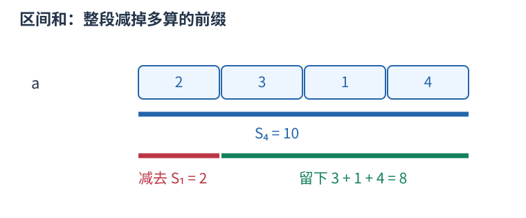

# P8873 二分所在波段，再按段内折线求值 题解

## 目录

| 题号 | 题名 | 考点 | 难度 |
|---|---|---|---|
| A | E-梅莉的市场经济学 | 二分查找 + 递推 | 1500 |

## A. E-梅莉的市场经济学

> 原题：[P8873](https://www.luogu.com.cn/problem/P8873)
> 解法：二分所在波段，再按段内折线求值 · C++17

### 题意

序列从 [0] 开始，第 $i$ 段依次从零升到 $i$、降到负 $i$、再升回零，$i$ 从零计，回答给定位置的值。

<!-- reusable-foundations:start -->

### 从零讲：C++ 输入输出：把数据读进变量，把结果写到标准输出

程序运行时从标准输入接收题目给的数据，把答案送到标准输出。`cin` 和 `cout` 定义在 `<iostream>`；写 `using namespace std;` 后可以省略它们前面的 `std::`。最小完整程序是：

```cxx
#include <iostream>
using namespace std;
int main() {
    int a, b;
    cin >> a >> b;
    cout << a + b << '\n';
    return 0;
}
```

输入二十和三十，两个变量分别保存二十、三十，输出五十。`int a, b;` 声明两个整数变量；`cin >> a` 才给变量赋入输入值。多个 `>>` 从左到右读取，读取整数时会跳过空格、制表符、换行，所以两个整数可以分处两行。负号属于整数，不需要另读一个符号。

`cout <<` 后可以接数值、字符或字符串。`' '` 是一个空格字符，`'\n'` 是换行字符，`"Hello"` 是字符串。`cout << a << ' ' << b << '\n';` 输出两个以空格分开的整数并换行。评测程序只需要答案，不应加入“请输入”等提示。

读取 `char c; cin >> c;` 会跳过前导空白。要读取包含空格的一整行，用 `<string>` 中的 `string s; getline(cin, s);`。若此前用 `cin >> n` 读取过整数，换行还留在输入中，需要先处理那一个剩余换行；不能盲目把所有空格都删掉，因为字符画的行首空格和文本中的空格可能就是数据。

`fixed << setprecision(3)`（需要 `<iomanip>`）表示以小数形式保留三位小数，例如把 $2.5$ 输出成 $2.500$；不用 `fixed` 时，`setprecision` 指有效数字总数。设置会影响后续输出，使用前应确认所需精度。

竞赛中可在首次输入输出前调用 `ios::sync_with_stdio(false); cin.tie(nullptr);`，减少 C++ 流与 C 标准输入输出的同步、绑定开销。随后保持使用 `cin/cout`，不要混用另一套 `scanf/printf`。交互题还要在需要对方回应前主动刷新，例如 `cout << query << endl;`；普通题用换行字符即可。

读入长度为 $L$ 的文本、或输出 $L$ 个字符，至少需要 $O(L)$ 时间。数据类型仍要能容纳结果：把两个整数相乘时，即使保存到 `long long`，也要让乘法本身在这个类型中进行，例如先把输入声明为 `long long`。

### 从零讲：分支与循环：按条件选择，按次序重复

`if (条件) { ... } else { ... }` 根据条件的真假选择一条分支。比较运算 `==`、`!=`、`<`、`<=`、`>`、`>=` 返回真假值；`=` 是赋值，不能代替相等比较。`&&` 表示两边都成立，`||` 表示至少一边成立，`!` 把真假反转。

```cxx
int score = 85;
if (score >= 90) cout << "A";
else if (score >= 60) cout << "B";
else cout << "C"; // 这个例子输出 B
```

这条分支链只执行第一个符合条件的分支。先处理高分后，第二个条件自然只会接到低于九十分的数。几个独立的 `if` 则可能执行多次；两种结构代表不同问题。逻辑运算会短路：`i < n && a[i] == 0` 先确认下标合法，才读取那一格。

`for (初始化; 继续条件; 每轮更新)` 适合知道重复范围的情况。例如下列代码依次处理一到四，总和是十：

```cxx
int sum = 0;
for (int i = 1; i <= 4; ++i) {
    sum += i;
}
cout << sum;
```

初始化只做一次；每轮先判断条件，条件为真才执行循环体，随后执行更新。`++i` 把 $i$ 加一，`sum += i` 等价于把旧 sum 加 $i$ 再保存。应明确每个变量在循环前、循环后分别表示什么；最大值相同时是否更新，决定了保留较早还是较晚的答案。

`while (条件)` 适合“不满足目标就再做一步”：

```cxx
int x = 13, times = 0;
while (x > 1) {
    x /= 2;
    ++times;
}
// x 依次是 13、6、3、1，执行三次
```

循环开始前先检查条件，初始已满足目标时可能一次也不执行。每次执行必须推进状态，否则可能无限循环。`break` 结束最内层循环，`continue` 跳过本轮剩余部分；`for` 中的 continue 之后仍会执行每轮更新。

复杂度由实际执行次数决定。上述求和执行 $n$ 次是 $O(n)$；每次将正整数减半只执行 $O(\log n)$ 次。两层循环不能仅凭外观判定为平方：内层若总共只前进 $n$ 次，总量仍可能线性。变量应在正确作用范围初始化；多组数据的计数器若未重置，下一组会错误继承上一组结果。

### 从零讲：vector：长度可变的连续数组

`vector<T>` 保存一串同类型的元素，适合按下标访问、扫描、排序。`T` 是元素类型，例如 `vector<int>` 保存整数，`vector<pair<int,int>>` 保存整数对，`vector<vector<int>>` 可保存每个顶点各自的邻居。需要 `<vector>`。

```cxx
vector<int> a(3, 7);   // 三个元素，内容是 7、7、7
a.push_back(9);       // 在末尾追加，现在长度为 4
int x = a[1];         // 从 0 编号，这里得到 7
a[1] = 2;            // 改第二个元素
int n = int(a.size());
```

`vector<int> a(3)` 创建三个值为零的元素；`a.reserve(3)` 只预留容量，元素数仍为零，此时不能访问 `a[0]`。长度 `size()` 与容量 `capacity()` 是不同概念。

下标访问为 $O(1)$，遍历为 $O(n)$。末尾追加通常为 $O(1)$；容量不足时会分配更大的连续空间并搬移元素，这次可能为 $O(n)$，一连串追加的平均成本称为摊还 $O(1)$。中间插入或删除会搬移后续元素，最坏 $O(n)$。内存是元素量的 $O(n)$，并可能预留部分尚未使用的容量。

`begin()` 指向首元素，`end()` 指向尾后位置，`sort(a.begin(),a.end())` 操作整个数组。`a[i]` 不检查越界；下标须满足 $0\le i<\mathrm{size}$。`at(i)` 会检查越界并抛异常。空数组不能访问 `front()`、`back()`；`pop_back()` 也要求非空。

扩容后指向旧存储的迭代器、引用和指针会失效。遍历的同时 `push_back`，不能假定此前取得的引用仍可用。读取大数组的函数常用 `const vector<int>& a` 按常量引用传入，既不复制也禁止通过该引用修改；`vector<int> a` 按值传参则复制内容。选择副本还是引用取决于是否要保留独立数据。

### 从零讲：整数类型、整除与溢出

计算前先看每一步可能达到的范围。常见环境中 `int` 是 32 位，上界约 $2.1\times10^9$；`long long` 至少 64 位，常见有符号 64 位上界约 $9.22\times10^{18}$。`using ll = long long;` 只是为已有类型起别名。

```cxx
int a = 100000, b = 100000;
long long wrong = a * b;      // 右边先按 int 乘，可能已溢出
long long right = 1LL * a * b; // 先把运算提升到 long long
```

不能指望“接收结果的变量够大”修复此前已经溢出的计算。先提高操作数类型，再做乘法。超过 64 位时，GCC 的 `__int128` 可作中间量，但它不是标准 C++17 类型，也没有标准流输出重载；先证明范围，再选择工具。

整数 `/` 对有符号数向零截断：`7/3==2`、`-7/3==-2`。对非负数才等于向下取整。余数满足 `a == (a/b)*b + a%b`，除数不能为零；要将余数归入 $[0,m-1]$（$m>0$），可用 `(a % m + m) % m`，同时保证中间加法不溢出。

非负 $a$、正 $b$ 的向上取整可写 `a/b + (a%b != 0)`，比 `(a+b-1)/b` 更容易避免加法溢出。比较平方时也应在宽类型内计算；浮点数不适合作为大整数相等的默认判断方式。

`size()` 返回无符号类型。空容器上写 `size()-1` 会绕到很大的数，逆序遍历可以先转成有符号、确认长度，或使用逆向迭代器。`abs` 对最小有符号数无法在同类型中表达其正值，需先约束输入差值范围。一般机器整数运算按常数时间估算，宽类型解决表示范围，不改变算法的增长阶。

### 从零讲：lower_bound 与 upper_bound：从位置到数量

#### 什么时候使用

有一批可以比较大小的数据，需要反复问“小于某数的有几个”“某个值出现几次”“第一个达到要求的元素在哪”。先排序，再查边界，能避免每次从头扫描。这里先讨论从小到大的 `vector<int>`，头文件为 `<algorithm>` 和 `<vector>`，适用于 C++17。

#### 先弄清返回的是什么

`a.begin()` 指向第一个元素，`a.end()` 指向末元素之后的空位置。`[a.begin(), a.end())` 包含左端、不包含右端。迭代器可以理解为指向容器中某个位置的标记；它不是元素的值，也不是数量。

设有序数组为 $[1,2,2,2,5,8]$，下标从零开始，查询 $x=2$：


- `lower_bound(a.begin(), a.end(), x)` 返回第一个**大于等于** `x` 的位置，这里是下标一。
- `upper_bound(a.begin(), a.end(), x)` 返回第一个**严格大于** `x` 的位置，这里是下标四。

把名字与等号绑定记忆：`lower_bound` 是相等区间的左边界，`upper_bound` 是相等区间的右边界；没有相等元素时两条边界重合。两个函数均不保证命中 `x`。

```cxx
vector<int> a{1, 2, 2, 2, 5, 8};
int x = 2;
auto lo = lower_bound(a.begin(), a.end(), x);
auto hi = upper_bound(a.begin(), a.end(), x);
int less = int(lo - a.begin());          // 1 个元素 < 2
int lessEqual = int(hi - a.begin());     // 4 个元素 <= 2
int equal = int(hi - lo);                // 3 个元素 == 2
```

#### 为什么“位置减 begin”可以计数

`lo` 之前恰有下标 $0$ 到 $0$ 的一个元素。一般地，第一个大于等于 $x$ 的位置如果是 $k$，它前面的下标为 $0,1,\ldots,k-1$，恰有 $k$ 个；有序性保证这 $k$ 个全部严格小于 $x$，之后没有漏下的小数。对 `vector`，`lo-a.begin()` 就是跨过的格子数 $k$。

同理，`hi` 之前全部不大于 $x$，所以它的下标就是不大于 $x$ 的数量。令数组长度为 $n$，便有：

| 要统计的元素 | C++ 表达式 | 本例结果 |
|---|---|---|
| 小于 $x$ | `lo - a.begin()` | $1$ |
| 不大于 $x$ | `hi - a.begin()` | $4$ |
| 大于等于 $x$ | `a.end() - lo` | $5$ |
| 大于 $x$ | `a.end() - hi` | $2$ |
| 等于 $x$ | `hi - lo` | $3$ |

因此，函数本身找的是分界位置，计数来自分界两边的长度。查询闭区间 $[L,R]$ 中的数量（保证 $L\le R$），用 `upper_bound(..., R)-lower_bound(..., L)`；这也避免了写 `L-1` 时可能发生的整数下溢。

#### 底层怎样二分

下面返回下标，展示 `lower_bound` 的核心逻辑，不依赖库函数：

```cxx
int first_ge(const vector<int>& a, int x) {
    int left = 0, right = int(a.size());
    // 答案在位置 [left, right] 内；待判断元素在 [left, right)。
    while (left < right) {
        int mid = left + (right - left) / 2;
        if (a[mid] < x) left = mid + 1;
        else right = mid;
    }
    return left;  // 可以等于 a.size()，表示没有符合条件的元素
}
```

若中点小于 $x$，它左侧都小于 $x$，连同中点一起排除；否则答案不会在中点右侧，把右边界移到中点，保留中点本身作为可能答案。每次排除约一半候选，区间长度从 $n$ 变成约 $n/2,n/4,\ldots$，经过约 $\log_2 n$ 次就剩一个边界，所以时间为 $O(\log n)$，额外空间为 $O(1)$。

实现 `upper_bound` 时，把 `a[mid] < x` 改为 `a[mid] <= x`：遇到相等也继续向右，才能越过全部重复值。比如六个数查二，`lower_bound` 的左边界、右边界和中点三个下标依次为 $(0,6,3)$、$(0,3,1)$、$(0,1,0)$，最终返回一；`upper_bound` 依次为 $(0,6,3)$、$(4,6,5)$、$(4,5,4)$，最终返回四。

#### 使用条件和边界

第一次排序花 $O(n\log n)$，之后 $q$ 次查询共花 $O(q\log n)$。每次查询前都重新排序，会丢掉复用有序数组的优势。若还需要原来的配对、编号或顺序，应另存原数据，再排序供查询的副本。

查零时两条边界都在 `begin()`；查十时都在 `end()`；查三时都指向五。空数组也会返回 `end()`，计数自然为零。**可以拿 `end()` 计算长度，不能解引用它。** 查是否存在应写 `it != a.end() && *it == x`。

一般前提是比较条件能把范围分成两段；完整升序是最易保证的方式。普通乱序数组不能直接套用。降序或自定义排序必须使用匹配的比较器，不能沿用上表的自然大小解释。

`vector`、数组的随机访问迭代器支持常数时间跳到中点和相减，所以总时间为 $O(\log n)$。`list` 或 `set` 的迭代器不支持相减，通用二分虽然比较次数是对数，迭代器移动却可能达到线性；在 `set`、`map` 上优先用成员函数 `s.lower_bound(x)`、`s.upper_bound(x)`，它们沿树查找为 $O(\log n)$。成员函数得到的迭代器到 `begin()` 的距离仍未必能快速计算。

规范核对：[C++ 工作草案：二分边界算法](https://eel.is/c++draft/alg.binary.search)。本文只使用 C++17 已有接口。

### 从零讲：前缀和：一段和由两段前缀相减

一串数需要反复询问连续一段的总和，逐段扫描会重复加很多相同元素。先保存从头到每个位置的累计量，就能复用这些工作。

对从一编号的数组定义 $S_0=0$，$S_i=a_1+\cdots+a_i$。例如 $a=[2,3,1,4]$，前缀为 $S=[0,2,5,6,10]$。



查询 $[2,4]$ 时，$S_4$ 包含第一个数，减去 $S_1$ 后留下 $3+1+4=8$。一般地，$S_r-S_{l-1}$ 中前 $l-1$ 项逐项抵消，只留下第 $l$ 到第 $r$ 项。

```cxx
vector<long long> s(n + 1, 0);
for (int i = 1; i <= n; ++i) s[i] = s[i - 1] + a[i];
long long sum = s[r] - s[l - 1];
```

预处理 $O(n)$ 时间和空间，每次查询 $O(1)$，比 $q$ 次逐段扫描的最坏 $O(nq)$ 更适合大量静态区间和。若使用从零编号的原数组，也可定义 $P_i$ 为前 $i$ 项之和，查询闭区间 $[l,r]$ 为 $P_{r+1}-P_l$；不要混用两套下标。

前缀可以累积满足条件的次数，把每项变成零或一；也可以保存异或，此时相同前缀通过异或抵消。最小值没有同样的可逆减法，不能直接套区间最小值。原数组改变后，后续许多前缀都受影响；频繁在线修改时可考虑树状数组或线段树。

首个空前缀零不可漏，累加类型要覆盖总和。数学上的减法可能得到负值，别让无符号类型把它变成巨大正数。

### 从零讲：整数、实数与单位换算

C++ 的数值类型决定了运算规则。`int` 适合常见的较小整数；`long long` 至少有 64 位，适合较大的整数与乘积；`double` 保存近似实数，适合面积、比值等需要小数的量，不能把它当作任意精度的十进制数。

```cxx
long long money = 10 * 10 + 3; // 十元三角，统一为一百零三角
long long count = money / 19; // 买得起五支，每支十九角
long long rest = money % 19;  // 还剩八角
double average = 5.0 / 2;     // 得到 2.5
```

正整数除法 `/` 丢掉余数；`%` 给出余数。因此非负整数总量 $x$ 按每组 $d>0$ 拆分时，$x=qd+r$，其中 $q=x/d$、$r=x\bmod d$ 且 $0\le r<d$。例如一百二十五分钟是两小时五分钟。负数除法向零截断，负数的余数规则不能直接套用上述非负分组直觉。

如果需要装下全部物品，最后不足一整组也需要一组，非负总量可以用 `x / d + (x % d != 0)` 向上取整。这样避免 `x+d-1` 在接近类型上限时溢出。实数除法至少让一个操作数是实数；五和二做整数除法，结果已经是整数二，事后再赋给 `double` 也不会恢复小数。

优先统一单位再计算。元和角统一成角，时和分统一成分，升和立方厘米按 $1$ 升等于 $1000$ 立方厘米换算。整数单位既减少分支，也能避开无必要的浮点误差。

赋值给大类型不会挽救已发生的小类型溢出：`long long z = a*b;` 中若两边都是 `int`，先做 `int` 乘法。可把输入声明为 `long long`，或用 `1LL*a*b` 让乘法在大类型中进行。除法要等需要合并的分子完整计算后再做，逐项取整可能丢掉余数。

`sqrt(x)` 在 `<cmath>` 中求非负实数的平方根；`ceil(x)` 返回不小于实数 `x` 的最小整数值，但返回类型仍是浮点类型。浮点计算只保留近似值，输出小数时按题目精度要求格式化；可以用整数精确表示的比较和整除问题应尽量直接用整数。

`abs(x)` 返回数值的绝对值，例如 abs(-5) 为五，适合比较分差和距离；最小负整数的正值可能无法放回同一有符号类型，不能假定任何输入都可安全取绝对值。`min(a,b)`、`max(a,b)` 选两者较小、较大的值，比较类型应一致；`min({a,b,c})` 用初始化列表比较三项。两个数比较只需常数时间，列表比较需要线性扫描列表内的元素，不能把长度会变化的列表比较都当作常数操作。

<!-- reusable-foundations:end -->

### 思路

第 $i$ 段长度 4i+1，前零到 $i$ 段总长度 $F(i)=(i+1)(2i+1)$。二分最小 $i$ 使 $F(i) \ge k$，再求零起始段内偏移 $t$。$t \le i$ 时值为 $t$，$i<t \le 3i$ 时值为 $2i-t$，其余为 $t-4i$。

每次查询时间 $O(\log k)$、额外空间 $O(1)$。

### 参考代码

```cpp
#include <bits/stdc++.h>
using namespace std;

int main() {
    ios::sync_with_stdio(false);
    cin.tie(nullptr);
int queries;cin>>queries;while(queries--){long long k;cin>>k;long long lo=0,hi=2000000000LL;
    while(lo<hi){long long mid=(lo+hi)/2;if((mid+1)*(2*mid+1)>=k)hi=mid;else lo=mid+1;}
    // 找到波段后，转换为从零开始的段内偏移。
    long long i=lo,t=k-i*(2*i-1)-1;
    if(t<=i)cout<<t<<'\n';else if(t<=3*i)cout<<2*i-t<<'\n';else cout<<t-4*i<<'\n';
}
    return 0;
}
```

### 易错点

第零段只有一个零；段内偏移要减一；平方级乘积先用 long long。

## 实测记录

本地 C++17 编译、1 组原站样例与 2 组独立边界/小域校验通过。
正文参考程序与源码逐字核对；没有向原站提交。
