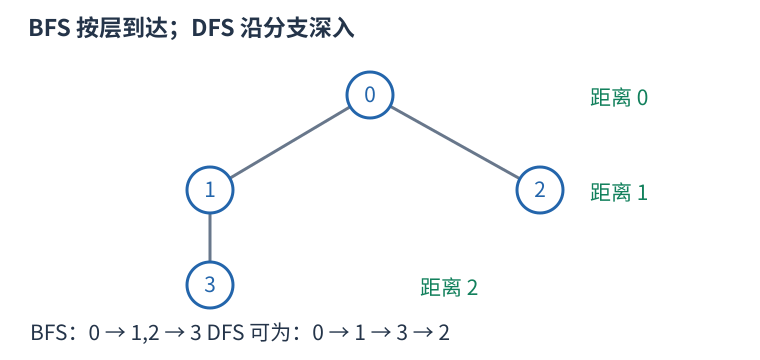
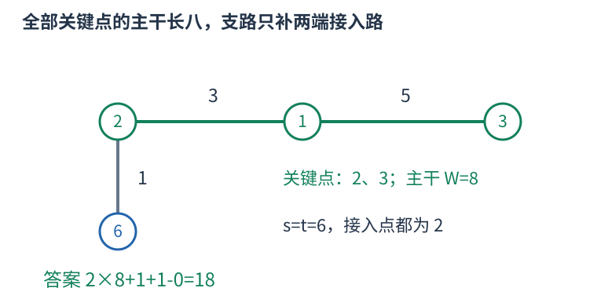

# P9433 关键点的连通子树只建一次，询问只补两条接入路 题解

## 目录

| 题号 | 题名 | 考点 | 难度 |
|---|---|---|---|
| A | Stage5 - Conveyors | LCA + 倍增 | 2100 |

## A. Stage5 - Conveyors

> 原题：[P9433](https://www.luogu.com.cn/problem/P9433)
> 解法：关键点的连通子树只建一次，询问只补两条接入路 · C++17

### 题意

带权树中固定$k$个关键点，每次给$s$、$t$，求从$s$走到$t$并至少经过每个关键点一次的最短路程，允许重复经过边。

<!-- reusable-foundations:start -->

### 从零讲：C++ 输入输出：把数据读进变量，把结果写到标准输出

程序运行时从标准输入接收题目给的数据，把答案送到标准输出。`cin` 和 `cout` 定义在 `<iostream>`；写 `using namespace std;` 后可以省略它们前面的 `std::`。最小完整程序是：

```cxx
#include <iostream>
using namespace std;
int main() {
    int a, b;
    cin >> a >> b;
    cout << a + b << '\n';
    return 0;
}
```

输入二十和三十，两个变量分别保存二十、三十，输出五十。`int a, b;` 声明两个整数变量；`cin >> a` 才给变量赋入输入值。多个 `>>` 从左到右读取，读取整数时会跳过空格、制表符、换行，所以两个整数可以分处两行。负号属于整数，不需要另读一个符号。

`cout <<` 后可以接数值、字符或字符串。`' '` 是一个空格字符，`'\n'` 是换行字符，`"Hello"` 是字符串。`cout << a << ' ' << b << '\n';` 输出两个以空格分开的整数并换行。评测程序只需要答案，不应加入“请输入”等提示。

读取 `char c; cin >> c;` 会跳过前导空白。要读取包含空格的一整行，用 `<string>` 中的 `string s; getline(cin, s);`。若此前用 `cin >> n` 读取过整数，换行还留在输入中，需要先处理那一个剩余换行；不能盲目把所有空格都删掉，因为字符画的行首空格和文本中的空格可能就是数据。

`fixed << setprecision(3)`（需要 `<iomanip>`）表示以小数形式保留三位小数，例如把 $2.5$ 输出成 $2.500$；不用 `fixed` 时，`setprecision` 指有效数字总数。设置会影响后续输出，使用前应确认所需精度。

竞赛中可在首次输入输出前调用 `ios::sync_with_stdio(false); cin.tie(nullptr);`，减少 C++ 流与 C 标准输入输出的同步、绑定开销。随后保持使用 `cin/cout`，不要混用另一套 `scanf/printf`。交互题还要在需要对方回应前主动刷新，例如 `cout << query << endl;`；普通题用换行字符即可。

读入长度为 $L$ 的文本、或输出 $L$ 个字符，至少需要 $O(L)$ 时间。数据类型仍要能容纳结果：把两个整数相乘时，即使保存到 `long long`，也要让乘法本身在这个类型中进行，例如先把输入声明为 `long long`。

### 从零讲：分支与循环：按条件选择，按次序重复

`if (条件) { ... } else { ... }` 根据条件的真假选择一条分支。比较运算 `==`、`!=`、`<`、`<=`、`>`、`>=` 返回真假值；`=` 是赋值，不能代替相等比较。`&&` 表示两边都成立，`||` 表示至少一边成立，`!` 把真假反转。

```cxx
int score = 85;
if (score >= 90) cout << "A";
else if (score >= 60) cout << "B";
else cout << "C"; // 这个例子输出 B
```

这条分支链只执行第一个符合条件的分支。先处理高分后，第二个条件自然只会接到低于九十分的数。几个独立的 `if` 则可能执行多次；两种结构代表不同问题。逻辑运算会短路：`i < n && a[i] == 0` 先确认下标合法，才读取那一格。

`for (初始化; 继续条件; 每轮更新)` 适合知道重复范围的情况。例如下列代码依次处理一到四，总和是十：

```cxx
int sum = 0;
for (int i = 1; i <= 4; ++i) {
    sum += i;
}
cout << sum;
```

初始化只做一次；每轮先判断条件，条件为真才执行循环体，随后执行更新。`++i` 把 $i$ 加一，`sum += i` 等价于把旧 sum 加 $i$ 再保存。应明确每个变量在循环前、循环后分别表示什么；最大值相同时是否更新，决定了保留较早还是较晚的答案。

`while (条件)` 适合“不满足目标就再做一步”：

```cxx
int x = 13, times = 0;
while (x > 1) {
    x /= 2;
    ++times;
}
// x 依次是 13、6、3、1，执行三次
```

循环开始前先检查条件，初始已满足目标时可能一次也不执行。每次执行必须推进状态，否则可能无限循环。`break` 结束最内层循环，`continue` 跳过本轮剩余部分；`for` 中的 continue 之后仍会执行每轮更新。

复杂度由实际执行次数决定。上述求和执行 $n$ 次是 $O(n)$；每次将正整数减半只执行 $O(\log n)$ 次。两层循环不能仅凭外观判定为平方：内层若总共只前进 $n$ 次，总量仍可能线性。变量应在正确作用范围初始化；多组数据的计数器若未重置，下一组会错误继承上一组结果。

### 从零讲：vector：长度可变的连续数组

`vector<T>` 保存一串同类型的元素，适合按下标访问、扫描、排序。`T` 是元素类型，例如 `vector<int>` 保存整数，`vector<pair<int,int>>` 保存整数对，`vector<vector<int>>` 可保存每个顶点各自的邻居。需要 `<vector>`。

```cxx
vector<int> a(3, 7);   // 三个元素，内容是 7、7、7
a.push_back(9);       // 在末尾追加，现在长度为 4
int x = a[1];         // 从 0 编号，这里得到 7
a[1] = 2;            // 改第二个元素
int n = int(a.size());
```

`vector<int> a(3)` 创建三个值为零的元素；`a.reserve(3)` 只预留容量，元素数仍为零，此时不能访问 `a[0]`。长度 `size()` 与容量 `capacity()` 是不同概念。

下标访问为 $O(1)$，遍历为 $O(n)$。末尾追加通常为 $O(1)$；容量不足时会分配更大的连续空间并搬移元素，这次可能为 $O(n)$，一连串追加的平均成本称为摊还 $O(1)$。中间插入或删除会搬移后续元素，最坏 $O(n)$。内存是元素量的 $O(n)$，并可能预留部分尚未使用的容量。

`begin()` 指向首元素，`end()` 指向尾后位置，`sort(a.begin(),a.end())` 操作整个数组。`a[i]` 不检查越界；下标须满足 $0\le i<\mathrm{size}$。`at(i)` 会检查越界并抛异常。空数组不能访问 `front()`、`back()`；`pop_back()` 也要求非空。

扩容后指向旧存储的迭代器、引用和指针会失效。遍历的同时 `push_back`，不能假定此前取得的引用仍可用。读取大数组的函数常用 `const vector<int>& a` 按常量引用传入，既不复制也禁止通过该引用修改；`vector<int> a` 按值传参则复制内容。选择副本还是引用取决于是否要保留独立数据。

### 从零讲：整数类型、整除与溢出

计算前先看每一步可能达到的范围。常见环境中 `int` 是 32 位，上界约 $2.1\times10^9$；`long long` 至少 64 位，常见有符号 64 位上界约 $9.22\times10^{18}$。`using ll = long long;` 只是为已有类型起别名。

```cxx
int a = 100000, b = 100000;
long long wrong = a * b;      // 右边先按 int 乘，可能已溢出
long long right = 1LL * a * b; // 先把运算提升到 long long
```

不能指望“接收结果的变量够大”修复此前已经溢出的计算。先提高操作数类型，再做乘法。超过 64 位时，GCC 的 `__int128` 可作中间量，但它不是标准 C++17 类型，也没有标准流输出重载；先证明范围，再选择工具。

整数 `/` 对有符号数向零截断：`7/3==2`、`-7/3==-2`。对非负数才等于向下取整。余数满足 `a == (a/b)*b + a%b`，除数不能为零；要将余数归入 $[0,m-1]$（$m>0$），可用 `(a % m + m) % m`，同时保证中间加法不溢出。

非负 $a$、正 $b$ 的向上取整可写 `a/b + (a%b != 0)`，比 `(a+b-1)/b` 更容易避免加法溢出。比较平方时也应在宽类型内计算；浮点数不适合作为大整数相等的默认判断方式。

`size()` 返回无符号类型。空容器上写 `size()-1` 会绕到很大的数，逆序遍历可以先转成有符号、确认长度，或使用逆向迭代器。`abs` 对最小有符号数无法在同类型中表达其正值，需先约束输入差值范围。一般机器整数运算按常数时间估算，宽类型解决表示范围，不改变算法的增长阶。

### 从零讲：具名函数：给可复用计算一个明确接口

函数把一段计算包装成“输入参数 → 返回结果”。例如判断整数是否为偶数：

```cxx
bool even(int x) {
    return x % 2 == 0;
}
int main() {
    bool a = even(8); // a 为 true
    bool b = even(7); // b 为 false
}
```

`bool` 是返回类型，`even` 是函数名，`int x` 是参数声明。调用 `even(8)` 时，实参八传入这个新调用的局部变量 $x$，执行 return 后把真假值交回调用处。定义本身不执行计算，只有调用才执行。函数应在调用处之前定义，或提前写声明。

普通数值参数按值传递，函数里修改 $x$ 不会改变调用者原变量。参数写成 `int &x` 时才引用调用者对象；必须让这个对象在调用期间有效。`const vector<int>& a` 用引用避免复制整个容器，并承诺不通过这个引用修改它。返回局部变量的值是安全的，返回局部变量的引用则在函数结束后失效。

函数名应说明它回答的问题，调用处负责传哪些数据。例如闰年判定只接收一个年份并返回真假，枚举年份范围和输出格式由调用者处理。同一判定被多次使用时，这能减少规则不一致；但函数包装不会自动降低算法复杂度，仍要把每次调用实际做的工作计入时间。

如果函数内部又调用自身，就是递归，需要明确最小情况如何直接返回、每次调用如何逼近它；递归会占用调用栈。普通辅助函数可以不使用递归，不应仅因写成函数就称作递归算法。

### 从零讲：图的表示、BFS 与 DFS

图由顶点与边组成，适合表达“哪些对象之间能一步到达”。有向边只允许一个方向；无向边需保存两个方向。邻接表 `vector<vector<int>> graph(n)` 为每个顶点保存邻居，空间 $O(n+m)$，无向边在表中出现两次。

以边 $0-1,0-2,1-3$ 为例，从零出发：



#### BFS 为什么得到最少边数

初始顶点距离为零，入先进先出的队列。弹出顶点时，将尚未到达的邻居距离设为当前距离加一，并立刻标记入队。距离为一的顶点都会先于距离为二的处理，因此第一次发现就是最少边数。

```cxx
vector<int> distance(n, -1);
queue<int> q;
distance[start] = 0; q.push(start);
while (!q.empty()) {
    int u = q.front(); q.pop();
    for (int v : graph[u]) if (distance[v] == -1) {
        distance[v] = distance[u] + 1;
        q.push(v);
    }
}
```

适用于无权或所有边代价相同的最少步数。边权不同，第一次发现未必费用最小，不能继续套这一结论。多起点 BFS 先把所有合法起点设零并入队。

#### DFS 的调用代表一整块未探索区域

DFS 标记当前点后，递归处理每个尚未访问的邻点；也可用显式栈。上例可能按 $0,1,3,2$ 的顺序深入，但顺序取决于邻居存放方式。它擅长检查连通性、处理子树和回溯，不保证最短路径。

两种遍历在每个顶点入队或调用一次、每条边检查常数次的实现下，时间均为 $O(n+m)$，额外标记和队列/栈为 $O(n)$。不要等出队才首次标记，否则同一顶点可能重复入队。图不连通时，从一个起点无法覆盖所有点；统计连通块应从每个尚未访问点再启动一次遍历。树的深递归可能用尽调用栈。

### 从零讲：树的根、子树、DFS 序与倍增

树是连通且无环的无向图，$n$ 个顶点有 $n-1$ 条边。指定一个根后，每个非根顶点有唯一父亲，其他向下邻居是孩子。子树包含自己和全部后代；换根会改变父子关系，但不改变原边。


#### 子树信息按依赖顺序计算

例如子树大小 `size[u]` 初始为一，每个孩子处理完后累加 `size[v]`。一来自节点自己，不能漏掉。树形 DP 也如此：先明确某状态允许怎样选择，再合并各孩子提供的信息；孩子独立性来自树上没有跨子树边，仍可能因总预算或选中父亲等条件产生状态关联。

换根 DP 先求一个根的状态，再沿边换根，将“来自孩子的一侧”和“来自父亲的一侧”合并。应画清只有哪条边的方向改变、哪些量不变；不能仅凭两张答案表代替依赖解释。普通遍历每条边常数次为 $O(n)$，背包式合并可能更大，按实际合并循环计算。

#### DFS 序为什么能把子树变成区间

进入节点时分配编号 `tin[u]`，完成整棵子树后记录最后编号 `tout[u]`。深度优先在返回父亲前会完整处理这棵子树，因此它的所有编号连续，恰是 $[tin[u],tout[u]]$。这允许把子树和等查询交给数组结构。若同时记录进出事件，区间定义会不同，不可混用两种序列。

#### 倍增与最近公共祖先

`up[k][u]` 存 $u$ 向上 $2^k$ 条边到达的祖先。基础 `up[0][u]=parent[u]`，递推为 `up[k][u]=up[k-1][up[k-1][u]]`，因为连续走两段 $2^{k-1}$。跳十三层可拆为八加四加一，只需对数个跳跃。

LCA 是两个节点公共祖先中最深者。先把更深的一方跳到同深度；若已经相同就是答案。否则从大到小试跳，祖先不同才两边同时上移，最后它们的父亲就是 LCA。预处理 $O(n\log n)$、每次查询 $O(\log n)$，表空间 $O(n\log n)$。根的虚拟祖先需统一定义，不能访问非法下标。

树的直径在非负无权边长等常见条件下可用两次最远点搜索求出；带负权时要重新判断。虚树则将关注节点按 DFS 序组织，补上相邻节点的 LCA 后连接祖先关系，边应携带原路径含义，不能把压缩后一条边误当原图一步。深链上的递归也须留意栈深度。

### 从零讲：倍增：把重复后继操作拼成二的幂次步长

若每个状态都有唯一后继 $next[u]$，反复移动 $t$ 步可以预先保存一、二、四、八……步的目的地。它适用于树的祖先、函数反复应用、跳转链等，不要求状态原本就是一棵树。

定义 $up[j][u]$ 为从 $u$ 出发走 $2^j$ 次后继到达的位置。基础 $up[0][u]=next[u]$；两段各 $2^{j-1}$ 次组成 $2^j$ 次，所以令 $v=up[j-1][u]$，有 $up[j][u]=up[j-1][v]$。先算小 $j$ 再算大 $j$，第二段才有现成答案。

例如链 1→2→3→4→5→0，走三步可拆成二加一：先从一用二步表到三，再用一步表到四。拆分的是移动次数，目的地必须沿上一次的结果继续，不能每次都从原起点查表。

如果每移动一次有费用 $w[u]$，约定费用属于出发状态 $u$、不包含最终到达者，就可同步保存 $cost[j][u]$。拼接公式是 $cost[j-1][u]+cost[j-1][v]$；若错误地把中间点在两段都算一遍，就会重复收费。

```cxx
// 此例使用固定大小的一张后继表；零号状态表示终点。
int next_node[6] = {0, 2, 3, 4, 5, 0};
int up[3][6] = {};
for (int u = 0; u < 6; ++u) up[0][u] = next_node[u];
for (int j = 1; j < 3; ++j)
    for (int u = 0; u < 6; ++u)
        up[j][u] = up[j-1][up[j-1][u]];
int u = 1, steps = 3;
for (int j = 0; j < 3; ++j)
    if ((steps >> j) & 1) u = up[j][u];
```

以上代码结束时 $u=4$。所有表下标必须合法，终点零的后继也设为零；如果要求走精确 $t$ 步，最大层数由 $t$ 的位数决定，而非一律由状态数决定。无环且链长至多 $n$ 时，按 $n$ 的位数建表就够用。

用预算找最长可走前缀时，常从大步长往小试跳，只有整段费用满足预算才接纳。这依赖费用非负等保证可行前缀具有单调性的条件，不能把任意带负费用的链也照搬。比较使用 `<` 还是 `<=` 由“恰好用完是否允许离开当前段”的题意决定。

$n$ 个状态、最大跳数 T 的预处理时间与空间均为 $O(n \log(T+1))$，一次按位跳转为 $O(\log(T+1))$。费用累加可能超过单步数值，应使用足够宽的整数类型。

### 从零讲：pair、tuple 与结构化绑定

有些数据天然需要成组：一个区间有两个端点，一个队列状态有坐标和距离。`pair<A,B>` 保存两项，用 `.first`、`.second` 读取；`tuple<A,B,C>` 可保存更多项，用 `get<0>(t)` 等读取。分别需要 `<utility>`、`<tuple>`。

C++17 的结构化绑定能为一组分量起局部名字：

```cxx
pair<int,int> point{3, 5};
auto [x, y] = point;      // 复制出两个分量
x = 9;                  // point.first 仍为 3
auto& [u, v] = point;    // 绑定原对象的分量
u = 7;                  // point.first 变为 7
```

`for (auto [l,r] : segments)` 每轮读取一对值；`for (const auto& [l,r] : segments)` 以只读引用读取，避免复制；需要修改原记录时才用 `auto&`。引用必须在原对象还存在且位置未失效时使用。

`pair` 和 `tuple` 的默认比较是字典序：从第一项起，第一个不同的分量决定顺序。`priority_queue<pair<int,int>>` 因而先比较第一项，再以第二项破同分，不能误认为只看第一项。这类语法只让记录组织和访问更清楚，拆分本身的成本取决于分量是否需要复制。

<!-- reusable-foundations:end -->

### 思路




先找连接全部关键点的最小子树H，总边权W。每个点$v$记录到H的唯一接入点$p[v]$和距离$h[v]$。询问答案为$2W+h[s]+h[t]-dist(p[s], p[t])$：H内除接入点间路径走一次，其余边走两次；两端接入路各走一次。用LCA计算最后的距离。

预处理时间、空间 $O(n\log n)$，每次询问 $O(\log n)$。

### 参考代码

```cpp
#include <bits/stdc++.h>
using namespace std;
struct Lift{
    int n,levels;vector<int>depth,order;vector<vector<int>>up;
    Lift(const vector<vector<int>> &g,int root):n(g.size()),levels(1),depth(n,-1){
        while((1LL<<levels)<=n)++levels;up.assign(levels,vector<int>(n,root));
        depth[root]=0;order.push_back(root);
        // 显式遍历次序，链形树也不消耗深递归调用栈。
        for(size_t i=0;i<order.size();++i){int u=order[i];for(int v:g[u])if(depth[v]<0){
            depth[v]=depth[u]+1;up[0][v]=u;order.push_back(v);
        }}
        for(int j=1;j<levels;++j)for(int u=0;u<n;++u)up[j][u]=up[j-1][up[j-1][u]];
    }
    int lca(int u,int v)const{
        if(depth[u]<depth[v])swap(u,v);int gap=depth[u]-depth[v];
        for(int j=0;j<levels;++j)if((gap>>j)&1)u=up[j][u];
        if(u==v)return u;
        for(int j=levels-1;j>=0;--j)if(up[j][u]!=up[j][v]){u=up[j][u];v=up[j][v];}
        return up[0][u];
    }
};
int main() {
    ios::sync_with_stdio(false);
    cin.tie(nullptr);
int n,q,k;cin>>n>>q>>k;vector<vector<int>>g(n);vector<vector<pair<int,int>>>weighted(n);
for(int i=1,u,v,w;i<n;++i){cin>>u>>v>>w;--u;--v;g[u].push_back(v);g[v].push_back(u);weighted[u].push_back({v,w});weighted[v].push_back({u,w});}
vector<int>count(n);vector<char>core(n);for(int i=0,u;i<k;++i){cin>>u;--u;count[u]=1;core[u]=true;}
Lift lift(g,0);vector<long long>rootDist(n);vector<int>edgeWeight(n);
for(int u:lift.order)for(auto [v,w]:weighted[u])if(lift.up[0][v]==u&&v!=u){rootDist[v]=rootDist[u]+w;edgeWeight[v]=w;}
long long total=0;for(int i=n-1;i>0;--i){int u=lift.order[i],p=lift.up[0][u];
    if(count[u]>0&&count[u]<k){total+=edgeWeight[u];core[u]=core[p]=true;}count[p]+=count[u];
}
vector<int>attach(n,-1),order;vector<long long>height(n);for(int u=0;u<n;++u)if(core[u]){attach[u]=u;order.push_back(u);}
for(size_t i=0;i<order.size();++i){int u=order[i];for(auto [v,w]:weighted[u])if(attach[v]<0){attach[v]=attach[u];height[v]=height[u]+w;order.push_back(v);}}
while(q--){int s,t;cin>>s>>t;--s;--t;int a=attach[s],b=attach[t],l=lift.lca(a,b);
    long long distance=rootDist[a]+rootDist[b]-2*rootDist[l];cout<<2*total+height[s]+height[t]-distance<<'\n';
}
    return 0;
}
```

### 易错点

$n$、$q$、$k$按原顺序读；需要全部关键点；$k$为一时H为单点；外部分支只有一个接入点；$s=t$仍可能需要往返；总权六十四位。

## 实测记录

本地 C++17 编译、1 组原站样例与 231 组独立边界/小域校验通过。
正文参考程序与源码逐字核对；没有向原站提交。
