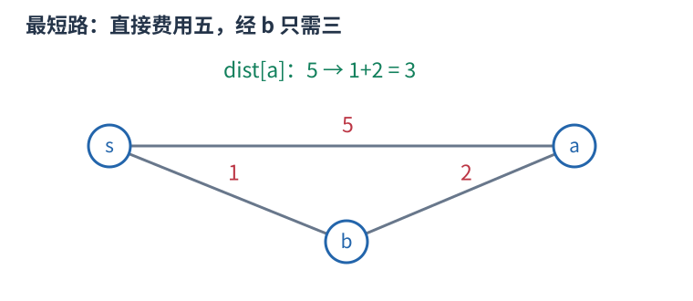
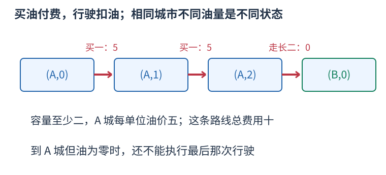

# UVA11367 城市和剩余油量组成状态，Dijkstra 求最少油费 题解

## 目录

| 题号 | 题名 | 考点 | 难度 |
|---|---|---|---|
| A | Full Tank? | 最短路 + 堆 | 1800 |

## A. Full Tank?

> 原题：[UVA11367](https://www.luogu.com.cn/problem/UVA11367)
> 解法：城市和剩余油量组成状态，Dijkstra 求最少油费 · C++17

### 题意

道路双向，每走一单位距离用一单位油，各城油价不同。每个询问从空油箱出发，容量给定，求到目标城的最少购油费用；不能到达输出 impossible。

<!-- reusable-foundations:start -->

### 从零讲：C++ 输入输出：把数据读进变量，把结果写到标准输出

程序运行时从标准输入接收题目给的数据，把答案送到标准输出。`cin` 和 `cout` 定义在 `<iostream>`；写 `using namespace std;` 后可以省略它们前面的 `std::`。最小完整程序是：

```cxx
#include <iostream>
using namespace std;
int main() {
    int a, b;
    cin >> a >> b;
    cout << a + b << '\n';
    return 0;
}
```

输入二十和三十，两个变量分别保存二十、三十，输出五十。`int a, b;` 声明两个整数变量；`cin >> a` 才给变量赋入输入值。多个 `>>` 从左到右读取，读取整数时会跳过空格、制表符、换行，所以两个整数可以分处两行。负号属于整数，不需要另读一个符号。

`cout <<` 后可以接数值、字符或字符串。`' '` 是一个空格字符，`'\n'` 是换行字符，`"Hello"` 是字符串。`cout << a << ' ' << b << '\n';` 输出两个以空格分开的整数并换行。评测程序只需要答案，不应加入“请输入”等提示。

读取 `char c; cin >> c;` 会跳过前导空白。要读取包含空格的一整行，用 `<string>` 中的 `string s; getline(cin, s);`。若此前用 `cin >> n` 读取过整数，换行还留在输入中，需要先处理那一个剩余换行；不能盲目把所有空格都删掉，因为字符画的行首空格和文本中的空格可能就是数据。

`fixed << setprecision(3)`（需要 `<iomanip>`）表示以小数形式保留三位小数，例如把 $2.5$ 输出成 $2.500$；不用 `fixed` 时，`setprecision` 指有效数字总数。设置会影响后续输出，使用前应确认所需精度。

竞赛中可在首次输入输出前调用 `ios::sync_with_stdio(false); cin.tie(nullptr);`，减少 C++ 流与 C 标准输入输出的同步、绑定开销。随后保持使用 `cin/cout`，不要混用另一套 `scanf/printf`。交互题还要在需要对方回应前主动刷新，例如 `cout << query << endl;`；普通题用换行字符即可。

读入长度为 $L$ 的文本、或输出 $L$ 个字符，至少需要 $O(L)$ 时间。数据类型仍要能容纳结果：把两个整数相乘时，即使保存到 `long long`，也要让乘法本身在这个类型中进行，例如先把输入声明为 `long long`。

### 从零讲：分支与循环：按条件选择，按次序重复

`if (条件) { ... } else { ... }` 根据条件的真假选择一条分支。比较运算 `==`、`!=`、`<`、`<=`、`>`、`>=` 返回真假值；`=` 是赋值，不能代替相等比较。`&&` 表示两边都成立，`||` 表示至少一边成立，`!` 把真假反转。

```cxx
int score = 85;
if (score >= 90) cout << "A";
else if (score >= 60) cout << "B";
else cout << "C"; // 这个例子输出 B
```

这条分支链只执行第一个符合条件的分支。先处理高分后，第二个条件自然只会接到低于九十分的数。几个独立的 `if` 则可能执行多次；两种结构代表不同问题。逻辑运算会短路：`i < n && a[i] == 0` 先确认下标合法，才读取那一格。

`for (初始化; 继续条件; 每轮更新)` 适合知道重复范围的情况。例如下列代码依次处理一到四，总和是十：

```cxx
int sum = 0;
for (int i = 1; i <= 4; ++i) {
    sum += i;
}
cout << sum;
```

初始化只做一次；每轮先判断条件，条件为真才执行循环体，随后执行更新。`++i` 把 $i$ 加一，`sum += i` 等价于把旧 sum 加 $i$ 再保存。应明确每个变量在循环前、循环后分别表示什么；最大值相同时是否更新，决定了保留较早还是较晚的答案。

`while (条件)` 适合“不满足目标就再做一步”：

```cxx
int x = 13, times = 0;
while (x > 1) {
    x /= 2;
    ++times;
}
// x 依次是 13、6、3、1，执行三次
```

循环开始前先检查条件，初始已满足目标时可能一次也不执行。每次执行必须推进状态，否则可能无限循环。`break` 结束最内层循环，`continue` 跳过本轮剩余部分；`for` 中的 continue 之后仍会执行每轮更新。

复杂度由实际执行次数决定。上述求和执行 $n$ 次是 $O(n)$；每次将正整数减半只执行 $O(\log n)$ 次。两层循环不能仅凭外观判定为平方：内层若总共只前进 $n$ 次，总量仍可能线性。变量应在正确作用范围初始化；多组数据的计数器若未重置，下一组会错误继承上一组结果。

### 从零讲：vector：长度可变的连续数组

`vector<T>` 保存一串同类型的元素，适合按下标访问、扫描、排序。`T` 是元素类型，例如 `vector<int>` 保存整数，`vector<pair<int,int>>` 保存整数对，`vector<vector<int>>` 可保存每个顶点各自的邻居。需要 `<vector>`。

```cxx
vector<int> a(3, 7);   // 三个元素，内容是 7、7、7
a.push_back(9);       // 在末尾追加，现在长度为 4
int x = a[1];         // 从 0 编号，这里得到 7
a[1] = 2;            // 改第二个元素
int n = int(a.size());
```

`vector<int> a(3)` 创建三个值为零的元素；`a.reserve(3)` 只预留容量，元素数仍为零，此时不能访问 `a[0]`。长度 `size()` 与容量 `capacity()` 是不同概念。

下标访问为 $O(1)$，遍历为 $O(n)$。末尾追加通常为 $O(1)$；容量不足时会分配更大的连续空间并搬移元素，这次可能为 $O(n)$，一连串追加的平均成本称为摊还 $O(1)$。中间插入或删除会搬移后续元素，最坏 $O(n)$。内存是元素量的 $O(n)$，并可能预留部分尚未使用的容量。

`begin()` 指向首元素，`end()` 指向尾后位置，`sort(a.begin(),a.end())` 操作整个数组。`a[i]` 不检查越界；下标须满足 $0\le i<\mathrm{size}$。`at(i)` 会检查越界并抛异常。空数组不能访问 `front()`、`back()`；`pop_back()` 也要求非空。

扩容后指向旧存储的迭代器、引用和指针会失效。遍历的同时 `push_back`，不能假定此前取得的引用仍可用。读取大数组的函数常用 `const vector<int>& a` 按常量引用传入，既不复制也禁止通过该引用修改；`vector<int> a` 按值传参则复制内容。选择副本还是引用取决于是否要保留独立数据。

### 从零讲：整数类型、整除与溢出

计算前先看每一步可能达到的范围。常见环境中 `int` 是 32 位，上界约 $2.1\times10^9$；`long long` 至少 64 位，常见有符号 64 位上界约 $9.22\times10^{18}$。`using ll = long long;` 只是为已有类型起别名。

```cxx
int a = 100000, b = 100000;
long long wrong = a * b;      // 右边先按 int 乘，可能已溢出
long long right = 1LL * a * b; // 先把运算提升到 long long
```

不能指望“接收结果的变量够大”修复此前已经溢出的计算。先提高操作数类型，再做乘法。超过 64 位时，GCC 的 `__int128` 可作中间量，但它不是标准 C++17 类型，也没有标准流输出重载；先证明范围，再选择工具。

整数 `/` 对有符号数向零截断：`7/3==2`、`-7/3==-2`。对非负数才等于向下取整。余数满足 `a == (a/b)*b + a%b`，除数不能为零；要将余数归入 $[0,m-1]$（$m>0$），可用 `(a % m + m) % m`，同时保证中间加法不溢出。

非负 $a$、正 $b$ 的向上取整可写 `a/b + (a%b != 0)`，比 `(a+b-1)/b` 更容易避免加法溢出。比较平方时也应在宽类型内计算；浮点数不适合作为大整数相等的默认判断方式。

`size()` 返回无符号类型。空容器上写 `size()-1` 会绕到很大的数，逆序遍历可以先转成有符号、确认长度，或使用逆向迭代器。`abs` 对最小有符号数无法在同类型中表达其正值，需先约束输入差值范围。一般机器整数运算按常数时间估算，宽类型解决表示范围，不改变算法的增长阶。

### 从零讲：图的表示、BFS 与 DFS

图由顶点与边组成，适合表达“哪些对象之间能一步到达”。有向边只允许一个方向；无向边需保存两个方向。邻接表 `vector<vector<int>> graph(n)` 为每个顶点保存邻居，空间 $O(n+m)$，无向边在表中出现两次。

以边 $0-1,0-2,1-3$ 为例，从零出发：


#### BFS 为什么得到最少边数

初始顶点距离为零，入先进先出的队列。弹出顶点时，将尚未到达的邻居距离设为当前距离加一，并立刻标记入队。距离为一的顶点都会先于距离为二的处理，因此第一次发现就是最少边数。

```cxx
vector<int> distance(n, -1);
queue<int> q;
distance[start] = 0; q.push(start);
while (!q.empty()) {
    int u = q.front(); q.pop();
    for (int v : graph[u]) if (distance[v] == -1) {
        distance[v] = distance[u] + 1;
        q.push(v);
    }
}
```

适用于无权或所有边代价相同的最少步数。边权不同，第一次发现未必费用最小，不能继续套这一结论。多起点 BFS 先把所有合法起点设零并入队。

#### DFS 的调用代表一整块未探索区域

DFS 标记当前点后，递归处理每个尚未访问的邻点；也可用显式栈。上例可能按 $0,1,3,2$ 的顺序深入，但顺序取决于邻居存放方式。它擅长检查连通性、处理子树和回溯，不保证最短路径。

两种遍历在每个顶点入队或调用一次、每条边检查常数次的实现下，时间均为 $O(n+m)$，额外标记和队列/栈为 $O(n)$。不要等出队才首次标记，否则同一顶点可能重复入队。图不连通时，从一个起点无法覆盖所有点；统计连通块应从每个尚未访问点再启动一次遍历。树的深递归可能用尽调用栈。

### 从零讲：最短路：从一步到达转向累计费用

路径费用是沿途边权之和。无权图的 BFS 按边数分层；边权不同时，先到达的路线不一定更便宜。最短路算法维护每个顶点目前已知的最小费用 `dist`，用已知路径尝试改善邻居，这一步叫松弛。

图有边 $s\to a$ 权五、$s\to b$ 权一、$b\to a$ 权二。直接到 $a$ 费用五，通过 $b$ 仅需三。所以不能第一次见到 $a$ 就永远固定为五。



#### 非负边权的 Dijkstra

起点距离零，其余为不可达。每次从小根堆取出当前最小的距离，若不是过期项，就松弛所有出边。非负边权保证尚未处理的更远顶点不可能绕出一条更便宜的路来推翻当前最小者。

```cxx
using State = pair<long long,int>;
priority_queue<State, vector<State>, greater<State>> heap;
dist[start] = 0; heap.push({0, start});
while (!heap.empty()) {
    auto [d, u] = heap.top(); heap.pop();
    if (d != dist[u]) continue;
    for (auto [v, weight] : graph[u]) {
        if (d + weight < dist[v]) {
            dist[v] = d + weight;
            heap.push({dist[v], v});
        }
    }
}
```

此实现可能为一个顶点保存多份堆项，更新后旧项仍在堆中，所以须检查是否过期。按实际入堆的边数，时间 $O((n+m)\log(n+m))$，空间 $O(n+m)$；常见简单图也写成 $O((n+m)\log n)$。距离和加边权要避免溢出。

若边权只为零或一，可用双端队列：零权改善放前端，一权改善放后端，称 0-1 BFS，正确实现可达 $O(n+m)$。负权图不能套非负贪心理由；Bellman-Ford 通过多轮松弛求解并检测可达负环，最坏 $O(nm)$。差分约束 $x_v\le x_u+w$ 可表示为边 $u\to v$ 权 $w$，但求解方向、超级源和负环含义要按约束目标解释。

状态不一定只是原图顶点。若后续费用还依赖钥匙、颜色或次数，应把这些信息并入状态；两条到同一顶点的路径未必能互相替代。

### 从零讲：priority_queue：随时取出最高优先级

若数据不断加入，每次只关心当前最大或最小项，无需每次排序整个数组。`priority_queue<T>` 用堆维护这一项：`top()` 查看，`push(x)` 加入，`pop()` 移除顶部但不返回值。需要 `<queue>`。

```cxx
priority_queue<int> largest;
largest.push(3); largest.push(8); largest.push(5);
int x = largest.top(); // 8，默认大根堆
largest.pop();         // 移走 8，此后顶部为 5
priority_queue<int, vector<int>, greater<int>> smallest;
```

最后一行是小根堆；对由距离和顶点编号组成的 `pair` 使用相同配置，可优先取最小距离。堆只保证顶部最优，内部并非完整有序数组，也不能高效随意查中间某个值。

堆在逻辑上是完全二叉树，高度为 $O(\log n)$，插入上浮、删除下沉最多跨越这个高度。故 `push`、`pop` 为 $O(\log n)$，`top` 为 $O(1)$，空间 $O(n)$。访问或删除顶部之前必须非空。

需要更新某项优先级时，标准 `priority_queue` 没有直接修改接口。常见方法是插入新版，取出时检查它是否仍与外部最新记录相符，丢弃过期项；这会影响队列大小和总复杂度，须按实际插入次数计算。

### 从零讲：pair、tuple 与结构化绑定

有些数据天然需要成组：一个区间有两个端点，一个队列状态有坐标和距离。`pair<A,B>` 保存两项，用 `.first`、`.second` 读取；`tuple<A,B,C>` 可保存更多项，用 `get<0>(t)` 等读取。分别需要 `<utility>`、`<tuple>`。

C++17 的结构化绑定能为一组分量起局部名字：

```cxx
pair<int,int> point{3, 5};
auto [x, y] = point;      // 复制出两个分量
x = 9;                  // point.first 仍为 3
auto& [u, v] = point;    // 绑定原对象的分量
u = 7;                  // point.first 变为 7
```

`for (auto [l,r] : segments)` 每轮读取一对值；`for (const auto& [l,r] : segments)` 以只读引用读取，避免复制；需要修改原记录时才用 `auto&`。引用必须在原对象还存在且位置未失效时使用。

`pair` 和 `tuple` 的默认比较是字典序：从第一项起，第一个不同的分量决定顺序。`priority_queue<pair<int,int>>` 因而先比较第一项，再以第二项破同分，不能误认为只看第一项。这类语法只让记录组织和访问更清楚，拆分本身的成本取决于分量是否需要复制。

<!-- reusable-foundations:end -->

### 思路

到同一座城市，花的钱少却没有油，与稍贵但剩很多油，后面能走的路线和购油决策不同。只给城市保存一个最小费用会丢掉必要状态，因此把剩余油量一并保存。



每个框写城市与剩油，不是城市与已花费用；箭头上才是本次动作增加的费用，行驶不再付第二次油钱。

油量在零到容量 C，每个状态有两类动作。购买一单位油付 $price[u]$，位置不变、油量加一；选择一条长度 $d \le f$ 的道路驶往 $v$，油量减 $d$，当前不再产生费用。开车动作的零费用表示油已经在购买动作时付过，不能把路长或邻城油价再加到费用中。

道路长、容量都是整数；从空箱开始，只在整数路长后扣油，为一单位购油建边足以表达最优方案。任何实际行程都可拆成这些买油与行驶动作，反过来状态图上的路径也可直接执行，因此状态图最短路就是最少购油费用。

边权为油价或零，均非负，适用 Dijkstra。优先队列按累计费用取最小，弹出时若与当前 dist 不同就丢掉旧条目。第一次弹出任意目标城市状态时，它已是全部目标油量中的最低费用，可立即输出，不必强制剩油为零，也不必处理完全部状态。

每个询问容量不同，重新建立对应距离表。起点等于终点可不买油直接得到零；若没有道路能在容量内形成连通路线，堆耗尽后输出小写 impossible。完整输入范围已按 [UVa 官方 PDF](https://onlinejudge.org/external/113/11367.pdf)核对，城市编号从零开始。

每问状态 $O(nC)$、转移 $O(C(n+m))$，时间 $O(C(n+m)\log(nC+1))$、空间 $O(C(n+m))$，包含堆中候选。

### 参考代码

```cpp
#include <bits/stdc++.h>
using namespace std;

int main() {
    ios::sync_with_stdio(false);
    cin.tie(nullptr);
int n,m;cin>>n>>m;vector<int>price(n);for(int &x:price)cin>>x;vector<vector<pair<int,int>>>graph(n);
for(int i=0;i<m;++i){int u,v,d;cin>>u>>v>>d;graph[u].push_back({v,d});graph[v].push_back({u,d});}
int queries;cin>>queries;const long long inf=LLONG_MAX/4;
while(queries--){int capacity,start,target;cin>>capacity>>start>>target;vector<vector<long long>>distance(n,vector<long long>(capacity+1,inf));
    priority_queue<tuple<long long,int,int>,vector<tuple<long long,int,int>>,greater<tuple<long long,int,int>>>todo;
    distance[start][0]=0;todo.push({0,start,0});long long answer=-1;
    while(!todo.empty()){auto [cost,u,fuel]=todo.top();todo.pop();if(cost!=distance[u][fuel])continue;
        if(u==target){answer=cost;break;}
        // 购油付钱，行驶只扣油；费用不能重复记在道路上。
        if(fuel<capacity&&cost+price[u]<distance[u][fuel+1]){distance[u][fuel+1]=cost+price[u];todo.push({distance[u][fuel+1],u,fuel+1});}
        for(auto [v,length]:graph[u])if(length<=fuel&&cost<distance[v][fuel-length]){distance[v][fuel-length]=cost;todo.push({cost,v,fuel-length});}
    }
    if(answer<0)cout<<"impossible\n";else cout<<answer<<'\n';
}
    return 0;
}
```

### 易错点

初始空箱；城市编号从零开始；同城不同剩油是不同状态；行驶不重复加费用；目标城任意剩油都能结束。

## 实测记录

本地 C++17 编译、1 组原站样例与 111 组独立边界/小域校验通过。
正文参考程序与源码逐字核对；没有向原站提交。
