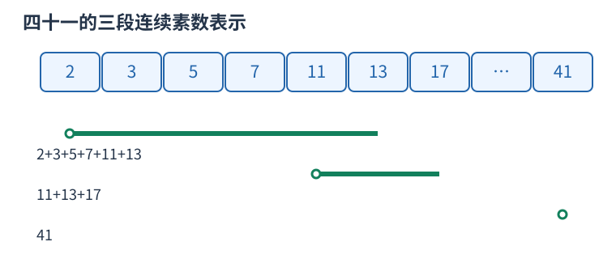

# UVA1210 筛出素数后预统计全部连续素数段 题解

## 目录

| 题号 | 题名 | 考点 | 难度 |
|---|---|---|---|
| A | 连续素数之和 Sum of Consecutive Prime Numbers | 素数 + 枚举 | 1500 |

## A. 连续素数之和 Sum of Consecutive Prime Numbers

> 原题：[UVA1210](https://www.luogu.com.cn/problem/UVA1210)
> 解法：筛出素数后预统计全部连续素数段 · C++17

### 题意

对二到一万之间的整数，求它能写成多少种一个或多个连续素数的和；输入零结束。

<!-- reusable-foundations:start -->

### 从零讲：C++ 输入输出：把数据读进变量，把结果写到标准输出

程序运行时从标准输入接收题目给的数据，把答案送到标准输出。`cin` 和 `cout` 定义在 `<iostream>`；写 `using namespace std;` 后可以省略它们前面的 `std::`。最小完整程序是：

```cxx
#include <iostream>
using namespace std;
int main() {
    int a, b;
    cin >> a >> b;
    cout << a + b << '\n';
    return 0;
}
```

输入二十和三十，两个变量分别保存二十、三十，输出五十。`int a, b;` 声明两个整数变量；`cin >> a` 才给变量赋入输入值。多个 `>>` 从左到右读取，读取整数时会跳过空格、制表符、换行，所以两个整数可以分处两行。负号属于整数，不需要另读一个符号。

`cout <<` 后可以接数值、字符或字符串。`' '` 是一个空格字符，`'\n'` 是换行字符，`"Hello"` 是字符串。`cout << a << ' ' << b << '\n';` 输出两个以空格分开的整数并换行。评测程序只需要答案，不应加入“请输入”等提示。

读取 `char c; cin >> c;` 会跳过前导空白。要读取包含空格的一整行，用 `<string>` 中的 `string s; getline(cin, s);`。若此前用 `cin >> n` 读取过整数，换行还留在输入中，需要先处理那一个剩余换行；不能盲目把所有空格都删掉，因为字符画的行首空格和文本中的空格可能就是数据。

`fixed << setprecision(3)`（需要 `<iomanip>`）表示以小数形式保留三位小数，例如把 $2.5$ 输出成 $2.500$；不用 `fixed` 时，`setprecision` 指有效数字总数。设置会影响后续输出，使用前应确认所需精度。

竞赛中可在首次输入输出前调用 `ios::sync_with_stdio(false); cin.tie(nullptr);`，减少 C++ 流与 C 标准输入输出的同步、绑定开销。随后保持使用 `cin/cout`，不要混用另一套 `scanf/printf`。交互题还要在需要对方回应前主动刷新，例如 `cout << query << endl;`；普通题用换行字符即可。

读入长度为 $L$ 的文本、或输出 $L$ 个字符，至少需要 $O(L)$ 时间。数据类型仍要能容纳结果：把两个整数相乘时，即使保存到 `long long`，也要让乘法本身在这个类型中进行，例如先把输入声明为 `long long`。

### 从零讲：分支与循环：按条件选择，按次序重复

`if (条件) { ... } else { ... }` 根据条件的真假选择一条分支。比较运算 `==`、`!=`、`<`、`<=`、`>`、`>=` 返回真假值；`=` 是赋值，不能代替相等比较。`&&` 表示两边都成立，`||` 表示至少一边成立，`!` 把真假反转。

```cxx
int score = 85;
if (score >= 90) cout << "A";
else if (score >= 60) cout << "B";
else cout << "C"; // 这个例子输出 B
```

这条分支链只执行第一个符合条件的分支。先处理高分后，第二个条件自然只会接到低于九十分的数。几个独立的 `if` 则可能执行多次；两种结构代表不同问题。逻辑运算会短路：`i < n && a[i] == 0` 先确认下标合法，才读取那一格。

`for (初始化; 继续条件; 每轮更新)` 适合知道重复范围的情况。例如下列代码依次处理一到四，总和是十：

```cxx
int sum = 0;
for (int i = 1; i <= 4; ++i) {
    sum += i;
}
cout << sum;
```

初始化只做一次；每轮先判断条件，条件为真才执行循环体，随后执行更新。`++i` 把 $i$ 加一，`sum += i` 等价于把旧 sum 加 $i$ 再保存。应明确每个变量在循环前、循环后分别表示什么；最大值相同时是否更新，决定了保留较早还是较晚的答案。

`while (条件)` 适合“不满足目标就再做一步”：

```cxx
int x = 13, times = 0;
while (x > 1) {
    x /= 2;
    ++times;
}
// x 依次是 13、6、3、1，执行三次
```

循环开始前先检查条件，初始已满足目标时可能一次也不执行。每次执行必须推进状态，否则可能无限循环。`break` 结束最内层循环，`continue` 跳过本轮剩余部分；`for` 中的 continue 之后仍会执行每轮更新。

复杂度由实际执行次数决定。上述求和执行 $n$ 次是 $O(n)$；每次将正整数减半只执行 $O(\log n)$ 次。两层循环不能仅凭外观判定为平方：内层若总共只前进 $n$ 次，总量仍可能线性。变量应在正确作用范围初始化；多组数据的计数器若未重置，下一组会错误继承上一组结果。

### 从零讲：数组：用下标定位一组状态

数组把同一类型的若干值按位置保存。`int a[5] = {};` 创建五个初始为零的整数，合法下标是零到四；`a[2] = 7;` 只修改第三格。下标表示位置，格子中保存的值是另一回事。

```cxx
int a[4] = {4, 3, 0, 5};
int sum = 0;
for (int i = 0; i < 4; ++i) sum += a[i];
// 和为十二；a[0] 是四，a[3] 是五
```

读写一个给定下标的格子是 $O(1)$。扫描全部 $n$ 格为 $O(n)$，保存 $n$ 格的空间为 $O(n)$。不能访问负下标或 $a[n]$，越界属于未定义行为，可能表现为随机数或崩溃，编译通过不代表安全。

`bool seen[34] = {};` 可以保存号码是否出现过，初始全为 false；`seen[x]=true` 表示记录出现状态。再次赋 true 不改变结果，因此适合去重、标记删除；若操作是开关翻转，则要写 `seen[x]=!seen[x]`。标记真假和记录出现次数是不同任务，后者需要整数计数数组。

若题目用一到 $n$ 编号，可以创建 $n+1$ 格并预留零号，统一按原编号访问。或者读入时改成零到 $n-1$，但必须让全部循环与公式使用同一套下标。

二维数组 `int a[5][6] = {};` 有五行六列，`a[r][c]` 表示第 $r$ 行第 $c$ 列。三维数组再加一个方向，用三个下标定位单位格子。逐格扫描的时间是各维长度的乘积，空间也按格子总数计算。

固定数组的长度需要在编译时确定，不能在标准 C++17 中写依赖输入的 `int a[n]`。输入后才确定大小时使用 `vector<int> a(n,0)`；它同样从零编号，也可以按下标访问，但仍须检查下标边界。大数组应避免放在空间有限的函数栈上，可以用动态容器或全局数组。数组里的旧状态是否应该保留，需要根据当前问题决定，多组测试不能意外继承上一组的内容。

### 从零讲：vector：长度可变的连续数组

`vector<T>` 保存一串同类型的元素，适合按下标访问、扫描、排序。`T` 是元素类型，例如 `vector<int>` 保存整数，`vector<pair<int,int>>` 保存整数对，`vector<vector<int>>` 可保存每个顶点各自的邻居。需要 `<vector>`。

```cxx
vector<int> a(3, 7);   // 三个元素，内容是 7、7、7
a.push_back(9);       // 在末尾追加，现在长度为 4
int x = a[1];         // 从 0 编号，这里得到 7
a[1] = 2;            // 改第二个元素
int n = int(a.size());
```

`vector<int> a(3)` 创建三个值为零的元素；`a.reserve(3)` 只预留容量，元素数仍为零，此时不能访问 `a[0]`。长度 `size()` 与容量 `capacity()` 是不同概念。

下标访问为 $O(1)$，遍历为 $O(n)$。末尾追加通常为 $O(1)$；容量不足时会分配更大的连续空间并搬移元素，这次可能为 $O(n)$，一连串追加的平均成本称为摊还 $O(1)$。中间插入或删除会搬移后续元素，最坏 $O(n)$。内存是元素量的 $O(n)$，并可能预留部分尚未使用的容量。

`begin()` 指向首元素，`end()` 指向尾后位置，`sort(a.begin(),a.end())` 操作整个数组。`a[i]` 不检查越界；下标须满足 $0\le i<\mathrm{size}$。`at(i)` 会检查越界并抛异常。空数组不能访问 `front()`、`back()`；`pop_back()` 也要求非空。

扩容后指向旧存储的迭代器、引用和指针会失效。遍历的同时 `push_back`，不能假定此前取得的引用仍可用。读取大数组的函数常用 `const vector<int>& a` 按常量引用传入，既不复制也禁止通过该引用修改；`vector<int> a` 按值传参则复制内容。选择副本还是引用取决于是否要保留独立数据。

### 从零讲：具名函数：给可复用计算一个明确接口

函数把一段计算包装成“输入参数 → 返回结果”。例如判断整数是否为偶数：

```cxx
bool even(int x) {
    return x % 2 == 0;
}
int main() {
    bool a = even(8); // a 为 true
    bool b = even(7); // b 为 false
}
```

`bool` 是返回类型，`even` 是函数名，`int x` 是参数声明。调用 `even(8)` 时，实参八传入这个新调用的局部变量 $x$，执行 return 后把真假值交回调用处。定义本身不执行计算，只有调用才执行。函数应在调用处之前定义，或提前写声明。

普通数值参数按值传递，函数里修改 $x$ 不会改变调用者原变量。参数写成 `int &x` 时才引用调用者对象；必须让这个对象在调用期间有效。`const vector<int>& a` 用引用避免复制整个容器，并承诺不通过这个引用修改它。返回局部变量的值是安全的，返回局部变量的引用则在函数结束后失效。

函数名应说明它回答的问题，调用处负责传哪些数据。例如闰年判定只接收一个年份并返回真假，枚举年份范围和输出格式由调用者处理。同一判定被多次使用时，这能减少规则不一致；但函数包装不会自动降低算法复杂度，仍要把每次调用实际做的工作计入时间。

如果函数内部又调用自身，就是递归，需要明确最小情况如何直接返回、每次调用如何逼近它；递归会占用调用栈。普通辅助函数可以不使用递归，不应仅因写成函数就称作递归算法。

### 从零讲：整数类型、整除与溢出

计算前先看每一步可能达到的范围。常见环境中 `int` 是 32 位，上界约 $2.1\times10^9$；`long long` 至少 64 位，常见有符号 64 位上界约 $9.22\times10^{18}$。`using ll = long long;` 只是为已有类型起别名。

```cxx
int a = 100000, b = 100000;
long long wrong = a * b;      // 右边先按 int 乘，可能已溢出
long long right = 1LL * a * b; // 先把运算提升到 long long
```

不能指望“接收结果的变量够大”修复此前已经溢出的计算。先提高操作数类型，再做乘法。超过 64 位时，GCC 的 `__int128` 可作中间量，但它不是标准 C++17 类型，也没有标准流输出重载；先证明范围，再选择工具。

整数 `/` 对有符号数向零截断：`7/3==2`、`-7/3==-2`。对非负数才等于向下取整。余数满足 `a == (a/b)*b + a%b`，除数不能为零；要将余数归入 $[0,m-1]$（$m>0$），可用 `(a % m + m) % m`，同时保证中间加法不溢出。

非负 $a$、正 $b$ 的向上取整可写 `a/b + (a%b != 0)`，比 `(a+b-1)/b` 更容易避免加法溢出。比较平方时也应在宽类型内计算；浮点数不适合作为大整数相等的默认判断方式。

`size()` 返回无符号类型。空容器上写 `size()-1` 会绕到很大的数，逆序遍历可以先转成有符号、确认长度，或使用逆向迭代器。`abs` 对最小有符号数无法在同类型中表达其正值，需先约束输入差值范围。一般机器整数运算按常数时间估算，宽类型解决表示范围，不改变算法的增长阶。

### 从零讲：整除、最大公约数与质因数

正整数 $d$ 整除 $n$，表示 $n$ 能分成整数个大小为 $d$ 的组，即 `n % d == 0`。公约数同时整除两个数，其中最大者为最大公约数。欧几里得算法使用 $\gcd(a,b)=\gcd(b,a\bmod b)$，因为共同整除两者的数也恰好整除余数。

例如 $\gcd(18,12)=\gcd(12,6)=\gcd(6,0)=6$。每两轮较大参数至少缩半，故为 $O(\log\max(a,b))$。C++17 `<numeric>` 提供 `gcd`；最小公倍数可按 `a/gcd(a,b)*b` 计算以减少中间量，但最终乘积仍须检查范围。

质数是大于一、只有一和自身两个正因数的整数，一不是质数。合数一定有不超过平方根的质因数：若一对因数都超过平方根，乘积会大于原数。因此试除只需检查到平方根。

```cxx
vector<pair<long long,int>> factor(long long n) {
    vector<pair<long long,int>> result;
    for (long long p = 2; p <= n / p; ++p) {
        if (n % p != 0) continue;
        int exponent = 0;
        while (n % p == 0) { n /= p; ++exponent; }
        result.push_back({p, exponent});
    }
    if (n > 1) result.push_back({n, 1});
    return result;
}
```

正整数六十拆成 $2^2\times3\times5$。每个因子的指数可从零选到其最大次数，所以因数数量为 $(2+1)(1+1)(1+1)=12$。剩余大于一的部分必须作为一个质因数保留。条件 `p<=n/p` 避免为检查平方而溢出。

试除最坏约 $O(\sqrt n)$。要处理从一到 $N$ 的大量质数问题，可用筛法：埃氏筛从每个质数的平方起标记倍数，时间 $O(N\log\log N)$、空间 $O(N)$。线性筛额外维护最小质因子，使每个合数只由规定的一次生成；不能把任意双循环标倍数都称为线性筛。

### 从零讲：埃氏筛：一次求出整个上界内的所有素数

若只判断一个小整数是否为素数，可以试除到平方根；若需要上界 $n$ 内的完整素数表，对每个数重复试除会做很多重复工作。埃氏筛反过来，从一个素数出发排除它的倍数。

先把二到 $n$ 都当作候选，零和一明确排除。从二开始扫描，尚未被排除的 $p$ 就是素数；把 $p^2$、$p^2+p$、$p^2+2p \ldots\ldots$标成合数。小于 $p^2$ 的 $p$ 的倍数已经含有小于 $p$ 的因子，早先被处理，不必再从二倍 $p$ 开始。

例如上界三十：二排除 4、6、8……；三从九开始排除 9、12、15……；四已被排除，跳过；五从二十五开始排除。最终留下 2、3、5、7、11、13、17、19、23、29。

```cxx
int limit = 30;
vector<bool> is_prime(limit+1, true);
is_prime[0] = false;
if (limit >= 1) is_prime[1] = false;
for (int p = 2; p <= limit/p; ++p) {
    if (!is_prime[p]) continue;
    for (long long multiple = 1LL*p*p; multiple <= limit; multiple += p)
        is_prime[multiple] = false;
}
vector<int> primes;
for (int x = 2; x <= limit; ++x)
    if (is_prime[x]) primes.push_back(x);
```

输入约定上界为非负整数，输出是布尔判定表与有序素数数组。外层只需到平方根，因为每个合数都有不超过平方根的素因子；最后收集仍须扫到 $n$，不能漏掉大于平方根的素数。

`p<=limit/p` 避免外层平方判定溢出，倍数循环用 long long 使乘法和步长也有足够范围。`vector<bool>` 是按位存储的标准库特化，适合这里的下标读写；不要假设其元素是普通 bool 引用，也不需要用引用遍历修改它。

标记次数约为 $n$ 乘各素数倒数之和，埃氏筛时间 $O(n \log \log n)$，保存标记与结果空间 $O(n)$。它适合按数值上界开表的场景；上界太大时，不应仅因输入项很少就开同样大的数组。这里不是线性筛，同一个合数可以被多个素数标记。

### 从零讲：枚举与模拟：让代码和允许的动作一一对应

枚举是系统地检查所有候选；模拟是按题目规则推进状态。先写清一个候选是什么、有哪些动作、执行后哪些量改变，再决定循环边界。

例如从集合 $\{1,2,3\}$ 中选两个不同数：有序选择可枚举 $(i,j)$ 且 $i\ne j$，共六项；如果只关心无序的一对，就规定 $i<j$，得到 $(1,2)$、$(1,3)$、$(2,3)$，避免重复计数。同一个双循环，边界表达的是不同对象。

```cxx
for (int i = 0; i < n; ++i)
    for (int j = i + 1; j < n; ++j) {
        // 每一对不同位置恰好出现一次
    }
```

模拟例如计数器初始为零，依次读动作“加二、减一、加二”，状态为 $0\to2\to1\to3$。每一步都只读取该时刻允许的信息；若规则要求同时更新多个量，应先用旧状态算全部新量，不能让后一个更新误读前一个新值。

时间要数实际候选数和每个候选的工作。双循环可能是 $O(n^2)$，枚举长度为 $k$ 的二进制选择是 $O(2^k)$；候选少但每次又扫描全数组，也要乘上扫描成本。空间取决于是否需要保存历史。

全枚举的优势是思路直接，容易作为独立校验程序。剪枝必须证明被略去的分支不可能合法或更优，不能只因一个小例子没遇到答案就删候选。若直接枚举超时，先找重复工作、对称性、可维护的量或单调边界，再选择优化方法。

<!-- reusable-foundations:end -->

### 思路

四十一有三种表示：2+3+5+7+11+13、11+13+17，以及单独的四十一。连续指素数表中的相邻项，7+13 跳过十一，不算合法；同一素数也不能反复取。



每条绿色线取完整素数表的一段；省略号中的素数依然存在，单独四十一也是一个连续段。

先用埃氏筛求完整素数表。对每个尚未标记的 $p$，从 $p^2$ 起按步长 $p$ 标记合数；更小的倍数已被更小质因子处理。零和一不是素数。只取到一万即可，因为任何合法段的各项都为正，超过一万的素数不可能参与和值不超过一万的段。

固定左端点 $l$，令 sum 从零起，依次加入 $primes[r]$，每个不超过上限的和值都对应唯一的连续段，$ways[sum]$ 加一。素数全为正，若和超过上限，再扩展只会更大，可以立即 break。所有段按唯一左右端点枚举一次，没有重计。

输入询问数未给固定上界，预统计使之后每次只查数组。不要为终止零输出答案，也不要遗漏单个素数形成的长度一段。官方完整题面与样例：[UVa 1210 PDF](https://onlinejudge.org/external/12/1210.pdf)。

上限 M、素数个数 P、询问数 T 下，时间上界 $O(M\log\log M+P^2+T)$、空间 $O(M)$。

### 参考代码

```cpp
#include <bits/stdc++.h>
using namespace std;

int main() {
    ios::sync_with_stdio(false);
    cin.tie(nullptr);
const int LIMIT=10000;vector<bool>prime(LIMIT+1,true);prime[0]=prime[1]=false;
for(int p=2;p*p<=LIMIT;++p)if(prime[p])for(int multiple=p*p;multiple<=LIMIT;multiple+=p)prime[multiple]=false;
vector<int>primes,ways(LIMIT+1);for(int x=2;x<=LIMIT;++x)if(prime[x])primes.push_back(x);
for(int l=0;l<(int)primes.size();++l){int sum=0;for(int r=l;r<(int)primes.size();++r){sum+=primes[r];if(sum>LIMIT)break;++ways[sum];}}
int n;while(cin>>n&&n!=0)cout<<ways[n]<<'\n';
    return 0;
}
```

### 易错点

素数必须在完整素数表中连续；一个素数也算一段；零是终止符。

## 实测记录

本地 C++17 编译、1 组原站样例与 1 组独立边界/小域校验通过。
正文参考程序与源码逐字核对；没有向原站提交。
