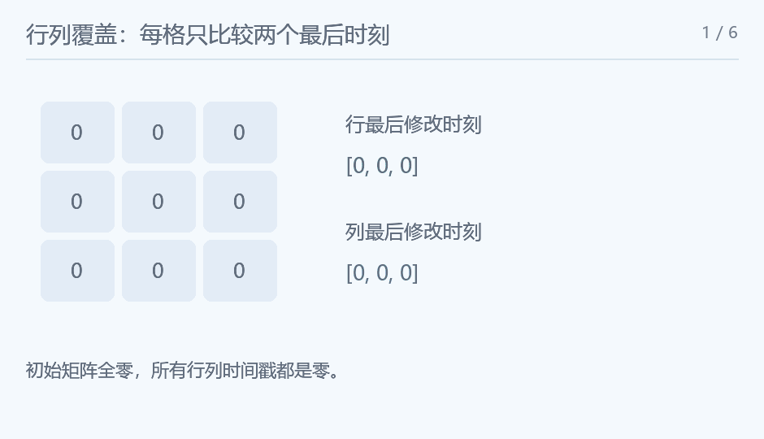

## Matrix

### 题意

多次把整行或整列赋值，输出最后矩阵。

### 思路

每个格子的最终值只由它所在行的最后赋值与所在列的最后赋值中较晚者决定。分别保存每行、每列的最后时间和数值，操作时只更新一个记录。最后枚举格子比较两个时间。未修改的时间与值均为零。

<!-- nowcoder-animation:matrix-timestamps -->

### 动态示例



绿色标出当前覆盖的行、列或正在比较的格子，旁边是实际时间戳。

### 参考代码

```cpp
#include <bits/stdc++.h>
using namespace std;

int main() {
    ios::sync_with_stdio(false);
    cin.tie(nullptr);
    int t;
    cin >> t;
    while (t--) {
        int n, q;
        cin >> n >> q;
        vector<int> rt(n), ct(n), rv(n), cv(n);
        for (int time = 1; time <= q; time++) {
            int op, k, v;
            cin >> op >> k >> v;
            k--;
            if (op == 1) {
                rt[k] = time;
                rv[k] = v;
            } else {
                ct[k] = time;
                cv[k] = v;
            }
        }
        for (int i = 0; i < n; i++) {
            for (int j = 0; j < n; j++) {
                if (j)
                    cout << ' ';
                cout << (rt[i] > ct[j] ? rv[i] : cv[j]);
            }
            cout << '\n';
        }
    }
    return 0;
}
```

### 复杂度

每组时间 $O(q+n^2)$，额外空间 $O(n)$。

### 易错点

不能逐次改整行整列，二十万次操作乘五百会造成不必要的开销。最终输出矩阵本身已需 n² 次。
