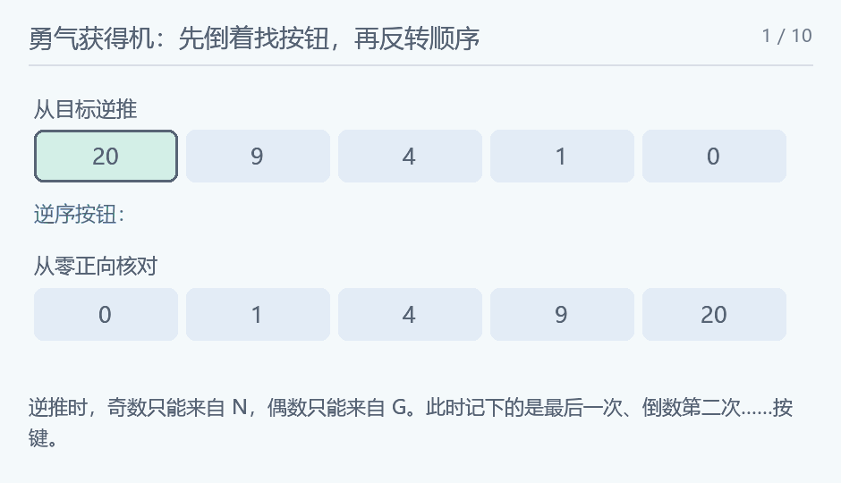

## 勇气获得机

### 题意

从零开始，通过 x→2x+1 或 x→2x+2，构造恰好到 n 的按钮序列。

### 思路

从目标逆推。奇数只能由 N 按钮得到，前值为 (n-1)/2；偶数只能由 G 按钮得到，前值为 (n-2)/2。每次目标变小，最终到零。记录的是从后往前的按钮，最后反转。

<!-- nowcoder-animation:reverse-buttons -->

### 动态示例



逆推找到的 GNGN 需要反转；图中把逆向数值和正向核对分成两行。

### 参考代码

```cpp
#include <bits/stdc++.h>
using namespace std;

int main() {
    ios::sync_with_stdio(false);
    cin.tie(nullptr);
    long long n;
    cin >> n;
    string ans;
    while (n > 0) {
        if (n % 2) {
            ans += 'N';
            n = (n - 1) / 2;
        } else {
            ans += 'G';
            n = (n - 2) / 2;
        }
    }
    reverse(ans.begin(), ans.end());
    cout << ans;
    return 0;
}
```

### 复杂度

时间与输出字符串空间均为 $O(\log(n+1))$。

### 易错点

偶数逆推不是直接除二，还需先减二；不反转字符串会把按键顺序颠倒。
