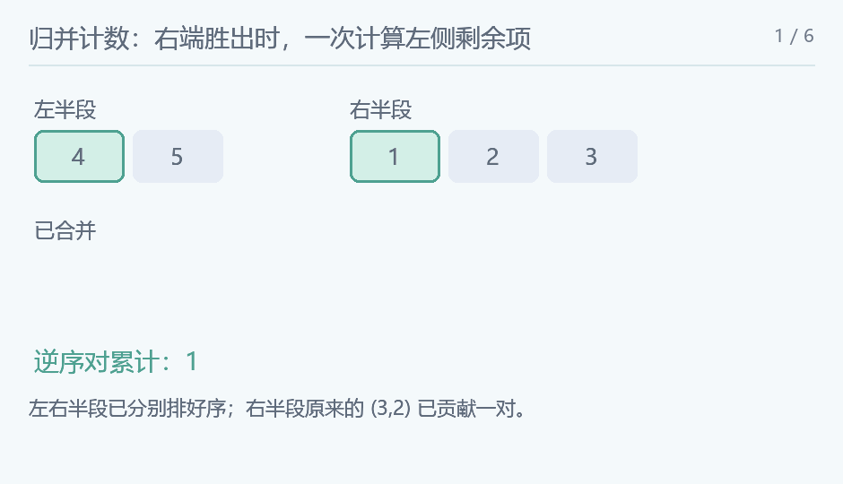

## 逆序数

### 题意

统计严格满足前面值大于后面值的下标对。

### 思路

归并排序分别求左右半段逆序数。合并两个有序半段时，若左端 a[i] 不大于右端 a[j]，先取左端，不增加逆序；否则右端 a[j] 小于左段剩下的全部 mid-i 个元素，这些对一起加入答案。每个跨中点逆序恰在该次合并中计数一次。

<!-- nowcoder-animation:inversion-merge -->

### 动态示例



原例为 4、5、1、3、2；先算子段内部的一对，再在跨段合并中新增六对，总计七对。

### 参考代码

```cpp
#include <bits/stdc++.h>
using namespace std;

long long countInversions(vector<int> &a, vector<int> &buffer, int l, int r) {
    if (r - l <= 1)
        return 0;
    int mid = (l + r) / 2;
    long long answer = countInversions(a, buffer, l, mid) + countInversions(a, buffer, mid, r);
    int i = l, j = mid, k = l;
    while (i < mid && j < r) {
        if (a[i] <= a[j])
            buffer[k++] = a[i++];
        else {
            answer += mid - i;
            buffer[k++] = a[j++];
        }
    }
    while (i < mid)
        buffer[k++] = a[i++];
    while (j < r)
        buffer[k++] = a[j++];
    copy(buffer.begin() + l, buffer.begin() + r, a.begin() + l);
    return answer;
}

int main() {
    ios::sync_with_stdio(false);
    cin.tie(nullptr);
    int n;
    cin >> n;
    vector<int> a(n), buffer(n);
    for (int &x : a)
        cin >> x;
    cout << countInversions(a, buffer, 0, n);
    return 0;
}
```

### 复杂度

时间 $O(n\log n)$，额外空间 $O(n)$。

### 易错点

值相等不是逆序，合并时使用小于等于。最多约 n²/2 对，答案用 long long。
