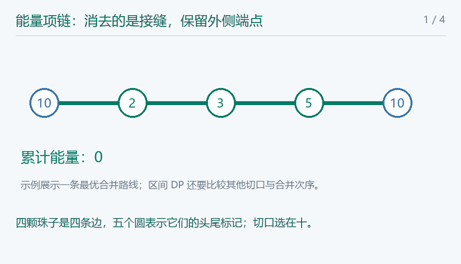

## 能量项链

> 原题：[P1063](https://www.luogu.com.cn/problem/P1063)
> 解法：复制珠子头标记，枚举每段的最后合并点 · C++17

### 题意

环形能量珠的尾标记等于下一珠头标记，合并相邻珠释放头、接缝、尾三个标记的乘积，求最大总能量。


### 思路


![对应原样例头标记二三五十，窗口从第四颗开始，圆是头尾边界，四条边才是四颗珠。](data:image/svg+xml;base64,PHN2ZyB4bWxucz0iaHR0cDovL3d3dy53My5vcmcvMjAwMC9zdmciIHdpZHRoPSI3NjAiIGhlaWdodD0iNDEwIiB2aWV3Qm94PSIwIDAgNzYwIDQxMCIgcm9sZT0iaW1nIiBhcmlhLWxhYmVsbGVkYnk9InRpdGxlIj48dGl0bGUgaWQ9InRpdGxlIj7lm5vpopfnj6Dlr7nlupTkupTkuKrovrnnlYzvvIzmjqXnvJ3lhrPlrprpop3lpJbog73ph488L3RpdGxlPg0KPHJlY3Qgd2lkdGg9IjEwMCUiIGhlaWdodD0iMTAwJSIgcng9IjEyIiBmaWxsPSIjZmZmIi8+DQo8ZyBmb250LWZhbWlseT0iTWljcm9zb2Z0IFlhSGVpLCBOb3RvIFNhbnMgQ0pLIFNDLCBzYW5zLXNlcmlmIiBmaWxsPSIjMjQzNDQ5Ij4NCjx0ZXh0IHg9IjI4IiB5PSIzNiIgZmlsbD0iIzI0MzQ0OSIgZm9udC1zaXplPSIyMyIgdGV4dC1hbmNob3I9InN0YXJ0IiBmb250LXdlaWdodD0iYm9sZCI+5Zub6aKX54+g5a+55bqU5LqU5Liq6L6555WM77yM5o6l57yd5Yaz5a6a6aKd5aSW6IO96YePPC90ZXh0Pg0KPGxpbmUgeDE9IjEwMCIgeTE9IjEzMCIgeDI9IjI0MCIgeTI9IjEzMCIgc3Ryb2tlPSIjMTI4MDVjIiBzdHJva2Utd2lkdGg9IjQiLz4NCjxsaW5lIHgxPSIyNDAiIHkxPSIxMzAiIHgyPSIzODAiIHkyPSIxMzAiIHN0cm9rZT0iIzEyODA1YyIgc3Ryb2tlLXdpZHRoPSI0Ii8+DQo8bGluZSB4MT0iMzgwIiB5MT0iMTMwIiB4Mj0iNTIwIiB5Mj0iMTMwIiBzdHJva2U9IiMxMjgwNWMiIHN0cm9rZS13aWR0aD0iNCIvPg0KPGxpbmUgeDE9IjUyMCIgeTE9IjEzMCIgeDI9IjY2MCIgeTI9IjEzMCIgc3Ryb2tlPSIjMTI4MDVjIiBzdHJva2Utd2lkdGg9IjQiLz4NCjxjaXJjbGUgY3g9IjEwMCIgY3k9IjEzMCIgcj0iMjMiIGZpbGw9IiNmZmYiIHN0cm9rZT0iIzIzNjVhYiIgc3Ryb2tlLXdpZHRoPSIzIi8+DQo8dGV4dCB4PSIxMDAiIHk9IjEzNyIgZmlsbD0iIzIzNjVhYiIgZm9udC1zaXplPSIyMSIgdGV4dC1hbmNob3I9Im1pZGRsZSIgZm9udC13ZWlnaHQ9Im5vcm1hbCI+MTA8L3RleHQ+DQo8Y2lyY2xlIGN4PSIyNDAiIGN5PSIxMzAiIHI9IjIzIiBmaWxsPSIjZmZmIiBzdHJva2U9IiMyMzY1YWIiIHN0cm9rZS13aWR0aD0iMyIvPg0KPHRleHQgeD0iMjQwIiB5PSIxMzciIGZpbGw9IiMyMzY1YWIiIGZvbnQtc2l6ZT0iMjEiIHRleHQtYW5jaG9yPSJtaWRkbGUiIGZvbnQtd2VpZ2h0PSJub3JtYWwiPjI8L3RleHQ+DQo8Y2lyY2xlIGN4PSIzODAiIGN5PSIxMzAiIHI9IjIzIiBmaWxsPSIjZmZmIiBzdHJva2U9IiMyMzY1YWIiIHN0cm9rZS13aWR0aD0iMyIvPg0KPHRleHQgeD0iMzgwIiB5PSIxMzciIGZpbGw9IiMyMzY1YWIiIGZvbnQtc2l6ZT0iMjEiIHRleHQtYW5jaG9yPSJtaWRkbGUiIGZvbnQtd2VpZ2h0PSJub3JtYWwiPjM8L3RleHQ+DQo8Y2lyY2xlIGN4PSI1MjAiIGN5PSIxMzAiIHI9IjIzIiBmaWxsPSIjZmZmIiBzdHJva2U9IiMyMzY1YWIiIHN0cm9rZS13aWR0aD0iMyIvPg0KPHRleHQgeD0iNTIwIiB5PSIxMzciIGZpbGw9IiMyMzY1YWIiIGZvbnQtc2l6ZT0iMjEiIHRleHQtYW5jaG9yPSJtaWRkbGUiIGZvbnQtd2VpZ2h0PSJub3JtYWwiPjU8L3RleHQ+DQo8Y2lyY2xlIGN4PSI2NjAiIGN5PSIxMzAiIHI9IjIzIiBmaWxsPSIjZmZmIiBzdHJva2U9IiMyMzY1YWIiIHN0cm9rZS13aWR0aD0iMyIvPg0KPHRleHQgeD0iNjYwIiB5PSIxMzciIGZpbGw9IiMyMzY1YWIiIGZvbnQtc2l6ZT0iMjEiIHRleHQtYW5jaG9yPSJtaWRkbGUiIGZvbnQtd2VpZ2h0PSJub3JtYWwiPjEwPC90ZXh0Pg0KPHRleHQgeD0iNjUiIHk9IjIzMCIgZmlsbD0iIzI0MzQ0OSIgZm9udC1zaXplPSIyMyIgdGV4dC1hbmNob3I9InN0YXJ0IiBmb250LXdlaWdodD0ibm9ybWFsIj7lhYjlkIggMTDihpIyIOS4jiAy4oaSM++8mjEww5cyw5czPTYwPC90ZXh0Pg0KPHRleHQgeD0iNjUiIHk9IjI5MCIgZmlsbD0iIzI0MzQ0OSIgZm9udC1zaXplPSIyMyIgdGV4dC1hbmNob3I9InN0YXJ0IiBmb250LXdlaWdodD0ibm9ybWFsIj7lho3mjqUgM+KGkjXvvJoxNTDvvJvmnIDlkI7mjqUgNeKGkjEw77yaNTAwPC90ZXh0Pg0KPHRleHQgeD0iNjUiIHk9IjM2NSIgZmlsbD0iIzEyODA1YyIgZm9udC1zaXplPSIyMiIgdGV4dC1hbmNob3I9InN0YXJ0IiBmb250LXdlaWdodD0ibm9ybWFsIj7ku6XnrKwgNCDpopfnj6DkuLrmlq3lj6PotbfngrnvvIzmgLvog73ph48gNjArMTUwKzUwMD03MTA8L3RleHQ+DQo8L2c+PC9zdmc+DQo=)

把珠子看成有头尾两个边界。若一段覆盖$l$至$r$，它聚合后的头一定是$a_l$，尾一定是$a_\{r+1\}$，与内部先合哪两颗无关。

最后一次把左段$l$至$k$与右段$k+1$至$r$相接，中间接缝是$a_\{k+1\}$，因此新释放的能量为

$$a_l\,a_{k+1}\,a_{r+1}.$$

两侧此前的能量分别取最大，再加最后一次，枚举所有分界即可。单珠不合并，初值零。

环上没有固定断口。将头标记序列复制一遍，每个长度$n$的连续窗口对应一个断口，包含原来跨过末尾与开头的相邻关系。任意环形合并过程可以在最后剩下珠子的头处断开，得到其中一个窗口的线性合并；反过来，窗口内的合并都对应环上的合法相邻聚合。所以对全部$n$个窗口取最大。

尾标记比最后一个头多一位，代码建立长度2n+1的头标记数组，最后一项继续取原首项。公式里接缝是$k+1$而非$k$，乘法先转long long，再累计能量。

时间 $O(n^3)$，空间 $O(n^2)$。

<!-- nowcoder-animation:necklace-merge -->

### 动态示例



圆是边界标记，线段才是一颗珠；合并不把两个外侧标记删掉。

### 参考代码

```cpp
#include <bits/stdc++.h>
using namespace std;

int main() {
    ios::sync_with_stdio(false);
    cin.tie(nullptr);
    int n;
    cin >> n;
    vector<long long> original(n);
    for (auto &x : original)
        cin >> x;
    vector<long long> a(2 * n + 1);
    for (int i = 0; i <= 2 * n; i++)
        a[i] = original[i % n];
    vector<vector<long long>> dp(2 * n, vector<long long>(2 * n));
    for (int length = 2; length <= n; length++) {
        for (int l = 0; l + length <= 2 * n; l++) {
            int r = l + length - 1;
            for (int k = l; k < r; k++) {
                dp[l][r] = max(dp[l][r], dp[l][k] + dp[k + 1][r] + a[l] * a[k + 1] * a[r + 1]);
            }
        }
    }
    long long answer = 0;
    for (int start = 0; start < n; start++)
        answer = max(answer, dp[start][start + n - 1]);
    cout << answer << '\n';
    return 0;
}
```

### 易错点

头尾标记不同于珠子价值；接缝取$k+1$；复制后只计算至多$n$颗；枚举全部断口；首尾补值；乘积六十四位。
