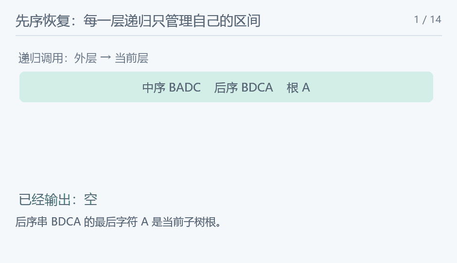

## [NOIP2001]求先序排列

> 原题：[P1030](https://www.luogu.com.cn/problem/P1030)
> 解法：后序末尾定根，中序位置划分左右子树 · C++17

### 题意

结点是互不相同的大写字母，给出同一棵二叉树的中序和后序排列，输出先序排列；最多八个结点。


### 思路


![根、左右子树以及三种访问顺序来自同一棵树；不能把中序右半部分误当成先序。](data:image/svg+xml;base64,PHN2ZyB4bWxucz0iaHR0cDovL3d3dy53My5vcmcvMjAwMC9zdmciIHdpZHRoPSI3NjAiIGhlaWdodD0iNDIwIiB2aWV3Qm94PSIwIDAgNzYwIDQyMCIgcm9sZT0iaW1nIiBhcmlhLWxhYmVsbGVkYnk9InRpdGxlIj48dGl0bGUgaWQ9InRpdGxlIj7lkI7luo/mnKvlsL7nmoQgQSDlrprmoLnvvIzkuK3luo/lnKggQSDlpITliIblvIA8L3RpdGxlPg0KPHJlY3Qgd2lkdGg9IjEwMCUiIGhlaWdodD0iMTAwJSIgcng9IjEyIiBmaWxsPSIjZmZmIi8+DQo8ZyBmb250LWZhbWlseT0iTWljcm9zb2Z0IFlhSGVpLCBOb3RvIFNhbnMgQ0pLIFNDLCBzYW5zLXNlcmlmIiBmaWxsPSIjMjQzNDQ5Ij4NCjx0ZXh0IHg9IjI4IiB5PSIzNiIgZmlsbD0iIzI0MzQ0OSIgZm9udC1zaXplPSIyMyIgdGV4dC1hbmNob3I9InN0YXJ0IiBmb250LXdlaWdodD0iYm9sZCI+5ZCO5bqP5pyr5bC+55qEIEEg5a6a5qC577yM5Lit5bqP5ZyoIEEg5aSE5YiG5byAPC90ZXh0Pg0KPGxpbmUgeDE9IjIzMCIgeTE9IjEwMCIgeDI9IjExMCIgeTI9IjIyMCIgc3Ryb2tlPSIjNjg3NzhiIiBzdHJva2Utd2lkdGg9IjQiLz4NCjxsaW5lIHgxPSIyMzAiIHkxPSIxMDAiIHgyPSIzNTAiIHkyPSIyMjAiIHN0cm9rZT0iIzY4Nzc4YiIgc3Ryb2tlLXdpZHRoPSI0Ii8+DQo8bGluZSB4MT0iMzUwIiB5MT0iMjIwIiB4Mj0iMjgwIiB5Mj0iMzMwIiBzdHJva2U9IiM2ODc3OGIiIHN0cm9rZS13aWR0aD0iNCIvPg0KPGNpcmNsZSBjeD0iMjMwIiBjeT0iMTAwIiByPSIyMyIgZmlsbD0iI2ZmZiIgc3Ryb2tlPSIjMjM2NWFiIiBzdHJva2Utd2lkdGg9IjMiLz4NCjx0ZXh0IHg9IjIzMCIgeT0iMTA3IiBmaWxsPSIjMjM2NWFiIiBmb250LXNpemU9IjIxIiB0ZXh0LWFuY2hvcj0ibWlkZGxlIiBmb250LXdlaWdodD0ibm9ybWFsIj5BPC90ZXh0Pg0KPGNpcmNsZSBjeD0iMTEwIiBjeT0iMjIwIiByPSIyMyIgZmlsbD0iI2ZmZiIgc3Ryb2tlPSIjMjM2NWFiIiBzdHJva2Utd2lkdGg9IjMiLz4NCjx0ZXh0IHg9IjExMCIgeT0iMjI3IiBmaWxsPSIjMjM2NWFiIiBmb250LXNpemU9IjIxIiB0ZXh0LWFuY2hvcj0ibWlkZGxlIiBmb250LXdlaWdodD0ibm9ybWFsIj5CPC90ZXh0Pg0KPGNpcmNsZSBjeD0iMzUwIiBjeT0iMjIwIiByPSIyMyIgZmlsbD0iI2ZmZiIgc3Ryb2tlPSIjMjM2NWFiIiBzdHJva2Utd2lkdGg9IjMiLz4NCjx0ZXh0IHg9IjM1MCIgeT0iMjI3IiBmaWxsPSIjMjM2NWFiIiBmb250LXNpemU9IjIxIiB0ZXh0LWFuY2hvcj0ibWlkZGxlIiBmb250LXdlaWdodD0ibm9ybWFsIj5DPC90ZXh0Pg0KPGNpcmNsZSBjeD0iMjgwIiBjeT0iMzMwIiByPSIyMyIgZmlsbD0iI2ZmZiIgc3Ryb2tlPSIjMjM2NWFiIiBzdHJva2Utd2lkdGg9IjMiLz4NCjx0ZXh0IHg9IjI4MCIgeT0iMzM3IiBmaWxsPSIjMjM2NWFiIiBmb250LXNpemU9IjIxIiB0ZXh0LWFuY2hvcj0ibWlkZGxlIiBmb250LXdlaWdodD0ibm9ybWFsIj5EPC90ZXh0Pg0KPHRleHQgeD0iNDQwIiB5PSIxMjUiIGZpbGw9IiMyNDM0NDkiIGZvbnQtc2l6ZT0iMjMiIHRleHQtYW5jaG9yPSJzdGFydCIgZm9udC13ZWlnaHQ9Im5vcm1hbCI+5Lit5bqP77yaQiBBIEQgQzwvdGV4dD4NCjx0ZXh0IHg9IjQ0MCIgeT0iMjAwIiBmaWxsPSIjMjQzNDQ5IiBmb250LXNpemU9IjIzIiB0ZXh0LWFuY2hvcj0ic3RhcnQiIGZvbnQtd2VpZ2h0PSJub3JtYWwiPuWQjuW6j++8mkIgRCBDIEE8L3RleHQ+DQo8dGV4dCB4PSI0NDAiIHk9IjI3NSIgZmlsbD0iIzI0MzQ0OSIgZm9udC1zaXplPSIyMyIgdGV4dC1hbmNob3I9InN0YXJ0IiBmb250LXdlaWdodD0ibm9ybWFsIj7lhYjluo/vvJpBIEIgQyBEPC90ZXh0Pg0KPHRleHQgeD0iNjUiIHk9IjM5NSIgZmlsbD0iIzI0MzQ0OSIgZm9udC1zaXplPSIyMSIgdGV4dC1hbmNob3I9InN0YXJ0IiBmb250LXdlaWdodD0ibm9ybWFsIj5BIOW3pui+ueWPquaciSBC77yb5Y+z5a2Q5qCR5qC55Li6IEPvvIxEIOaYryBDIOeahOW3puWtqeWtkDwvdGV4dD4NCjwvZz48L3N2Zz4NCg==)

中序BADC、后序BDCA的最后一个字母A是根。中序在A处被分成B和DC，左子树只有B，右子树的中序是DC、后序是DC，所以右子树的根是C，C的左孩子为D。按根、左、右访问，输出ABCD。

用半开区间表示同一棵子树：中序下标范围为 $[l,r)$，后序为 $[p,q)$。非空时，根是后序下标 $q-1$ 处的字母。设根在中序的位置为 $mid$，左子树有 $mid-l$ 个结点；因此左子树的后序范围为 $[p,p+mid-l)$，右子树为 $[p+mid-l,q-1)$。根不再放入任一子树。

先序要求根先于两棵子树，因此找到根后立即输出，再依次递归左、右。两个排列来自同一棵树且标号不重复，根在中序中的位置唯一，这样的划分也唯一。某一侧可能为空，进入空区间直接返回；不要假定每个非叶结点都有两个孩子。

本题只有八个结点，每次在线性区间寻找根就足够，不必额外建立树后再遍历。

最坏时间 $O(n^2)$，递归空间 $O(n)$；本题 $n\le8$。

<!-- nowcoder-animation:tree-recursion -->

### 动态示例



动态展示分割、进入左子树、返回和继续右子树，输出顺序与程序的先序访问一致。

### 参考代码

```cpp
#include <bits/stdc++.h>
using namespace std;

int main() {
    ios::sync_with_stdio(false);
    cin.tie(nullptr);
    string in, post;
    cin >> in >> post;
    function<void(int, int, int, int)> visit = [&](int l, int r, int p, int q) {
        if (l == r)
            return;
        char root = post[q - 1];
        int mid = l;
        while (in[mid] != root)
            ++mid;
        cout << root;
        int left = mid - l;
        visit(l, mid, p, p + left);
        visit(mid + 1, r, p + left, q - 1);
    };
    visit(0, in.size(), 0, post.size());
    cout << '\n';
    return 0;
}
```

### 易错点

后序末字母定根；中序定左右；先序先输出根；空子树直接返回；不能按字母大小判断左右。
