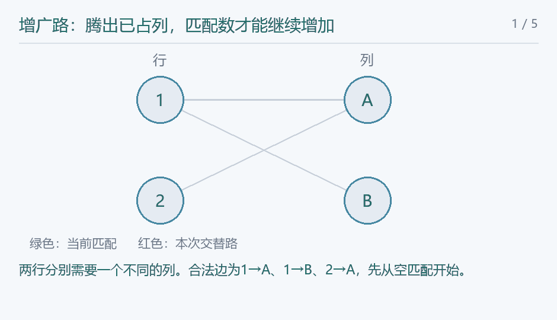

## [ZJOI2007]矩阵游戏

### 题意

交换行列后能否主对角线全黑。

### 思路

每个黑格连接其行与列。主对角线全黑意味着为每行选一个黑格，且所选列互不相同，恰是完美匹配。反过来匹配给出行列的一一对应，只需重排列就能使所选黑格上主对角线。求最大匹配是否等于n。

参考代码使用Hopcroft–Karp：从所有未匹配左点BFS标记最短增广路层数，再DFS沿这些层同时增广。每条增广路将匹配边与非匹配边交替翻转，匹配数增加1；不存在增广路时已达最大匹配。

<!-- nowcoder-animation:augmenting-path -->

### 动态示例



两行两列的具体例子：第2行经已占用的A列找到第1行，再改配B列；翻转三条边后匹配数增加1。

### 参考代码

```cpp
#include <bits/stdc++.h>
using namespace std;

struct Matching {
    int left, right, shortest;
    vector<vector<int>> edge;
    vector<int> mateLeft, mateRight, distance;
    Matching(int left, int right)
        : left(left), right(right), edge(left), mateLeft(left, -1), mateRight(right, -1),
          distance(left) {}
    bool bfs() {
        queue<int> queue;
        fill(distance.begin(), distance.end(), -1);
        for (int u = 0; u < left; u++)
            if (mateLeft[u] < 0) {
                distance[u] = 0;
                queue.push(u);
            }
        shortest = INT_MAX;
        while (!queue.empty()) {
            int u = queue.front();
            queue.pop();
            if (distance[u] + 1 > shortest)
                continue;
            for (int v : edge[u])
                if (mateRight[v] < 0)
                    shortest = min(shortest, distance[u] + 1);
                else if (distance[mateRight[v]] < 0) {
                    distance[mateRight[v]] = distance[u] + 1;
                    queue.push(mateRight[v]);
                }
        }
        return shortest < INT_MAX;
    }
    bool dfs(int u) {
        for (int v : edge[u])
            if ((mateRight[v] < 0 && distance[u] + 1 == shortest) ||
                (mateRight[v] >= 0 && distance[mateRight[v]] == distance[u] + 1 &&
                 dfs(mateRight[v]))) {
                mateLeft[u] = v;
                mateRight[v] = u;
                return true;
            }
        distance[u] = -1;
        return false;
    }
    int maximum() {
        int result = 0;
        while (bfs())
            for (int u = 0; u < left; u++)
                if (mateLeft[u] < 0 && dfs(u))
                    result++;
        return result;
    }
};

int main() {
    ios::sync_with_stdio(false);
    cin.tie(nullptr);
    int tests;
    cin >> tests;
    while (tests--) {
        int n;
        cin >> n;
        Matching match(n, n);
        for (int i = 0; i < n; i++)
            for (int j = 0; j < n; j++) {
                char c;
                cin >> c;
                if (c == '1')
                    match.edge[i].push_back(j);
            }
        cout << (match.maximum() == n ? "Yes\n" : "No\n");
    }
    return 0;
}
```

### 复杂度

每组时间 $O(n^2\sqrt n)$，空间 $O(n^2)$。

### 易错点

不能只检查每行每列至少有黑格，它们可能争抢同一列。
