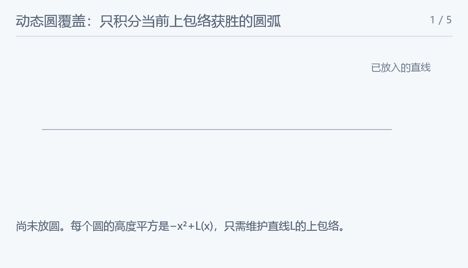

## A Bite of Teyvat

### 题意

圆心全部在x轴，每插入一个圆盘立即求总覆盖面积。

### 思路

上半圆高度平方是$r_i^2-(x-x_i)^2=-x^2+(2x_i x+r_i^2-x_i^2)$。公共项−x²不影响最大值，所以圆盘并的上边界，由直线$L_i(x)=2x_i x+r_i^2-x_i^2$的上包络决定。再将负的高度平方截为0，下半平面对称。

用按斜率有序的map维护上凸壳。相同圆心只保留最大半径；若连续三条线的相邻交点不递增，中间线永远不胜出，应删除。插入后只可能删掉两侧相邻的一段线，每条线至多被删一次。交点次序用128位整数比较。

每条保留线在与左右邻线的交点之间获胜，再与该圆自己的[x_i−r_i,x_i+r_i]相交。这个区间的面积贡献为2倍上半圆积分，其原函数为t*sqrt(r²−t²)+r²*asin(t/r)，t=x−x_i。插入、删除一条线，只会改动它和左右邻线的贡献：先减旧贡献，变更map，再加新贡献。用long double和补偿求和控制大量面积增减的误差。

<!-- nowcoder-animation:circle-envelope-insertion -->

### 动态示例



沿用原题四个半径1圆：按圆心0、2、3、1依次插入，彩色边界表示此刻获胜圆弧，面积与参考程序逐步一致。

### 参考代码

```cpp
#include <bits/stdc++.h>
using namespace std;

using Wide = __int128_t;
struct Disc {
    long long x, r;
    long long intercept() const { return r * r - x * x; }
};
map<long long, Disc> hull;
long double total = 0, compensation = 0;
void accumulate(long double value) {
    long double adjusted = value - compensation, next = total + adjusted;
    compensation = (next - total) - adjusted;
    total = next;
}
long double contribution(map<long long, Disc>::iterator it) {
    if (it == hull.end())
        return 0;
    Disc d = it->second;
    long double l = d.x - d.r, r = d.x + d.r;
    auto crossing = [](const auto &a, const auto &b) {
        return (long double)(a.second.intercept() - b.second.intercept()) / (b.first - a.first);
    };
    if (it != hull.begin())
        l = max(l, crossing(*prev(it), *it));
    if (next(it) != hull.end())
        r = min(r, crossing(*it, *next(it)));
    if (l >= r)
        return 0;
    auto primitive = [&](long double x) {
        long double t = clamp(x - d.x, -(long double)d.r, (long double)d.r), radius = d.r;
        return t * sqrtl(max(0.0L, radius * radius - t * t)) +
               radius * radius * asinl(clamp(t / radius, -1.0L, 1.0L));
    };
    return primitive(r) - primitive(l);
}
void eraseLine(map<long long, Disc>::iterator it) {
    auto left = it == hull.begin() ? hull.end() : prev(it), right = next(it);
    accumulate(-contribution(left));
    accumulate(-contribution(it));
    accumulate(-contribution(right));
    hull.erase(it);
    accumulate(contribution(left));
    accumulate(contribution(right));
}
bool redundant(map<long long, Disc>::iterator it) {
    if (it == hull.begin() || next(it) == hull.end())
        return false;
    auto a = prev(it), b = it, c = next(it);
    return (Wide)(a->second.intercept() - b->second.intercept()) * (c->first - b->first) >=
           (Wide)(b->second.intercept() - c->second.intercept()) * (b->first - a->first);
}
void insertDisc(Disc d) {
    long long slope = 2 * d.x;
    auto old = hull.find(slope);
    if (old != hull.end()) {
        if (old->second.r >= d.r)
            return;
        eraseLine(old);
    }
    auto right = hull.lower_bound(slope), left = right == hull.begin() ? hull.end() : prev(right);
    accumulate(-contribution(left));
    accumulate(-contribution(right));
    auto it = hull.emplace(slope, d).first;
    accumulate(contribution(left));
    accumulate(contribution(it));
    accumulate(contribution(right));
    if (redundant(it)) {
        eraseLine(it);
        return;
    }
    while (it != hull.begin() && redundant(prev(it)))
        eraseLine(prev(it));
    while (next(it) != hull.end() && redundant(next(it)))
        eraseLine(next(it));
}

int main() {
    ios::sync_with_stdio(false);
    cin.tie(nullptr);
    int n;
    cin >> n;
    while (n--) {
        Disc d;
        cin >> d.x >> d.r;
        insertDisc(d);
        cout << fixed << setprecision(12) << max(0.0L, total) << '\n';
    }
    return 0;
}
```

### 复杂度

总时间 $O(n\log n)$，空间 $O(n)$；每条线只插入、删除一次。

### 易错点

圆盘不能只按相邻圆心的两圆交面积容斥，会漏掉多圆重叠及包含。包络线即使在某段高度平方为负，也应保留到几何积分时再截零。
