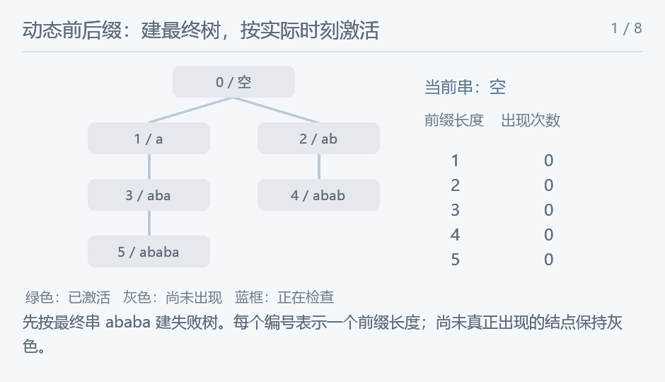

## 葫芦和斌斌的字符串2

### 题意

末尾不断加字符，多次查询至少出现 k 次的最长前后缀长度。

### 思路

所有操作可以预读，先把追加后的最终字符串求出前缀函数，建立失败树：长度 i 的父亲是 pi[i-1]。任意较早版本的前缀函数不会因后续追加而改变，因此这棵最终树也适用于所有时刻。对当前串每个结束位置 j，激活失败树上的结点 j；某个前缀长度 len 的出现次数，恰是它失败树子树内已激活结点数。因为 len 是以 j 结尾的匹配，当且仅当 len 在 j 的 border 祖先链上。

用迭代 DFS 求子树欧拉区间，树状数组做单点激活、子树计数。追加只激活一个新结点。查询的候选是当前长度的祖先链，越向上串越短，出现次数不会更少；利用倍增跳过仍不足 k 次的祖先，再看其父亲。每次频数查询 O(log N)，总查询 O(log²N)。

<!-- nowcoder-animation:failure-tree-activation -->

### 动态示例



以 abab 追加 a 为例，展示结束位置激活、失败树子树计数，以及 k=2、k=3 时沿祖先链找答案。

### 参考代码

```cpp
#include <bits/stdc++.h>
using namespace std;

template <class Sequence> vector<int> prefixFunction(const Sequence &s) {
    int n = s.size();
    vector<int> pi(n);
    for (int i = 1; i < n; i++) {
        int j = pi[i - 1];
        while (j > 0 && s[i] != s[j])
            j = pi[j - 1];
        if (s[i] == s[j])
            j++;
        pi[i] = j;
    }
    return pi;
}

int main() {
    ios::sync_with_stdio(false);
    cin.tie(nullptr);
    int n, q;
    string s;
    cin >> n >> q >> s;
    s.reserve(n + q);
    struct Operation {
        int type, k = 0;
        char c = 0;
    };
    vector<Operation> operations(q);
    for (auto &op : operations) {
        cin >> op.type;
        if (op.type == 1) {
            cin >> op.c;
            s += op.c;
        } else
            cin >> op.k;
    }
    int total = s.size();
    const int log = 20;
    auto pi = prefixFunction(s);
    vector<array<int, log>> up(total + 1);
    vector<int> head(total + 1, -1), next(total + 1, -1), enter(total + 1), leave(total + 1);
    for (int i = 1; i <= total; i++) {
        int parent = pi[i - 1];
        up[i][0] = parent;
        for (int b = 1; b < log; b++)
            up[i][b] = up[up[i][b - 1]][b - 1];
        next[i] = head[parent];
        head[parent] = i;
    }
    vector<pair<int, int>> stack;
    stack.reserve(total + 1);
    stack.push_back({0, 0});
    int timer = 0;
    while (!stack.empty()) {
        auto [u, stage] = stack.back();
        stack.pop_back();
        if (stage == 0) {
            enter[u] = ++timer;
            stack.push_back({u, 1});
            for (int v = head[u]; v != -1; v = next[v])
                stack.push_back({v, 0});
        } else
            leave[u] = timer;
    }
    vector<int> tree(timer + 1);
    auto activate = [&](int node) {
        for (int p = enter[node]; p <= timer; p += p & -p)
            tree[p]++;
    };
    auto prefix = [&](int p) {
        int value = 0;
        for (; p > 0; p -= p & -p)
            value += tree[p];
        return value;
    };
    auto count = [&](int node) { return prefix(leave[node]) - prefix(enter[node] - 1); };
    for (int i = 1; i <= n; i++)
        activate(i);
    int current = n;
    for (auto op : operations) {
        if (op.type == 1) {
            activate(++current);
            continue;
        }
        int node = current;
        if (count(node) < op.k) {
            for (int b = log - 1; b >= 0; b--) {
                int ancestor = up[node][b];
                if (ancestor && count(ancestor) < op.k)
                    node = ancestor;
            }
            node = up[node][0];
        }
        cout << (node ? node : -1) << '\n';
    }
    return 0;
}
```

### 复杂度

最终长度 $N\le n+q$，预处理与激活 $O(N\log N)$，每次查询 $O(\log^2N)$，空间 $O(N\log N)$。

### 易错点

未来追加的结点先建好，但只能在实际追加时激活。子树统计的是已出现的结束位置，不能直接使用最终整棵失败树的子树大小。空前缀不能作为答案。
