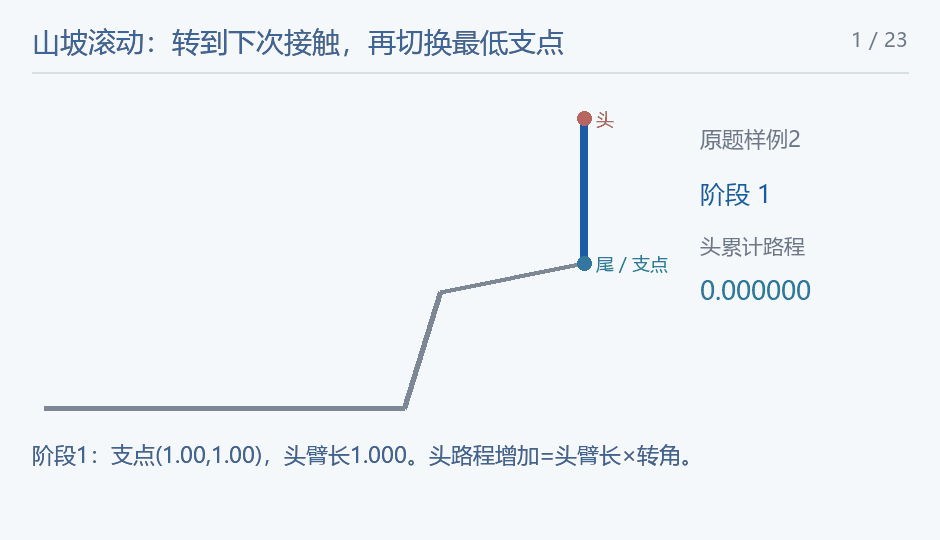

## Mountain Is Quiet and Alone

### 题意

长1线段沿单调山坡逆时针滚动，遇到更低接触点更换支点，求头端总路程。

### 思路

两次接触事件之间，线段绕当前最低支点O做纯旋转，头部走一段半径|OH|的圆弧，路程=半径×转角。下一接触只有两类：山坡顶点碰到线段内部，或线段某个端点碰到山坡边内部。第一类枚举支点左下方、距离不超过相应半臂长度的山坡顶点；第二类求以O为圆心、头臂/尾臂长度为半径的圆与每条山坡边的交点。

对每个候选接触，把从当前线段朝向转到候选朝向的逆时针角归一到[0,2π)，取最小。新接触点必须严格低于O；同一时刻有多个接触时选最低的那个。头端朝向候选点，尾端则朝向其反方向。除此以外，单独求头部圆轨迹与y=0的交会角，若它更早发生就结束。

转过事件角后同时旋转头和尾，累加头弧长，再换支点。半臂长度并非总为1：支点可能在身体内部，头臂为0时头暂时不动。山坡还包括从(0,0)向左的水平地面。每个坡顶最多成为一次更低支点，两次坡顶接触之间的端点滚动每步沿坡推进一个单位，所以事件数受n与坡线长度共同限制。

<!-- nowcoder-animation:rolling-contact-events -->

### 动态示例



按原题样例2与同一份参考程序的接触事件绘制：观察尾、头及支点的切换，并按各阶段头臂长度累加圆弧路程。

### 参考代码

```cpp
#include <bits/stdc++.h>
using namespace std;

constexpr long double EPS = 1e-12L;
struct Point {
    long double x = 0, y = 0;
    Point operator+(Point b) const { return {x + b.x, y + b.y}; }
    Point operator-(Point b) const { return {x - b.x, y - b.y}; }
    Point operator*(long double t) const { return {x * t, y * t}; }
    Point operator/(long double t) const { return {x / t, y / t}; }
};
long double cross(Point a, Point b) { return a.x * b.y - a.y * b.x; }
long double dot(Point a, Point b) { return a.x * b.x + a.y * b.y; }
long double norm(Point a) { return sqrtl(dot(a, a)); }
long double distance(Point a, Point b) { return norm(a - b); }
Point rotate90(Point a) { return {-a.y, a.x}; }

Point rotated(Point p, long double angle) {
    return {p.x * cosl(angle) - p.y * sinl(angle), p.x * sinl(angle) + p.y * cosl(angle)};
}

int main() {
    ios::sync_with_stdio(false);
    cin.tie(nullptr);
    int n;
    cin >> n;
    vector<Point> mountain = {{-10000, 0}, {0, 0}};
    for (int i = 0; i < n; i++) {
        Point p;
        cin >> p.x >> p.y;
        mountain.push_back(p);
    }
    Point pivot = mountain.back(), tail = pivot, head = pivot + Point{0, 1};
    long double answer = 0, pi = acosl(-1.0L);
    while (head.y > 1e-11L) {
        Point body = head - tail;
        long double h = distance(head, pivot), t = distance(tail, pivot), best = 2 * pi;
        Point contact;
        bool stop = false;
        auto angleTo = [&](Point d) {
            long double angle = atan2l(cross(body, d), dot(body, d));
            if (angle < -1e-12L)
                angle += 2 * pi;
            return max(0.0L, angle);
        };
        auto candidate = [&](Point p, bool headSide) {
            if (p.y >= pivot.y - 1e-11L)
                return;
            Point d = headSide ? p - pivot : pivot - p;
            long double angle = angleTo(d);
            if (angle < best - 1e-12L || (fabsl(angle - best) <= 1e-12L && p.y < contact.y)) {
                best = angle;
                contact = p;
                stop = false;
            }
        };
        if (h > 1e-14L && pivot.y <= h + 1e-12L) {
            long double a = asinl(clamp(-pivot.y / h, -1.0L, 1.0L));
            for (long double angle : {a, pi - a}) {
                Point d = {cosl(angle), sinl(angle)};
                long double turn = angleTo(d);
                if (turn < best) {
                    best = turn;
                    stop = true;
                }
            }
        }
        for (int i = 1; i < (int)mountain.size(); i++) {
            Point p = mountain[i];
            if (p.y < pivot.y - 1e-11L) {
                long double d = distance(p, pivot);
                if (d <= h + 1e-12L)
                    candidate(p, true);
                if (d <= t + 1e-12L)
                    candidate(p, false);
            }
        }
        for (int i = 0; i + 1 < (int)mountain.size(); i++) {
            Point a = mountain[i], e = mountain[i + 1] - a;
            for (auto [radius, headSide] : {pair<long double, bool>{h, true}, {t, false}}) {
                if (radius < 1e-14L)
                    continue;
                Point offset = a - pivot;
                long double A = dot(e, e), B = 2 * dot(e, offset),
                            C = dot(offset, offset) - radius * radius,
                            discriminant = B * B - 4 * A * C;
                if (discriminant < -1e-12L)
                    continue;
                long double root = sqrtl(max(0.0L, discriminant));
                for (long double u : {(-B - root) / (2 * A), (-B + root) / (2 * A)})
                    if (u >= -1e-12L && u <= 1 + 1e-12L)
                        candidate(a + e * clamp(u, 0.0L, 1.0L), headSide);
            }
        }
        answer += h * best;
        head = pivot + rotated(head - pivot, best);
        tail = pivot + rotated(tail - pivot, best);
        if (stop)
            break;
        pivot = contact;
    }
    cout << fixed << setprecision(15) << answer;
    return 0;
}
```

### 复杂度

设坡线总长L<2000，事件数 $O(n+L)$，总时间 $O(n(n+L))$，空间 $O(n)$。

### 易错点

不能只在山坡顶点换支点，身体端点落在边中间也会触发事件。不能把整条身体的转动角直接累加成头路程，必须乘当前头臂长度。题目保证端点接触远离坡顶，可避免端点与坡顶数值重合。
