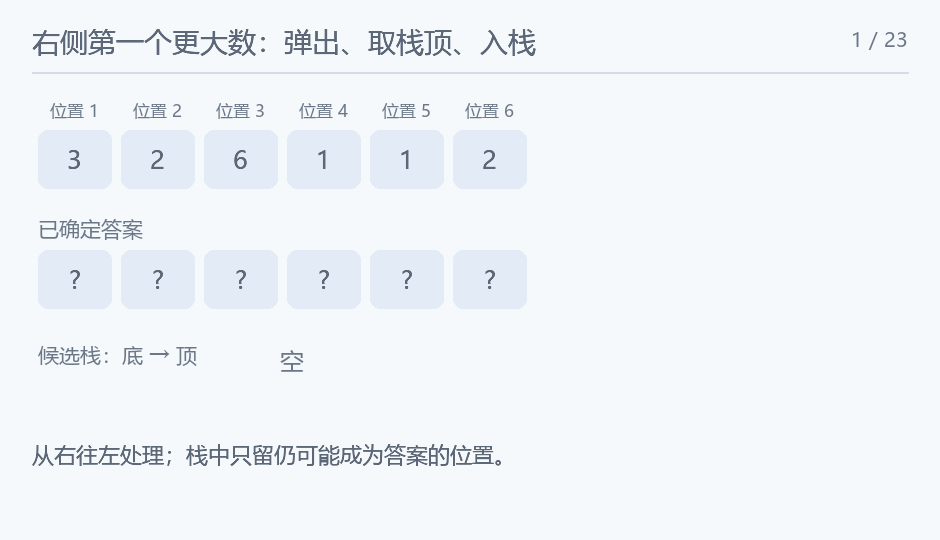

## Look Up

### 题意

对每个位置，求右侧第一个严格更大元素的下标，没有则为零。

### 思路

从右往左维护候选栈。处理 a[i] 时，栈顶若不大于 a[i] 就弹出：它既不满足当前查询，也会被更近且不小的 a[i] 取代。弹完后栈顶就是最近的严格更大位置，再把 i 入栈。每个位置只进出栈一次。

<!-- nowcoder-animation:monotonic-stack -->

### 动态示例



相同数值也要弹出；栈里保存下标，而不是只保存数值。

### 参考代码

```cpp
#include <bits/stdc++.h>
using namespace std;

int main() {
    ios::sync_with_stdio(false);
    cin.tie(nullptr);
    int n;
    cin >> n;
    vector<int> a(n), ans(n), st;
    for (int &x : a)
        cin >> x;
    for (int i = n - 1; i >= 0; i--) {
        while (!st.empty() && a[st.back()] <= a[i])
            st.pop_back();
        ans[i] = st.empty() ? 0 : st.back() + 1;
        st.push_back(i);
    }
    for (int i = 0; i < n; i++) {
        if (i)
            cout << ' ';
        cout << ans[i];
    }
    return 0;
}
```

### 复杂度

时间与数组空间均为 $O(n)$。

### 易错点

相等的值也必须弹出，因为要求严格大于。最后按一行输出，返回一开始的下标。
