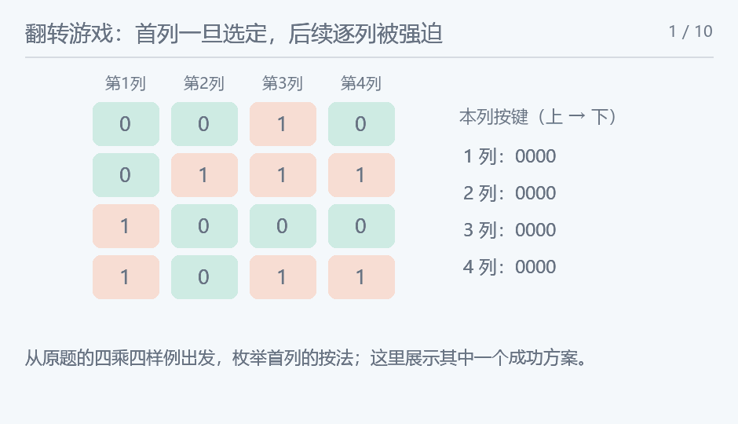

## 翻转游戏：hard

### 题意

判断能否通过按键翻转自身及上下左右灯，使全部灯关闭。

### 思路

对同一格按两次会抵消，操作顺序也不影响结果，所以每格只需考虑按或不按。沿列处理，枚举第一列的全部按键方案；第一列按完后，若仍有灯亮，唯一还能改变它的就是下一列同一行的按键，因此第二列按法被唯一确定，后面依此类推。用 n 位整数表示一列，上一列按键、自身按键以及自身按键上下移一位的异或，就是已有影响。递推出末列之后所需的虚拟下一列按键必须为零，才表示末列也已熄灭。

<!-- nowcoder-animation:flip-forced-columns -->

### 动态示例



一表示灯亮，零表示灯灭；对首列的一个猜测逐列验证，上一列亮位唯一决定本列按键。

### 参考代码

```cpp
#include <bits/stdc++.h>
using namespace std;

bool solvable(const vector<string> &a) {
    int n = a.size(), m = a[0].size(), limit = (1 << n) - 1;
    vector<int> initial(m);
    for (int c = 0; c < m; c++)
        for (int r = 0; r < n; r++)
            if (a[r][c] == '1')
                initial[c] |= 1 << r;
    for (int first = 0; first <= limit; first++) {
        int previous = 0, current = first;
        for (int c = 0; c < m; c++) {
            int next = initial[c] ^ previous ^ current ^ ((current << 1) & limit) ^ (current >> 1);
            previous = current;
            current = next;
        }
        if (current == 0)
            return true;
    }
    return false;
}

int main() {
    ios::sync_with_stdio(false);
    cin.tie(nullptr);
    int n, m;
    cin >> n >> m;
    vector<string> a(n);
    for (auto &row : a)
        cin >> row;
    cout << (solvable(a) ? "YES" : "NO");
    return 0;
}
```

### 复杂度

时间 $O(nm+2^n m)$，额外空间 $O(m)$（不计输入矩阵）。

### 易错点

困难版只有行数 n 不超过十，必须沿列推进来枚举 2^n 种首列，而不是枚举可能长达一百的首行。左移后屏蔽超出 n 位的部分。
