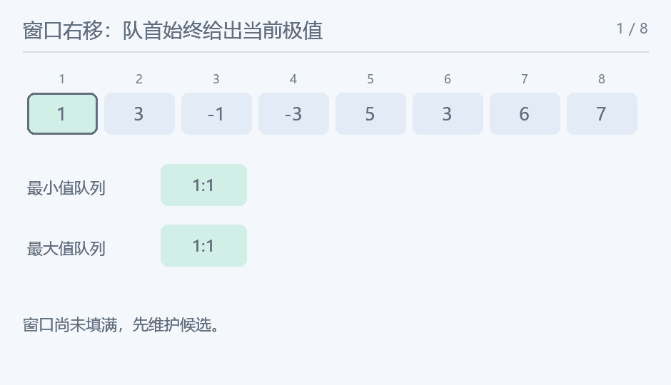

## 滑动窗口

> 原题：[P1886](https://www.luogu.com.cn/problem/P1886)
> 解法：同一数组分别维护完整窗口的最小与最大候选 · C++17

### 题意

给定长度$k$的滑动窗口，依次输出每个完整窗口的最小值与最大值，各占一行。


### 思路


![原样例八项给出六个完整窗口，尚未读满三项时不输出。](data:image/svg+xml;base64,PHN2ZyB4bWxucz0iaHR0cDovL3d3dy53My5vcmcvMjAwMC9zdmciIHdpZHRoPSI3NjAiIGhlaWdodD0iNDYwIiB2aWV3Qm94PSIwIDAgNzYwIDQ2MCIgcm9sZT0iaW1nIiBhcmlhLWxhYmVsbGVkYnk9InRpdGxlIj48dGl0bGUgaWQ9InRpdGxlIj7plb/luqbkuInnmoTlrozmlbTnqpflj6PvvJrlvZPliY3lj7Pnq6/kuZ/lj4LkuI7mnoHlgLw8L3RpdGxlPg0KPHJlY3Qgd2lkdGg9IjEwMCUiIGhlaWdodD0iMTAwJSIgcng9IjEyIiBmaWxsPSIjZmZmIi8+DQo8ZyBmb250LWZhbWlseT0iTWljcm9zb2Z0IFlhSGVpLCBOb3RvIFNhbnMgQ0pLIFNDLCBzYW5zLXNlcmlmIiBmaWxsPSIjMjQzNDQ5Ij4NCjx0ZXh0IHg9IjI4IiB5PSIzNiIgZmlsbD0iIzI0MzQ0OSIgZm9udC1zaXplPSIyMyIgdGV4dC1hbmNob3I9InN0YXJ0IiBmb250LXdlaWdodD0iYm9sZCI+6ZW/5bqm5LiJ55qE5a6M5pW056qX5Y+j77ya5b2T5YmN5Y+z56uv5Lmf5Y+C5LiO5p6B5YC8PC90ZXh0Pg0KPHJlY3QgeD0iMzAiIHk9IjkwIiB3aWR0aD0iODUiIGhlaWdodD0iNDgiIHJ4PSI3IiBmaWxsPSIjZWRmNWZmIiBzdHJva2U9IiMxMjgwNWMiIHN0cm9rZS13aWR0aD0iMiIvPg0KPHRleHQgeD0iNzIuNSIgeT0iMTIxLjAiIGZpbGw9IiMxMjgwNWMiIGZvbnQtc2l6ZT0iMjEiIHRleHQtYW5jaG9yPSJtaWRkbGUiIGZvbnQtd2VpZ2h0PSJub3JtYWwiPjE8L3RleHQ+DQo8cmVjdCB4PSIxMTgiIHk9IjkwIiB3aWR0aD0iODUiIGhlaWdodD0iNDgiIHJ4PSI3IiBmaWxsPSIjZWRmNWZmIiBzdHJva2U9IiMxMjgwNWMiIHN0cm9rZS13aWR0aD0iMiIvPg0KPHRleHQgeD0iMTYwLjUiIHk9IjEyMS4wIiBmaWxsPSIjMTI4MDVjIiBmb250LXNpemU9IjIxIiB0ZXh0LWFuY2hvcj0ibWlkZGxlIiBmb250LXdlaWdodD0ibm9ybWFsIj4zPC90ZXh0Pg0KPHJlY3QgeD0iMjA2IiB5PSI5MCIgd2lkdGg9Ijg1IiBoZWlnaHQ9IjQ4IiByeD0iNyIgZmlsbD0iI2VkZjVmZiIgc3Ryb2tlPSIjMTI4MDVjIiBzdHJva2Utd2lkdGg9IjIiLz4NCjx0ZXh0IHg9IjI0OC41IiB5PSIxMjEuMCIgZmlsbD0iIzEyODA1YyIgZm9udC1zaXplPSIyMSIgdGV4dC1hbmNob3I9Im1pZGRsZSIgZm9udC13ZWlnaHQ9Im5vcm1hbCI+LTE8L3RleHQ+DQo8cmVjdCB4PSIyOTQiIHk9IjkwIiB3aWR0aD0iODUiIGhlaWdodD0iNDgiIHJ4PSI3IiBmaWxsPSIjZWRmNWZmIiBzdHJva2U9IiMyMzY1YWIiIHN0cm9rZS13aWR0aD0iMiIvPg0KPHRleHQgeD0iMzM2LjUiIHk9IjEyMS4wIiBmaWxsPSIjMjM2NWFiIiBmb250LXNpemU9IjIxIiB0ZXh0LWFuY2hvcj0ibWlkZGxlIiBmb250LXdlaWdodD0ibm9ybWFsIj4tMzwvdGV4dD4NCjxyZWN0IHg9IjM4MiIgeT0iOTAiIHdpZHRoPSI4NSIgaGVpZ2h0PSI0OCIgcng9IjciIGZpbGw9IiNlZGY1ZmYiIHN0cm9rZT0iIzIzNjVhYiIgc3Ryb2tlLXdpZHRoPSIyIi8+DQo8dGV4dCB4PSI0MjQuNSIgeT0iMTIxLjAiIGZpbGw9IiMyMzY1YWIiIGZvbnQtc2l6ZT0iMjEiIHRleHQtYW5jaG9yPSJtaWRkbGUiIGZvbnQtd2VpZ2h0PSJub3JtYWwiPjU8L3RleHQ+DQo8cmVjdCB4PSI0NzAiIHk9IjkwIiB3aWR0aD0iODUiIGhlaWdodD0iNDgiIHJ4PSI3IiBmaWxsPSIjZWRmNWZmIiBzdHJva2U9IiMyMzY1YWIiIHN0cm9rZS13aWR0aD0iMiIvPg0KPHRleHQgeD0iNTEyLjUiIHk9IjEyMS4wIiBmaWxsPSIjMjM2NWFiIiBmb250LXNpemU9IjIxIiB0ZXh0LWFuY2hvcj0ibWlkZGxlIiBmb250LXdlaWdodD0ibm9ybWFsIj4zPC90ZXh0Pg0KPHJlY3QgeD0iNTU4IiB5PSI5MCIgd2lkdGg9Ijg1IiBoZWlnaHQ9IjQ4IiByeD0iNyIgZmlsbD0iI2VkZjVmZiIgc3Ryb2tlPSIjMjM2NWFiIiBzdHJva2Utd2lkdGg9IjIiLz4NCjx0ZXh0IHg9IjYwMC41IiB5PSIxMjEuMCIgZmlsbD0iIzIzNjVhYiIgZm9udC1zaXplPSIyMSIgdGV4dC1hbmNob3I9Im1pZGRsZSIgZm9udC13ZWlnaHQ9Im5vcm1hbCI+NjwvdGV4dD4NCjxyZWN0IHg9IjY0NiIgeT0iOTAiIHdpZHRoPSI4NSIgaGVpZ2h0PSI0OCIgcng9IjciIGZpbGw9IiNlZGY1ZmYiIHN0cm9rZT0iIzIzNjVhYiIgc3Ryb2tlLXdpZHRoPSIyIi8+DQo8dGV4dCB4PSI2ODguNSIgeT0iMTIxLjAiIGZpbGw9IiMyMzY1YWIiIGZvbnQtc2l6ZT0iMjEiIHRleHQtYW5jaG9yPSJtaWRkbGUiIGZvbnQtd2VpZ2h0PSJub3JtYWwiPjc8L3RleHQ+DQo8dGV4dCB4PSI0NSIgeT0iMjIwIiBmaWxsPSIjMjQzNDQ5IiBmb250LXNpemU9IjIzIiB0ZXh0LWFuY2hvcj0ic3RhcnQiIGZvbnQtd2VpZ2h0PSJub3JtYWwiPummlueqlyBbMSwzLOKIkjFd77ya5pyA5bCPIOKIkjHvvIzmnIDlpKcgMzwvdGV4dD4NCjx0ZXh0IHg9IjQ1IiB5PSIyODUiIGZpbGw9IiMyNDM0NDkiIGZvbnQtc2l6ZT0iMjMiIHRleHQtYW5jaG9yPSJzdGFydCIgZm9udC13ZWlnaHQ9Im5vcm1hbCI+5qyh56qXIFszLOKIkjEs4oiSM13vvJrmnIDlsI8g4oiSM++8jOacgOWkpyAzPC90ZXh0Pg0KPHRleHQgeD0iNDUiIHk9IjM2MCIgZmlsbD0iIzEyODA1YyIgZm9udC1zaXplPSIyMyIgdGV4dC1hbmNob3I9InN0YXJ0IiBmb250LXdlaWdodD0ibm9ybWFsIj7lhajpg6jmnIDlsI/vvJriiJIx44CB4oiSM+OAgeKIkjPjgIHiiJIz44CBM+OAgTM8L3RleHQ+DQo8dGV4dCB4PSI0NSIgeT0iNDI1IiBmaWxsPSIjMjM2NWFiIiBmb250LXNpemU9IjIzIiB0ZXh0LWFuY2hvcj0ic3RhcnQiIGZvbnQtd2VpZ2h0PSJub3JtYWwiPuWFqOmDqOacgOWkp++8mjPjgIEz44CBNeOAgTXjgIE244CBNzwvdGV4dD4NCjwvZz48L3N2Zz4NCg==)

位置$i$为当前窗口右端，完整窗口是$i$减$k$加一至$i$。与只查“前面$k$项”的题不同，本题必须先加入$a_i$，再得到这一窗口答案。

最小值扫描中，队列下标递增、数值严格递增。下标早于窗口左端的候选从队首移走；队尾若值不小于新值，就被更新更晚且不大的新项永久替代。更新后队首就是窗口最小值。

最大值的证明对称，把队尾比较方向反过来即可。代码用一个maximum标记控制两次扫描，避免把输入取负来转换问题；输入允许最小的有符号int，直接取相反数可能超出int表示范围。

前$k$减一项还没有组成完整窗口，不产生答案。每行恰有$n$减$k$加一个值，按窗口左端递增顺序输出。$k$为一时两行都与原数组相同；$k$为$n$时每行只有一个数。

队列必须存下标，不能只存值，否则重复值无法准确判断何时离开窗口。相同值下保留较新的候选，既不改变极值，也使候选更晚到期。

为了先完整输出最小值一行、再输出最大值一行，保存原数组供两遍使用。不需要保存两份结果数组，扫到完整窗口便输出。

时间 $O(n)$，空间 $O(n+k)$，含输入数组。

<!-- nowcoder-animation:sliding-window -->

### 动态示例



方块中的“下标:数值”对应正文中的单调队列；绿色队首是当前答案。

### 参考代码

```cpp
#include <bits/stdc++.h>
using namespace std;

int main() {
    ios::sync_with_stdio(false);
    cin.tie(nullptr);
    int n, k;
    cin >> n >> k;
    vector<int> a(n);
    for (int &x : a)
        cin >> x;
    for (int maximum = 0; maximum < 2; maximum++) {
        deque<int> queue;
        bool first = true;
        for (int i = 0; i < n; i++) {
            while (!queue.empty() && queue.front() < i - k + 1)
                queue.pop_front();
            while (!queue.empty() && (maximum ? a[queue.back()] <= a[i] : a[queue.back()] >= a[i]))
                queue.pop_back();
            queue.push_back(i);
            if (i >= k - 1) {
                if (!first)
                    cout << ' ';
                first = false;
                cout << a[queue.front()];
            }
        }
        cout << '\n';
    }
    return 0;
}
```

### 易错点

本题包含当前位置；只输出完整窗口；每行$n$减$k$加一项；存下标以处理过期；两次比较方向相反；不把最小int取负；重复值保留较新者。
