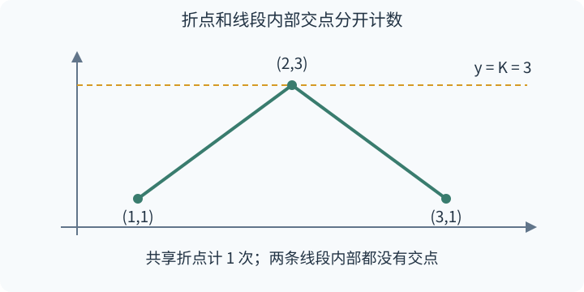
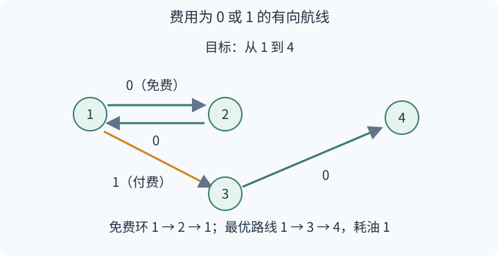
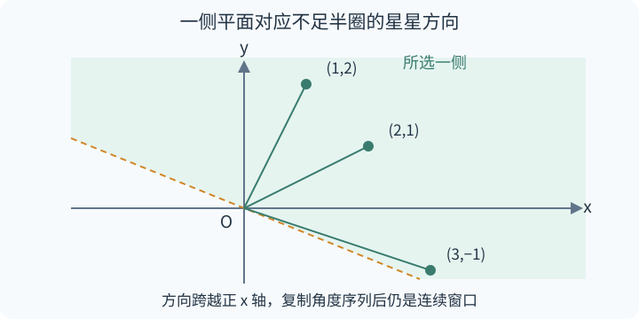
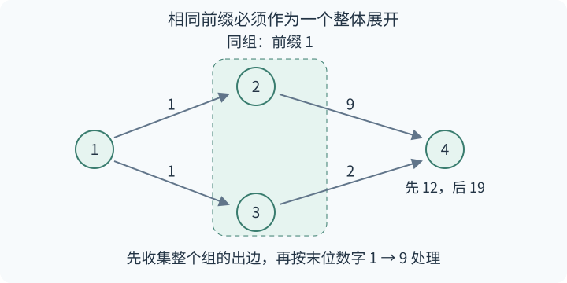

# ABC 481 详细题解

> 比赛：https://atcoder.jp/contests/abc481
> 语言：C++17

## 目录

| 题号 | 题名 | 考点 | 难度 |
|---|---|---|---|
| A | Digits of A+B | 模拟 | 800 |
| B | Polyline | 计算几何 | 800 |
| C | Bank Accounts | 模拟 | 800 |
| D | Autopilot | 最短路 | 1000 |
| E | Most Brilliant Starry Sky | 计算几何[主] + 双指针 + 排序 | 1500 |
| F | Evil Shortest Path | BFS[主] + 贪心 | 1700 |

## A. Digits of A+B

### 题意

输入两个 1 到 9 的整数，求它们相加后需要几个十进制数字表示。

### 从零讲：整数比较与二选一

`bool two_digits = sum >= 10;` 用大于等于运算比较两个数，结果是布尔值，即真或假。`int answer = condition ? x : y;` 使用条件表达式：条件为真就取 $x$，为假就取 $y$，赋给 answer。条件表达式也能放在输出语句中，只选择其中一边的值。

### 思路

例如 $3+4=7$，写出来只有一个数字；$8+7=15$，写出来有两个数字。两种情况的分界是 10。

先用题目的范围排除其他情况：最小的和是 $1+1=2$，最大的和是 $9+9=18$。所以不会出现 0，也不会出现三位数。读入后判断 $A+B\ge10$ 即可，成立输出 2，不成立输出 1。

无论输入是什么，都只做一次加法和一次比较，时间、额外空间均为 $O(1)$。

### 参考代码

```cpp
#include <bits/stdc++.h>
using namespace std;
int main() {
    ios::sync_with_stdio(false);
    cin.tie(nullptr);
    int a, b;
    cin >> a >> b;
    // 和在 2 到 18 之间，只需判断是否达到 10。
    cout << (a + b >= 10 ? 2 : 1) << '\n';
}
```

### 易错点

判断应包含等于 10，例如输入 1 和 9 的答案是 2。


## B. Polyline

### 题意

点 $(1,A_1),(2,A_2),\ldots,(N,A_N)$ 按顺序连成折线。求水平线 $y=K$ 与折线相交的不同位置数量；相邻高度保证不同。

### 从零讲：数组与相邻元素

`std::vector<int> a(n)` 是长度为 $n$ 的动态数组，下标从 0 开始。输入循环 `for (int &v : a)` 让循环变量引用当前元素，对 $v$ 赋值会直接修改数组。遍历相邻两项时，令 $i$ 从 1 开始，比较 `a[i-1]` 和 `a[i]`，这样左右下标都在范围内。单次下标访问为 $O(1)$，保存数组用 $O(n)$ 空间。

### 思路

#### 交在端点上时，只能算一个位置

取高度序列 $[1,3,1]$，令 $K=3$。左右两段都接触水平线，但接触的是同一个点 $(2,3)$。



如果直接对每条线段判断“有没有碰到水平线”，会把这个点算两次。解决方式是先规定每一类交点由谁负责统计：折点由点循环统计，线段内部交点由线段循环统计。

#### 线段内部什么时候相交

线段的一端高度为 $u$，另一端高度为 $v$。由于线段上的高度连续变化，K 严格夹在 $u$ 与 $v$ 之间时，内部恰好经过高度 K 一次。因此条件是

$$
(u<K<v)\quad\text{或}\quad(v<K<u).
$$

在代码里分别写成两组 `&&`，再用 `||` 连接。若有端点等于 K，严格比较不成立，这个交点已经由点循环负责。

横坐标递增保证每段内部占据各自的开区间 $(i,i+1)$，不会和其他段的内部重叠。因此统计折点数，再加严格跨越的线段数，就是不同交点总数。一次遍历点、一次遍历边，时间 $O(N)$，空间 $O(N)$。

### 参考代码

```cpp
#include <bits/stdc++.h>
using namespace std;
int main() {
    ios::sync_with_stdio(false);
    cin.tie(nullptr);
    int n, k;
    cin >> n >> k;
    vector<int> a(n);
    int answer = 0;
    for (int &v : a) {
        cin >> v;
        if (v == k) ++answer;  // 折点单独计数，避免相邻线段重复算它。
    }
    for (int i = 0; i + 1 < n; ++i) {
        // 两端严格分居水平线两侧，才有一个内部交点。
        if (min(a[i], a[i + 1]) < k && k < max(a[i], a[i + 1]))
            ++answer;
    }
    cout << answer << '\n';
}
```

### 易错点

不能把严格比较改成小于等于，否则共享端点又会重复统计。第一个点和最后一个点也要参加折点统计。


## C. Bank Accounts

### 题意

每来一个账户名，就告诉它对应的编号。第一次见到的新名字按 1、2、3……分配编号；同名账户必须返回之前分配的编号。

### 从零讲：键值映射和迭代器

要反复回答“这个名字对应哪个编号”，适合用 `std::map<string,int>`。字符串是键，整数是值，键唯一。可以先写 `auto it = id.find(name);`；it 指向找到的条目，`it->first` 是名字，`it->second` 是编号。没找到时返回特殊位置 `id.end()`，此时不能读取 `it->second`。

`id[name]=value` 会保存映射；如果键原来不存在，它会创建条目，因此单纯检查存在性时用 `find` 更清楚。map 通常用平衡搜索树实现，通过比较键缩小查找范围，单次操作为 $O(\log N)$ 次键比较。它按键排序不等于按键分配编号，保存什么值仍由程序决定。

### 思路

用一个表记下已经分配过的编号，另用 `int next_id=1;` 记下下一次能用的编号。

| 读到的名字 | 查表结果 | 本次输出 | 处理后的下一个编号 |
|---|---|---|---|
| `"z"` | 没有记录，分配 1 | 1 | 2 |
| `"a"` | 没有记录，分配 2 | 2 | 3 |
| `"z"` | 已记录为 1 | 1 | 3 |
| `"b"` | 没有记录，分配 3 | 3 | 4 |
| `"a"` | 已记录为 2 | 2 | 4 |

每次输入只需区分两种情况。查表成功时直接输出，表和计数器都保持原值；查表失败时先保存 `next_id`，输出它，再把它加一。

这还说明了为什么编号连续：计数器每次只增加 1，而且只在新名字出现时增加。为什么同名编号相同：第一次写入的映射以后不再修改。

名字长度至多 L 时，一次字符串比较最多检查 L 个字符，总时间 $O(NL\log N)$；最多保存 N 个名字，空间 $O(NL)$。

### 参考代码

```cpp
#include <bits/stdc++.h>
using namespace std;
int main() {
    ios::sync_with_stdio(false);
    cin.tie(nullptr);
    int q;
    cin >> q;
    map<string, int> id;
    int next_id = 1;
    while (q--) {
        string s;
        cin >> s;
        // 账户从不删除，已用编号始终是从 1 开始的连续一段。
        auto it = id.find(s);
        if (it == id.end()) {
            id[s] = next_id;
            cout << next_id << '\n';
            ++next_id;
        } else {
            cout << it->second << '\n';
        }
    }
}
```

### 易错点

不要每读一个名字就递增编号。也不要把所有名字排序后重新编号，那会改变题目要求的出现顺序。


## D. Autopilot

### 题意

有 N 个星球和 M 条单向航线。每次可以免费飞向当前星球的出边中编号最小的终点，也可以花 1 单位油任选一条出边。求 S 到 T 最少需要多少油。

### 从零讲：图的保存与 0-1 BFS

邻接表给每个点保存一个出边终点数组。`graph[u].push_back(v)` 只加入 $u \to v$，不会自动加入反向边。`std::vector<int>(n+1,INF)` 则创建长度为 $n+1$、初值全为 INF 的距离数组；INF 是足够大、但加 1 不溢出的整数，用来表示还没找到路线。

最短路中的“松弛”就是检查经由 $u$ 能否把 $v$ 的已知费用变小。普通 BFS 适用于每条边同价；边权只有 0 和 1 时，可用双端队列 `std::deque`：零费用改善放队首，一费用改善放队尾。`todo.front();` 读头部，`pop_front` 删除头部，`push_front` 与 `push_back` 分别从两端插入，单次均为 $O(1)$，访问前应确认非空。

### 思路

#### 先把操作变成边的费用

在 $u$ 的所有出边中求最小终点 `smallest[u]`。如果边 $u \to v$ 满足 `v==smallest[u]`，就把它的费用设为 0，否则设为 1。虽然题目允许对最小终点也付费，但免费走完全相同的边总不会更差，所以无需保留那种选择。



以图为例，1 的最小邻点是 2，2 的唯一邻点是 1。一直自动驾驶会在这两个点间循环。花一次油走 1→3，再走 3→4 才能到达目标。

#### 为什么双端队列能保证费用顺序

假设当前取出的最小费用是 $d$。沿 0 权边得到的候选仍为 $d$，应在尚未处理的 $d+1$ 候选之前；沿 1 权边得到的候选是 $d+1$，可以排到尾部。如此始终先完成便宜的一层，再处理贵的一层。

如果一个点第一次出队时还能找到更便宜的路线，那么那条路线的前驱费用不会更大，必然已先被处理，早就应该改善这个点，矛盾。因此第一次出队可以标记 `fixed[u]=true`。同一个点可能因距离改善被放入队列多次，后来的重复项直接跳过。

初始化 `distance[S]=0`，其他为 INF。只有候选费用严格小于旧距离才入队，零费用环便不会导致无限重复。最后检查 `distance[T]`：没有变过就是不可达。

每个点只真正展开一次，每条边只做一次松弛检查，所以时间、空间均为 $O(N+M)$。

### 参考代码

```cpp
#include <bits/stdc++.h>
using namespace std;
int main() {
    ios::sync_with_stdio(false);
    cin.tie(nullptr);
    int n, m, s, t;
    cin >> n >> m >> s >> t;
    vector<vector<int>> graph(n + 1);
    vector<int> smallest(n + 1, n + 1);
    while (m--) {
        int a, b;
        cin >> a >> b;
        graph[a].push_back(b);
        smallest[a] = min(smallest[a], b);
    }
    const int INF = 1000000000;
    vector<int> distance(n + 1, INF);
    vector<bool> fixed(n + 1, false);
    deque<int> todo;
    distance[s] = 0;
    todo.push_front(s);
    while (!todo.empty()) {
        int u = todo.front();
        todo.pop_front();
        if (fixed[u]) continue;
        fixed[u] = true;
        for (int v : graph[u]) {
            int cost = (v == smallest[u] ? 0 : 1);
            if (distance[v] > distance[u] + cost) {
                distance[v] = distance[u] + cost;
                // 零费用留在当前层，费用为一的路线进入下一层。
                if (cost == 0) todo.push_front(v);
                else todo.push_back(v);
            }
        }
    }
    cout << (distance[t] == INF ? -1 : distance[t]) << '\n';
}
```

### 易错点

航线是单向的；没有出边的点直接结束展开。`fixed[u]` 在出队时设置，不能在发现一个点、把它加入队列时就设置。


## E. Most Brilliant Starry Sky

### 题意

选一条过原点、不穿过星星的直线，再选它的一侧，尽量把更多星星放进这一侧。星星离原点的距离不限制选择；任意两颗星都不与原点共线。

### 从零讲：方向、叉积和排序

从原点 O 指向点 P 的向量就是 P 的坐标。向量的长度描述距离，极角描述方向。绕 O 逆时针观察星星时，遇到它们的顺序就是极角顺序。

二维叉积 $a_xb_y-a_yb_x$ 是有正负号的面积量。例如 $a=(1, 0)$、$b=(0, 1)$，叉积为 1，表示从 $a$ 逆时针转到 $b$ 不足半圈；把 $b$ 换成 $(0, -1)$，叉积为 $-1$。叉积为零时两向量共线。比较方向时不必计算浮点角度。

但整圈不能仅用“叉积大于零”作为排序规则，因为绕一圈后这个关系不再传递。先按上、下半平面拆成两个跨度不足半圈的范围，再在各自范围内按叉积比较。正 $x$ 轴放在第一半，负 $x$ 轴放在第二半，边界也就明确了。

`sort(p.begin(),p.end(),angle_less)` 对动态数组排序。比较函数返回“$a$ 是否严格位于 $b$ 前面”，相等时不能双向都返回真。`Point p;` 结构体使坐标成对移动，避免只排序 $x$ 或 $y$ 破坏点的对应关系。排序时间为 $O(N\log N)$；数组访问、末尾追加的均摊时间为 $O(1)$。

### 思路

#### 一侧平面等于半圈方向

固定过原点的直线后，某一侧恰好覆盖连续半圈的射线。因为边界不能包含星星，被选中星星的最小方向和最大方向之间必须严格小于半圈。



图中三颗星的位置是 $(3,-1),(2,1),(1,2)$。按零度开始排序，下面的星会排在最后，上面的两颗排在前面，但它们实际上挨在一起。因此把排好序的数组再复制一遍，原来末尾到开头的连续窗口就可以向右读出来。

#### 固定第一颗星，寻找最远终点

令 left 指向当前窗口第一颗星。从它的射线逆时针旋转，后面的点与它叉积严格为正，就说明尚未到半圈。让 right 不断右移，直到遇到第一颗不满足条件的星，或已经扫描 N 颗。

有效下标区间是 $[left,right)$，所以星数为 $right-left$。起点的叉积是零，代码先令 right 至少为 left+1，把起点作为窗口的一员单独保留。

这不会违反直线不能经过星星的要求：窗口实际跨度小于半圈，且星的数量有限，可以把穿过起点的临时边界略微顺时针旋转。这样起点进入内部，最远点仍在内部，边界也能避开全部星。

#### 为什么 right 不需要退回

left 每次沿逆时针方向前进一步，对应的“left 方向加半圈”也只会前进。因此之前仍在窗口里的后续点不会突然越过新的右边界，right 可以继续向右找。left 扫 N 次，right 最多扫到第二份数组的末尾，双指针扫描共 $O(N)$。

排序加扫描为 $O(N\log N)$ 时间，复制数组使用 $O(N)$ 空间。任意最优半平面中的第一颗星都会被枚举，后续星也都会被对应窗口包含，因此取最大窗口即可。

### 参考代码

```cpp
#include <bits/stdc++.h>
using namespace std;
struct Point { long long x, y; };
int half(Point p) {
    return (p.y > 0 || (p.y == 0 && p.x > 0)) ? 0 : 1;
}
long long cross(Point a, Point b) {
    return a.x * b.y - a.y * b.x;
}
bool angle_less(Point a, Point b) {
    if (half(a) != half(b)) return half(a) < half(b);
    return cross(a, b) > 0;
}
int main() {
    ios::sync_with_stdio(false);
    cin.tie(nullptr);
    int t;
    cin >> t;
    while (t--) {
        int n;
        cin >> n;
        vector<Point> p(n);
        for (Point &v : p) cin >> v.x >> v.y;
        sort(p.begin(), p.end(), angle_less);
        for (int i = 0; i < n; ++i) p.push_back(p[i]);
        int answer = 1, right = 0;
        for (int left = 0; left < n; ++left) {
            right = max(right, left + 1);
            // 从起点逆时针转动不足半圈，叉积严格为正。
            while (right < left + n && cross(p[left], p[right]) > 0) ++right;
            answer = max(answer, right - left);
        }
        cout << answer << '\n';
    }
}
```

### 易错点

叉积必须使用 64 位有符号整数；本题坐标范围下绝对值不超过 $2\times10^{18}$。复制数组后最多取 N 颗星，不能把第二份中的同一颗重复算入。


## F. Evil Shortest Path

### 题意

从点 1 沿有向边出发，把经过的边上的数字依次拼接。对每个目标点，求能形成的最小正整数的余数。边上数字只有 1 到 9，且所有点都能从 1 到达。

### 从零讲：字典序、BFS 与 C++ 容器

等长字符串的字典序由第一个不同字符决定，例如 128 小于 131。没有前导零时，数字比较先看长度，再看字典序；9 小于 11，就是长度优先的例子。

BFS 用先进先出的队列逐层处理点，第 $k$ 层对应走 $k$ 条边。`std::queue<T>` 可保存任意元素类型；`push` 加到队尾，`todo.front();` 读队首，`todo.pop();` 删除队首，单次操作均为 $O(1)$。本题的 T 是 `std::vector<int>`，所以一个队列元素保存一组点，而不是一个点。

邻接表用动态数组保存每个点的出边，`std::pair<int,int>` 把终点和数字绑定。`auto [v,digit]` 是 C++17 结构化绑定，取出这两个成员的值。把一个 vector 交给另一个容器时，`std::move` 允许直接转移底层存储，减少复制；原对象仍可安全销毁，但后续不应假定它还含有旧元素。本程序移动队首后立即弹出它，移动新组后也不再读取旧组。

### 思路

#### 先最短，再最小

路径每经过一条边就增加一位，所以优先最少边数。只在边数相同时才需要比较每一位，这使 BFS 成为合适的框架。不过，普通 BFS 的相邻点枚举顺序不能保证整个字符串有序。



图中从 1 到点 2、3 都得到字符串 1。点 2 接数字 9 得到 19，点 3 接数字 2 得到 12。即使分别把每个点的出边排好序，先展开点 2 仍会先遇到 19。

#### 把共同前缀的出边一起比较

队列里保存一组最优字符串完全相同的点。例如 {2,3} 对应字符串 1。取出这组时，先扫描所有成员的出边，按边上数字放进 1 到 9 的桶。之后才按桶编号从小到大处理：数字 2 的所有候选都先于数字 9 的候选。

每个桶里的未确定点形成一个新组，它们都具有相同的新字符串。此时设置 `seen[v]`，以免同一个目标被重复确定。一个点从多个父节点或多条重边进入同一个桶，也只加入新组一次。

#### 队列的整体顺序为什么正确

初始组 {1} 对应空字符串。假设当前一层的组已按前缀字典序排列：对较小前缀添加任何一位，都小于较大前缀添加一位；同一前缀则按新增数字 1 到 9 排列。因此按旧组顺序、再按桶顺序入队，下一层仍有序。FIFO 同时保证上一层处理完才开始下一层。

于是候选路径严格按“长度优先、同长字典序优先”的次序产生。点第一次被确定时，所有更小的候选都已经考虑过，它的答案不会再改善。环路只会产生更长字符串，已确定点跳过即可。

#### 不保存巨大整数

分组本身已经决定大小关系，不需要真的拼出字符串。若当前组的答案余数是 $r$，追加数字 $d$ 后余数为 $(10r+d)\bmod998244353$。同组任何点的 $r$ 都相同，所以读取第一个点的余数即可。两个不同组碰巧余数相同，仍按原队列顺序分别处理。

每个点进入一个组，只展开一次；每条边最多进入一个桶，之后也只检查一次。组数不超过 N，每组检查 9 个桶是常数开销，总时间、空间均为 $O(N+M)$。

### 参考代码

```cpp
#include <bits/stdc++.h>
using namespace std;
const long long MOD = 998244353;
int main() {
    ios::sync_with_stdio(false);
    cin.tie(nullptr);
    int n, m;
    cin >> n >> m;
    vector<vector<pair<int, int>>> graph(n + 1);
    while (m--) {
        int a, b, c;
        cin >> a >> b >> c;
        graph[a].push_back({b, c});
    }
    vector<bool> seen(n + 1, false);
    vector<long long> answer(n + 1, 0);
    queue<vector<int>> groups;
    groups.push({1});
    seen[1] = true;
    while (!groups.empty()) {
        vector<int> current = move(groups.front());
        groups.pop();
        vector<int> bucket[10];
        for (int u : current)
            for (auto [v, digit] : graph[u])
                if (!seen[v]) bucket[digit].push_back(v);
        for (int digit = 1; digit <= 9; ++digit) {
            vector<int> next;
            for (int v : bucket[digit]) {
                if (seen[v]) continue;
                // 必须在整组按末位排序后确认首次到达，不能按父顶点顺序抢占。
                seen[v] = true;
                answer[v] = (answer[current[0]] * 10 + digit) % MOD;
                next.push_back(v);
            }
            if (!next.empty()) groups.push(move(next));
        }
    }
    for (int v = 2; v <= n; ++v) cout << answer[v] << '\n';
}
```

### 易错点

标记首次到达的位置必须在完整分桶之后。不得用取模结果比较得分；取模不保持大小关系。


## 实测记录

编译：A—F 均通过 C++17、-O2、-Wall、-Wextra 检查，无警告。
官方样例：A—F 分别 3、3、2、3、1、3 组全过。
边界用例：A—F 分别 81、4、2、4、4、3 条全过。
随机对拍：A—F 分别实跑 300、300、300、500、1500、500 组，全一致（seed=20261024）。
极限计时：A—F 分别 0.005、0.006、0.088、0.045、0.033、0.074 s，均通过题面时限。
