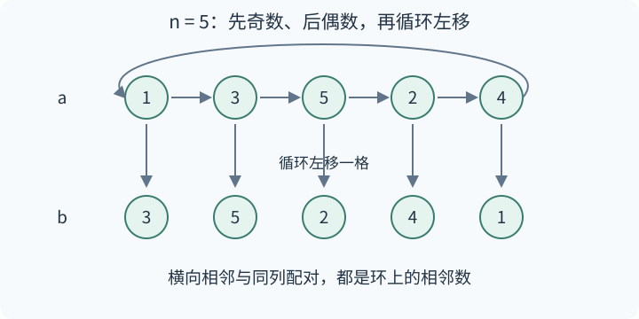
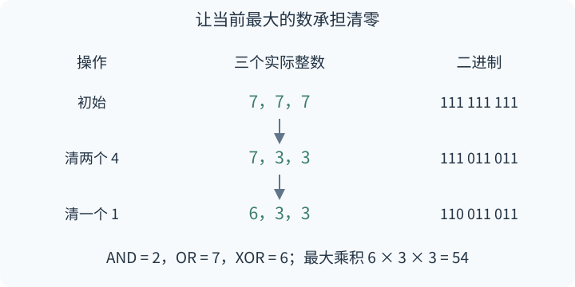

# 月赛 311 题解

> 比赛：https://www.luogu.com.cn/contest/364653
> 语言：C++17

## 目录

| 题号 | 题名 | 考点 | 难度 |
|---|---|---|---|
| A | 极差 / Range | 构造 | 1150 |
| C | 位运算 / Bit | 位运算[主] + 贪心 + 快速幂 | 2050 |

## A. 极差 / Range

### 题意

构造两个 1 到 $n$ 的排列，使每行任意长度至少为 2 的连续区间的极差都大于 1，且同一列两数之差的绝对值大于 1。

### 从零讲：循环下标和动态数组

`std::vector<int>` 可以依次用 `push_back` 加入元素，均摊 $O(1)$，下标从 0 开始。`(i+1)%n;` 把最后一个位置的后继变成 0，适合表示环上的下一项；这里的 `i % n;` 是整数余数运算。`" \n"[condition]` 从两个字符中选一个，条件为假时输出空格，为真时输出换行。

### 思路

只需保证每行相邻两数之差大于 1：任何更长区间包含这样一对，其极差至少同样大。

对 $n\ge5$，先写所有奇数，再写所有偶数，作为第一行 $a$；把 $a$ 循环左移一格得到第二行 $b$。



同奇偶段内部相邻差为 2。奇数段末尾到 2 的差至少为 3，最后一个偶数回到 1 的差也至少为 3，因此整个环的每条邻接都合法。两行内部的相邻位置、同列的两个数都是环上的相邻项，三个条件同时满足。

$n\le3$ 时数 2（或唯一的数 1）无法找到足够远的同列数。$n=4$ 时相邻差大于 1 的排列只有 $3,1,4,2$ 和它的逆序；两行相同会出现差 0，两行相反在首列出现差 1，因此也无解。输出 $-1$ 即可。

时间、空间均为 $O(n)$。

### 参考代码

```cpp
#include <bits/stdc++.h>
using namespace std;
int main() {
    ios::sync_with_stdio(false);
    cin.tie(nullptr);
    int n;
    cin >> n;
    if (n <= 4) {
        cout << -1 << '\n';
        return 0;
    }
    vector<int> a;
    for (int v = 1; v <= n; v += 2) a.push_back(v);
    for (int v = 2; v <= n; v += 2) a.push_back(v);
    for (int i = 0; i < n; ++i) cout << a[i] << " \n"[i == n - 1];
    // 第二行循环左移一位，使同列两数也是环上的相邻数。
    for (int i = 0; i < n; ++i) cout << a[(i + 1) % n] << " \n"[i == n - 1];
}
```

### 易错点

一定要检查环的首尾差，否则第二行换位后可能产生非法邻接。循环左移保持排列元素不重不漏。


## C. 位运算 / Bit

### 题意

构造 $n$ 个非负整数，使按位与、或、异或分别为 $x$、$y$、$z$，求最大乘积对 **998244853** 取模；无解输出 $-1$。$n$ 可达 $10^{18}$，数值小于 $2^{60}$。

### 从零讲：位运算、快速幂和局部函数

按位与 `a & b;` 要求两个对应位都为 1，按位或 `a | b;` 要求至少一个为 1，异或 `a ^ b;` 要求对应位不同；多个数异或后的一位，就是这一位中 1 的个数的奇偶性。`(v>>k)&1` 取第 $k$ 位，`1ULL<<k` 生成权重 $2^k$，ULL 让移位在 64 位无符号整数上进行。

快速幂把指数按二进制拆开，反复将底数平方，指数的当前位为 1 时乘入答案，时间 $O(\log n)$。每次乘法后取模可保持余数；取模不能用于比较原乘积大小。

代码里的 `auto f = [&](...) {...};` 是局部 lambda 函数。`[&](){ return product; }` 按引用捕获所用的外部变量，修改会写回；`[=](){ return product; }` 则保存定义时的值副本。引用必须活到调用结束，不能把引用局部变量的函数带出其作用域后再调用。本题两个函数只在当前测试内同步调用，变量始终有效。`std::sort(top,top+kept,std::greater<ull>())` 按降序排这个左闭右开范围，至多三个数，费用是常数。

### 思路

#### 每一位只清零一个或两个数

先把全部数设为 $y$。$y$ 为 0 的位必须全部为 0，$x$ 为 1 的位必须全部为 1；因此 $x$、$z$ 都不能含 $y$ 没有的位，且 $x$ 中各位的 $z$ 必须等于 $n$ 的奇偶性。

对 $y_k=1,x_k=0$ 的可变位，设其中 $q$ 个数取 0。必须 $1\le q<n$，且剩余 $n-q$ 个 1 的奇偶性为 $z_k$。同奇偶条件下，若 $q \ge 3$，可把两个 0 改成 1，保持所有位运算条件、使乘积不减。因此最优解可以取

$$q=\begin{cases}1,&z_k\ne n\bmod2,\\2,&z_k=n\bmod2.\end{cases}$$

$n=1$ 必须 $x=y=z$；$n=2$ 的每个可变位都必须 $z_k=1$，否则 $q=2$ 会清空所有 1。

#### 从高位到低位，让较大的数承担清零

对权重 $w$ 的一位，在当前最大的 $q$ 个数中清掉它。同一位选不同的数。例：$n=3$、$x=2$、$y=7$、$z=6$，从 $[7,7,7]$ 开始，清两个 4 得 $[7,3,3]$，再清一个 1 得 $[6,3,3]$，乘积 54。



为什么选最大的？若高位前缀较大的数 A 保留 $w$，较小的 B 清掉 $w$，交换这一位可把二者变成 $A-w$、$B+w$。即使考虑未定的低位，也有 $A-B>w$，乘积变化为 $w(A-B-w)>0$；其他数非负，整体乘积不减。高位前缀相同的数等价，可任意选。因此逐位贪心成立。

#### $n$ 很大时，只保留三个候选数

用 rest 记录尚未改动、仍为 $y$ 的个数，它们总是最大。已经修改过的数，按“第一次清零的是哪一位”分组：每组至多两个数；第一次清零的位越低，这组的数永久越大，后续低位无法逆转顺序。

每次最多选两个数。如果最大组有两个，只会选这一组；如果最大组只有一个，再需要下一组的至多两个数。因此修改过的数只需保留最大的三个，其余数不会再被选，可直接把它们乘进 product。

每位先消耗 rest；不足时再修改保留的最大值，重新排序。最后把保留值及 $y^{rest}$ 乘入答案。时间 $O(60+\log n)$，额外空间 $O(1)$。

### 参考代码

```cpp
#include <bits/stdc++.h>
using namespace std;
using ull = unsigned long long;
const ull MOD = 998244853;

class FastInput {
    char buffer[1 << 20];
    int at = 0, size = 0;
    char get() {
        if (at == size) { size = fread(buffer, 1, sizeof buffer, stdin); at = 0; }
        return at < size ? buffer[at++] : 0;
    }
public:
    ull read() {
        char c = get();
        while (c && (c < '0' || c > '9')) c = get();
        ull value = 0;
        while (c >= '0' && c <= '9') { value = value * 10 + c - '0'; c = get(); }
        return value;
    }
};

ull power(ull a, ull k) {
    ull result = 1; a %= MOD;
    while (k) {
        if (k & 1) result = result * a % MOD;
        a = a * a % MOD; k >>= 1;
    }
    return result;
}

int main() {
    static FastInput input;
    int t = input.read();
    while (t--) {
        ull n = input.read(), x = input.read(), y = input.read(), z = input.read();
        ull parity = (n & 1) ? y : 0;
        ull variable = y ^ x;
        if ((x & y) != x || (z & y) != z || (z & x) != (parity & x)
            || (n == 1 && (x != y || y != z))
            || (n == 2 && (z & variable) != variable)) {
            puts("-1"); continue;
        }
        // rest 个数还等于 y；改过的数保留最大的三个，防止第二、三名并列。
        ull rest = n, top[3]{}, product = 1;
        int kept = 0;
        auto freeze = [&](ull value) { product = product * (value % MOD) % MOD; };
        auto insert = [&](ull value) {
            if (kept < 3) top[kept++] = value;
            else if (value > top[2]) { freeze(top[2]); top[2] = value; }
            else freeze(value);
            sort(top, top + kept, greater<ull>());
        };
        for (int k = 59; k >= 0; --k) if ((variable >> k) & 1) {
            ull bit = 1ULL << k;
            int count = 1 + (((z >> k) & 1) == (n & 1));
            if (rest >= (ull)count) {
                // 先取尚未改变的 y；这一批一定大于之前改过的数。
                rest -= count;
                for (int j = 0; j < count; ++j) insert(y - bit);
            } else if (rest == 1) {
                // 需要清零两个数：最后一个 y，以及已修改数中的最大者。
                top[0] -= bit;
                sort(top, top + kept, greater<ull>());
                insert(y - bit);
                rest = 0;
            } else {
                for (int j = 0; j < count; ++j) top[j] -= bit;
                sort(top, top + kept, greater<ull>());
            }
        }
        for (int j = 0; j < kept; ++j) freeze(top[j]);
        printf("%llu\n", product * power(y, rest) % MOD);
    }
}
```

### 易错点

模数是 998244853。只保留两个候选会漏掉“第二、第三名并列后轮流被选”的情况，例如 $n=3$、$x=0$、$y=7$、$z=7$ 的最优数为 4、2、1，乘积 8。需要减少两个数时，先选原来的前两名，再一起排序。


## 实测记录

编译：A、C 均通过 C++17、-O2、-Wall、-Wextra 检查，无警告。
官方样例：A、C 各 2 组全过；A 使用合法性判定器。
边界用例：A 的 5 条、C 的 2 条全过；C 包含 3072 组小范围约束的独立穷举。
随机对拍：A 实跑 300 组，C 实跑 500 组，全一致（seed=20261024）。
极限计时：A 的百万长度为 0.093 s；C 的五十万组、60 位及大规模参数为 0.627 s，均通过题面时限。
