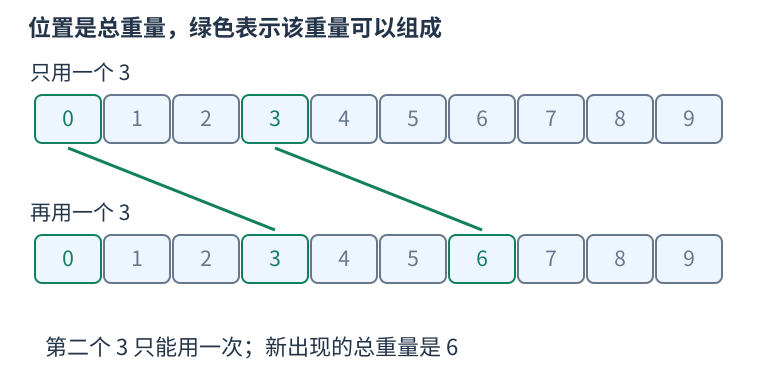

# bitset：一位保存一个可达状态

只需要回答“这个整数重量能否出现”时，可以用一个二进制位保存真假。`bitset<N>` 来自 `<bitset>`，在编译时固定保存 N 位，下标从零到 N 减一；初始各位都是零。它存的是一组真假，不能替代记录最小费用或方案数的整数数组。



例如起初只有空集的重量零可达，随后依次加入两个重量三的物品：

```cpp
#include <bitset>
#include <iostream>
using namespace std;
int main() {
    bitset<10> possible;
    possible[0] = 1;
    possible |= possible << 3;
    possible |= possible << 3;
    cout << possible[0] << ' ' << possible[3] << ' '
         << possible[6] << ' ' << possible.count() << '\n';
}
```

输出是一、一、一、三：能够得到零、三、六这三种重量。第一次加入物品前，只有零位为一；左移三位，把它送到三位。第二次左移的是当时的零、三两位，得到三、六两位，再与原状态按位或，便保留全部“选或不选”的结果。

`possible << weight` 先产生移位后的新值，不直接改变原变量；`|=` 再把它并入原值。因此同一轮读取的是本轮加入物品之前的状态，一件物品只用一次。若有两件等重物品，可以分两轮加入，但相同总重量只保留一位，不会记录它有几种组成方式。

`count()` 返回一的总数，包括零位。只有在明确零可达时，才可减一来排除空重量。`possible[index]` 可读写一位，使用前应保证下标在范围内；不能访问第 N 位。

固定长度会丢掉移出边界的位，因此必须先证明保存范围足够。下面刻意演示这个边界，并说明 `reset()` 会清除全部旧状态：

```cpp
#include <bitset>
#include <iostream>
using namespace std;
int main() {
    bitset<8> states;
    states[0] = 1;
    states |= states << 7; // 保存下标零与七。
    states |= states << 8; // 高位全部超出范围，没有新增状态。
    cout << states.count() << ' ';
    states.reset();
    states[0] = 1;         // 开始另一份独立问题。
    cout << states.count() << '\n';
}
```

输出二和一。对于非负重量，若所有物品总重不超过 W，就保留 W 加一位，正好包括零至 W。不同候选物品集要重新初始化，不能把上一组得到的状态留下。

移位与按位或会处理整个位集。按逐位计算可保守估计每次为 O(N)；常用 GCC 标准库把多位打包到机器字并行处理，实际约为 O(N 除以字长)，空间也按打包的 N 位计。这个优化不会改变所表示的数学状态，尤其不会把真假自动变成计数。
