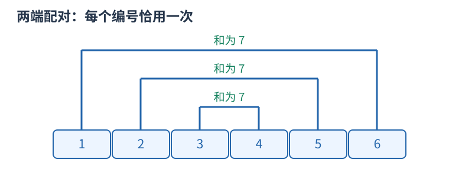

# 构造：找到一份合法对象，并解释它为何总能生成

构造题允许输出任意满足要求的对象。先区分“只需合法”与“还要求最小、最多或字典序最小”，不要额外发明优化目标。

例如要把从一到 $2k$ 的数字配成 $k$ 对，使每对和相同，可以配 $(1,2k),(2,2k-1),\ldots,(k,k+1)$，每对都为 $2k+1$。数字不重复，因为两半各用一次；也没有漏数。这个一般描述能直接转成循环。

如果还要求最大化某项，先给任何方案都不能超越的上界，再展示构造确实达到上界；没有最优性要求时只证明合法和能完成即可。

一个完整构造应能回答：什么时候无解；输出对象是什么；每次允许的动作如何执行；后续所需的条件有没有被前面的动作破坏；数量、范围和边界是否满足。操作题还要区分目标排列和真正输出的操作序列。

验证构造不能只和另一程序逐字比较，因为合法答案可有多份。应将结果代回题目条件：检查长度、元素多重集合、限制、每步前后状态及目标。复杂度按生成和校验成本计算，输出本身有 $k$ 项就至少需要 $O(k)$ 时间。
