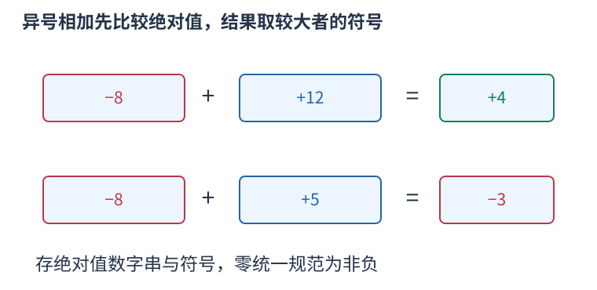

# 有符号十进制大整数：分开管理符号与绝对值

当输入整数没有足够小的范围保证时，先读成字符串，避免在读入阶段就溢出。下面的Number保存一个符号与不含前导零的绝对值数字串；零统一写成正号的"0"。这是整数的精确表示，不经过double近似。



Number是结构体名，与它同名且没有返回类型的成员是构造函数。`Number(text)` 从一段有可选正负号的十进制文本构造对象；默认构造则采用成员初值，得到零。运算后的对象也保持同样的规范，因此比较时不必再考虑"0003"与"3"这类重复表示。

比较先看正负号。符号相同时，绝对值位数较多者更大；位数相同才可直接按字符串字典序比较。两数均为负时，绝对值越大，实际数值反而越小。

加法分两类。同号时，从个位起逐位相加，记进位，结果保留共同符号；异号时，相当于用绝对值较大者减较小者，逐位借位，结果取绝对值较大者的符号。例如负八加十二得到四，负八加五得到负三，恰好抵消时重新规范成零。

乘一个32位整数时，将乘数先提升到long long，再求其绝对值，避免对int最小负数直接取反。逐位做“本位乘数加进位”，符号由两者是否异号决定。中间量至多约十倍乘数绝对值，在long long内；这不是任意两个大整数相乘的实现。

以下程序包含完整的规范化、比较、加法、绝对值减法和乘小整数。`const Number&` 只读引用避免每次调用先复制参数；返回Number的值则由调用者独立持有。

```cpp
#include <bits/stdc++.h>
using namespace std;
struct Number{
    string digits="0";bool negative=false;
    Number()=default;
    Number(string text){
        size_t pos=0;
        if(!text.empty()&&(text[0]=='-'||text[0]=='+')){negative=text[0]=='-';++pos;}
        while(pos<text.size()&&text[pos]=='0') ++pos;
        digits=pos==text.size()?"0":text.substr(pos);
        if(digits=="0") negative=false;
    }
};
int absoluteCompare(const string &a,const string &b){
    if(a.size()!=b.size()) return a.size()<b.size()?-1:1;
    return a==b?0:(a<b?-1:1);
}
bool lessNumber(const Number &a,const Number &b){
    if(a.negative!=b.negative) return a.negative;
    int order=absoluteCompare(a.digits,b.digits);
    return a.negative?order>0:order<0;
}
string absoluteAdd(const string &a,const string &b){
    string result;int i=int(a.size())-1,j=int(b.size())-1,carry=0;
    while(i>=0||j>=0||carry){
        int value=carry;if(i>=0) value+=a[i--]-'0';if(j>=0) value+=b[j--]-'0';
        result.push_back(char('0'+value%10));carry=value/10;
    }
    reverse(result.begin(),result.end());return result;
}
// 前提：a 不小于 b；两个参数都只含绝对值数字。
string absoluteSubtract(const string &a,const string &b){
    string result;int j=int(b.size())-1,borrow=0;
    for(int i=int(a.size())-1;i>=0;--i){
        int value=a[i]-'0'-borrow-(j>=0?b[j--]-'0':0);borrow=value<0;
        if(borrow) value+=10;result.push_back(char('0'+value));
    }
    while(result.size()>1&&result.back()=='0') result.pop_back();
    reverse(result.begin(),result.end());return result;
}
Number plusNumber(const Number &a,const Number &b){
    Number result;
    if(a.negative==b.negative){result.digits=absoluteAdd(a.digits,b.digits);result.negative=a.negative;}
    else if(absoluteCompare(a.digits,b.digits)>=0){result.digits=absoluteSubtract(a.digits,b.digits);result.negative=a.negative;}
    else{result.digits=absoluteSubtract(b.digits,a.digits);result.negative=b.negative;}
    if(result.digits=="0") result.negative=false;return result;
}
Number timesSmall(const Number &a,int multiplier){
    Number result;if(!multiplier||a.digits=="0") return result;
    result.negative=a.negative^(multiplier<0);long long factor=multiplier;if(factor<0) factor=-factor;
    long long carry=0;string digits;
    for(int i=int(a.digits.size())-1;i>=0;--i){
        long long value=(a.digits[i]-'0')*factor+carry;digits.push_back(char('0'+value%10));carry=value/10;
    }
    while(carry){digits.push_back(char('0'+carry%10));carry/=10;}
    reverse(digits.begin(),digits.end());result.digits=digits;return result;
}
int main() {
    Number a("-999999999999999999999999999999");
    Number b("1000000000000000000000000000000");
    Number sum = plusNumber(a, b);
    Number product = timesSmall(Number("-12345678901234567890"), -100000000);
    cout << (sum.negative ? "-" : "") << sum.digits << '\n';
    cout << (product.negative ? "-" : "") << product.digits << '\n';
    cout << lessNumber(Number("-10"), Number("-2")) << '\n';
}
```

第一行是精确的一；第二行是两个负数相乘得到的正整数1234567890123456789000000000；第三行是一，表示负十确实小于负二。不会先把大数塞进机器整数再试图补救。

各次比较或加减处理至多L位，时间O(L)，结果空间O(L)；乘小整数处理L位及有限个末尾进位，也是O(L)时间，空间按实际结果位数计。若累加很多次，L应取过程中实际最大位数，而不只取最初输入长度。

这个类型没有用某个数字值表示“状态不存在”。把它用于优化或路径状态时，应另外保存可达标记；零和负数都可能是合法答案。它也没有实现除法、任意大整数乘法或自动类型转换，使用的操作必须确实在这里定义。
