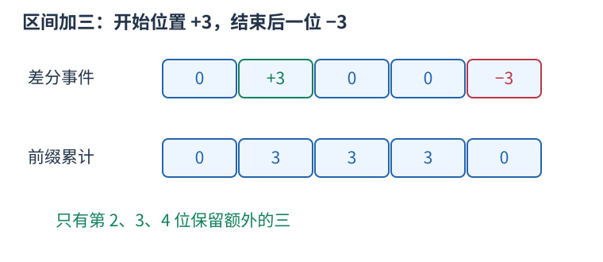

# 差分：把区间的变化写在两个边界

很多次操作都给一整段加同一个数，最后才需要所有位置的结果。逐项修改会重复扫描；差分只记录“从哪里开始多这一份、从哪里停止”。

定义 $D_1=a_1$，$D_i=a_i-a_{i-1}$。从左累计 $D$ 就能恢复 $a$。给闭区间 $[l,r]$ 加 $v$，仅需 $D_l$ 加 $v$、$D_{r+1}$ 减 $v$：第 $l$ 位开始，前缀多出 $v$；到第 $r+1$ 位，额外的一份被抵消。



例如五个零上给 $[2,4]$ 加三，差分事件为 $[0,3,0,0,-3]$，累计得到 $[0,3,3,3,0]$。两个标记不表示只修改了两个原元素。

```cpp
vector<long long> d(n + 2, 0);
d[l] += v;
d[r + 1] -= v;
long long current = 0;
for (int i = 1; i <= n; ++i) {
    current += d[i];
    // current 是该位置受到的总增量
}
```

$q$ 次区间加与最后恢复共 $O(n+q)$，空间 $O(n)$。如果初始数组非零，可先构造它的差分，或在恢复增量后加回原值。右边界要标在后一位，数组须留出 `n+1`；闭区间和半开区间的停止位置不能混用。

差分适合离线集中恢复。若每次操作后立刻查询任意位置，仅存差分并不能自动做到常数时间，需要动态前缀数据结构。坐标非常大但事件少时，应排序事件或离散化，不能按最大坐标盲目分配数组。
