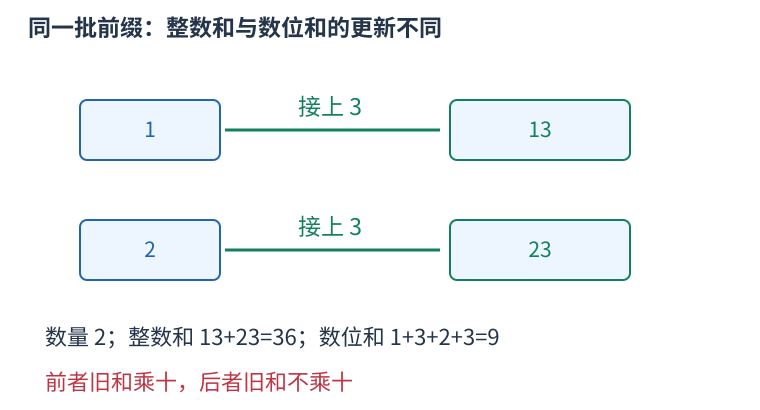

# 数位统计：方案数、整数数值和与数位和是三种量

如果很多前缀被合并到同一状态，想求它们延长后的数值总和，必须同时保存方案数。只知道旧总和，不知道要给多少个数各加一次新末位。



设有C个前缀，整数数值之和为S，各位数字之和的总和为D。每个前缀后面接数码d，进制为B。每个数值v变成B乘v加d，所以新数值和为：

$$S'=BS+dC.$$

原数码本身没有改变，只是多了一个数码d，因此新的数位和总和为：

$$D'=D+dC.$$

两个式子只有第一个将旧和乘B。把二者混淆，会把“所有整数相加”误做成“它们的数字相加”。数量C在同一固定数码分支内保持不变；若枚举多个不同数码分支，再把每个分支的数量与总和分别累加。

```cpp
#include <bits/stdc++.h>
using namespace std;
int main(){
    vector<int>prefixes={1,2};
    long long count=prefixes.size(),numeric=0,digits=0;
    for(int value:prefixes){
        numeric+=value;
        for(int x=value;x;x/=10) digits+=x%10;
    }
    int base=10,digit=3;
    long long nextNumeric=base*numeric+digit*count;
    long long nextDigits=digits+digit*count;
    cout<<count<<' '<<nextNumeric<<' '<<nextDigits<<'\n';
}
```

输出二、三十六、九，表示得到两个数十三与二十三；整数之和为三十六，数位和总和为九。二进制只需把B换成二，数值左移一位就对应乘二。

放进数位DP时，每个逻辑状态各保存C、S或C、D，转移目标还要满足该题的掩码、余数、奇偶等限制。每轮写新表，汇入同一目标的分支分别增加其数量与总和。

若答案取模，数量与总和都要在同一模数下转移，乘法本身先使用足够宽的类型。数量余数为零可能只是原数量恰为模数倍数，此时总和余数仍可能非零；不能只因C为零就跳过整个状态，应检查需要传播的所有量。

是否把前导零当作实际数码，要按具体约束决定。对于单纯数值或数位和，占位零贡献零；若限制数码种类或实际零的个数，就还需要是否开始的状态，不能把占位零登记成实际数码零。
