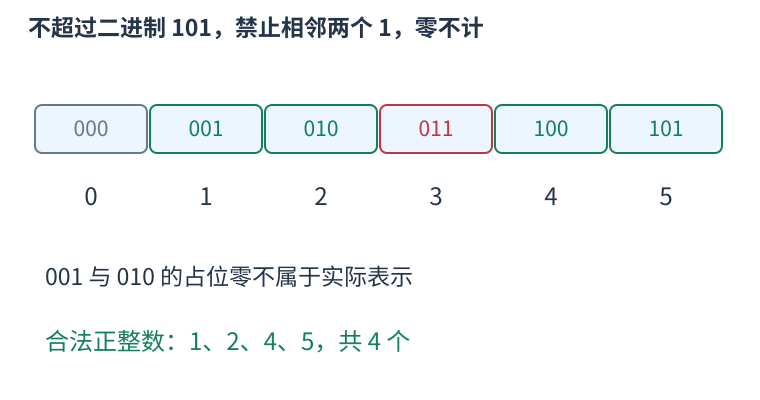

# 数位 DP：按前缀状态统计上界以内的整数

一个区间可能包含十亿个数，但所有数的表示只有几十位。如果某个前缀对未来的影响能压成少量状态，就可以把具有相同影响的前缀合并计数。

先定义F(x)统计一至x的合法正整数，则闭区间答案为F(r)减F(l减一)。上界为零时F返回零。接下来只需要处理一个上界。



从高位向低位填数。tight为真，表示前面每一位都与上界相同，本位最多填上界的本位；选了较小数字后tight变假，后面可选整个数码范围。下一次tight必须同时要求旧tight为真且本位相等；已经小于上界的前缀不会再次变回贴界。

较短整数可以在统一宽度中补前导零，但占位零通常不属于实际表示。例如二进制1不能因为补成001就算有两个实际零。started表示是否已经遇到真实首位：未开始时填零仍未开始，非零位才开始。开始后的零要正常参加题目约束。

下面的独立例子统计正整数一至n中，二进制不含相邻两个一的数。未来只需知道前一实际位是否为一，故状态为started、previous、tight；位置由循环固定。接一时若previous已经为一就拒绝。全占位零最后排除。

```cpp
#include <bits/stdc++.h>
using namespace std;
long long countWithout11(long long n){
    if(n<=0) return 0;
    vector<int>bits;
    for(long long x=n;x;x>>=1) bits.push_back(x&1);
    reverse(bits.begin(),bits.end());
    long long dp[2][2][2]={};dp[0][0][1]=1;
    for(int bit:bits){
        long long next[2][2][2]={};
        for(int started=0;started<2;++started)
        for(int previous=0;previous<2;++previous)
        for(int tight=0;tight<2;++tight){
            int limit=tight?bit:1;
            for(int d=0;d<=limit;++d){
                if(started&&previous&&d) continue;
                int ns=started||d,np=ns?d:0;
                int nt=tight&&d==limit;
                next[ns][np][nt]+=dp[started][previous][tight];
            }
        }
        for(int s=0;s<2;++s) for(int p=0;p<2;++p)
        for(int t=0;t<2;++t) dp[s][p][t]=next[s][p][t];
    }
    long long answer=0;
    for(int p=0;p<2;++p) for(int t=0;t<2;++t) answer+=dp[1][p][t];
    return answer;
}
int main(){
    long long n;cin>>n;
    cout<<countWithout11(n)<<'\n';
}
```

输入十，输出七，分别对应一、二、四、五、八、九、十。输入五，输出四，图中逐个列出这些表示。不是把五前面的所有三位二进制串都当成三位实际表示。

每轮要从旧dp读取并写入清零的新表，避免当前位刚加入的数量又被同一轮延长。状态里存的是前缀数量，两个不同前缀汇入同一状态时要累加。

也可以用记忆化搜索。缓存只包含不贴界状态时，未来可选范围不依赖上界后面的具体字符；若跨询问复用，缓存的位置最好明确表示“还剩几位”，而不是另一个上界下的绝对下标。

这个例子状态数固定，时间与二进制位数成正比，滚动表额外空间为常数；保存上界位数组需要位数级空间。计数类型仍应按上界范围选择，不能因为状态少就假设答案小。
