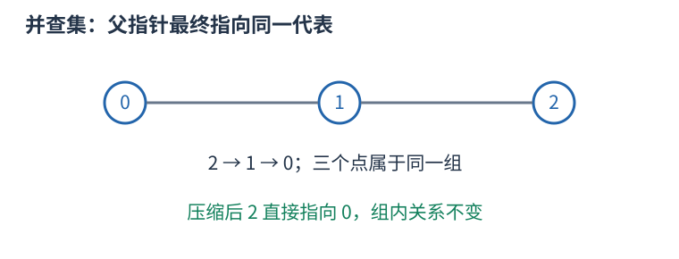

# 并查集：维护哪些对象已属于同一组

从每个元素独立成组开始，反复合并两组、判断两项是否连通。并查集用父指针形成若干棵树，每棵树的根代表一组；根的编号只是代表，不一定是最小编号或有特殊题意。



```cpp
struct DSU {
    vector<int> parent, size;
    DSU(int n): parent(n), size(n, 1) {
        iota(parent.begin(), parent.end(), 0);
    }
    int find(int x) {
        return parent[x] == x ? x : parent[x] = find(parent[x]);
    }
    bool merge(int a, int b) {
        a = find(a); b = find(b);
        if (a == b) return false;
        if (size[a] < size[b]) swap(a, b);
        parent[b] = a; size[a] += size[b];
        return true;
    }
};
```

合并 $0,1$ 再合并 $1,2$ 后，三者的 `find` 相同，即使零和二没有直接边。这表示路径连通，不表示两项相邻。路径压缩将访问链上的父亲直接改为根；按大小合并把小树挂到大树，避免人为形成长链。

初始化 $O(n)$，两种优化一起使用时，一连串操作的摊还成本为 $O(\alpha(n))$ 每次，常见规模近似常数；不能说每一次都严格 $O(1)$。数组空间 $O(n)$。

普通并查集擅长增加连通关系，不直接支持删边和拆组。回滚版本通常不用路径压缩，并保存每次合并改变的值；带权版本还需维护到父亲的关系，不能只合并普通 parent。分组大小等统计应读根上的记录。
