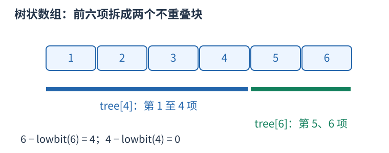

# 树状数组：动态前缀和

前缀和数组适合不修改的序列；若要不断给单点加值并查询前缀总和，树状数组把每个前缀拆成少量已维护的小块。

从一编号，`lowbit(i)=i&-i` 是二进制最低的一位所代表的数。`tree[i]` 维护区间 $[i-\operatorname{lowbit}(i)+1,i]$ 的和。例如 $i=6$、二进制 $110_2$，lowbit 为二，维护第五、第六项；查询前六项时再转到四，取第一到第四项。



```cpp
void add(int i, long long delta) {
    for (; i <= n; i += i & -i) tree[i] += delta;
}
long long prefix(int i) {
    long long sum = 0;
    for (; i > 0; i -= i & -i) sum += tree[i];
    return sum;
}
```

查询每次去掉最低的一位，区间块恰好首尾衔接；更新则访问所有覆盖原位置的上层块。二进制位数为 $O(\log n)$，所以两种操作均为 $O(\log n)$，空间 $O(n)$。区间 $[l,r]$ 的和仍为 `prefix(r)-prefix(l-1)`。

`add` 接收增量，不是新值；赋新值需减去旧值。下标零会使更新步长为零，导致死循环，必须从一开始。坐标稀疏时可先离散化。求第 $k$ 小的倍增搜索还要求维护的频次非负，不能将任意带负数的前缀误认为单调。
