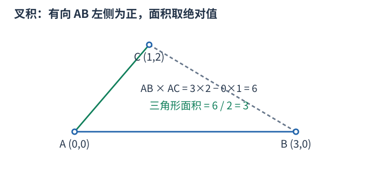

# 计算几何：先画位置，再选择精确判定

点 $(x,y)$ 表示平面位置，向量 $(dx,dy)$ 表示从一个点到另一个点的位移。距离比较可用平方距离 $(x_1-x_2)^2+(y_1-y_2)^2$，避免不必要的开方；先用足够宽的类型计算差与乘积。

二维向量叉积 $u\times v=u_xv_y-u_yv_x$。令 $u=B-A$、$v=C-A$，叉积正、零、负分别表示 C 在有向直线 AB 的左侧、线上、右侧。它的绝对值是两向量组成平行四边形的面积，不是直接的三角形面积。

例如 $A=(0,0),B=(3,0),C=(1,2)$，叉积为六，三角形面积为三。交换 B、C 会改变符号但不改变绝对面积，因此“在哪侧”和“面积多大”是不同用途。

点在线段上还须位于端点围成的坐标范围内，叉积为零只说明共线。判断两线段相交，要处理端点接触、共线重叠和真交，不能只比较四个叉积的严格正负。轴平行线段可直接用固定坐标和范围包含判断，通常比通用浮点直线计算简单。

整数输入优先用精确整数判断，注意坐标差与叉积可超过 64 位。浮点比较的误差阈值要与量纲、数值规模相配，不能把固定 epsilon 视为所有题通用。排序比较器尤其不能随意加 epsilon，可能破坏传递性。

单次叉积为常数时间；枚举点对、线段对仍为 $O(n^2)$。几何图用来说明方向与相交关系，正确性还须覆盖退化情形，不能依赖示意图比例。
