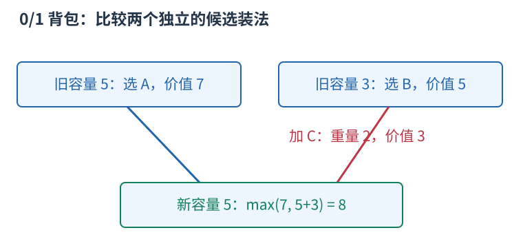

# 背包 DP：容量约束下保留不同选择

给若干物品，每件有重量和价值，容量有限，想选出总价值最大且不超重的组合。每件最多选一次是 0/1 背包；每种可以无限选是完全背包，两者不能使用同样的原地更新顺序。

容量五，A 为重量四价值七，B 为三和五，C 为二和三。单件价值最高的是 A，但 B+C 总价值八更好，因此只拿眼下价值最高或性价比最高的物品不能保证正确。

令 $f_{i,c}$ 表示只考虑前 $i$ 件、容量上限为 $c$ 的最大价值。不同的 $c$ 是不同问题的答案，不是同一个背包逐步塞东西。考虑 C 时，容量五比较两类候选：不选 C 保留旧答案七；选 C 从前两件的容量三最优值五，加上 C 的三，得到八。



一般地，$c\ge w_i$ 时：

$$f_{i,c}=\max(f_{i-1,c},\ f_{i-1,c-w_i}+v_i).$$

没有物品且允许空方案时，所有 $f_{0,c}=0$。不够放时只保留不选的候选。每个候选都对应合法装法，所有装法按选不选当前物品分为两类，所以转移不漏最优解。

两行可以合成一行，0/1 背包按容量倒序：

```cpp
for (int i = 0; i < n; ++i)
    for (int c = capacity; c >= weight[i]; --c)
        dp[c] = max(dp[c], dp[c - weight[i]] + value[i]);
```

倒序保证 `dp[c-weight[i]]` 还是没有处理当前物品的旧行。若只有一件重量二价值三、容量四，正序先写 `dp[2]=3`，再读它得到 `dp[4]=6`，实际重复选了同一件；完全背包允许重复时，正序正好表达这种选择。

若要求恰好装满，容量零初始为零，其他容量应为不可达，不能全填零。若重量为零，递推和完全背包的有界性还需单独分析。复杂度为 $O(nC)$ 时间、$O(C)$ 空间，依赖容量数值 $C$，容量极大时并不适用。
