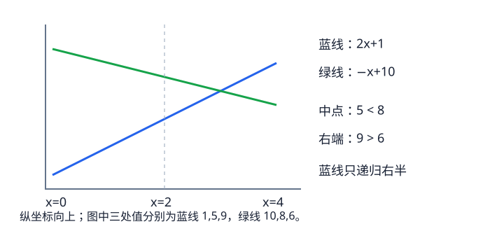

# Li Chao 树：插入直线并查询某个横坐标的最优值

陆续出现直线y=kx+b，查询给定x时所有直线的最小值或最大值。直接逐条试需要O(直线数)，Li Chao树利用“两条直线最多相交一次”，把单次插入与查询降到对数时间；它不要求斜率或查询顺序单调。

先固定查询横坐标范围。如果只会查询一组已知坐标X，可以排序去重，在线段树的下标范围上建树；比较直线时使用实际X[mid]，不能使用压缩后的下标代替横坐标。

每个节点负责一段横坐标，存一条候选直线。以下讨论求最大值：插入新线时，在区间中点比较新旧两线，较优者留在当前节点，较差者记作loser。由于差值是一次函数，loser只可能在中点的一侧变好：若它在左端更优，递归左半；否则若它在右端更优，递归右半；两端均不优则丢弃。到叶子就停止。求最小值时反转比较方向。

例如y=2x+1与y=−x+10，查询坐标0、2、4。在中点2，后者为8，大于前者5，所以保留后者。前者在左端0更差，但在右端4达到9，大于后者6，因此只向右半递归。这不是丢掉前者，它仍可能回答右侧的查询。

查询x时，沿对应根到叶路径走，把沿途所有候选线在x处的值取最优。插入过程中每次留下的线能负责中点及败线未递归的一侧；败线若还能获胜，已交给对应孩子。归纳可知所有可能影响x的直线都由这条查询路径上的某条候选覆盖。

相同斜率时，求最大值只需保留截距更大的一条，求最小值保留更小的一条。初始化空节点时应记录“没有直线”，或使用经过范围证明的无穷哨兵；任意设为零会误答全部负值或全部正值的查询。

树高O(log|X|)，每次插入最多走一个孩子，查询也只走一个孩子，因此二者都是O(log|X|)。完整静态树空间O(|X|)。数值范围上的动态树每次插入最多新建一条路径，其空间上界应按插入次数乘树高计算。kx+b与交叉比较可能溢出64位时，应在乘法前转为__int128。
