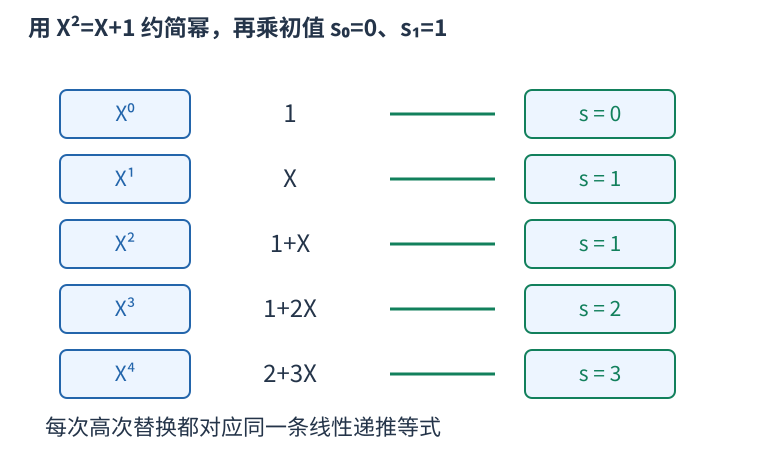

# 线性递推加速：确定阶数依据后恢复系数并求远项

长度或步数达到十的十八次方时，逐步模拟不可行。若已证明一个数列在固定质数模数下满足有限阶线性递推，就可以先生成短前缀，再求很远的第N项。

递推阶数为d，表示从下标d开始，每项都由之前d项按同一组系数线性组合。本文约定：

$$s_i=c_1s_{i-1}+\cdots+c_ds_{i-d}.$$

例如零、一、一、二、三、五、八的递推系数为一、一，零起下标十二的值为一百四十四。不能仅凭看到几项相似就假定未来也遵守同一递推；必须先有阶数上界。例如d维固定线性转移的任意线性输出，都满足阶数不超过d的递推。



恢复系数使用Berlekamp–Massey算法，记作BM。它维护多项式C，常数项为一，使当前已经处理的序列满足残差为零；计算新项时的残差是：

$$\delta=s_i+\sum_{j=1}^{L}C_js_{i-j}.$$

若残差为零，继续下一项。否则保存上次阶数增长前的B及当时非零残差b，将B延迟shift位、乘上本次残差与b逆元之积，再从C中减去，便能抵消本位失配。旧位的有效范围与阶数一起维护；需要增长时，新阶数为i加一减旧阶数。最小阶性质与更新依据可查[Massey原论文](https://www.isiweb.ee.ethz.ch/archive/massey_pub/pdf/BI411.pdf)。这里所有计算都在质数模域中，非零b的逆元用模幂求得。

程序中的length为当前递推阶数，B是上次增长前的C，last为对应失配，shift为距离那次失配有多少位。增长前先保留旧C；若二乘length不大于当前下标i，就更新length，并把旧C、当前失配存为下一次修正的依据。否则只增加shift。返回时去掉C的常数一，再给余下系数取负，转成上面右边全部为正号的递推约定。

若已知真实递推阶数至多d，取至少二d个连续初值即可恢复产生整个数列的递推。没有阶数界的任意数组，即使BM能匹配已经看到的前缀，也不能保证下一项。全零前缀返回空递推，在已知阶数界且初值足够的条件下，未来也全零。

得到系数以后，还不能用每次向后推一步求第N项。把递推写成幂的约简规则：

$$X^d=c_1X^{d-1}+\cdots+c_d.$$

对任意更高次幂都可反复替换右侧，最后把X的N次方写成低于d次的多项式。它的第i项系数乘初值s_i，相加就是第N项，因为每一次替换都对应一条合法的递推等式。

两份低次多项式相乘，先得到至多二d减二次，再从高次向低次按规则消去；一次需要平方级运算。用二进制快速幂计算X的N次方，累计多项式初始为一。d为一时，X直接约简为c一，不能访问不存在的下标一。

下面的完整程序以斐波那契前八项为初值，读取零起下标N，输出其余数；两段函数可独立用于已经证明阶数上界的其它数列。

```cpp
#include <bits/stdc++.h>
using namespace std;

const long long MOD=998244353;
long long power(long long a,long long e){long long result=1;for(;e;e>>=1,a=a*a%MOD) if(e&1) result=result*a%MOD;return result;}
vector<long long> recurrence(const vector<long long>&s){
    vector<long long>C(1,1),B(1,1);int length=0,shift=1;long long last=1;
    for(int i=0;i<int(s.size());++i){
        long long error=s[i];for(int j=1;j<=length;++j) error=(error+C[j]*s[i-j])%MOD;
        if(error==0){++shift;continue;}
        auto old=C;long long factor=error*power(last,MOD-2)%MOD;
        if(C.size()<B.size()+shift) C.resize(B.size()+shift);
        for(int j=0;j<int(B.size());++j) C[j+shift]=(C[j+shift]-factor*B[j]%MOD+MOD)%MOD;
        if(2*length<=i){length=i+1-length;B=old;last=error;shift=1;}else ++shift;
    }
    C.resize(length+1);C.erase(C.begin());for(auto &x:C) x=(MOD-x)%MOD;return C;
}
long long term(const vector<long long>&s,const vector<long long>&rec,long long index){
    if(index<int(s.size())) return s[index];int d=rec.size();if(!d) return 0;
    auto multiply=[&](const vector<long long>&a,const vector<long long>&b){
        vector<long long>v(2*d-1);
        for(int i=0;i<d;++i) for(int j=0;j<d;++j) v[i+j]=(v[i+j]+a[i]*b[j])%MOD;
        for(int i=2*d-2;i>=d;--i) for(int j=1;j<=d;++j) v[i-j]=(v[i-j]+v[i]*rec[j-1])%MOD;
        v.resize(d);return v;
    };
    vector<long long>result(d),x(d);result[0]=1;if(d==1) x[0]=rec[0];else x[1]=1;
    for(;index;index>>=1,x=multiply(x,x)) if(index&1) result=multiply(result,x);
    long long answer=0;for(int i=0;i<d;++i) answer=(answer+result[i]*s[i])%MOD;return answer;
}

int main(){
long long n;cin>>n;vector<long long>s={0,1,1,2,3,5,8,13};
cout<<term(s,recurrence(s),n)<<'\n';
}
```

输入十二，输出一百四十四。N已经落在所给初值范围时直接读取；这个边界与空递推分开处理。乘积先用long long，998244353下两个余数的乘积能容纳，不能先在int中相乘。

设给定前缀长度为M，BM计算残差与修改系数共需平方级时间；这里每次非零失配另做一次模幂求逆，时间为模数对数级。求第N项为阶数平方乘N的对数，额外空间线性于阶数。复杂度不等于“发现规律后常数时间”。
