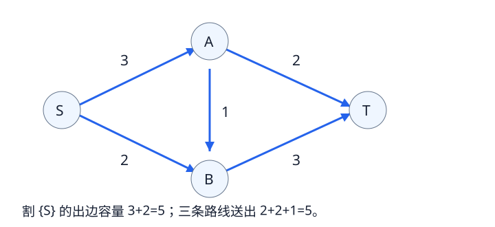

# 最大流、最小割与 Dinic：容量限制下怎样传递

有向网络中，一条边最多通过它的容量那么多流量。源点S负责发出流量，汇点T负责接收；其余点流入量必须等于流出量。目标是让S到T的总流量最大。

图中可先沿S→A→T送二，再沿S→B→T送二，最后沿S→A→B→T送一，总流量五。把S单独放在源侧，另外三点放在汇侧，跨过去的容量为3+2=5；任何流都要通过这个出口，所以五也是上界。

这样的两侧划分称为割。只加从源侧指向汇侧的边容量，反方向不加。最大流最小割定理说明：最大可送流量，等于所有割中最小的容量。做二选一建模时，先让每种选择划分的割容量准确等于目标代价，再求最大流，就能得到最小代价。

求流不能只贪心固定一次路径。已送出的流可能挡住更好的安排，所以维护残量网络：原边还可送“容量减已有流量”；每送出x，同时给反向边增加x的残量，允许后续撤销和改道。反向残量是调整旧流的工具，不是原问题凭空多了一条道路。

Dinic重复两步：

1. 在正残量边上从S做BFS，level记录最少边数。若T不可达，结束。
2. 用DFS只沿level增加一的边送流，直到当前层次图中再无增广路。当前弧指针cur[u]跳过已证明不能继续送流的出边；下一轮BFS后才重置这些指针。

DFS送出x后，同时减少正向残量、增加反向残量。邻接表中常把一对正反边连续存放，边号id的反边就是id^1。若按顶点分开存，则每条边保存反向边在对方邻接表中的下标rev，不能把两种存储方式混用。

当T在残量网络中不可达时，从S仍可达的点组成源侧。流量已填满这个割的全部出边，而且没有反向流跨回，故当前流量等于该割容量；任何其他流又不可能超过割容量，证明当前流已最大。

一般有V个点、E条边时，Dinic通用时间上界为O(V²E)，空间O(V+E)。单位容量等特殊网络可以有更强的界，但普通整数容量网络不能直接套用。容量与总流量用能容纳总和的整数类型，不能只按单条边最大容量选类型。
