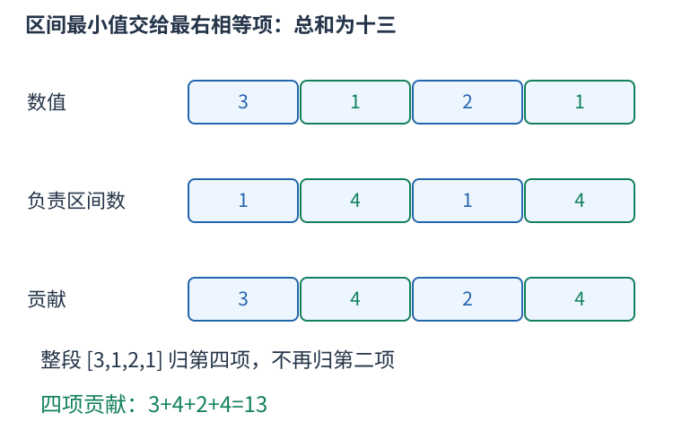

# 单调栈算区间贡献：固定最小项，再数左右端点

求所有连续区间的最小值之和，直接枚举每个区间会有平方级数量。换一个方向，固定某项作为区间最小值，数有多少对左右端点归它负责。



重复最小值需要约定归属。这里把每个区间交给最右边的最小项。对位置j，左边界之前最近的严格更小项记为L，右边最近的小于等于项记为R。合法左端点可以从L加一选到j，右端点从j选到R减一，共有：

$$(j-L)(R-j)$$

种。允许左边出现相等项，但不能包含右边的相等项，这就使j成为该区间最右边的最小项。若两边都禁止相等，会漏掉跨相等项的区间；若两边都允许相等，又会重复分配。

单调递增栈从左到右扫描。遇到新值小于等于栈顶时，弹出的j找到了它的右界R；弹出后新栈顶是它左边最近严格更小的位置L。数组结束时，用虚拟的最右边界清空全部剩余项，不把这个虚拟点当成真实元素加入栈。

```cpp
#include <bits/stdc++.h>
using namespace std;
long long sumMinimums(const vector<long long>&a){
    int n=a.size();vector<int>stack;long long answer=0;
    for(int right=0;right<=n;++right){
        while(!stack.empty()&&(right==n||a[stack.back()]>=a[right])){
            int j=stack.back();stack.pop_back();
            int left=stack.empty()?-1:stack.back();
            answer+=a[j]*(j-left)*(right-j);
        }
        if(right<n) stack.push_back(right);
    }
    return answer;
}
int main(){
    vector<long long>a={3,1,2,1};
    cout<<sumMinimums(a)<<'\n';
}
```

输出十三。按一开始的位置看，四项负责的区间数量分别为一、四、一、四，乘各自数值得到三、四、二、四。比如整段三一二一归最后一个一，不再归第二项的一。

虚拟右界为n时，条件先判断right是否等于n，成立就不读取越界的a[n]；这是逻辑或的短路求值。空数组也会自然返回零。乘法从long long数值开始，使左右距离相乘前就处于足够宽的类型中；最终是否够大还要用题目的数值与长度上界确认。

求所有区间最大值之和时，把大小关系反过来，用单调递减栈即可。若求最大减最小的总和，可分别算两种总贡献再相减。

这个思想还能数全空白矩形。固定矩形底边一行，令每列高度是向上连续空白的格数。一个连续列区间能选多少种矩形高度，正好是这些列高度的最小值。于是每一行对应一次区间最小值之和；实际实现可按当前右端点维护相同最小高度的一组左端点，做到整张网格线性时间。

每个下标只入栈、出栈一次，时间线性，额外栈空间线性。这里计算的是所有区间最小值的总和；若改成最小值乘区间元素和的最大值，就要另外证明扩展区间为何有利，不能直接照搬贡献乘法。
