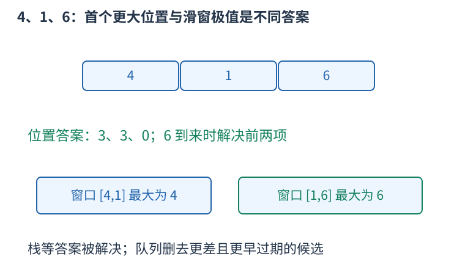

# 单调结构的完整例子：首个更大位置与滑窗最大值

单调结构能够删候选，是因为已经证明被删者对未来不再有用，或它的答案此刻已经确定。单纯把数据排成单调顺序，并不能自动保证算法正确。



先看右侧第一个严格更大元素。栈保存尚未找到答案的下标，新下标i到来时，若它的值严格大于栈顶值，栈顶的答案就是i：之前已经扫描过的右侧元素都没能解决它，i自然是第一个。反复解决栈顶，再放入i。

严格大于时，只有旧值小于新值才弹出，相等不能回答询问。存下标而不只存数值，可以区分重复项、计算距离和输出位置。以下结果用一开始的下标，零表示没有答案。

再看长为k的窗口最大值。双端队列保存候选下标，队首最大。新值不小于一个队尾旧值，而且更晚过期，因此在旧值的全部剩余有效时间里都不劣于它，可以永久弹掉旧值。查询前还要从队首移走已经离开窗口的下标。

```cpp
#include <bits/stdc++.h>
using namespace std;
vector<int> nextGreater(const vector<long long>&a){
    vector<int>stack,answer(a.size());
    for(int i=0;i<int(a.size());++i){
        while(!stack.empty()&&a[stack.back()]<a[i]){
            answer[stack.back()]=i+1;
            stack.pop_back();
        }
        stack.push_back(i);
    }
    return answer;
}
vector<long long> slidingMaximum(const vector<long long>&a,int k){
    deque<int>queue;
    vector<long long>answer;
    for(int i=0;i<int(a.size());++i){
        while(!queue.empty()&&queue.front()<=i-k) queue.pop_front();
        while(!queue.empty()&&a[queue.back()]<=a[i]) queue.pop_back();
        queue.push_back(i);
        if(i>=k-1) answer.push_back(a[queue.front()]);
    }
    return answer;
}
int main(){
    vector<long long>a={4,1,6};
    auto next=nextGreater(a);
    auto maximum=slidingMaximum(a,2);
    for(int i=0;i<int(next.size());++i) cout<<(i?" ":"")<<next[i];
    cout<<'\n';
    for(int i=0;i<int(maximum.size());++i) cout<<(i?" ":"")<<maximum[i];
    cout<<'\n';
}
```

输出第一行三、三、零，表示四和一的首个更大位置都是第三项；不是输出更大的数值六。第二行四、六，对应窗口四一与一六的最大值。调用滑窗函数时要求一不大于k且k不大于数组长度。

vector用push_back、back、pop_back从末尾操作，适合栈；deque还能用front、pop_front从前端移走过期项。每次访问首尾之前都要先确认非空。循环中的while可能一次删很多项，但每个下标总共只加入、弹出一次，整体时间仍是线性的。

两段代码的等号处理不同有具体原因：第一个要求严格更大，相等不能解决；第二个只求最大值，同值新项更晚到期，旧项可删除。题目如果改成严格后缀纪录、重复次数统计或不同区间范围，需要重新判断等号和过期条件，不能机械套同一符号。

首个更大位置函数需要线性栈与结果数组；滑窗队列最多保存k个有效候选，结果向量仍可能是线性长度。若只需逐项输出滑窗结果，可以不保存结果向量。
