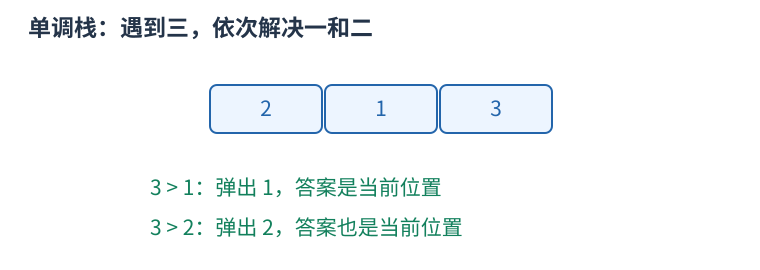

# 单调栈与单调队列：删去以后不会更优的候选

若某个新候选在所有未来场景都不劣于一个旧候选，就可以永久删去旧候选。这种支配关系使栈或双端队列中的值保持单调，而不是仅仅为了“看上去有序”。

## 单调栈找下一个更大项

从左扫描 $[2,1,3]$，栈保存尚未找到答案的下标。读三时，它大于栈顶的一，故一的首个右侧更大值为三；再大于二，二的答案也是三。每个值在自己的答案被首次发现时出栈。



```cpp
for (int i = 0; i < n; ++i) {
    while (!st.empty() && a[st.back()] < a[i]) {
        answer[st.back()] = i;
        st.pop_back();
    }
    st.push_back(i);
}
```

严格大于用 `<` 弹出；若问大于等于，等号处理会改变。栈里保存下标，才能计算距离和识别相同数的不同位置。没有答案的项保留约定哨兵。

## 单调队列维护固定窗口最大值

队首保存当前最大项的下标。新值到来，从队尾删除不大于它的旧值：新值更晚过期且不小，不会比这些旧值差；再把过期下标从队首移走。查询最大值读队首。

每个下标都只入、出一次，所以两者总时间 $O(n)$，空间最坏 $O(n)$。这是摊还分析，不能把“一个 while 里有时弹很多项”误算为必然平方，也不能把每次操作都说成严格常数。删候选之前应证明它在剩余有效期内永远不更优；窗口范围改变或查询目标不同，支配关系也要重证。
