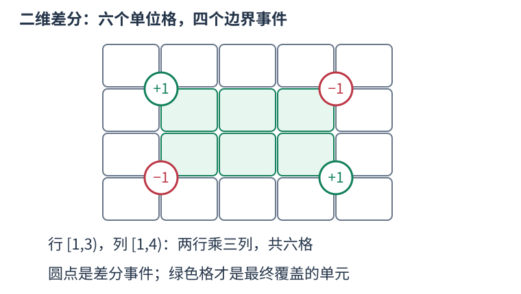

# 二维差分：四个角登记一块矩形的增量

一维差分让一次区间加法只登记开始和结束：开始加、结束后一位减，前缀还原后只有区间内部保留增量。二维把这个思路分别用于行和列。

先约定使用半开矩形：行在 [x1,x2)、列在 [y1,y2)。每格加 v 的四个事件为左上 +v、右上 −v、左下 −v、右下 +v。这里的上下指行号增大向下；不同题面可能把 x 作为水平方向，算法只依赖两个独立坐标，保持约定一致即可。



把左上的 +v 想成对所有右下方格子生效。超过右边界时用右上 −v 撤销，超过下边界时用左下 −v 撤销；两者右下交叠区域被减两次，必须在右下再加 v。于是矩形内留下 v，外面全部抵消。这里的四项不是四个矩形面积，而是还原时会扩散的边界事件。

还原为二维前缀和。上方前缀与左方前缀有一块共同的左上区域，所以要扣一次：value[x][y]=diff[x][y]+value[x−1][y]+value[x][y−1]−value[x−1][y−1]。从小行、小列到大行、大列，三份来源均已还原，可以原地更新。

```cpp
int rows = 4, columns = 5;
vector<vector<int>> diff(rows+1, vector<int>(columns+1));
int x1 = 1, y1 = 1, x2 = 3, y2 = 4;
++diff[x1][y1]; --diff[x1][y2];
--diff[x2][y1]; ++diff[x2][y2];
int covered = 0;
for (int x = 0; x < rows; ++x) {
    for (int y = 0; y < columns; ++y) {
        if (x > 0) diff[x][y] += diff[x-1][y];
        if (y > 0) diff[x][y] += diff[x][y-1];
        if (x > 0 && y > 0) diff[x][y] -= diff[x-1][y-1];
        covered += diff[x][y] == 1;
    }
}
```

例子中 covered=6，行一、二与列一、二、三的格子为一，其余为零。多次修改只需重复四角登记，全部修改结束后还原一次。若修改与查询任意交替，不能每次仍宣称只付一次还原成本，需要按查询频次选择重新扫描或其它数据结构。

闭区间格子 [l,r] 应先改写为 [l,r+1)，所以撤销在 r+1；连续坐标的矩形面积本来可按半开边界处理，不额外加一。终点事件要有合法下标，因此数组多开一行一列。R×C 网格、M 次矩形修改的时间为 O(M+RC)，空间 O(RC)。若只需要单格面积且坐标间隔不为一，离散化后还须乘实际宽与高，不能只数格子。
