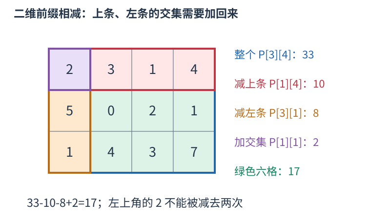

# 二维前缀和：矩形总和减上方、减左方、补交集

表格中的一块矩形需要反复求和时，逐格重算会多次访问同一元素。先保存从左上角开始的矩形和，就能用四个数回答一次查询。

约定原表从零开始编号，P[x][y]表示前x行、前y列的总和，行下标小于x、列下标小于y。零行或零列是空矩形，和为零。下图给出三行四列的实际数字，绿色部分是行下标一到二、列下标一到三的六格。



目标矩形采用半开边界 $[x_1,x_2)\times[y_1,y_2)$。先取 $P[x_2][y_2]$，它包含目标、上方和左方；减去 $P[x_1][y_2]$ 与 $P[x_2][y_1]$。两块多余区域的左上交集被减了两次，补回一次 $P[x_1][y_1]$，恰好留下目标：

$$S=P[x_2][y_2]-P[x_1][y_2]-P[x_2][y_1]+P[x_1][y_1].$$

图中查询前一行之后、第一列之后的六格，即边界为 $[1,3)\times[1,4)$，结果为 $33-10-8+2=17$。空边界不需要另判：x1或y1为零时，相应前缀就是零。

建表也按同样的面积关系。新前缀由上方前缀、左方前缀和右下这一格组成，上方与左方的共同区域被加了两次，扣一次：

$$P[x][y]=P[x-1][y]+P[x][y-1]-P[x-1][y-1]+a[x-1][y-1].$$

按行、列递增计算，三个旧前缀都已存在。

```cpp
vector<vector<long long>> a = {
    {2, 3, 1, 4},
    {5, 0, 2, 1},
    {1, 4, 3, 7}
};
int n = 3, m = 4;
vector<vector<long long>> p(n+1, vector<long long>(m+1));
for (int x = 1; x <= n; ++x) {
    for (int y = 1; y <= m; ++y) {
        p[x][y] = p[x-1][y] + p[x][y-1]
                - p[x-1][y-1] + a[x-1][y-1];
    }
}
long long sum = p[3][4] - p[1][4] - p[3][1] + p[1][1];
cout << sum << '\n'; // 17
```

建立n乘m的前缀表耗时、空间均为 $O(nm)$，每次矩形查询只做四项加减，为 $O(1)$。元素为负数仍可相消；累计总和可能超出单格范围，应选择足够宽的类型。

原表改变后，许多旧前缀也会受影响。这里用于静态矩形求和；频繁修改时，需要重新建表或选择支持修改的数据结构。半开边界与一开始的闭区间写法都能使用，但一次计算中必须统一下标约定。
