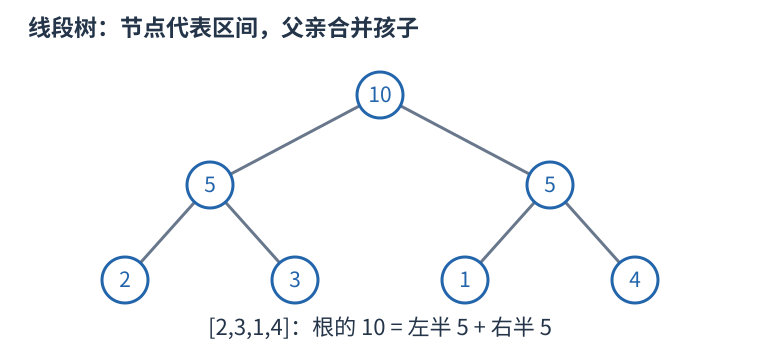

# 线段树：把区间问题分成可合并的两半

需要动态修改并查询区间的和、最小值或最大值时，可以递归将数组一分为二。一个节点代表一段范围，叶子代表单个元素，父节点保存两个孩子答案的合并。



例如 $[2,3,1,4]$，叶子是各项，左半和五、右半和五，根为十。修改第三项后，只需改叶子及其到根的祖先；其他范围完全未变。查询 $[2,3]$ 时取覆盖这两项的节点，跳过完全无交的节点，合并各部分。

树高 $O(\log n)$。单点修改沿一条根到叶路径，区间查询在每层只需处理边界附近的少量分支，均为 $O(\log n)$；建树 $O(n)$，空间 $O(n)$，数组式常预留约四倍大小。

```cpp
// 假设当前结点范围为 [left,right]，查询为 [ql,qr]
if (ql <= left && right <= qr) return tree[node];
int mid = left + (right - left) / 2;
long long answer = 0; // 求和的合并单位；求最小值应换成 +INF
if (ql <= mid) answer += query(node*2, left, mid, ql, qr);
if (qr > mid) answer += query(node*2+1, mid+1, right, ql, qr);
return answer;
```

求和、求最小和最大各有自己的合并与无交单位，不能混用。维护的信息要足以从孩子合并；例如最大连续子段和需要额外的区间和、最大前缀及后缀，单存一个最大值不够。

区间修改可用懒标记：整段更新时先改当前节点答案，记录尚未作用到孩子的操作；下次进入孩子前下传。区间加对区间和的变化是“增量乘长度”，赋值与加法的标记组合顺序不同。只有更新能够从所存摘要直接计算、且标记能正确复合时才能这样优化，不能对任意操作机械加一个 lazy 数组。
